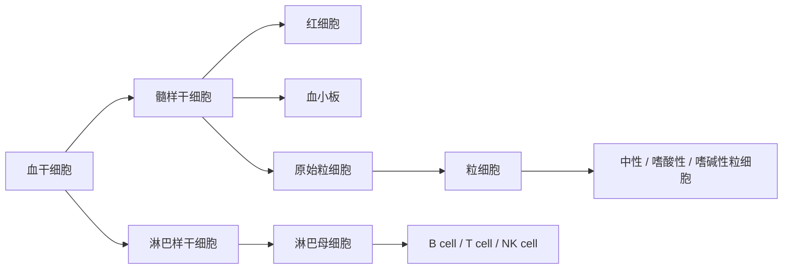

# 细胞分化、衰老与死亡（Cell Differentiation, Senescence & Death）

> 讲义：[[7.2026-第五周.细胞分化、衰老与死亡.pdf]]

## 定义

**细胞分化（cell differentiation）**：在个体发育中，由一种相同的细胞经过分裂后，逐渐在形态、结构和功能上产生稳定性差异，形成不同细胞类群的过程。

> [!note] 三个相关联的生命活动与两大特点
> 细胞的**生长、增殖和分化**相互关联。分化终其一生都在发生，但在**胚胎时期达到最大程度**；其两大特点是**持久性**（贯穿整个生命进程）与**不可逆性**（状态稳定、不可逆转）。分化的意义是**生物体发育的基础**。

---

## 概览

| 主题 | 核心问题 | 关键概念 |
|---|---|---|
| 分化 | 同样的基因组如何产生不同细胞 | 基因选择性表达、主导基因 |
| 干细胞 | 如何既自我更新又分化 | 全能 / 多能 / 单能 |
| 衰老 | 细胞为何逐渐衰退 | Hayflick 界限 |
| 死亡 | 细胞如何被清除 | 凋亡、程序性坏死 |

---

## 一、细胞分化（Differentiation）

### 1.1 血细胞分化

造血干细胞先分成髓样干细胞与淋巴样干细胞，再走向各自终末类型：

### 1.2 基因选择性表达

细胞分化是**基因选择性表达**的结果：同一时间内不是所有基因都有活性，有的有活性、有的无活性；有些细胞是这部分基因有活性，另一些细胞则是另外一些基因有活性。

| 项目 | 管家基因 | 组织特异性基因（luxury gene） |
|---|---|---|
| **表达范围** | 几乎所有细胞都表达 | 特异性表达 |
| **产物功能** | 维持生命必需 | 赋予各类细胞特异的结构与功能 |
| **基因种类占比** | — | 占基因种类大多数 |
| **S 期复制时机** | 早期复制 | 表达者早期复制；不表达者晚期复制 |

这张表要注意两个不完全对称的地方。其一，**管家基因的「普遍」指表达范围，不指数量**——占基因种类大多数的其实是组织特异性基因；正因为大多数基因是特异性的，「选择」才有意义。其二，**复制时机与表达状态挂钩**：不表达的组织特异性基因被推到 S 期晚期复制，而管家基因始终早期复制。这说明「选择性表达」不仅在转录层面实现，还在 DNA 复制的时序上留下了痕迹。

由此可以回答本节的核心问题：**同一套基因组为什么能产生不同细胞**——不是因为丢了基因，而是因为每种细胞只启动其中一部分，且启动的组合各不相同。

### 1.3 调控

1. **组合调控**：每种类型的细胞分化都由多种调控蛋白共同参与完成；
2. **主导基因**：编码在分化启动过程中起决定性作用的调控蛋白的基因；一旦表达，可能启动整个细胞的分化。例如 **MyoD** 是启动肌细胞分化为骨骼肌细胞的主导基因。

这两条不矛盾，而是两个层次。**组合调控**解释「种类为什么够多」：调控蛋白的种类有限，但若干种同时出现就构成一种组合，组合数远多于蛋白种类数，于是有限的调控蛋白足以指定大量细胞类型。**主导基因**解释「启动为什么干脆」：某些组合里有一个成员起决定作用，它一表达就能把整条分化程序推下去，MyoD 就是这样的「总开关」。

也正因如此，主导基因常被用作重编程的切入点：要人为改变细胞命运，找一个足够「上游」的调控蛋白，比逐个调整下游基因有效得多（对应 1.5 的重编程）。

### 1.4 细胞谱系

又叫**细胞世系**，指从受精卵第一次卵裂开始，到分化为各个组织和器官的终末细胞为止的发育史。利用**细胞谱系示踪技术**追踪细胞活动，可以了解分化与发育。

### 1.5 转分化与再生

1. **转分化**：一种类型的分化细胞转化成另一种类型的分化细胞；
2. **去分化（脱分化）**：分化细胞失去特有结构，变成具有未分化细胞特征的过程；
3. **重编程**：设计 DNA 与 Histone 修饰的改变；
4. **再生**：生物体缺失部分后重建的过程。

这四个概念常被混用，区分它们只需问两件事：**起点和终点分别是什么状态**，以及**它是手段还是结果**。

| 概念 | 起点 → 终点 | 要点 |
|---|---|---|
| **转分化** | 已分化 → 另一种已分化 | 不经过未分化阶段，直接换「工种」 |
| **去分化（脱分化）** | 已分化 → 未分化样状态 | 失去原有特有结构 |
| **重编程** | 改变细胞的表观修饰状态 | 手段：改写 DNA 与组蛋白修饰 |
| **再生** | 缺失 → 重建 | 结果：组织或器官层面恢复 |

按这张表读，转分化与去分化的区别在**终点**：前者落在另一种分化细胞上，后者落在「具有未分化特征」的状态上。而重编程是**操作层面**的概念，去分化与转分化都可以通过重编程来实现；再生则是**生物学结果**，它可能借道去分化、也可能依赖残存干细胞的增殖。混用这四个词，往往是因为只记住了「变化」，没分清「变到哪里」。

---

## 二、干细胞（Stem Cell）

特点：**自我更新**与**多向分化潜能**。

### 2.1 按潜能分类

| 类型 | 分化能力 | 例子 |
|---|---|---|
| **全能（totipotent）** | 一定条件下能发育形成完整个体（包括胎盘和脐带） | 桑葚胚 8-cell 前的细胞 |
| **多潜能（multipotent）** | 分化为特定组织或谱系内的多种细胞；三胚层形成后范围受谱系限制 | 造血干细胞、神经干细胞、间充质干细胞 |
| **多能（pluripotent）** | 分化为人体绝大多数类型细胞，涵盖三胚层衍生细胞（胎盘脐带除外） | ESC、iPSC |
| **单能（unipotent）** | 通常只能分化为一种特定类型细胞，但仍具自我更新能力 | 精原干细胞 |

> [!warning] 教材翻译的坑
> 由于教材翻译问题，"多能"与"多潜能"会与现代翻译颠倒：现代用法中 **pluripotent > multipotent**，本笔记按现代用法排列，教材顺序与之相反。答题时以任课教材的措辞为准，但要清楚两者的能力高低。

四类的差别可以归结为一句话：**潜能大小取决于「还能形成什么」**。按能力从高到低排是：**全能**能发育成完整个体（含胎盘和脐带），如桑葚胚 8-cell 前的细胞；**多能**（pluripotent）能跨越三胚层、分化出绝大多数细胞类型，但不能形成胎盘脐带，如 ESC 与 iPSC；**多潜能**（multipotent）在三胚层形成后受谱系限制，只能产生特定组织或谱系内的多种细胞，如造血干细胞；**单能**通常只产生一种终末细胞，但仍能自我更新，如精原干细胞。

注意两点：其一，上表的**行序按教材排列**，与能力高低并不一致，判断高低以本段的顺序为准；其二，**「单能」并不等于「不能自我更新」**——自我更新与分化潜能是两个独立维度，这正是不把「单能」写成「终末分化细胞」的原因。

### 2.2 按来源分类

- **胚胎干细胞（ESC）**：高水平表达端粒酶，可分化为除胎盘、脐带等之外的任何一种特定类型细胞，即能长成动物的任何组织和器官；主要来源是**内细胞团**。
- **成体干细胞**：基本功能是分化产生某些类型或某种类的终末分化细胞，广泛存在于多种组织；需要特定的微环境才能实现其特性，这个微环境称作**干细胞巢（niche）**。

规律：**全能 → 多能 → 单能**的分化趋向。哺乳动物终末分化细胞的细胞核也有全能性与再生能力，通过**重编程**可以实现克隆与再生医学。

### 2.3 常见的成体干细胞

常见的成体干细胞：**造血干细胞**；**神经干细胞**（含胚胎神经干细胞与短暂增殖细胞）；**肠干细胞**——存在于隐窝中，可产生肠上皮细胞，附近有潘氏细胞。

下图是肠上皮的基本结构单位——**隐窝**的纵切示意，也是理解「成体干细胞如何工作」最直观的一张图。读图先认颜色：隐窝最底部**蓝色**的是**肠干细胞**，紧挨着它的浅黄色细胞是**潘氏细胞**，隐窝外围包着一圈黄色的是**间充质细胞**。再往上看颜色分层：中段浅绿是**增殖区域**，上段深绿是**分化区域**。右侧那根向上的箭头标着「细胞迁移方向」，说明细胞是**从隐窝底向绒毛顶端单向前进**的。

把颜色和箭头连起来读，就得到一条完整的生产线：干细胞在底部自我更新，同时产出子细胞；子细胞进入增殖区反复分裂，把整列细胞往上推；推到分化区后停止分裂、分化成熟；最终在顶端脱落。**位置本身就是命运**——越靠上越成熟。这也解释了为什么干细胞必须待在隐窝最底部：只有那个位置能维持它的未分化状态。

![[bowelsc.png]]

*图：肠隐窝的结构与细胞迁移。隐窝底部为肠干细胞（蓝）与紧邻的潘氏细胞，外围为间充质细胞；中段为增殖区域，上段为分化区域，右侧箭头标示细胞由隐窝底向顶端迁移的方向。*

| 图中区域 | 图中颜色 | 细胞状态 |
|---|---|---|
| 隐窝底部 | 蓝 | 肠干细胞，自我更新并产生子细胞 |
| 隐窝底部 | 浅黄 | 潘氏细胞，紧邻干细胞 |
| 隐窝外围 | 黄 | 间充质细胞 |
| 中段 | 浅绿 | 增殖区域，分裂活跃、尚未分化 |
| 上段 | 深绿 | 分化区域，停止分裂、分化成熟 |

> [!note] 这张图为什么能说明「干细胞巢」
> 2.2 说过成体干细胞「需要特定的微环境才能实现其特性」。肠隐窝就是一个可看的结构例子：干细胞被固定在隐窝底，周围紧邻潘氏细胞与间充质细胞。位置一旦离开这个区域，细胞就开始增殖、分化——可见维持「未分化」的不是细胞自己，而是它所处的微环境。

---

## 三、细胞衰老（Senescence）

随着时间推移，细胞增殖能力和生理功能逐渐衰退、并趋向死亡的变化过程。细胞衰老与**细胞自身因素**有关，与环境条件无关。

> [!note] Hayflick 界限
> 细胞进入增殖停滞状态前的**有限倍增次数**。它说明体外培养的细胞不是无限增殖的——这正是正常细胞与癌细胞的分水岭之一。

### 3.1 特征

| 部位 | 变化 |
|---|---|
| **细胞膜** | 黏度增加、流动性降低，弹性和功能变差 |
| **细胞质** | 色素积累、空泡形成、糖原减少、脂肪积聚；线粒体减少、体积增大、DNA 突变增多；高尔基体破碎，溶酶体转化为致密体；内质网排列无序、膨胀，核糖体减少；细胞形态改变 |
| **细胞核** | 核膜内陷 / 崩解；染色质凝缩、固缩、碎裂、溶解；核增大、着色深、包含物变多 |

这张表看似杂乱，其实只有两类变化：**功能下降**与**废物堆积**。膜黏度增加、线粒体减少、核糖体减少、高尔基体破碎，属于前者——每一处都指向合成与代谢能力下降；色素积累、空泡形成、脂肪积聚、溶酶体转化为致密体、核内包含物变多，属于后者——细胞清除废物的能力跟不上废物的产生。两组变化互为因果：清除能力下降使损伤产物越积越多，而堆积的产物又进一步损害功能。

用这条线去读细节就不必死记：**「致密体」与「色素积累」是同一件事的两个说法**——溶酶体消化不掉的内容物留在里面，既让它变成致密体，也表现为可见的色素沉积。同样，「线粒体减少、体积增大」意味着残存的线粒体多为受损肿胀者，能量供应因此下降，而这又反过来削弱了清除能力。

### 3.2 生理变化

1. **DNA**：复制与转录受抑（个别会异常激活）；端粒 DNA 丢失、线粒体 DNA 特异性缺失；DNA 氧化、断裂、缺失和交联；甲基化程度降低。
2. **蛋白质**：含量下降；发生糖基化、氨甲酰化、脱氨基化等修饰，稳定性、抗原性和可降解性下降；自由基使肽键断裂、交联而变形；氨基酸由左旋变为右旋。
3. **酶**：活性中心被氧化，多种金属离子丢失；二级结构、溶解度和等电点改变；活性降低或丢失。
4. **膜脂**：饱和脂肪酸被氧化，引起膜脂之间或膜蛋白之间交联，膜流动性降低。
5. **信号通路**：由信号通路介导，例如 p53 介导的通路。

下图把「端粒缩短」与「细胞周期停滞」接成一条通路，正好补上 Hayflick 界限缺失的分子环节。读图从最上面开始：**缩短的端粒被识别为 DNA 损伤**——注意措辞是「被识别为」，端粒本身并没有断裂，是它的状态触发了损伤信号。信号传到 **p53**，p53 再作用于 **p16** 与 **p21(CDKs)** 这两个 CDK 抑制因子。

下半部分分成 A、B 两栏，是同一通路的两张对照。**A 栏是没有抑制的情形**：cyclin/CDK 2,4,6 作用于 Rb，Rb 再指向 E2F/DP，E2F/DP 启动 G1→S，细胞进入 S 期。**B 栏是 p53 通路被激活后的情形**：p16 与 p21 抑制 cyclin/CDK，图上在两个位置打了 **×**——一处是 cyclin/CDK 2,4,6 与 Rb 之间，一处是 E2F/DP 与 G1→S 之间。两处关卡同时被掐断，细胞就停在 G1，进不了 S 期。

这就是「复制性衰老」的分子解释：端粒越短，损伤信号越强，p53 通路越容易被激活，细胞越容易停在 G1。**Hayflick 界限描述的是现象**（有限倍增次数），**这张图给出的是机制**（端粒 → p53 → CDK 抑制 → G1 阻滞）。它也解释了为什么衰老细胞「还活着却不分裂」——阻滞发生在细胞周期中，而不是细胞死亡。

![[p53.png]]

*图：端粒缩短经 p53 引起细胞周期阻滞。缩短的端粒被识别为 DNA 损伤，信号经 p53 传至 p16 与 p21(CDKs)；p21 抑制 cyclin/CDK 2,4,6，图中以 × 标出两处阻断——cyclin/CDK 与 Rb 之间、E2F/DP 与 G1→S 之间。A 为无抑制时的正常通路，B 为 p53 通路激活后的阻滞状态。*

| 环节 | A 栏（无抑制） | B 栏（p53 通路激活） |
|---|---|---|
| p16 / p21(CDKs) | 不起抑制作用 | 抑制 cyclin/CDK 2,4,6 |
| cyclin/CDK 2,4,6 → Rb | 通行 | 被阻断（×） |
| Rb → E2F/DP | 通行 | 通路被上游掐断 |
| E2F/DP → G1/S | 通行 | 被阻断（×） |
| 结果 | 进入 S 期 | 停在 G1 |

> [!warning] 这张图的四个易错点
> 1. **把 p53 当成「促进增殖」的基因**——图中的箭头最终指向的是**阻滞**，它是刹车而不是油门。
> 2. **说「端粒断裂」**——图中写的是「被识别为 DNA 损伤」，这是信号层面的判断，不等于端粒真的断成两截。
> 3. **把「衰老」与「死亡」混为一谈**——阻滞的细胞停在 G1，代谢仍在进行，只是不再分裂。
> 4. **把 p21 记成「激活 CDK」**——图上 p21 与 p16 并列在 p53 下游，作用是**抑制** cyclin/CDK，所以 × 才画在 CDK 的下游而不是上游。

> [!note] 与另两条笔记的接口
> 端粒如何缩短、端粒酶如何延长端粒，见 [[端粒与端粒酶]]；Hayflick 界限的原始含义见 3 节开头的说明。三处合起来才是「复制性衰老」的完整链条：端粒长度 → 损伤信号 → p53 → G1 阻滞。

---

## 四、细胞死亡（Cell Death）

### 4.1 细胞凋亡（Apoptosis）

**标志**：DNA ladders——染色质断裂，核小体断裂成不同长度的片段，因此出现长度不同的条带。

**特点**：细胞膜不破裂、内含物不泄露、不引起炎症反应、受基因调控。

形态学变化：

1. 细胞质皱缩；
2. 线粒体嵴增多、膨胀、空泡化；
3. 核糖体从内质网上脱落，内质网腔膨胀，并逐渐与质膜融合；
4. 细胞骨架开始紊乱；
5. 所有特征化结构（如微绒毛）消失；
6. 细胞膜起泡，但仍保持完整、仍具有选择通透性；
7. 细胞间接触消失；
8. 原在膜内侧的磷脂酰丝氨酸外翻到膜外侧。

这八条并不是八个孤立的现象，按「发生在哪一层」重新归组就很清楚：

| 层面 | 变化 | 后果 |
|---|---|---|
| **细胞质** | 皱缩；线粒体嵴增多、膨胀、空泡化；核糖体脱落、内质网腔膨胀并与质膜融合；骨架紊乱 | 细胞器解体，但内容物仍包在膜内 |
| **细胞核** | 染色质凝缩、核小体断裂（DNA ladders） | 提供可检测的生化标志 |
| **细胞膜** | 起泡，但保持完整、仍具选择通透性 | 内容物不泄露，因此不引发炎症 |
| **细胞表面** | 微绒毛等特化结构消失、细胞间接触消失 | 与周围组织脱离，便于被清除 |
| **膜脂分布** | 磷脂酰丝氨酸由膜内侧外翻到外侧 | 成为被吞噬细胞识别的信号 |

把这套变化串起来，凋亡的「逻辑」就出来了：**先把细胞拆解、再打包，最后等别人来收**。拆解（皱缩、细胞器解体、染色质断裂）发生在膜**内**，包装（起泡）让膜保持完整，标识（PS 外翻）则告诉吞噬细胞「这里有一个该被吃掉的目标」。三者缺一不可：膜若破裂就变成坏死的后果（漏出内容物 → 炎症），没有 PS 外翻则凋亡小体难以被及时识别。

**阶段**：凋亡起始 → 凋亡小体形成 → 凋亡小体被吞噬。

### 4.2 程序性坏死

受基因调控，但**细胞膜发生破裂**、细胞核弥漫性降解，会**引发炎症反应**。

关键差别就在「膜破裂」三个字。膜一旦破裂，细胞内的内容物（包括各种可被免疫系统识别的分子）就会泄漏到周围组织，招来炎症细胞——所以两者都受基因调控，**后果却完全相反**：凋亡是「安静地消失」，程序性坏死是「有动静地爆开」。判读时先看膜，再看炎症，而不是先看「是否受基因调控」。

### 4.3 程序性死亡（植物）

常见于植物细胞，功能包括：防御病原体 / 超敏反应、对环境胁迫的反应、在发育进程中的作用。

机理是用**液泡的水解酶**分解死亡细胞：液泡破裂释放水解酶；或液泡与膜融合，把水解酶释放到细胞外。

### 4.4 意义

意义：细胞具有寿命，通过新陈代谢回收和再利用衰老细胞中的分子；清除因各种因素损伤的细胞、限制感染并回收再利用；应对营养、能量和氧气缺乏状态；**凋亡不足和过度均会引发疾病**，例如阿尔茨海默病。

---

## 五、三种死亡方式的对比

| 维度 | 细胞凋亡 | 程序性坏死 | 植物程序性死亡 |
|---|---|---|---|
| **膜完整性** | 保持完整，膜起泡 | 破裂 | 液泡破裂、与膜融合 |
| **炎症反应** | 无 | 有 | — |
| **核的变化** | 染色质凝缩，核小体断裂（DNA ladders） | 弥漫性降解 | 由水解酶分解 |
| **分子标志** | DNA ladders、磷脂酰丝氨酸外翻 | 膜破裂 + 炎症 | 液泡水解酶释放 |
| **是否受基因调控** | 是 | 是 | — |

> [!warning] "程序性死亡"不等于"凋亡"
> 凋亡是程序性死亡的一种，但程序性坏死同样受基因调控却不属于凋亡；植物还有以液泡水解酶为核心的程序性死亡。判断依据是**膜是否破裂、是否引发炎症**，而不是"是否受基因调控"。

---

## 易错点与重要概念速查

> [!warning] 常见错误
> 1. **以为分化是基因丢失**——错。分化是**选择性表达**，基因组并未改变。
> 2. **把持久性与不可逆性混为一谈**——持久性指贯穿一生，不可逆性指状态稳定。
> 3. **以为管家基因不复制**——错。管家基因在 S 期早期复制，只是所有细胞都表达。
> 4. **把"多能"与"多潜能"按字面排序**——错。现代用法 pluripotent（多能）> multipotent（多潜能），教材翻译可能相反。
> 5. **以为成体干细胞不需要微环境**——错。其特性依赖干细胞巢。
> 6. **把 Hayflick 界限当成"细胞寿命"**——它指进入增殖停滞前的有限**倍增次数**。
> 7. **以为凋亡会引发炎症**——错。凋亡膜不破裂、内含物不泄露，不引起炎症；程序性坏死才引发炎症。
> 8. **只用"受基因调控"区分凋亡与程序性坏死**——错。两者都受基因调控，差别在膜是否破裂。
> 9. **把磷脂酰丝氨酸外翻记成"膜破裂"**——外翻时膜仍完整，这正是凋亡小体被识别吞噬的信号。
> 10. **以为程序性死亡只发生在动物**——错。植物程序性死亡依赖液泡水解酶。

> [!summary] 核心概念
> - **细胞分化**：形态、结构、功能产生稳定性差异。
> - **管家基因 / 组织特异性基因**：普遍表达 / 特异性表达。
> - **主导基因**：如 MyoD，启动整个分化程序。
> - **干细胞巢（niche）**：维持干细胞特性的微环境。
> - **Hayflick 界限**：增殖停滞前的有限倍增次数。
> - **凋亡 / 程序性坏死**：前者膜完整、无炎症、DNA ladders；后者受基因调控但膜破裂、有炎症。

---

## 与生物工程的联系

> [!example] 从分化到生产
> **(1) 干细胞与再生医学**：ESC/iPSC 的多能性配合定向分化，可制备特定细胞用于细胞治疗与疾病模型；iPSC 由重编程获得，绕开了胚胎来源的限制。
>
> **(2) 分化诱导 → 药物筛选模型**：把干细胞定向分成心肌、肝等目标细胞，可在体外评价药物毒性与疗效，减少对原代组织的依赖。
>
> **(3) 抗凋亡改造 → 重组蛋白生产**：培养过程中凋亡会降低活细胞密度与产物产量；通过抗凋亡基因工程改造、优化补料与培养条件抑制凋亡，可提高 CHO 等表达系统的稳健性。
>
> **(4) Hayflick 界限 → 细胞工艺的代次上限**：体外扩增的细胞倍增次数有限，工艺设计必须在细胞衰老前完成扩增与收获。

## 相关笔记

- [[Ca]] — 癌细胞如何脱离分化、逃避凋亡并获得无限增殖
- [[端粒与端粒酶]] — 端粒缩短、Hayflick 界限与衰老的分子机制
- [[表达类型]] — 组成型与诱导型表达，可与管家基因对照理解
- [[细胞周期]] — 分化、衰老都发生在周期框架内
- [[细胞分裂]] — 分化前的最后一次分裂：有丝分裂与减数分裂

*整理自：课堂笔记及参考课件*
