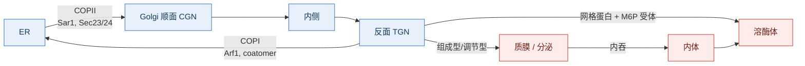
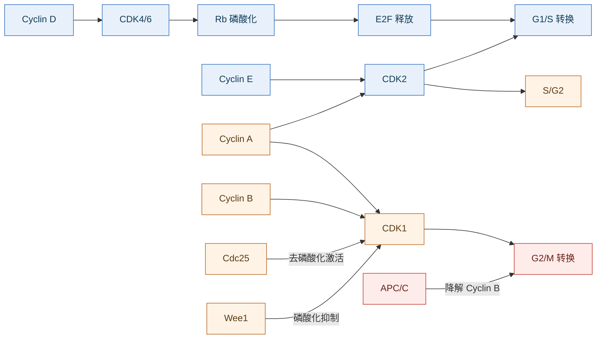

# 细胞生物学复习总纲

> 用法：本页按你列的关键词重组为 15 个板块，链接到已有笔记形成双向链接。标【高频】的是必背，标【易错】的是选择题/判断题常设陷阱。
> 顺序建议：先过第 0 节的地图，再按 1→13 顺序复习，最后用第 14、15 节自测式回忆。

## 0. 一张地图：这门课到底在讲什么


三条主线：

1. **结构与功能对应**：有什么结构，就能做什么事（嵴→面积→ATP；微绒毛→吸收；核孔→运输）。
2. **膜与区室化**：膜把反应分开，运输与分选把物质送到正确位置。
3. **调控与命运**：周期检查点、分化、衰老、死亡、癌变，都是同一套分子机器在不同状态下的表现。

---

## 1. 绪论：细胞学说、细胞类型与六界

详解：[[细胞生物学/上课笔记/绪论]]、[[细分]]、[[分裂方式]]

### 1.1 细胞学说【高频】

| 人物 | 年份 | 贡献 |
|---|---|---|
| R. Hooke | 1665 | 观察软木，提出 "cell" 一词 |
| A. van Leeuwenhoek | 1674 | 首次观察活细胞（细菌、精子、红细胞） |
| M. Schleiden | 1838 | 植物由细胞构成 |
| T. Schwann | 1839 | 动物由细胞构成，提出细胞学说 |
| R. Virchow | 1855 | "Omnis cellula e cellula"，细胞来自细胞 |

细胞学说三条：

1. 所有生物都由细胞构成；
2. 细胞是生命活动的基本单位；
3. 细胞只能来自已存在的细胞。

【易错】病毒没有细胞结构，是细胞学说的例外；朊病毒只有蛋白质，也不是细胞。

### 1.2 原核 vs 真核

| 特征 | 原核 | 真核 |
|---|---|---|
| 核膜/核仁 | 无 | 有 |
| 染色体 | 环状 DNA，无组蛋白（古菌有组蛋白类似物） | 线状 DNA + 组蛋白 |
| 核糖体 | 70S（50S + 30S） | 80S（60S + 40S） |
| 细胞器 | 无膜性细胞器（有核糖体、间体） | 有 |
| 大小 | 1–10 μm | 10–100 μm |
| 分裂 | 二分裂、出芽 | 有丝、减数、无丝 |
| 细胞壁 | 肽聚糖（细菌） | 纤维素（植物）、几丁质（真菌） |

【高频】原核的"分裂"不是有丝分裂：**二分裂**是 DNA 复制 + 胞质分裂，没有纺锤体、没有染色体凝缩。细菌还有出芽、孢子形成等繁殖方式，详见 [[快生长和慢生长]]、[[革兰氏]]、[[鞭毛差异]]。

### 1.3 六界与三域

- 六界（中文教材常用）：**病毒界、原核生物界、原生生物界、真菌界、植物界、动物界**。
- 三域（Woese）：**细菌域、古菌域、真核域**；古菌在分子系统学上更接近真核生物。
- 【易错】"六界"不是分类学唯一标准；病毒是否算"生物"仍有争议。

---

## 2. 研究方法：把细胞看清楚

详解：[[研究方法]]、[[动态方法]]、[[动物细胞培养]]、[[单抗]]

### 2.1 显微镜与分辨率【高频】

| 类型 | 分辨率 | 优点 | 局限 |
|---|---|---|---|
| 光学显微镜 | 约 0.2 μm | 活细胞、彩色 | 受衍射极限 |
| 共聚焦 | 约 0.2 μm（光学切片） | 减少背景、三维重建 | 仍需荧光标记 |
| 超分辨（STED/PALM/STORM/SIM） | 20–50 nm | 突破衍射极限 | 样品与标记要求高 |
| TEM | 0.1–0.2 nm（点分辨） | 超微结构 | 固定、切片、不能活细胞 |
| SEM | 1–10 nm | 表面三维形貌 | 只看表面 |

分辨率公式（Abbe）：

$$d = \frac{0.61\lambda}{NA}$$

提高分辨率的办法：**缩短波长 λ**（电镜）、**增大数值孔径 NA**（油镜）、**超分辨技术**（STED/PALM/STORM/SIM）。

### 2.2 冷冻蚀刻与膜不对称性【高频】

- 快速冷冻 → 断裂 → 真空升华（蚀刻）→ 复型 → 电镜观察。
- 膜沿疏水层裂开，暴露 **P 面（protoplasmic face，靠胞质）** 与 **E 面（exoplasmic face，靠外）**。
- 膜蛋白颗粒在两面分布不均，直接证明**膜蛋白不对称分布**。

### 2.3 荧光技术

| 技术 | 看什么 | 原理 |
|---|---|---|
| 免疫荧光 | 特异蛋白定位 | 抗体 + 荧光基团 |
| GFP 融合 | 活细胞动态 | 基因编码荧光蛋白 |
| FRAP | 分子运动/流动 | 强光漂白局部，观察恢复 |
| FLIP | 连续性 | 反复漂白，观察整体荧光下降 |
| FRET | 蛋白-蛋白相互作用（<10 nm） | 供体-受体能量转移 |
| 荧光标记 + 细胞融合 | 膜蛋白侧向扩散 | 人-鼠杂种细胞，抗体成斑/成帽 |

见 [[现象]]。

### 2.4 离心与分离

| 方法 | 依据 | 用途 |
|---|---|---|
| 差速离心 | 沉降系数/大小 | 粗分细胞核、线粒体、微粒体 |
| 速率区带离心 | 沉降速率 | 按大小分离 |
| 等密度离心 | 浮力密度 | 分离 DNA、细胞器 |

### 2.5 原位杂交与放射自显影

- **原位杂交（FISH）**：探针与染色体/细胞内的特定核酸配对，定位基因或染色体。
- **放射自显影**：³H-亮氨酸脉冲标记 → 追踪蛋白在分泌途径中的移动（Palade 的经典实验）。

### 2.6 细胞培养与细胞融合

- 原代培养 → 传代 → **细胞株**（有限寿命）/**细胞系**（无限增殖，常已转化）。
- 贴壁型：成纤维样、上皮样；悬浮型：淋巴细胞。
- 植物：单倍体（花药培养）、原生质体（去壁后融合）。
- 融合剂：**PEG、电融合、灭活病毒（HVJ）**；用于杂种细胞、单抗制备。
- 单抗：B 细胞 + 骨髓瘤 → 杂交瘤 → HAT 筛选 → 克隆化。见 [[单抗]]。

---

## 3. 质膜：模型、膜脂、膜蛋白

详解：[[细胞质膜]]、[[胆固醇对脂膜的调节]]

### 3.1 模型演变【高频】

| 模型 | 年代 | 核心 |
|---|---|---|
| 三明治模型 | 1935 | 脂双层两侧铺蛋白 |
| 单位膜模型 | 1959 | 电镜下"暗-亮-暗"三层 |
| 流动镶嵌模型 | 1972 | 脂双层为流体，蛋白镶嵌/贯穿 |
| 脂筏模型 | 1980s– | 胆固醇+鞘脂微区，信号平台 |

【易错】流动镶嵌模型并不等于"蛋白漂浮在纯脂海中"；现在强调**膜骨架、脂筏、蛋白-蛋白相互作用**对膜组织的限制。

### 3.2 膜脂

| 类型 | 特点 | 例子 |
|---|---|---|
| 甘油磷脂 | 甘油骨架，两亲性 | PC、PE、PS、PI |
| 鞘磷脂 | 鞘氨醇骨架 | SM |
| 糖脂 | 糖链连于脂 | 脑苷脂、神经节苷脂 |
| 固醇 | 刚性环，调节流动性 | 胆固醇（动物）、植物固醇 |

- 脂肪酸**不饱和度高** → 熔点低 → 流动性高。
- 膜脂四类运动：**侧向扩散、尾部摆动、自旋、翻转（flip-flop）**。
- 【高频】翻转极慢（小时—天），由 **flippase（向内）、floppase（向外）、scramblase（双向、Ca²⁺依赖）** 调控；PS 正常在**内侧**，凋亡时外翻是"吃我"信号。

### 3.3 相变温度 Tm

- 温度低于 Tm：膜呈**凝胶态**；高于 Tm：**液晶态**。
- 影响 Tm 的因素：脂肪酸链长（越长 Tm 越高）、不饱和度（双键越多 Tm 越低）、胆固醇（**双向调节**：低温防冻、高温防流）。
- 见 [[胆固醇对脂膜的调节]]。

### 3.4 膜蛋白

| 类型 | 位置 | 去除方式 |
|---|---|---|
| 外在（周边） | 膜表面，靠静电/氢键 | 高盐、极端 pH |
| 内在（整合） | 嵌入或贯穿脂双层 | 去垢剂、有机溶剂 |
| 脂锚定 | 通过脂链/GPⅠ锚插入 | PI-PLC 等 |

- 跨膜段多为 **α 螺旋**（约 20 个疏水氨基酸）；孔蛋白可为 β 桶。
- 膜蛋白运动：**侧向扩散、旋转**，一般**不翻转**（不对称性基础）。
- 红细胞膜骨架：**spectrin、ankyrin、band 3、glycophorin**，是"膜不对称 + 骨架限制"的经典模型。

### 3.5 流动性与不对称性

- 流动性证据：细胞融合（人-鼠膜蛋白混合）、FRAP、成斑/成帽。
- 不对称性证据：冷冻蚀刻（P/E 面颗粒分布）、糖链只在外侧、PS 只在内侧、脂筏外小叶富集鞘脂。
- 【易错】流动性是"脂和蛋白都能侧向动"，不是"所有成分都能翻转"。

---

## 4. 跨膜运输

详解：[[物质的跨膜运输]]、[[AQP]]、[[GLUT]]、[[膜电位]]

### 4.1 分类总表【高频】

| 类型 | 是否耗能 | 是否需膜蛋白 | 方向 | 例子 |
|---|---|---|---|---|
| 简单扩散 | 否 | 否 | 顺浓度/电化学梯度 | O₂、CO₂、乙醇、苯 |
| 协助扩散 | 否 | 是（通道/载体） | 顺梯度 | GLUT、AQP、离子通道 |
| 主动运输 | 是（ATP/光/离子梯度） | 是（泵/载体） | 逆梯度 | Na⁺/K⁺-ATPase、Ca²⁺ 泵 |
| 胞吞/胞吐 | 是（膜周转） | 是（膜变形） | 囊泡 | 受体介导内吞、分泌 |

### 4.2 通道 vs 载体【高频】

| 特征 | 通道 | 载体 |
|---|---|---|
| 机制 | 形成亲水孔道 | 构象改变搬运 |
| 速率 | 极快（10⁷–10⁸/s） | 慢（10²–10⁴/s） |
| 饱和性 | 不明显 | 明显（类似酶） |
| 能量 | 被动 | 可被动/主动 |
| 例子 | 离子通道、AQP | GLUT、Na⁺/K⁺ 泵 |

- 通道门控：**电压门控、配体门控、机械门控**。
- 水通道 AQP：四聚体，每个单体 6 次跨膜，**NPA  motif** 形成选择性滤器；AQP1 只过水，AQP3 也过甘油。见 [[AQP]]。
- GLUT：GLUT1（红细胞/血脑屏障，Km 低）、GLUT2（肝/β 细胞，Km 高，感受血糖）、GLUT3（神经元，Km 最低）、GLUT4（肌肉/脂肪，**胰岛素敏感**）。见 [[GLUT]]。

### 4.3 主动运输

| 类型 | 能量来源 | 例子 |
|---|---|---|
| P 型 ATPase | ATP | Na⁺/K⁺-ATPase、Ca²⁺-ATPase、H⁺/K⁺-ATPase |
| V 型 ATPase | ATP | 溶酶体、液泡酸化 |
| ABC 转运体 | ATP | MDR1/P-gp、CFTR |
| 光驱动 | 光 | 细菌视紫红质（H⁺ 泵） |
| 协同转运 | 离子梯度 | Na⁺-葡萄糖同向；Na⁺/Ca²⁺ 反向 |

- Na⁺/K⁺-ATPase：**3 Na⁺ 出、2 K⁺ 入、1 ATP**，生电性，维持膜电位与细胞体积。
- 膜电位：Nernst 方程、K⁺ 平衡电位、动作电位见 [[膜电位]]。

### 4.4 胞吞与胞吐

| 类型 | 触发 | 囊泡大小 | 例子 |
|---|---|---|---|
| 网格蛋白内吞 | 受体-配体 | 约 50–100 nm | LDL、转铁蛋白 |
| 小窝蛋白内吞 | 脂筏 | 约 50–80 nm | 某些信号分子 |
| 巨胞饮 | 生长因子/Rac | 0.2–5 μm | 营养摄取、抗原采样 |
| 吞噬 | 受体（FcγR 等） | >0.5 μm | 细菌、凋亡细胞 |

- 胞吐：组成型（持续分泌）与调节型（Ca²⁺ 触发，如神经递质、胰岛素）。

### 4.5 糖基化【高频】

| 类型 | 发生位置 | 连接 | 特点 |
|---|---|---|---|
| N-连接 | ER（起始）、Golgi（加工） | Asn-X-Ser/Thr | 核心寡糖先加到 Asn |
| O-连接 | Golgi | Ser/Thr 的 OH | 逐个加糖，无核心前体 |

功能：蛋白折叠（calnexin/calreticulin）、稳定性、分选（M6P）、细胞识别、ABO 血型。

---

## 5. 细胞质基质与内膜系统

详解：[[细胞质基质与内膜系统]]、[[COP]]、[[Bip]]、[[ERS]]、[[fish-trap]]

### 5.1 细胞质基质

- 占细胞体积约一半，含代谢酶、核糖体、细胞骨架、分子伴侣、蛋白酶体。
- 功能：糖酵解、蛋白合成与降解、信号转导、物质运输。
- **蛋白寿命**差异极大：短寿命蛋白（周期蛋白、错误折叠蛋白）分钟级；长寿命蛋白（血红蛋白、晶体蛋白）可达数年。

### 5.2 泛素-蛋白酶体系统【高频】

$$\ce{\text{Ub} + \text{E1} + \text{ATP} -> \text{E1-Ub} -> \text{E2-Ub} -> \text{E3-Ub} -> \text{substrate-Ub}_n}$$

- **E1 激活（耗 ATP）→ E2 结合 → E3 连接酶**决定底物特异性。
- **K48 多泛素链** → 26S 蛋白酶体降解；**K63 链** → 信号转导/自噬。
- 与自噬分工：蛋白酶体降解**短寿命/错误折叠**蛋白；自噬降解**大分子聚集体/细胞器**。

### 5.3 内质网（ER）

| 类型 | 功能 |
|---|---|
| 粗面 ER | 分泌蛋白、膜蛋白合成；N-糖基化；折叠（BiP、calnexin） |
| 光面 ER | 脂质合成、Ca²⁺ 储存、解毒（P450） |

**信号肽与共翻译易位**：

1. 信号肽（N 端 15–30 个疏水氨基酸）被 **SRP** 识别；
2. SRP-核糖体复合体结合 ER 膜上的 **SRP 受体**；
3. 新生肽链进入 **Sec61 易位子**；
4. **信号肽酶**切除信号肽；
5. ER 腔内 **N-糖基化、二硫键形成、BiP 折叠**。

### 5.4 未折叠蛋白反应（UPR）【高频】

| 传感器 | 通路 | 结果 |
|---|---|---|
| IRE1 | 剪接 XBP1 mRNA | 上调伴侣、ERAD |
| PERK | 磷酸化 eIF2α | 全局翻译下降，ATF4 上调 |
| ATF6 | 转运至 Golgi 被切割 | 上调伴侣与脂质合成 |

- 轻度/短期：适应；长期/过强：**凋亡**。见 [[ERS]]、[[Bip]]。

### 5.5 高尔基体与囊泡运输



| 包被 | 方向 | 关键蛋白 |
|---|---|---|
| COPII | ER → Golgi | Sar1、Sec23/24、Sec13/31 |
| COPI | Golgi → ER（逆向） | Arf1、coatomer |
| 网格蛋白 | TGN → 溶酶体/内体；质膜内吞 | clathrin、AP2、dynamin |

- Golgi 功能：糖链加工、硫酸化、蛋白分选；顺面/反面酶分布不同。
- **M6P 标记**：溶酶体酶在顺面 Golgi 获得甘露糖-6-磷酸，TGN 的 M6P 受体把它们送到溶酶体；I 细胞病即 GlcNAc-1-磷酸转移酶缺陷。

### 5.6 溶酶体与过氧化物酶体

| 细胞器 | 特征 | 关键酶/功能 |
|---|---|---|
| 溶酶体 | 单层膜，pH 4.5–5.0，v-ATPase 酸化 | 60 余种酸性水解酶；自噬降解；LSD |
| 过氧化物酶体 | 单层膜，含晶状核心 | catalase、VLCFA β-氧化、缩醛磷脂合成 |

- 溶酶体酶分选依赖 M6P；自噬经 **autophagosome → autolysosome**。
- 过氧化物酶体病：Zellweger 综合征（PEX 基因）、X-ALD（ABCD1）。

---

## 6. 线粒体与叶绿体

详解：[[线粒体和叶绿体]]、[[电子传递链]]、[[氧化磷酸化]]、[[ATP合酶]]

### 6.1 结构与半自主性【高频】

| 特征 | 线粒体 | 叶绿体 |
|---|---|---|
| 外膜/内膜 | 有，内膜形成嵴 | 有，内膜内为类囊体 |
| 自身 DNA | 环状，16.6 kb，37 个基因 | 环状，约 120–150 kb，100+ 基因 |
| 核糖体 | 70S | 70S |
| 遗传 | 母系遗传 | 母系遗传 |
| 编码蛋白 | 13 个（呼吸链亚基） | Rubisco 大亚基等 |
| 分裂 | 类似细菌二分裂 | 类似细菌二分裂 |

**内共生起源证据**：双层膜、自身环状 DNA、70S 核糖体、心磷脂、二分裂、对细菌抗生素敏感。

### 6.2 呼吸链与氧化磷酸化

- 复合体 I（NADH→Q，泵 4H⁺）、II（FADH₂→Q，不泵）、III（QH₂→cyt c，泵 4H⁺）、IV（cyt c→O₂，泵 2H⁺）。
- 每 NADH 泵 10 H⁺ → 约 2.5 ATP；每 FADH₂ 泵 6 H⁺ → 约 1.5 ATP。
- 化学渗透：Δp = Δψ + ΔpH；ATP 合酶 F₀ 转子 → F₁ 构象变化 → ATP。
- 抑制剂：鱼藤酮（I）、抗霉素 A（III）、CN⁻/CO（IV）、寡霉素（ATP 合酶）；解偶联剂：DNP、UCP1。

### 6.3 蛋白导入

- 线粒体：**TOM/TIM**；N 端 **MTS** 被 MPP 切除；Hsp70/ATP 驱动。
- 叶绿体：**TOC/TIC**；转运肽切除。
- 蛋白必须保持**未折叠**才能过孔。

### 6.4 分裂、融合与自噬

| 过程 | 关键蛋白 | 意义 |
|---|---|---|
| 分裂 | Drp1 | 线粒体碎片化，分配 |
| 外膜融合 | Mfn1/2 | 融合、互补 |
| 内膜融合 | OPA1 | 嵴重塑 |
| 线粒体自噬 | PINK1/Parkin | 清除损伤线粒体 |

- 相关疾病：OPA1 → 视神经萎缩；MFN2 → Charcot-Marie-Tooth 2A；Parkin/PINK1 → 早发帕金森。

---

## 7. 细胞骨架

详解：[[细胞骨架]]、[[细胞运动]]、[[踏车行为]]、[[MAP]]、[[阻断]]

### 7.1 三种骨架对比【高频】

| 特征 | 微丝 | 微管 | 中间纤维 |
|---|---|---|---|
| 直径 | 7–8 nm | 25 nm | 10 nm |
| 单体 | actin（42 kDa） | α/β tubulin 异二聚体 | 角蛋白、vimentin 等 |
| 极性 | 有（+/−） | 有（+/−） | **无** |
| 核苷酸 | ATP | GTP | 无 |
| 马达 | myosin | kinesin（+）/dynein（−） | 无 |
| 功能 | 收缩、运动、胞质分裂 | 运输、纺锤体、纤毛 | 机械强度、抗拉 |

### 7.2 微丝

- 聚合：ATP-actin 加于 + 端；踏车见 [[踏车行为]]。
- 成核：**Arp2/3**（分支网络）、**formin**（直束）。
- 药物：cytochalasin（封 + 端）、latrunculin（螯合单体）、phalloidin（稳定）、jasplakinolide（稳定）。
- 结构：stress fiber、微绒毛核心、收缩环、片状伪足。

### 7.3 微管

- 动态不稳定：**catastrophe/rescue**；GTP 帽决定生长。
- MTOC/中心体：**γ-TuRC** 成核；+TIP 蛋白 EB1 追踪生长端。
- 药物：colchicine/nocodazole（解聚）、taxol（稳定）、vinblastine（解聚）。
- 结构：纺锤体、纤毛/鞭毛轴丝（9+2）、神经元微管。

### 7.4 中间纤维

- 组织特异性：角蛋白（上皮）、vimentin（间充质）、desmin（肌肉）、GFAP（胶质）、neurofilament（神经）、lamins（核）。
- 无极性、无马达，靠**侧向交联**提供抗拉强度；lamins 突变 → 早老症（progeria）。

### 7.5 皮层与运动

- 皮层 = actin 网络 + myosin II + 交联蛋白；驱动**胞质环流、阿米巴运动、皱膜、吞噬**。见 [[细胞运动]]。

---

## 8. 细胞核与核糖体

详解：[[细胞核和核糖体]]、[[fish-trap]]、[[染色体带]]、[[翻译]]

### 8.1 核被膜与核孔复合体【高频】

- 核被膜：**双层膜**，外膜与 ER 相连；核周隙与 ER 腔相通。
- **NPC**：约 120 MDa，约 30 种 Nup，**8 重对称**；中央通道 + 辐条 + 胞质丝 + 核篮（"捕鱼篮"）。
- 运输：
  - 入核：**importin α/β** 识别 NLS，RanGTP 在核内释放货物；
  - 出核：**exportin/CRM1** 识别 NES，RanGTP 协助。
  - RanGEF（核内）/RanGAP（胞质）维持 RanGTP 梯度。
- 小分子（<40 kDa）可自由扩散；大分子需主动运输。

### 8.2 核仁

| 组分 | 功能 |
|---|---|
| FC（纤维中心） | rDNA 转录 |
| DFC（致密纤维组分） | rRNA 加工 |
| GC（颗粒组分） | 核糖体亚基组装 |

- 45S pre-rRNA → 18S、5.8S、28S；5S rRNA 由核仁外转录后运入。

### 8.3 染色质与核小体

- 核小体：**147 bp DNA 绕组蛋白八聚体 1.75 圈**（H2A/H2B/H3/H4 各 2 个）；H1 结合连接 DNA。
- 层级：11 nm"串珠" → 30 nm 纤维 → 袢环 → 染色体。
- 常染色质（松散、活跃） vs 异染色质（致密、沉默）；组成型 vs 功能型异染色质。
- 表观修饰：DNA 甲基化（CpG）、组蛋白乙酰化（激活）、甲基化（H3K4 激活/H3K9、H3K27 沉默）。

### 8.4 染色体与特殊染色体

- 结构：着丝粒/动粒、端粒、次缢痕、随体。
- 带型：G（Giemsa，AT 富集，深带）、Q（喹吖因）、R（反带）、C（着丝粒异染色质）、T（端粒）、NOR（核仁组织区）。见 [[染色体带]]。
- 特殊染色体：**多线染色体**（果蝇唾液腺，DNA 复制不分裂）、**灯刷染色体**（两栖类卵母细胞，转录活跃）、**B 染色体**（额外、非必需）。

### 8.5 核糖体与翻译

| 特征 | 原核 70S | 真核 80S |
|---|---|---|
| 亚基 | 50S + 30S | 60S + 40S |
| rRNA | 23S、16S、5S | 28S、18S、5.8S、5S |
| 位点 | A/P/E | A/P/E |
| 起始 | Shine-Dalgarno | 5′ cap + Kozak |
| 延伸因子 | EF-Tu、EF-G | eEF1A、eEF2 |

- **肽酰转移酶活性由 rRNA 催化**（核酶），不是蛋白质。
- 翻译三步：起始（Met/tRNAi）→ 延伸（进位、成肽、移位）→ 终止（释放因子）。
- 附着核糖体 → 分泌/膜蛋白；游离核糖体 → 胞内蛋白。见 [[翻译]]。

---

## 9. 细胞周期与调控

详解：[[细胞周期]]、[[MPF和各种周期调控相关蛋白]]、[[阻断]]

### 9.1 四期与时长

| 期 | 主要事件 | 典型时长（24 h 周期） |
|---|---|---|
| G1 | 生长、准备 DNA 复制 | 约 10 h |
| S | DNA 复制、组蛋白合成 | 约 8 h |
| G2 | 检查复制完整性、准备分裂 | 约 4 h |
| M | 有丝分裂 + 胞质分裂 | 约 1 h |

- **G0**：暂时/永久退出周期（神经元、肌细胞）。
- 周期长短主要由 **G1** 决定。

### 9.2 MPF 与 CDK-cyclin【高频】



- **MPF = CDK1（Cdc2）+ Cyclin B**；G2/M 处被 **Cdc25** 激活、被 **Wee1** 抑制。
- Cyclin 的周期性合成/降解决定 CDK 的时序性激活；**APC/C** 泛素化 Cyclin B 与 securin，驱动后期。
- CKI：p21/p27/p57（CIP/KIP）、p16（INK4）。

### 9.3 检查点【高频】

| 检查点 | 监测 | 核心通路 |
|---|---|---|
| G1/S | DNA 损伤、营养 | p53 → p21 → 抑制 CDK2；Rb-E2F |
| G2/M | DNA 损伤、复制完成 | ATM/ATR → Chk1/2 → 抑制 Cdc25 |
| 纺锤体（SAC） | 动粒是否全部连接 | Mad2/BubR1 → 抑制 APC/C-Cdc20 |
| 后期 | 染色体是否分离 | APC/C 激活 → separase |

- p53 是"基因组卫士"；p53 突变见于多数肿瘤。
- SAC 未满足 → 细胞停滞在中期，等待修复。

### 9.4 周期同步化

| 方法 | 原理 | 阻断点 |
|---|---|---|
| 血清饥饿 | 撤血清 → G0 | G1 |
| 双胸苷 | 胸苷抑制 DNA 合成 | S |
| 诺考达唑 | 微管解聚 | M |
| 流式分选 | 按 DNA 含量 | 各期 |

- 见 [[阻断]]。

---

## 10. 细胞分裂

详解：[[细胞分裂]]、[[有丝]]、[[减数]]、[[特殊Meiosis]]、[[极体的偏向性]]、[[分裂方式]]

### 10.1 有丝分裂五阶段【高频】

| 阶段 | 关键事件 |
|---|---|
| 前期 | 染色质凝缩；中心体分离；纺锤体开始组装；核仁消失 |
| 前中期 | 核膜破裂（NEBD）；动粒被微管捕获；染色体向赤道移动 |
| 中期 | 染色体排列在赤道板；SAC 检查全部动粒连接 |
| 后期 | 姐妹染色单体分开；后期 A（动粒微管缩短）+ 后期 B（极间微管延长） |
| 末期 | 核膜重建、染色体去凝缩、核仁重现；胞质分裂 |

- 动粒-微管连接四型：单极、双极（正确）、merotelic（一条动粒连两极）、syntelic（姐妹动粒连同一极）。
- **Aurora B** 在动粒外侧形成"距离传感器"，磷酸化错误连接的底物，纠正错误。
- **SAC**：Mad2/BubR1 结合 Cdc20，抑制 APC/C，直到所有动粒正确连接。
- 胞质分裂：RhoA → ROCK → myosin II 收缩环；ESCRT-III 完成 abscission。

### 10.2 减数分裂【高频】

| 阶段 | 关键事件 |
|---|---|
| 减数第一次分裂前 S 期 | DNA 复制一次 |
| 前期 I | 细线期 → 偶线期（联会）→ 粗线期（交叉互换）→ 双线期（交叉可见）→ 终变期 |
| 中期 I | 同源染色体配对排列；着丝粒**共定向**（姐妹动粒朝同一极） |
| 后期 I | 同源染色体分开；臂部 cohesin 被 separase 切割，着丝粒 cohesin 由 **SGO1-PP2A** 保护 |
| 中期 II | 姐妹染色单体排列 |
| 后期 II | 姐妹染色单体分开 |

- **SPO11** 制造程序性 DNA 双链断裂；**联会复合体（SC）** 由 SYCP1/2/3 组成；交叉是 chiasma 的细胞学表现。
- **Rec8** 是减数分裂特异的 cohesin；MI 时臂部 Rec8 被切、着丝粒 Rec8 被保护，是实现"两步分离"的关键。
- 人类：$2^{23}$ 种染色体组合；21 三体多来自母源 MI 不分离，与母亲年龄、黏连老化相关。
- 特殊减数：雄性果蝇无交叉、全着丝粒类群倒置减数分裂，见 [[特殊Meiosis]]。
- 卵母细胞不对称分裂与极体偏向见 [[极体的偏向性]]。

### 10.3 有丝 vs 减数【高频】

| 维度 | 有丝 | 减数 |
|---|---|---|
| 分裂次数 | 1 | 2 |
| 同源配对/交叉 | 无 | 有 |
| MI 分离 | — | 同源染色体 |
| MII/后期分离 | 姐妹染色单体 | 姐妹染色单体 |
| 产物 | 2 个 2n | 4 个 n |
| 遗传 | 与母细胞相同 | 重组 + 单倍体 |

---

## 11. 细胞分化

详解：[[细胞分化,衰老,死亡]]、[[表达类型]]、[[细分]]

### 11.1 核心概念

- **分化**：同一基因组在时间和空间上**选择性表达**，产生形态/功能特异的细胞。
- 机制：转录因子网络、表观遗传（DNA 甲基化、组蛋白修饰、染色质重塑、ncRNA）、选择性剪接、翻译后调控。
- **细胞决定**先于分化：细胞先"承诺"命运，再表现形态。

### 11.2 潜能等级【高频】

| 类型 | 能形成 | 例子 |
|---|---|---|
| 全能（totipotent） | 完整个体 + 胎盘 | 受精卵、早期卵裂球 |
| 多能（pluripotent） | 三个胚层，不能单独成个体 | 内细胞团、ESC、iPSC |
| 多潜/多能（multipotent） | 同一胚层的多种细胞 | 造血干细胞、MSC |
| 单能（unipotent） | 一种细胞 | 精原细胞、表皮基底层细胞 |

- **ESC** 来自囊胚内细胞团；**iPSC** 由 Yamanaka 四因子（Oct4、Sox2、Klf4、c-Myc）诱导。
- 转分化、去分化、重编程是再生医学的基础。

---

## 12. 衰老与死亡

详解：[[细胞分化,衰老,死亡]]、[[端粒与端粒酶]]

### 12.1 衰老

- **Hayflick 极限**：正常体细胞约分裂 50 次后进入复制性衰老。
- **端粒学说**：端粒（TTAGGG 重复）每次复制缩短 50–200 bp；缩短到临界长度触发 DNA 损伤应答 → p53/p21 或 p16/Rb → 衰老。
- **端粒酶**：TERC（RNA 模板）+ TERT（逆转录酶）；干细胞、生殖细胞、约 90% 癌细胞高表达。
- 其他机制：氧化应激、mTOR、表观遗传漂变、蛋白稳态失衡、SASP（衰老相关分泌表型）。
- 见 [[端粒与端粒酶]]。

### 12.2 死亡方式对比【高频】

| 特征 | 凋亡 | 坏死 | 自噬性死亡 |
|---|---|---|---|
| 形态 | 细胞皱缩、凋亡小体 | 肿胀、膜破裂 | 自噬泡堆积 |
| 炎症 | 无 | 有 | 一般无 |
| 能量 | 依赖 ATP | 不依赖 | 依赖 |
| 关键分子 | caspase、Bcl-2、cyt c | RIPK1/3、MLKL | LC3、p62、Atg |
| DNA | 180–200 bp ladder | 随机降解 | — |

- 凋亡两条通路：**内源（线粒体）** cyt c → Apaf-1 → caspase-9；**外源（死亡受体）** FasL/TNF → caspase-8 → caspase-3/7。
- Bcl-2 家族：抗凋亡（Bcl-2、Bcl-xL）vs 促凋亡（Bax、Bak）。
- 检测：Annexin V/PI（PS 外翻）、TUNEL、caspase 活性、DNA ladder。

---

## 13. 癌细胞

详解：[[Ca]]

### 13.1 基本概念

- 癌基因（gain of function）：RAS、MYC、ERBB2、BCR-ABL。
- 抑癌基因（loss of function）：TP53、RB、APC、BRCA1/2。
- **Knudson 两次打击**：视网膜母细胞瘤需 RB 两个等位基因都失活；遗传性病例出生时已有一个突变。
- 驱动突变 vs 乘客突变；克隆演化、瘤内异质性。

### 13.2 标志（Hanahan 2022，14 项）

| 类别 | 标志 |
|---|---|
| 基础 | 基因组不稳定与突变；非突变性表观遗传重编程 |
| 增殖 | 持续增殖信号；逃避生长抑制；抵抗细胞死亡；无限复制 |
| 代谢 | 代谢重编程（Warburg 效应） |
| 微环境 | 诱导血管生成；免疫逃逸；肿瘤促进炎症；激活侵袭与转移 |
| 新维度 | 表型可塑性；衰老细胞；微生物组；多态性 |

### 13.3 关键机制

- **Warburg 效应**：即使有氧，肿瘤也偏好糖酵解，为合成提供中间物。
- **转移级联**：局部侵袭 → 内渗 → 循环 → 外渗 → 定植（EMT、干细胞特性）。
- **治疗**：靶向药（imatinib 抑制 BCR-ABL、trastuzumab 抗 HER2）、免疫检查点抑制剂（PD-1/PD-L1）、化疗/放疗。
- 耐药：靶点突变、旁路激活、药物外排、肿瘤干细胞。

---

## 14. 高频对比与数字清单

### 14.1 必背对比表

| 对比 | 要点 |
|---|---|
| 原核 vs 真核 | 70S vs 80S；无核膜 vs 有核膜；二分裂 vs 有丝/减数 |
| 通道 vs 载体 | 快、不饱和 vs 慢、饱和、构象改变 |
| COPII vs COPI vs 网格蛋白 | ER→Golgi vs Golgi→ER vs TGN/内吞 |
| 微丝 vs 微管 vs 中间纤维 | ATP/极性/马达 vs GTP/极性/马达 vs 无极性/无马达 |
| 有丝 vs 减数 | 1 次 vs 2 次；2n vs n；无交叉 vs 有交叉 |
| 凋亡 vs 坏死 | 皱缩/无炎症 vs 肿胀/炎症 |
| 全能 vs 多能 vs 多潜 vs 单能 | 个体 vs 三胚层 vs 一个胚层 vs 一种细胞 |
| 组成型 vs 调节型分泌 | 持续 vs 信号触发 |

### 14.2 数字清单

- 光镜分辨率约 **0.2 μm**；公式 $d = 0.61\lambda/NA$。
- 核小体 **147 bp**、1.75 圈、8 个组蛋白。
- 原核核糖体 **70S**（50S+30S）；真核 **80S**（60S+40S）。
- 线粒体 DNA **16.6 kb、37 基因、13 个蛋白**。
- P/O：NADH **2.5**，FADH₂ **1.5**。
- 人类染色体 **46** 条；减数组合 $2^{23}$。
- 端粒重复 **TTAGGG**；Hayflick 约 **50** 次。
- 凋亡 DNA ladder **180–200 bp**。

### 14.3 易错 20 条

1. 细胞学说三人是 Schleiden、Schwann、Virchow，不是 Hooke。
2. 病毒无细胞结构，不属于细胞。
3. 原核"二分裂"不是有丝分裂。
4. 分辨率由 λ 和 NA 决定，放大倍数不等于分辨率。
5. 冷冻蚀刻证明的是**膜蛋白不对称**，不是流动性。
6. FRAP 测流动性，FRET 测分子间距离/相互作用。
7. 膜脂翻转极慢，需 flippase/floppase/scramblase。
8. 胆固醇对膜流动性是**双向调节**。
9. PS 正常在内侧，凋亡时外翻。
10. 通道不饱和，载体饱和。
11. Na⁺/K⁺ 泵：3 Na⁺ 出、2 K⁺ 入、1 ATP。
12. 胞吞的网格蛋白在**质膜内陷**处聚合，不是 TGN 专属。
13. M6P 是溶酶体酶的标签。
14. COPII 负责**出 ER**，COPI 负责**回 ER**。
15. 线粒体蛋白以**未折叠**状态过 TOM/TIM。
16. 微丝、微管有极性；中间纤维无极性。
17. 中间纤维没有马达蛋白。
18. 核糖体肽酰转移酶是 **rRNA**（核酶）。
19. MPF 是 CDK1 + Cyclin B，不是单一蛋白。
20. 减数 MI 分离同源染色体，MII 分离姐妹染色单体；倒置减数分裂例外。

---

## 15. 一页速记（考前 10 分钟）

- **绪论**：Schleiden/Schwann/Virchow；原核 70S、无核膜、二分裂；六界/三域。
- **方法**：0.61λ/NA；冷冻蚀刻证不对称；FRAP 流动、FRET 互作；差速/密度梯度离心。
- **膜**：流动镶嵌 + 脂筏；脂四动；胆固醇双向；糖链在外、PS 在内。
- **运输**：通道快、载体饱和；Na⁺/K⁺ 3:2:1；GLUT4 胰岛素；AQP 四聚体。
- **内膜**：信号肽→SRP→Sec61；COPII 出、COPI 回、网格蛋白进；M6P 去溶酶体；UPR 三通路。
- **线粒体**：37 基因 13 蛋白；呼吸链 10/6 H⁺；P/O 2.5/1.5；TOM/TIM；Drp1/Mfn/OPA1。
- **骨架**：微丝 ATP/肌球蛋白；微管 GTP/驱动蛋白/动力蛋白；中间纤维无极性。
- **核**：NPC 8 重对称、RanGTP；核仁 FC/DFC/GC；核小体 147 bp。
- **周期**：Cyclin D/E/A/B + CDK；MPF=CDK1+B；p53-p21、Rb-E2F、SAC。
- **分裂**：有丝五期；减数 MI/MII、Rec8/SGO1；21 三体母源 MI。
- **分化**：全能/多能/多潜/单能；ESC/iPSC 四因子。
- **衰老死亡**：端粒 TTAGGG、端粒酶；凋亡 caspase/Bcl-2/cyt c。
- **癌**：癌基因 vs 抑癌基因；Knudson；Warburg；转移；靶向/免疫治疗。

---

<details>
<summary>原始关键词（保留）</summary>

```
## ch1
细胞学说,发展,人物,贡献,细胞学说三人
细胞类型,生物六界
真核与原核的分裂繁殖方式
## ch2
研究方法
显微镜,光学/电子,构造,原理,差异
放大倍数,分辨率公式,提高分辨率方法
冷冻蚀刻技术,生物膜不对称性
荧光标记,细胞融合,生物膜流动性
超离心,分离组分,差速离心,密度梯度离心
荧光标记,特异蛋白
原位杂交,特异核酸
荧光漂白,膜运动速率
免疫荧光,蛋白质相互作用
细胞培养,动物,上皮样悬浮,成纤维样贴壁,植物单倍体,原生质体,细胞株和细胞系
细胞融合,电融合,PEG融合,灭活病毒
膜脂运动,侧向,尾部摆动,自旋,翻转
膜蛋白运动,侧向,自旋
荧光共振能量转移
放射自显影
## ch3
基质,质膜
细胞质膜,内膜系统,半透膜,选择性
结构模型,三明治,单位膜,脂双分子层,流动镶嵌,脂筏模型
膜脂,膜蛋白,磷脂,糖脂,固醇,外在膜蛋白,内在膜蛋白,脂锚定蛋白,疏水作用
分离膜蛋白
相变温度
流动性,不对称性
## ch4
跨膜运输
被动,主动,胞吞胞吐
膜蛋白,通道,载体,离子通道,孔蛋白,水孔蛋白
ATP驱动 光驱动 协同转运
胞吞,吞噬,胞饮
糖基化,N连,O连
## ch5
内膜系统
单层膜包裹
蛋白寿命,泛素化
内膜细胞器
## ch6
线粒体,核糖体,细胞核 结构,功能,关联
周期 分化,过程 影响因素
半自主细胞器
呼吸链
核仁,颗粒组分,致密纤维组分,纤维中心
核糖体,附着,游离
APE三位点
## ch7
细胞核,核被膜,染色质/体,核小体
特殊染色体
周期同步化
MPF
检查点
有丝分裂,减数分裂
## ch8
基因选择性表达,分化
全能,多能,多潜能,单能
内细胞团,ESC
衰老
端粒
死亡
癌细胞
```

</details>
