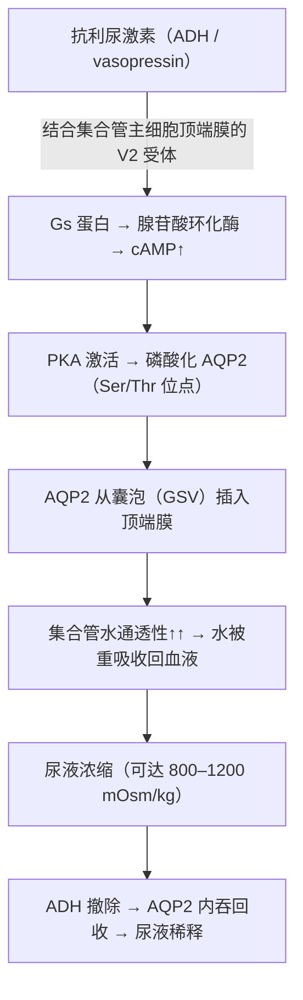
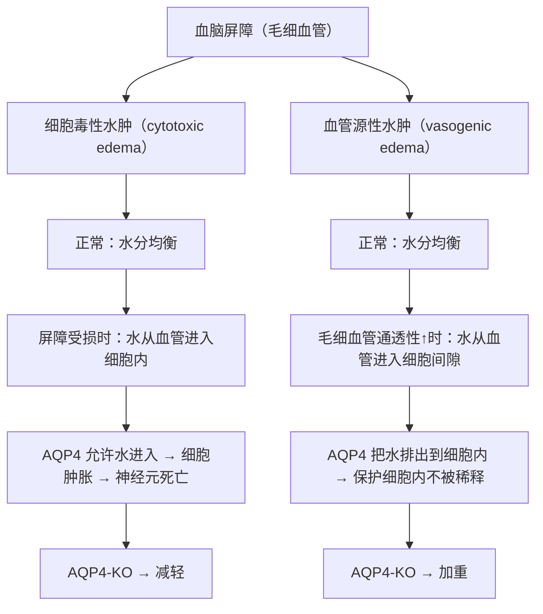

# 水通道蛋白（Aquaporin, AQP）

> **核心命题**：水通道蛋白是**跨越细胞膜的水专用通道**，属于 **MIP（Major Intrinsic Protein）超家族**。人类基因组编码 **13 个 AQP 成员（AQP0–AQP12）**。
>
> 三条主线：
> - **结构上极度保守**：全部为 **6 次跨膜螺旋（6-TM）**，含两个**NPA 基序**构成的水通道桶
> - **功能上分为两大类**：**水选择性水通道**（aquaporin，只过水）与**甘油通道**（aquaglyceroporin，过水+甘油/小溶质）
> - **分布上高度组织特异**：每个组织只表达特定几种，**与该组织的生理功能精确对应**

---

## 一、家族概览

### 1.1 基本特征

| 项目 | 内容 |
|---|---|
| **家族命名** | **AQP（Aquaporin）**；属于 **MIP（Major Intrinsic Protein）超家族** |
| **亚型数量** | 人类 **13 个**（AQP0–AQP12）；**γ-TIP** 为植物液泡膜通道（Tonoplast Intrinsic Protein） |
| **蛋白大小** | **约 250–320 个氨基酸**（30–35 kDa） |
| **跨膜结构** | ⭐ **6 次跨膜α-螺旋（TM1–TM6）**；N 端和 C 端均在**胞质侧** |
| **关键基序** | ⭐ **两个 NPA 基序**（Asn-Pro-Ala，天冬酰胺-脯氨酸-丙氨酸），构成水通道的"桶壁" |
| **选择性滤器** | **ar/R（aromatic/arginine）**基序——决定**只过水**还是**也过甘油** |
| **寡聚状态** | **同源四聚体**（AQP1 晶体结构证实）；单体的"通道"与四聚体在膜上共存 |
| **转运方式** | 被动、**不耗 ATP**；渗透压驱动的**顺水势扩散** |
| **底物** | ① 纯水通道：**H₂O**；② 甘油通道：**H₂O + 甘油 + urea + 小溶质** |

### 1.2 两大功能类群

| 类群 | 成员 | 底物 | 结构基础 |
|---|---|---|---|
| **水选择性水通道** Aquaporin | **AQP0、AQP1、AQP2、AQP4、AQP5、AQP6、AQP8、AQP11、AQP12** | **仅 H₂O** | **ar/R 滤器**体积小、极性高 → 只容许水分子通过 |
| **甘油通道** Aquaglyceroporin | **AQP3、AQP7、AQP9、AQP10** | **H₂O + 甘油 + 尿素 + H₂O₂ + NO 等小溶质** | **ar/R 滤器**旁有**疏水残基（NPA 中的 N 替换为 V/I/F）**→ 容纳更大底物 |
| **植物/植物相关** | **γ-TIP** | 水 + 甘油 | 植物液泡膜通道 |

> 💡 **一个残基决定底物谱**：甘油通道的 NPA 中的**天冬酰胺（N）被疏水残基（Val/Ile/Phe）替换**，使滤器侧链变大 → 允许甘油通过。这就是"**一个氨基酸决定底物选择性**"的经典案例。

---

## 二、组织分布总表（教材核心表 + 现代补全）

### 2.0 分布示意图

![[aqp-tissue-distribution.svg]]

> 📌 **分布即功能**：每个组织只表达它需要的那几种通道，结构与生理需求精确对应。
> - **分泌型上皮**（集合管、泪腺、汗腺）→ **AQP2/3/5/6**：负责分泌液体
> - **中枢神经**→ **AQP4**：负责 K⁺/水稳态，但**对脑水肿双向作用**
> - **代谢组织**→ **AQP7（脂肪）/AQP9（肝、中性粒）**：负责**甘油输出**与**免疫 ROS 爆发**
> - **终身使用的部位**→ **AQP0（晶状体）**：演化出 **C 端切除加工**换取长期稳定性

### 2.1 教材原表（AQP0–AQP7）

教材原表（点击展开，可与图片对照）

| 水孔蛋白 | 组织分布 |
|---|---|
| **AQP0** | **晶状体纤维细胞** |
| **AQP1** | **红细胞**、**肾近曲小管**、**眼睛睫状上皮**、**大脑脉络丛**、**肺泡上皮细胞** |
| **AQP2** | **肾集合管** |
| **AQP3** | **肾集合管**、**呼吸道支气管上皮细胞** |
| **AQP4** | **肾集合管**、**中枢神经系统**、**呼吸道支气管上皮细胞** |
| **AQP5** | **角膜**、**泪腺**、**汗腺** |
| **AQP7** | **脂肪组织**、**汗腺**、**肝** |
| **γ-TIP** | **植物液泡膜** |

> 📎 **原表只列到 AQP7 + γ-TIP**，缺 AQP6、AQP8–AQP12。下表补全，并按系统重新归纳。

### 2.2 现代补全（AQP8–AQP12）

| 水孔蛋白 | 主要组织分布 | 底物 | 核心功能 |
|---|---|---|---|
| **AQP6** | **肾近曲小管**、输尿管（** anion exchanger 1 相邻**） | **H₂O + 甘油 +尿素** | ⭐ **在酸性 pH（pH 6.5）下才打开**；是**唯一的高选择性子水通道**；参与**尿液稀释** |
| **AQP8** | **肝**、**肾**、小肠、睾丸 | **H₂O** | 肝细胞**水运输**；**肝再生**必需（AQP8-KO 小鼠肝再生延迟） |
| **AQP9** | **肝**、**小肠**、**脾**、**白细胞**、**前列���** | **H₂O + 甘油 + H₂O₂ + NO** | ⭐ **先天免疫防御**（中性粒细胞 ROS 爆发）；也是 **HNF4A 调控的肝癌标志物** |
| **AQP10** | 小肠 | **甘油通道**（弱水通道） | 甘油吸收；也作**肿瘤标志物** |
| **AQP11** | **肾**、肝、小脑 | **H₂O** | ⭐ **与尿崩症/渴觉相关**（位于肾集合管主细胞） |
| **AQP12** | 胃、小肠、结肠 | **甘油通道**（非典型） | 消化道水分分泌；**细胞凋亡调控** |

### 2.3 按系统归纳（临床最实用）

| 系统 / 器官 | 表达的 AQP | 功能含义 |
|---|---|---|
| **肾** | **AQP1**（近曲小管）、**AQP2/AQP3/AQP4/AQP6/AQP11**（集合管）、**AQP7** | ⭐ **尿液浓缩稀释的核心**；近曲小管重吸收 90% 水，集合管受 ADH 调节 |
| **中枢神经系统** | **AQP4**（星形胶质细胞足突）、**AQP1**（脉络丛）、**AQP6/AQP11/AQP12** | 脑水代谢；**脑水肿双向调节** |
| **眼** | **AQP0**（晶状体）、**AQP1**（睫状上皮）、**AQP4**（视网膜）、**AQP5**（角膜） | 房水循环、角膜含水、晶状体透明度 |
| **肺与气道** | **AQP1**（肺泡上皮）、**AQP3/AQP4/AQP5**（支气管上皮） | 肺泡水清除（呼气末）、气道黏液水化 |
| **皮肤** | **AQP3**、**AQP5**、**AQP7** | ⭐ **汗液分泌**；经皮水分吸收 |
| **消化道** | **AQP3/AQP7**（结肠）、**AQP8**、**AQP9/AQP10/AQP12**（小肠） | 肠腔水分吸收 |
| **肝** | **AQP8**、**AQP9**、**AQP7**、**AQP11** | 肝细胞水代谢、**肝再生** |
| **生殖系统** | **AQP1**（子宫内膜血管）、**AQP7**（精子）、**AQP9**（前列���） | 生殖周期调节、精子获能 |
| **血液/免疫** | **AQP1**（红细胞）、**AQP9**（中性粒/单核细胞） | 红细胞水稳态；**中性粒细胞 ROS 爆发** |
| **脂肪** | **AQP7** | ⭐ **甘油输出**——脂肪合成的关键步骤 |

---

## 三、结构：6 次跨膜与 NPA 桶

![[aqp-structure-selectivity.svg]]

> **上半部分（单体结构）**：紫色为 6 条跨膜螺旋，橙色为两个胞质环中的 **NPA 基序**（各自形成伸入膜内的半螺旋 Pa / Pb）。**两个 NPA + Pa/Pb + TM2/TM5 共同围成"水通道桶"**；胞外侧的 **ar/R 滤器**（芳香族残基 + 精氨酸）是**底物选择的关卡**。
>
> **下半部分（选择性）**：⭐ **一个氨基酸决定底物谱**——甘油通道的 NPA 中 **N 被缬/异亮/苯丙氨酸替换**（疏水、体积大），滤器变宽 → 容许甘油通过。**AQP1 单点突变 N→V 即可从水通道转为甘油通道**。

### 3.1 拓扑结构

<svg viewBox="0 0 640 300" width="100%" style="max-width:640px;height:auto;display:block;margin:1rem auto" xmlns="http://www.w3.org/2000/svg">

  <text x="320" y="22" text-anchor="middle" font-size="13" stroke="none">胞外（Extracellular）</text>
  <text x="320" y="44" text-anchor="middle" font-size="10.5" stroke="none">三个胞外环 A / C / E 上各有 ar/R 选择性滤器</text>

  <rect x="30" y="80" width="580" height="140" fill="var(--lightgray)" opacity="0.18"/>
  <line x1="30" y1="80" x2="610" y2="80" stroke="currentColor" stroke-width="1" opacity="0.55"/>
  <line x1="30" y1="220" x2="610" y2="220" stroke="currentColor" stroke-width="1" opacity="0.55"/>

  <g stroke="currentColor" stroke-width="1.6" fill="none">
    <ellipse cx="70" cy="150" rx="13" ry="58"/>
    <ellipse cx="125" cy="150" rx="13" ry="58"/>
    <ellipse cx="200" cy="150" rx="13" ry="44" stroke-dasharray="5 4"/>
    <ellipse cx="275" cy="150" rx="13" ry="58"/>
    <ellipse cx="330" cy="150" rx="13" ry="58"/>
    <ellipse cx="405" cy="150" rx="13" ry="44" stroke-dasharray="5 4"/>
    <ellipse cx="480" cy="150" rx="13" ry="58"/>
    <ellipse cx="535" cy="150" rx="13" ry="58"/>

    <polyline points="125,208 200,194 275,208"/>
    <polyline points="330,208 405,194 480,208"/>

    <path d="M70,90 Q97,62 125,90"/>
    <path d="M275,90 Q302,62 330,90"/>
    <path d="M480,90 Q507,62 535,90"/>
  </g>

  <text x="320" y="292" text-anchor="middle" font-size="13" stroke="none">胞质（Cytoplasm）</text>

  <g font-size="9" text-anchor="middle" stroke="none">
    <text x="70" y="238">TM1</text>
    <text x="125" y="238">TM2</text>
    <text x="200" y="238">Pa</text>
    <text x="275" y="238">TM3</text>
    <text x="330" y="238">TM4</text>
    <text x="405" y="238">Pb</text>
    <text x="480" y="238">TM5</text>
    <text x="535" y="238">TM6</text>
  </g>

  <g font-size="10" text-anchor="middle" stroke="none">
    <text x="200" y="262">环 B · NPA</text>
    <text x="405" y="262">环 D · NPA</text>
    <text x="62" y="262">N 端</text>
    <text x="543" y="262">C 端</text>
  </g>
</svg>

*上图：6-TM 拓扑——环 B / 环 D 的两个 NPA 各自形成伸入膜内的半螺旋 Pa / Pb，与 TM2、TM5 共同围成水通道桶（water-filled pore）。*

| 结构域 | 位置 | 关键要素 |
|---|---|---|
| **TM1–TM6** | 跨膜 | 两组三联体对称排列；**TM2/TM5 + Pa/Pb + NPA** 围成桶 |
| **环 A / 环 C / 环 E** | 胞外 | 含 **ar/R 选择性滤器**（芳香族 + 精氨酸）；对水/甘油的选择性决定于此 |
| **环 B** | 胞质，含 **NPA** | 形成半螺旋 **Pa**，伸入膜内 |
| **环 D** | 胞质，含 **NPA** | 形成半螺旋 **Pb**，伸入膜内 |
| **N 端 / C 端** | 胞质 | 决定**亚细胞定位**（质膜 vs 胞器膜）、调节活性 |

### 3.2 ar/R 选择性滤器：水 vs 甘油的决定者

ar/R 滤器位于**胞外端**，由芳香族残基（**F165 / W188 / Y202**，侧链窄）与**精氨酸 R207**（带正电）构成；滤器下方再按 NPA 中第三个残基分流：

| 类型 | NPA 中的 N | 残基性质 | 滤器孔径 | 可通过的底物 |
|---|---|---|---|---|
| **水选择性 AQP**（如 AQP1 / AQP4） | **天冬酰胺（N）** | 极性、小 | 窄 | 只容许单个水分子 |
| **甘油通道**（AQP3 / AQP7 / AQP9） | **缬氨酸 / 异亮氨酸 / 苯丙氨酸** | 疏水、体积大 | 变宽 | 容许甘油等小溶质通过 |

> 🎯 **经典结论**：AQP1 单点突变（**NPA 中 N → V**）即可把它从**水通道**转变为**甘油通道**。这是"**一个氨基酸决定底物选择性**"的最有力证据。

### 3.3 四聚体与"原生功能单位"

<svg viewBox="0 0 560 212" width="100%" style="max-width:560px;height:auto;display:block;margin:1rem auto" xmlns="http://www.w3.org/2000/svg">

  <defs>
    <marker id="arrow-aqp4-tetramer" markerWidth="8" markerHeight="8" refX="6" refY="3" orient="auto">
      <path d="M0,0 L6,3 L0,6 Z" fill="currentColor"/>
    </marker>
  </defs>

  <rect x="40" y="48" width="120" height="80" rx="10" fill="none" stroke="currentColor" stroke-width="1.6"/>
  <text x="100" y="82" text-anchor="middle" font-size="12" stroke="none">单体 AQP</text>
  <text x="100" y="102" text-anchor="middle" font-size="10" stroke="none">6-TM · 一条水通道</text>

  <line x1="176" y1="88" x2="240" y2="88" stroke="currentColor" stroke-width="1.5" marker-end="url(#arrow-aqp4-tetramer)"/>
  <text x="208" y="78" text-anchor="middle" font-size="10" stroke="none">四聚化</text>

  <g fill="none" stroke="currentColor" stroke-width="1.6">
    <circle cx="305" cy="66" r="27"/>
    <circle cx="363" cy="66" r="27"/>
    <circle cx="305" cy="124" r="27"/>
    <circle cx="363" cy="124" r="27"/>
  </g>
  <g fill="currentColor" stroke="none">
    <circle cx="305" cy="66" r="3.5"/>
    <circle cx="363" cy="66" r="3.5"/>
    <circle cx="305" cy="124" r="3.5"/>
    <circle cx="363" cy="124" r="3.5"/>
  </g>

  <text x="334" y="178" text-anchor="middle" font-size="11" stroke="none">同源四聚体（AQP1 晶体结构证实）</text>
  <text x="334" y="198" text-anchor="middle" font-size="10" stroke="none">每个单体各有一条独立通道 · 四聚体界面决定脂筏定位与组装稳定性</text>
</svg>

*上图：一个单体即一条水通道；四个单体组成同源四聚体，中心黑点标出各自的通道。*

| 层级 | 结构 | 功能 |
|---|---|---|
| **单体** | 6-TM 桶 | 一条水通道 |
| **四聚体** | 4 个单体 | **AQP1 的原生状态**；决定**质膜与脂筏的定位**；比单体更稳定 |
| **更高阶聚集体** | 四聚体之间再聚合 | 囊泡化实验中形成**晶体样二维阵列**（landmark of AQP1） |

---

## 四、各亚型详解

### 4.1 AQP0（MIP）——"晶状体专用，**不存在于其他组织**"

| 维度 | 内容 |
|---|---|
| **分布** | ⭐ **仅晶状体纤维细胞（lens fiber cells）**——**哺乳动物组织中分布最局限的 AQP** |
| **功能** | 维持晶状体**透明性与水稳态**；晶状体无血管，水分靠 AQP0 被动平衡 |
| **独特之处** | ⭐ **AQP0 在表达后被切除 C 端 12 个氨基酸**（**蛋白水解成熟**）→ 转变为**更稳定的通道**，寿命极长（晶状体蛋白半衰期数十年） |
| **病理** | 🔴 **AQP0-KO 小鼠发生** cataracts（白内障）**，晶状体蛋白聚集、液化 |
| **临床** | 白内障的**潜在治疗靶点**（AQP0 突变/表达下调与年龄相关白内障） |

> 🧠 **记忆点**：**AQP0 = 只在眼睛的晶状体里**。它为了"终身使用"演化出了 **C 端切除加工**——这是教科书级的"蛋白加工增加稳定性"案例。

---

### 4.2 AQP1——"最广泛的水通道"

| 维度 | 内容 |
|---|---|
| **分布** | **红细胞**、**肾近曲小管**、**睫状上皮**、**大脑脉络丛**、**肺泡上皮细胞**（教材原表）；此外**毛细血管内皮**、**脑星形胶质细胞足突**、**血管平滑肌** |
| **功能** | ① **红细胞**：调节红细胞**体积与变形性**，通过肾小球滤过 ② **肾近曲小管**：重吸收滤液中 **~90% 的水**（等渗重吸收） ③ **肺泡上皮**：清除肺泡内多余水分，维持**气体交换表面干燥** ④ **脉络丛**：分泌脑脊液 |
| **病理** | 🔴 AQP1-KO 小鼠表现出**尿量增多但浓缩能力正常**（集合管代偿）、**血管通透性改变**、**肿瘤生长与血管生成异常** 🔴 AQP1 表达↑与**肿瘤血管生成、转移**相关（多个肿瘤模型） |
| **研究地位** | ⭐ **AQP1 是第一个被克隆的水通道**（1992, Agre 实验室）；**X 射线晶体结构（1996, Science）**——**结构生物学的里程碑** |

---

### 4.3 AQP2——"抗利尿激素的效应器"

| 维度 | 内容 |
|---|---|
| **分布** | ⭐ **肾集合管主细胞**（严格而言：**连接细胞与主细胞的顶端膜**） |
| **调控** | ⭐ **完全由抗利尿激素（ADH/加压素, vasopressin）控制**——见下方级联 |
| **病理** | 🔴 **肾性尿崩症（NDI）**：AQP2 突变或 V2R 信号缺陷 → **多尿、烦渴**（治疗：**氨甲环酸+噻嗪类**，或**托VP 类似物去氨加压素**） 🔴 **Aq2-BI 抗体**（自身免疫性 NDI） |

#### ADH → AQP2 的调控级联

> ⚠️ **核心机制**：AQP2 **不改变表达量，只改变定位**——从胞内囊泡**转位到顶端膜**。这是"**急性调控**"的经典范例（与 GLUT4 转位类似，但分子完全不同）。

---

### 4.4 AQP4——"中枢神经系统的水通道（双刃剑）"

| 维度 | 内容 |
|---|---|
| **分布** | ⭐ **中枢神经系统**——**星形胶质细胞足突**（与毛细血管接触）、**室管膜细胞**；此外**肾集合管**、**呼吸道支气管上皮**（教材原表）；**骨骼肌**、**视网膜** |
| **靶点** | ⭐ **AQP4 抗体（抗 AQP4-IgG）**——**视神经脊髓炎谱系疾病（NMOSD / Devic病）的特异性自身抗体靶点** |
| **对脑水肿的双向作用** | 🔴 **促进细胞毒性脑水肿**（cytotoxic edema）：水从血液→细胞内，细胞肿胀、神经元死亡 🟢 **限制血管源性脑水肿**（vasogenic edema）：阻止水从血管→细胞间隙 → **AQP4-KO 小鼠**结果：**细胞毒性水肿减轻，但血管源性水肿加重**——⭐ **说明 AQP4 在不同水肿类型中作用相反** |
| **生理意义** | ⭐ 脑**K⁺/水稳态维持**、神经兴奋性调控；AQP4 表达↓会**增加癫痫易感性** |
| **其他** | 参与**运动神经肌肉接头**（AQP4 在肌膜/肌腱连接处，与肌肉收缩力相关） |

> 🔑 **关键理解**：AQP4 在 CNS 是**双向的**——它既是水进入脑细胞的"通道"，也是把水排出脑组织的"排水渠"。**这解释了为什么 AQP4 抑制剂不能用于治疗脑水肿**——不同水肿类型需要相反的作用方向。

---

### 4.5 AQP5——"分泌型水通道"

| 维度 | 内容 |
|---|---|
| **分布** | ⭐ **角膜**、**泪腺**、**汗腺**（教材原表）；此外**唾液腺**、**乳腺**、**气管支气管腺** |
| **功能** | ① **泪腺**：分泌层液（泪液的三层：脂质层/水层/黏液层，AQP5 提供**水层**） ② **汗腺**：汗液分泌（主要是**离子型汗**，经汗管时 AQP5 回收水分） ③ **角膜**：维持**角膜含水量与透明度**（角膜需约 75% 含水） ④ **唾液腺**：唾液的水分分泌 |
| **病理** | 🔴 **AQP5-KO 小鼠**：**严重泪腺分泌减少**、**唾液腺分泌减少**、角膜上皮异常 🔴 **Sjögren 综合征**（干燥综合征）：泪腺/唾液腺 AQP5 表达↓ → **干眼、口干**；AQP5 是**干燥综合征的候选生物标志物** 🔴 **COPD**（慢阻肺）：气道黏液脱水、AQP5 表达↓ |

---

### 4.6 AQP3与 AQP7——"甘油通道与代谢"

#### AQP3

| 维度 | 内容 |
|---|---|
| **分布** | ⭐ **肾集合管**、**呼吸道支气管上皮细胞**（教材原表）；此外**结肠**、**皮肤**、**胃肠道**、**免疫细胞** |
| **功能** | ① **汗腺**：分泌汗液（甘油通道 + 水通道） ② **结肠**：水与甘油吸收 ③ **支气管黏液**的水化 ④ **表皮**：经皮水分吸收（配合 AQP5） |
| **病理** | 🔴 **Sjögren 综合征**（AQP3 表达↓） 🔴 **特应性皮炎（AD）**：皮肤 AQP3 表达↓ → 屏障功能受损 |

#### AQP7

| 维度 | 内容 |
|---|---|
| **分布** | ⭐ **脂肪组织**、**汗腺**、**肝**（教材原表） |
| **核心功能** | ⭐ **甘油输出**——⭐ **这是 AQP7 在脂肪组织中存在的根本原因**： 脂肪甘油三酯（TAG）水解产生**游离甘油**，AQP7 把甘油**运出脂肪细胞** → 经血液到肝 → 糖异生 → **AQP7 = 脂肪动员（脂解）的关键通道** |
| **机制意义** | **肾上腺素 → cAMP/PKA → ABL（脂肪甘油三酯脂肪酶）** 脂解 → 甘油释放 → **AQP7 导出**。缺乏 AQP7 时甘油无法离开脂肪细胞 → **堆积在细胞内造成脂毒性** |
| **表型** | AQP7-KO 小鼠：**体重减轻、脂肪堆积减少**（但高脂饮食下体重↑）；抗**高胰岛素血症** |

> 🧠 **记忆点**：**AQP7 = 脂肪组织的甘油出口**。理解它只需记住"**脂解产生的甘油必须被运走**"——这与 GLUT4 是肌肉的葡萄糖入口正好对称。

---

### 4.7 植物的 γ-TIP

| 维度 | 内容 |
|---|---|
| **全称** | **γ-TIP（Tonoplast Intrinsic Protein）** |
| **分布** | ⭐ **植物液泡膜（tonoplast）**（教材原表） |
| **功能** | 调节**液泡与胞质之间的水交换**——维持**细胞膨压（turgor）**；植物气孔开闭也依赖液泡水进出 |
| **意义** | 植物中**没有 GLUT 类的质膜水通道**，水跨膜主要靠**TIP**；是植物抗旱/抗逆研究的重要对象（**TIP2;1** 等参与 ABA 信号） |

---

## 五、水通道的调控

### 5.1 调控层级总表

| 调控层级 | 代表机制 | 例子 |
|---|---|---|
| **急性：囊泡转位** | 胞内囊泡 ↔ 质膜 | ⭐ **AQP2**（ADH → PKA → 转位）；**AQP4**（脑水肿、癫痫） |
| **急性：pH 门控** | pH 敏感性 | ⭐ **AQP6**（pH < 6.5 才打开）；**AQP1**（低 pH 抑制） |
| **化学修饰：磷酸化** | PKA / PKC / 蛋白激酶 | AQP2（Ser/Thr）；AQP1（Thr） |
| **抑制：汞与硫醇** | **Hg²⁺、金盐**与**半胱氨酸**共价结合，堵塞通道 | ⭐ **HgCl₂ 抑制 AQPs**（实验工具）；病理：**汞中毒肾损伤** |
| **抑制：脱水收缩** | 高渗 → 细胞脱水 | AQP1、AQP3 表达下调 |
| **长期：转录调控** | 转录因子 + 激素 | **AQP2**（ADH 长期 → 表达↑）；**AQP8**（肝再生）；**HNF4A → AQP9**（肝癌）；**AQP5**（Sjögren、COPD） |
| **蛋白降解** | 泛素化 / 蛋白酶体 | AQP2（AQP2 内吞后降解）；**AQP0**（**反向：C 端切除提高稳定性**） |

### 5.2 AQP6 的 pH 门控（特例）

> **AQP6 是唯一的高选择性子（subselectivity）AQP**：在**酸性 pH（pH 6.5）**时才被激活。
>
> **生理位置**：位于**肾近曲小管**，紧邻 **AE1（anion exchanger 1，氯-碳酸氢盐交换器）**。近曲小管细胞内 pH 偏酸 → AQP6 打开 → **甘油/尿素/水通过**
>
> **意义**：这是**通道活性严格由环境 pH 门控**的罕见范例，也是**"亚选择性（subselectivity）"**概念的经典案例。

---

## 六、疾病关联

### 6.1 遗传病与病理

| 疾病 | 相关 AQP | 表型 / 机制 |
|---|---|---|
| **AQP0 缺失** | AQP0 | 猫/小鼠**白内障** |
| **肾性尿崩症（NDI）** | ⭐ **AQP2** | 多尿烦渴；V2R 或 AQP2 缺陷；自身免疫性（Aq2-BI） |
| **视神经脊髓炎谱系疾病（NMOSD）** | ⭐ **AQP4** | **抗 AQP4-IgG** 阳性；视神经炎 + 脊髓炎 |
| **Sjögren 综合征** | AQP3、**AQP5** | 干眼、口干；泪腺/唾液腺 AQP5↓ |
| **慢阻肺（COPD）** | AQP5、AQP3 | 气道黏液脱水 |
| **特应性皮炎** | AQP3 | 皮肤屏障功能受损 |
| **肿瘤** | **AQP1**、AQP3、AQP4、AQP9 | ⭐ **AQP1 促血管生成与转移**；**AQP9 是 HNF4A 下游肝癌标志物** |
| **肝再生障碍** | **AQP8** | AQP8-KO 小鼠肝再生延迟、肝细胞衰老 |
| **肝性脑病** | AQP4 | 星形胶质细胞肿胀（氨转运障碍） |
| **白内障** | AQP0 | 晶状体水稳态失衡 |

### 6.2 AQP4 与脑水肿的双向作用（重要概念）

> 🎯 **结论**：**AQP4 抑制剂不能用于治疗所有脑水肿**——它在细胞毒性水肿中是有害的（促进水进入），在血管源性水肿中是有益的（排水）。治疗策略必须**按水肿类型区分**。

---

## 七、研究方法

### 7.1 表达与定位

| 方法 | 用途 |
|---|---|
| **Western blot / IHC / IF** | AQP 蛋白定位（组织特异分布的标准方法） |
| **RT-qPCR / RNA-seq** | 13 个 AQP 的表达谱分析 |
| **原位杂交** | 组织中 mRNA 定位 |
| **EM / 冷冻电镜** | 四聚体与囊泡化二维阵列 |
| **X 射线晶体结构** | ⭐ **AQP1（1996）、AQP4、aquaglyceroporin GlpF（1997）** |
| **冷冻电镜（cryo-EM）** | 近年生理条件下结构 |

### 7.2 功能测定

| 方法 | 原理 | 应用 |
|---|---|---|
| **³H-牛磺酸（3H-taurine）摄取** | 示踪水流量 | ⭐ **金标准**（Merck 旧标准法） |
| **荧光素酶-氧不敏感同源物（LOIC）** | 生物发光法测水通透性 | 高灵敏度 |
| **荧光探针法**（荧光素、CFSE、**D₂O**、钙黄绿素） | 荧光探针随水进入胞内 | **活细胞成像** |
| ****2-NBDG 类似的 AQP 水探针** | — | AQP 特异性探针 |
| **干重/湿重比** | 组织含水量 | 整体水平 |
| **肾灌注实验** | 分离肾小管的水通透性 | 生理水平 |
| **冷冻电镜 + 囊泡化（vesiculation）** | 形成泡状囊泡测水通透性 | 单分子层 |

> 📌 **注意**：**汞盐（HgCl₂ / pCMBS）是 AQP 的经典抑制剂**——通过与**半胱氨酸**共价结合堵塞通道。在实验中使用后必须**彻底透析去除**（不可逆结合）。

---

## 八、要点速记

| 要点 | 内容 |
|---|---|
| **家族** | **MIP 超家族**；人类 **13 个 AQP（AQP0–AQP12）**；植物 **γ-TIP** |
| **结构** | ⭐ **6 次跨膜**；**两个 NPA 基序** + 半螺旋 Pa/Pb 围成水通道桶；**ar/R 选择性滤器**；**同源四聚体** |
| **两大类** | **水选择性**（AQP0/1/2/4/5/6/8/11/12）vs **甘油通道**（AQP3/7/9/10）——**由 NPA 中的 N 是否被疏水残基替换决定** |
| **AQP0** | ⭐ **仅晶状体**；**C 端切除加工**增加稳定性；KO→白内障 |
| **AQP1** | ⭐ **分布最广**（红细胞、近曲小管、肺泡、脉络丛）；**第一个被克隆**（1992 Agre）；**第一个晶体结构**（1996）；促肿瘤血管生成 |
| **AQP2** | ⭐ **仅肾集合管**；**完全由 ADH 控制**——**只转位不改表达**；缺陷→**肾性尿崩症** |
| **AQP4** | ⭐ **中枢神经（星形胶质细胞）**；**抗 AQP4-IgG = NMOSD**；⭐ **脑水肿双向作用**（促细胞毒性、抑血管源性） |
| **AQP5** | **泪腺、汗腺、角膜、唾液腺**；KO→泪液/唾液减少；**Sjögren/COPD** 相关 |
| **AQP3** | **肾集合管、支气管、结肠、皮肤**；**甘油 + 水**；Sjögren/特应性皮炎 |
| **AQP7** | ⭐ **脂肪组织**——**甘油输出**，脂解关键通道；**汗腺、肝** |
| **AQP6** | **近曲小管**；**pH 门控**（pH<6.5 才开）；**亚选择性** |
| **AQP8** | **肝**——**肝再生**必需 |
| **AQP9** | **肝、脾、中性粒**——**先天免疫（ROS 爆发）**；**HNF4A → 肝癌标志物** |
| **AQP11** | **肾**——渴觉/尿崩症相关 |
| **γ-TIP** | **植物液泡膜**——维持膨压 |
| **共同逻辑** | **分布 = 功能**：分泌上皮→分泌水通道（AQP2/3/5/6）；中枢→双向水通道（AQP4）；代谢组织→甘油通道（AQP7/9） |
| **实验工具** | **HgCl₂/pCMBS** 抑制（与 Cys 共价结合）；**³H-taurine** 摄取金标准 |

---

## 九、常见误区澄清

| 误区 | 正确认识 |
|---|---|
| ❌ "水通道能主动泵水" | ❌ **完全被动**，靠渗透压梯度。耗 ATP 的是**水通道的调控**（如 AQP2 转位）而非转运本身 |
| ❌ "所有 AQP 都只过水" | ❌ **AQP3/7/9/10 是甘油通道**，还过尿素、H₂O₂、NO 等小溶质 |
| ❌ "AQP2 是泵水" | ❌ AQP2 本身**只是通道**；它由 **ADH 通过 V2R-cAMP-PKA 调控转位**——这是"调控"而非"泵" |
| ❌ "AQP4 能治脑水肿" | ❌ ⭐ **AQP4 对脑水肿是双向的**：促细胞毒性水肿、抑血管源性水肿。**必须按水肿类型区分** |
| ❌ "AQP 在所有细胞表达" | ❌ **分布高度特异**：AQP0 **只在晶状体**；AQP2 **只在集合管** |
| ❌ "AQP0 就是普通的 AQP" | ❌ 它**表达后 C 端被切除 12 个氨基酸**——加工成更稳定的通道（终身使用的特化） |
| ❌ "AQP7 是水通道" | ⚠️ 它是**甘油通道**。在脂肪组织中它的功能是**导出脂解产生的甘油**，而非"过水" |
| ❌ "汞盐抑制是可逆的" | ❌ Hg²⁺/pCMBS 与半胱氨酸**共价结合**，**不可逆**，必须透析彻底去除 |
| ❌ "AQP9 只是代谢通道" | ❌ 它在**中性粒细胞**中参与 **ROS 爆发**（先天免疫），是**免疫功能通道** |
| ❌ "TIP 是植物的 GLUT" | ❌ **TIP 是液泡膜通道**，负责**膨压调节与气孔运动**；植物质膜水通道另有**PIP 家族** |

---

## 附：关键缩写对照

| 缩写 | 全称 | 中文 |
|---|---|---|
| **AQP** | Aquaporin | **水通道蛋白** |
| **MIP** | Major Intrinsic Protein | **固有蛋白超家族**（AQP 所属超家族） |
| **NPA** | Asn-Pro-Ala（天冬酰胺-脯氨酸-丙氨酸） | ⭐ **水通道桶关键基序** |
| **ar/R** | aromatic/arginine（芳香族/精氨酸） | **选择性滤器基序** |
| **TIP** | Tonoplast Intrinsic Protein | **液泡膜固有蛋白**（γ-TIP） |
| **PIP** | Plasma membrane Intrinsic Protein | 植物**质膜**水通道 |
| **ADH / VP** | Antidiuretic Hormone / Vasopressin | **抗利尿激素（加压素）** |
| **V2R** | Vasopressin receptor 2 | **加压素 2 型受体**（Gs 蛋白偶联） |
| **GSV** | — | AQP2 的储存囊泡（类比 GLUT4） |
| **NDI** | Nephrogenic Diabetes Insipidus | **肾性尿崩症** |
| **Aq2-BI** | — | **抗 AQP2 自身抗体**（自身免疫性 NDI） |
| **NMOSD** | Neuromyelitis Optica Spectrum Disorder | **视神经脊髓炎谱系疾病** |
| **AQP4-IgG** | Anti-AQP4 antibody | **视神经脊髓炎特异性自身抗体** |
| **cytotoxic edema** | — | **细胞毒性脑水肿** |
| **vasogenic edema** | — | **血管源性脑水肿** |
| **AE1** | Anion Exchanger 1 | **阴离子交换器 1**（AQP6 的邻居） |
| **pCMBS** | p-chloromercuribenzenesulfonate | **对氯汞苯磺酸**（AQP 不可逆抑制剂） |
| **HgCl₂** | Mercury(II) chloride | **氯化汞**（AQP 抑制剂） |
| **LOIC** | Luciferase-based Oxygen Insensitive Coupling | 生物发光水通透性测定法 |
| **3H-taurine** | Tritiated taurine | **³H 标记牛磺酸**（水流量金标准示踪） |
| **TAG / NEFA** | Triacylglycerol / Non-esterified fatty acid | **甘油三酯 / 游离脂肪酸** |
| **HNF4A** | Hepatocyte Nuclear Factor 4 Alpha | **肝细胞核因子 4α**（AQP9 上游） |
| **Sjögren** | Sjögren syndrome | **干燥综合征** |
| **AD** | Atopic Dermatitis | **特应性皮炎** |
| **COPD** | Chronic Obstructive Pulmonary Disease | **慢性阻塞性肺疾病** |
| **H₂O₂ / ROS** | Hydrogen peroxide / Reactive oxygen species | 过氧化氢 / 活性氧 |

---

> **总结**
> **AQP 家族的核心逻辑是"分布即功能"**——每个组织只表达它需要的那几种通道，**分子结构与生理需求精确对应**：
>
> - **分泌型上皮**（集合管、汗腺、泪腺）→ **AQP2/AQP3/AQP5**，负责**分泌液体**；AQP2 额外受 **ADH 急性调控（只转位，不改表达）**
> - **中枢神经**→ **AQP4**，负责**K⁺/水稳态**；但**对脑水肿双向**——所以不能一刀切用抑制剂
> - **代谢组织**→ **AQP7（脂肪）/AQP9（肝、中性粒）**，负责**甘油输出**与**免疫 ROS 爆发**
> - **特殊部位**→ **AQP0 只在晶状体**（终身使用，故演化出 **C 端切除加工**）
>
> 结构上，**6-TM + 两个 NPA 基序 + ar/R 滤器**是全家族的统一模板；而 **NPA 中一个氨基酸的替换**（天冬酰胺 → 疏水残基）就足以把"水通道"变成"甘油通道"——这是**结构决定功能**最简洁的证明。