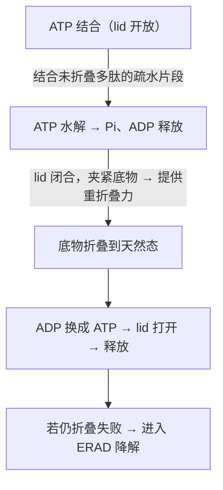
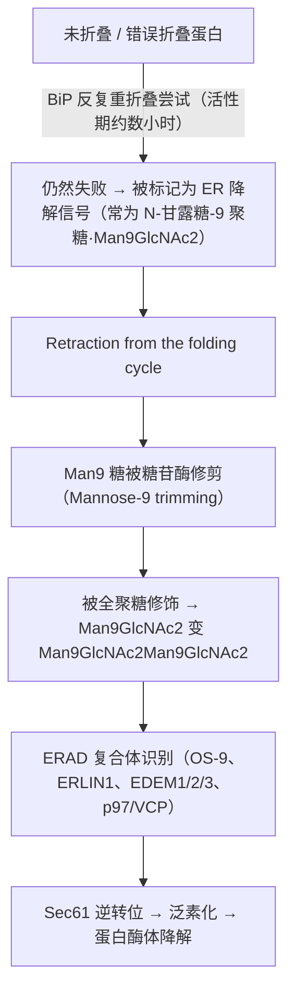
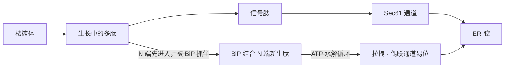
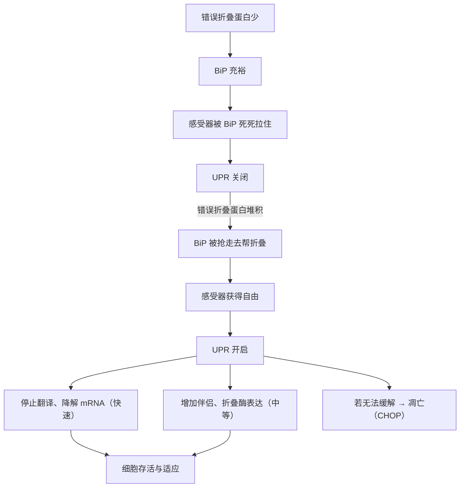

# BiP（GRP78 / HSPA5）

> **一句话**：BiP 是**内质网腔内的 Hsp70 分子伴侣**，负责新生多肽的折叠、错误折叠蛋白的返工与降解、跨膜转运的马达动力，并通过"感知错误折叠的量"来启动 **UPR（未折叠蛋白反应）**。
>
> 名字来历：**B**inding **i**mmunoglobulin **P**rotein —— 最初因为能结合浆细胞内质网中的免疫球蛋白重链而得名。

---

## 一、基本信息速查

| 项目 | 内容 |
|---|---|
| 基因 | **HSPA5**（heat shock protein family A member 5） |
| 常用名 | BiP / GRP78 / 78 kDa 葡萄糖调节蛋白 |
| 家族 | **Hsp70 家族**（与胞质 Hsc70、DnaK 同源） |
| 定位 | **内质网腔**（N 端带信号肽，KDEL 锚定在腔面） |
| 分子量 | 78 kDa，约 637 aa |
| 表达 | **组成型高表达**，是 ER 中含量最丰富的蛋白之一 |
| 二聚化 | 天然为**同源二聚体**；功能单体为主；也可形成寡聚体 |
| 关键结构域 | NBD（核苷酸结合域）+ SBD（底物结合域）+ **lid 结构域** |
| 核心功能 | 折叠催化、品质控制、转运马达、UPR 传感器 |
| 病理关联 | 肿瘤、神经退行性疾病、自身免疫病、病毒感染、代谢病 |

> **易混点**：BiP（GRP78）在 **ER 腔**；Hsc70（HSPA1A/B）在**胞质**。两者是同一家族不同成员，抗体不交叉识别。

---

## 二、结构：三个结构域 + 一个"盖子"

### 2.1 结构域组成

<svg viewBox="0 0 700 200" width="100%" style="max-width:700px;height:auto;display:block;margin:1rem auto" xmlns="http://www.w3.org/2000/svg">
<text x="350" y="30" text-anchor="middle" font-size="13" stroke="none">BiP 单体（约 78 kDa）</text>
  <g stroke="currentColor" stroke-width="1.5" fill="none">
    <rect x="30" y="52" width="42" height="58"/>
    <rect x="72" y="52" width="322" height="58"/>
    <rect x="394" y="52" width="44" height="58"/>
    <rect x="438" y="52" width="186" height="58"/>
    <rect x="624" y="52" width="50" height="58"/>
  </g>
  <g text-anchor="middle" stroke="none">
    <text x="51" y="78" font-size="10">信号肽</text>
    <text x="51" y="94" font-size="8.5">~20 aa</text>
    <text x="233" y="78" font-size="11">NBD（核苷酸结合域）</text>
    <text x="233" y="94" font-size="8.5">~1-380 aa</text>
    <text x="416" y="78" font-size="8">linker</text>
    <text x="416" y="94" font-size="7.5">~380-400</text>
    <text x="531" y="78" font-size="11">SBD（底物结合域）</text>
    <text x="531" y="94" font-size="8.5">~400-590</text>
    <text x="649" y="78" font-size="10">lid</text>
    <text x="649" y="94" font-size="7.5">590-637</text>
  </g>
  <g stroke="currentColor" stroke-width="1" stroke-dasharray="3 3" fill="none">
    <line x1="233" y1="110" x2="233" y2="132"/>
    <line x1="531" y1="110" x2="531" y2="132"/>
    <line x1="649" y1="110" x2="649" y2="132"/>
  </g>
  <g text-anchor="middle" stroke="none">
    <text x="233" y="150" font-size="10">ATP/ADP 结合</text>
    <text x="233" y="167" font-size="10">分子伴侣循环动力</text>
    <text x="531" y="150" font-size="10">底物结合口袋</text>
    <text x="531" y="167" font-size="10">结合未折叠链</text>
    <text x="649" y="150" font-size="10">螺旋盖</text>
    <text x="649" y="167" font-size="10">开合控制</text>
  </g></svg>

*上图：结构域线性排布——NBD 结合并水解 ATP 提供动力，SBD 抓未折叠链，lid 像盖子控制口袋开合。*

| 结构域 | 主要功能 | 关键特征 |
|---|---|---|
| **NBD**（nucleotide-binding domain） | 结合并水解 ATP，提供重折叠的能量 | 类 actin 折叠，两叶结构，ATP 口袋夹在中间 |
| **linker** | 连接 NBD 与 SBD | 富含谷氨酸/赖氨酸，传递构象变化 |
| **SBD**（substrate-binding domain） | 结合未折叠多肽，提供"拉链"式作用力 | β 折叠片层构成底物结合口袋（偏好疏水片段） |
| **lid**（螺旋盖） | 控制底物结合口袋的开放与关闭 | 在 **α 构象（开）** 与 **β 构象（闭）** 间切换 |

### 2.2 盖子的构象切换 = 分子伴侣循环的核心

- **ATP 结合 → lid 处于 α 螺旋构象 → 口袋开放 → 结合底物**
- **ATP 水解 → lid 跌落成 β 构象 → 口袋闭合 → 夹紧底物**
- **ADP 释放 → ATP 换入 → lid 重新打开 → 释放底物**

![[bip-domain-lid-cycle.svg]]

> **一句话**：BiP 不是"把蛋白变好"的酶，而是**用 ATP 反复"抓—挤—放"的分子钳**，把错误折叠的能量拉回到正确构象。

---

## 三、分子伴侣循环（与细菌 DnaK 同源）

| 步骤 | 触发条件 | 分子事件 | 底物状态 |
|---|---|---|---|
| 1 | ATP 高、ADP 低 | NBD 结合 ATP，lid 开放 | 未折叠 |
| 2 | — | SBD 口袋捕捉疏水片段 | 被抓住 |
| 3 | ATP 水解 | ATP→ADP+Pi，lid 闭合 | 被夹紧、拉伸 |
| 4 | — | 反复循环多次，给予重折叠机会 | 趋于正确折叠 |
| 5 | 折叠完成 | ADP 换成 ATP，lid 打开 | 天然态，释放 |

> **消耗比**：Hsp70 类伴侣平均每帮助折叠一个蛋白需要消耗**数十至数百个 ATP**，属于高耗能的"暴力搜索"机制。

---

## 四、BiP 的四大功能

### 4.1 折叠催化

- 天然蛋白质的折叠在水中是一个**熵减**过程（需要负的 ΔS），热力学上极慢。
- BiP 提供的解决方案是**局部去折叠**：抓住某一小段（5–10 个氨基酸），把它从天然结构中**拔出**并重新折叠。
  - 这一步 ΔS 为正（解离有利），克服了熵障碍；
  - 结果是"把熵障碍拆成多个小步骤"，使折叠速度提高约 **10⁴–10⁵ 倍**。
- 关键概念：**局部去折叠（local unfolding）** 是 Hsp70 类伴侣的通用工作原理。

| 参数 | 数值 |
|---|---|
| 底物结合长度 | 5–10 aa（偏好疏水 + 富含脯氨酸） |
| 每循环酶速 | 约 1 个 ATP / 1 个底物结合-释放循环 |
| 结合亲和力 | 循环中可在 ~10⁵ 范围调控 |

### 4.2 品质控制（Quality Control）与 ERAD 挂钩

- ERAD 的核心机制是**错误折叠蛋白的"滞留 + 退回"**。
- **Man9 修剪级联**是决定"折叠还是降解"的时间开关：滞留时间越长，Man9 修剪越多，越可能被送去降解。
- 一旦启动降解，**伴侣不能再帮忙**——这被称为 **retraction from the folding cycle**。

### 4.3 蛋白质转位（Translocation）

BiP 是**内质网共翻译转位系统的动力来源**：

| 环节 | 细节 |
|---|---|
| 启动 | 信号肽被 **SRP** 识别，核糖体被导向 Sec61 通道 |
| 动力 | BiP（SRP 的"分子对应物"）结合信号肽，通过 ATP 水解把多肽拉入腔内 |
| 拉入方向 | BiP 通过 **BIPAR（BAX inhibitor factor 1 样蛋白）**、RAMP4 与膜连接 |
| 方向性 | 每次 ATP 水解净推进 **约 2–3 个氨基酸** |
| 高度保守 | 细菌 SecYEG 的同源马达是 DnaK + SecD/F，**机制完全一致** |

> **演化意义**：细菌 SecYEG 转位 + DnaK 马达，与真核 Sec61 + BiP 是同一套零件的不同组装。**这个机制从细菌一直用到哺乳动物细胞。**

### 4.4 UPR 传感器（最核心的调控功能，见下节）

---

## 五、BiP 与 UPR：折叠需求量的"传感器"

### 5.1 核心模型

**BiP 的结合位点是有限的**。它必须同时扮演两个角色：

1. **给错误折叠蛋白提供折叠帮助**
2. **与三个 UPR 感受器的腔内结构域结合，抑制它们**

因此 BiP 本身就像一个"**分子音量旋钮**"：

![[bip-upr-sensor.svg]]

> **核心命题**：UPR 不是"检测到错误折叠蛋白"，而是**检测"BiP 被占用掉了"**——这是一个**分子水平的占有率传感器**，而非"错误折叠传感器"。

### 5.2 三条 UPR 支路详解

| 感受器 | 位于 | 激活后事件 | 初始响应速度 |
|---|---|---|---|
| **PERK**（PKR-like ER kinase） | ER 膜 | 二聚化自磷酸化 → 磷酸化 **eIF2α** → 抑制翻译起始 | 慢（分钟级） |
| **ATF6** | ER 膜 | 转运到高尔基体，被 **S1P/S2P** 蛋白酶切开 → 入核 | **最快（秒~分钟）** |
| **IRE1** | ER 膜 | 寡聚化 → 内切核酸酶活性 → **XBP1 mRNA 可变剪接** | 中等 |

#### （1）ATF6 通路：最先响起的警报

- 未应激时，ATF6 与 BiP 结合，滞留在 ER 膜。
- 应激时 BiP 被抽走 → ATF6 变成 **高尔基体驻留信号** → 被包装进 COPII 囊泡 → 运到高尔基体 → 被 **site-1 protease (S1P)** 与 **site-2 protease (S2P)** 双切 → N 片段入核。
- 核内 ATF6 与 **NF-Y** 结合，激活 BiP、蛋白二硫键异构酶（PDI）、ERp57、钙网蛋白等 **ERQC 基因**的转录。

#### （2）IRE1 通路：把信息"剪接"进 mRNA

- IRE1 是**唯一的 RNA 内切核酸酶**，切的是自己 mRNA。
- 剪切 **XBP1 mRNA** 引发 **+1 移码（frameshift）**，去掉一段 26 nt 内含子，成熟 XBP1 蛋白比未剪接的长 **50 个氨基酸**。
- 这个多出来的片段形成一个新的 C 末端结构域，让 XBP1 成为一个**转录因子**（记忆犹新：mRNA 序列本身就编码了蛋白质功能的变化，非常巧妙）。
- XBP1s 激活 BiP、EDEM1、HERD 等质量控制与脂质合成基因。
- **过强时**：IRE1 还能通过 **TRAF2–ASK1–JNK** 通路促进凋亡（临床正在研究 IRE1 激酶抑制剂）。

#### （3）PERK 通路：减产量 + 决定生死

- PERK 自磷酸化后磷酸化 **eIF2α**（真核起始因子 2α）。
- eIF2α 磷酸化 → 无法再生 ternary complex（tRNA-GTP-GTP-tRNA 三元复合体）→ **全局翻译抑制**。
- 同时，少数 mRNA 逃逸翻译抑制并被翻译：
  - **ATF4** → 应激适应（上调 BiP、氨基酸转运体、抗氧化）；
  - ATF4 → **CHOP (DDIT3)** → 若持续表达，则启动凋亡。

#### CHOP：UPR 从"适应"走向"死亡"的开关

| 通路 | 机制 | 结果 |
|---|---|---|
| CHOP → JNK | 激活 JNK → 抑制 Bcl-2 | 促凋亡 |
| CHOP → Bim / Noxa | 上调 BH3-only 蛋白 | 线粒体外膜通透化 |
| CHAP1 转位 | CHOP-CHAP1 复合物入核，抑制 Bcl-2 | 阻断抗凋亡 |
| CHOP → GADD34 → 反馈 | 去磷酸化 eIF2α | **负反馈，恢复翻译** |

> **关键反直觉点**：**细胞不增殖时，UPR 倾向于被"降级"为适应反应**；只有在**快速增殖的细胞（如肿瘤）**中，持续的 eIF2α 抑制才会触发 CHOP 凋亡。这解释了为什么 UPR 既能救细胞也能杀细胞。

---

## 六、BiP 的其他生物学角色

| 角色 | 说明 | 临床/研究意义 |
|---|---|---|
| **细胞表面表达** | BiP 可异常转位到细胞膜外表面（CS-BiP） | 肿瘤标志物；CD91/α2M 受体；镰状细胞病、单核细胞疟疾受体 |
| **受体激活** | 与 Par-1、α2-巨球蛋白、Cripto/TFPI 相互作用 | 与细胞增殖、血管生成相关 |
| **肿瘤中的高表达** | 肿瘤细胞依赖 BiP 存活；BiP 高表达预后差 | 抗 GRP78 抗体单抗（如 MAb159）、BTP-2 抑制剂 |
| **神经保护** | 神经元 BiP 抑制可致 ER 应激过度 → 细胞死亡；BiP 上调保护 | 帕金森病、阿尔茨海默病、亨廷顿病 |
| **病毒入侵受体** | 多种病毒（HCV、Zika、SFV、登革）在内质网组装时依赖 GRP78 | 抗病毒药物靶点 |
| **肠道屏障** | 调控上皮通透性与紧密连接 | 炎症性肠病 |
| **发育与胚胎** | 小鼠 BiP 敲除胚胎致死；BiP 过表达可提高细胞耐受性 | 生物工程（工业细胞株抗 ER 应激改造） |
| **金属离子结合** | C 端 MEEVD 尾可结合 Zn²⁺ | 与蛋白质折叠、酶活性调节 |

---

## 七、BiP 的调控

### 7.1 转录与翻译水平

| 层面 | 机制 |
|---|---|
| **启动子** | ER 应激元件 **ERSE (ER stress response element, CCAAT-n9-ATTCC)** 与 NF-Y、ATF6 协同激活 |
| **mRNA 稳定性** | mRNA 稳定序列 **+ORF (+downstream ORF)** 使 BiP mRNA 在未应激时翻译效率低，应激时解除抑制 |
| **蛋白稳定性** | BiP 自身周转快（半衰期约 12–24 h），需持续合成以维持稳态 |
| **蛋白水解** | 被 **EGTA、G325E 突变**改变；也可被泛素-蛋白酶体降解 |
| **亚细胞定位** | KDEL 依赖回收；也可与前体蛋白竞争 Sec61 |

> **BiP mRNA 的 +ORF 机制很值得记**：mRNA 上游框 (uORF) 在未应激时抑制下游 BiP 编码序列的翻译，应激时 PERK 抑制翻译但 uORF 起始占优势下降，BiP 得以翻译——这是一个**精巧的"翻译层"开关**。

### 7.2 药理学干预

| 化合物 | 靶点 | 作用 |
|---|---|---|
| **BTP-2**（seratrodast） | GRP78 的 **NB 域 ATP 酶位点** | 抑制 BiP 的伴侣活性与 UPR，诱导肿瘤凋亡 |
| 16F16 | GRP78 抑制剂 | 抗肿瘤 |
| **HS-72** | GRP78 抑制剂 | 抗肿瘤 |
| 抗 GRP78 抗体 | 细胞表面 BiP | 抗体依赖细胞毒杀伤 |
| IRE1 激酶抑制剂 | IRE1 | 阻断 JNK 凋亡通路 |

---

## 八、实验方法：如何研究 BiP

| 方法 | 用途 | 注意事项 |
|---|---|---|
| **免疫荧光（抗 BiP/GRP78）** | 观察 ER 形态、BiP 表达上调 | BiP 过度表达时 ER 扩张；细胞表面染色需特殊固定 |
| **Western blot（抗 BiP）** | 检测 BiP 蛋白水平（≈ 78 kDa 带） | 必须用能区分 BiP 与 Hsc70 的特异性抗体 |
| **免疫沉淀（IP BiP）** | 拉下 BiP 结合的底物 → 质谱鉴定"BiP interactome" | 交联（DSP/DSG）可捕获瞬时互作 |
| **交联质谱（XL-MS）** | 解析 BiP 底物谱与 UPR 复合物 | 依赖交联剂类型与位点鉴定 |
| **BiP ATPase 活性测定** | 用荧光底物或 NADPH 氧化酶偶联法 | 需无 ATP 的纯化蛋白 |
| **内质网应激诱导剂** | Thapsigargin（SERCA 抑制剂）、Tunicamycin（GlcNAc2-ER 阻断 N-糖基化）、DTT、2-ME | **Tunicamycin 是 N-糖基化最佳模型**，Thapsigargin 是急性 Ca²⁺ 耗竭 |
| **BiP 过表达** | 工业细胞株抗逆改造（抗体产量提升） | 需电转，电击效率影响大 |
| **ChIP-qPCR** | 观察 ATF6/XBP1 在 BiP 启动子上的结合 | XBP1s 结合位点与 ATF6 不同 |

> **实验陷阱**：BiP 是 ER 最丰富的蛋白之一，IP 背景极高。**Co-IP 必须做 IgG 对照 + 用 BiP 敲低或 ATP 缺失突变体（如 D119A）做特异性验证。**

---

## 九、常见误区澄清

| 误区 | 纠正 |
|---|---|
| ❌ "BiP 是酶，能催化折叠" | ✅ BiP 是**非酶类伴侣**。真正的折叠酶是 PDI（异构化二硫键）、肽基脯氨酰异构酶（FKBP、cyclophilin）。BiP 提供的是**物理力（binding + 局部去折叠）** |
| ❌ "BiP 和 Hsc70 是一回事" | ✅ 同家族不同基因。**BiP = HSPA5（ER）**；Hsc70 = HSPA1A/1B（胞质）；Bip 的 B 常用语也被引申到 **Bcl-2-interacting mediator of cell death (Bim)**，注意不要混 |
| ❌ "UPR 是被错误折叠蛋白"激活的 | ✅ 更准确说是被 **BiP 占有率下降**激活的。三个感受器（PERK、ATF6、IRE1）直接由 BiP 感知 |
| ❌ "BiP 越高越好" | ✅ 适度上调是保护；长期上调（如肿瘤）反而预后差。BiP 是 **UPR 双刃剑** |
| ❌ "GRP78 和 BiP 是两个蛋白" | ✅ 同一蛋白的不同历史命名 |
| ❌ "Hsp70 只在应激时表达" | ✅ 伴侣蛋白多为**组成型高表达**，应激只是进一步上调。BiP 甚至在无应激时就是 ER 最丰富的蛋白 |

---

## 十、要点速记

> **BiP = ER 里的 Hsp70 = UPR 的开关**
>
> 1. **结构**：NBD（水解 ATP）+ SBD（抓底物）+ lid（开合控制）
> 2. **循环**：ATP 结合→开口抓→水解→闭口夹→换 ATP→放人
> 3. **四大功能**：折叠催化、品质控制、转位马达、UPR 传感器
> 4. **UPR 三支**：ATF6（最快，入高尔基体切开）、IRE1（剪 XBP1 mRNA）、PERK（磷酸化 eIF2α，→ ATF4 → CHOP）
> 5. **生死分岔**：CHOP 持续表达 → 凋亡；一过性 → 适应
> 6. **一个原理**：局部去折叠 = 把大熵障拆成小步骤

---

## 附：关键缩写对照

| 缩写 | 全称 | 说明 |
|---|---|---|
| **BiP** | Binding immunoglobulin protein | 别称 GRP78、78 kDa 葡萄糖调节蛋白 |
| **HSPA5** | Heat shock protein family A member 5 | BiP 的基因名 |
| **UPR** | Unfolded protein response | 未折叠蛋白反应 |
| **ERAD** | ER-associated degradation | 内质网相关降解 |
| **NBD / SBD** | Nucleotide-binding / Substrate-binding domain | 核苷酸结合域 / 底物结合域 |
| **NEF** | Nucleotide exchange factor | 核苷交换因子（如 BAP） |
| **UPR sensors** | PERK / ATF6 / IRE1 | 三个内质网膜感受器 |
| **eIF2α** | Eukaryotic translation initiation factor 2α | 被 PERK 磷酸化以抑制翻译 |
| **CHOP** | C/EBP homologous protein (DDIT3) | UPR 促凋亡转录因子 |
| **XBP1s** | X-box binding protein 1, spliced | IRE1 剪接后的成熟 XBP1 |
| **PDI** | Protein disulfide isomerase | 二硫键异构折叠酶 |
| **S1P / S2P** | Site-1 / Site-2 protease | 高尔基体蛋白酶，切 ATF6 |
| **EDEM** | ER degradation-enhancing mannosidase-like | ERAD 中的甘露糖酶 |
| **p97 / VCP** | Valosin-containing protein | ERAD 中从膜上抽出底物的 ATP 酶 |
| **GRP94** | Glucose-regulated protein 94 | ER 另一大 Hsp90，与 BiP 协同 |
| **CNX / CRT** | Calnexin / Calreticulin | 钙伴侣，参与 N-糖基化折叠循环 |

---

## 相关笔记

- [[膜电位]] —— 跨膜转运与电化学梯度
- [[GLUT]] —— 膜转运体家族
- [[AQP]] —— 通道蛋白家族
- [[单抗]] —— 抗体制备（可用于开发抗 BiP 抗体）
- [[动态方法]] —— 活细胞成像与动态研究技术
