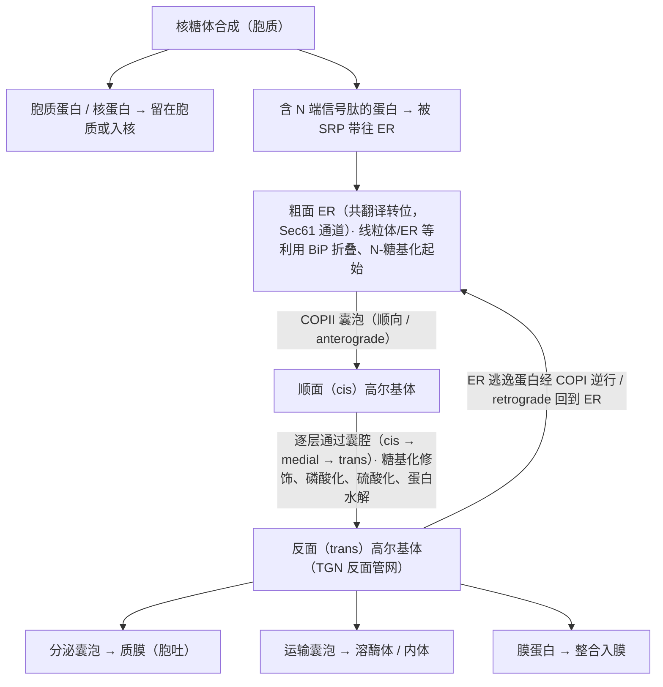
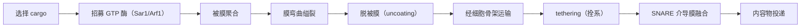

# 高尔基体与 COPI / COPII：分泌途径的运输与加工

> **一句话**：蛋白在核糖体上合成，分泌蛋白/膜蛋白在 **粗面 ER** 上边合成边转入 ER 腔；之后不再"合成"，而是被 **COPII 囊泡**运往高尔基体加工、**COPI 囊泡**把逃逸的 ER 蛋白送回去。高尔基体是**加工与分选站**，COPI/COPII 是连接它的**运输车**。

---

## 一、全景：蛋白从合成到分选

![[golgi-cop-pathway.svg]]

> **关键澄清**：**蛋白"合成"只发生在核糖体上**，且 ER 腔里完成的主要是**起始折叠与起始糖基化**。高尔基体**不合成蛋白**，它做的是**修饰加工 + 分选**；COPI/COPII 做的是**把蛋白从一个区室搬到另一个区室**。三者关系是"生产—运输—加工分选"的流水线，而非并列的三种合成方式。

---

## 二、COPII：ER → 高尔基体（顺向运输）

### 2.1 核心组成

| 成分 | 角色 |
|---|---|
| **Sar1**（小 GTP 酶） | 启动者：GTP 结合后插入 ER 膜，招募 Sec23/24 |
| **Sec23/24**（内层被膜） | 直接**选择 cargo**；Sec24 识别分选信号 |
| **Sec13/31**（外层被膜） | 形成笼状外骨架，决定囊泡形态 |
| **Sec12**（GEF） | 在 ER 膜上激活 Sar1（催化 GDP→GTP） |
| **Sec16** | 脚手架，组织 COPII 装配位点 |

### 2.2 形成循环

1. Sar1-GDP →（Sec12 作 GEF）→ Sar1-GTP
2. Sar1-GTP 插入 ER 膜，暴露疏水 N 端
3. 招募 Sec23/24（内层），Sec24 抓 cargo
4. 招募 Sec13/31（外层），形成笼状被膜
5. 膜弯曲、缢裂（fission），囊泡脱落
6. Sar1 水解 GTP → 被膜解离（uncoating）
7. COPII 囊泡经 ER-Golgi 中间体（ERGIC）运抵顺面高尔基体

### 2.3 选择性

- **信号依赖**：如 **di-acidic 基序（DXE）**、疏水基序。
- **受体介导**：分泌蛋白/膜蛋白经 cargo receptor（如 p24 家族、ERGIC-53）浓缩。
- **大小筛分**：COPII 囊泡可选择性富集 cargo。

---

## 三、COPI：高尔基体 → ER（逆行运输）

### 3.1 核心组成

| 成分 | 角色 |
|---|---|
| **Arf1**（小 GTP 酶） | 启动者：GEF（GBF1）催化激活后招募被膜 |
| **COPI 七聚体**（α/β/β'/γ/δ/ε/ζ） | 形成笼状被膜，包被囊泡 |
| **GBF1**（GEF） | 激活 Arf1 |
| **KDEL 受体** | 识别 ER 逃逸蛋白（带 KDEL 信号）并递交给 COPI |

### 3.2 两大职能

1. **逆行回收（retrieval）**：把从 ER 逃逸的驻留蛋白（BiP、calreticulin、PDI 等带 **KDEL** 信号）经 COPI 运回 ER。
   - 机制：KDEL 受体在**高尔基体低 pH** 下结合 KDEL 肽，经 COPI 逆行；到 ER 中性 pH 释放。
2. **高尔基体内部运输（intra-Golgi）**：在 cisternae 之间顺/逆向搬运，维持各层区室的酶组成。

> **易混点**：COPI 不只是"回 ER"那么简单。它同时负责**高尔基体层间运输**——这使得"囊腔成熟模型（cisternal maturation）"成为可能：高尔基体各层不是固定管道，而是不断由囊泡供给、成熟、再被回收的动态结构。

---

## 四、高尔基体：加工与分选站

### 4.1 极性结构

| 区室 | 别名 | 主要事件 |
|---|---|---|
| **CGN**（cis-Golgi network） | 顺面管网 | 接收 COPII 囊泡，初步分拣 |
| **cis 囊腔** | 顺面 | 甘露糖修饰、O-糖基化起始 |
| **medial 囊腔** | 中间 | 多数糖基化（N-糖链加工） |
| **trans 囊腔** | 反面 | 半乳糖/唾液酸添加、硫酸化 |
| **TGN**（trans-Golgi network） | 反面管网 | **最终分选**：质膜/溶酶体/分泌方向 |

### 4.2 加工反应（高尔基体"做什么"）

| 类型 | 反应 | 例子 |
|---|---|---|
| N-糖基化加工 | 修剪 Man，加 GlcNAc、Gal、唾液酸 | 成熟糖蛋白 |
| O-糖基化 | 添加 GalNAc 等 | 黏蛋白 |
| 磷酸化 | 甘露糖-6-磷酸（M6P）标记 | 溶酶体酶定向 |
| 硫酸化 | 酪氨酸/糖胺聚糖硫酸化 | 蛋白聚糖 |
| 蛋白水解 | 前体切割 | 胰岛素原→胰岛素、胶原前体 |

### 4.3 分选信号

| 目的地 | 信号 |
|---|---|
| 溶酶体 | **M6P**（甘露糖-6-磷酸） |
| 质膜 | 多种膜锚定 + 分选基序 |
|  regulated 分泌 | 聚集信号（如分泌颗粒蛋白） |
| 组成型分泌 | 默认通路（无特殊信号即去质膜） |

---

## 五、囊泡运输的通用循环（COPI/COPII 共享）

| 步骤 | 关键分子 | 说明 |
|---|---|---|
| 选择 | Sec24 / KDEL 受体 | 信号依赖的 cargo 富集 |
| 启动 | Sar1-GTP / Arf1-GTP | 小 GTP 酶锚定膜并招募被膜 |
| 成形 | Sec13/31（COPII）/ COPI 七聚体 | 笼状骨架产生曲率 |
| 缢裂 | 发动蛋白样蛋白（DRP1 样）/ 内陷 | 膜剪断 |
| 脱被 | GTP 水解 | 被膜解体以便融合 |
| 拴系 | Rab 蛋白 + tether 复合体 | 空间识别目标区室 |
| 融合 | **v-SNARE + t-SNARE** | 形成跨膜 SNARE 复合体拉合膜 |

> **核心命题**：COPI / COPII 决定"**从哪到哪**"（方向性靠被膜蛋白识别 source 区室信号），而 **Rab + SNARE** 决定"**融到哪**"。被膜管方向，SNARE 管对接。

---

## 六、方向性对比（一张表记牢）

| 特征 | **COPII** | **COPI** |
|---|---|---|
| 方向 | ER → 高尔基体（顺向） | 高尔基体 → ER（逆行）+ 高尔基体内 |
| 启动 GTP 酶 | **Sar1** | **Arf1** |
| GEF（激活因子） | **Sec12**（ER 膜） | **GBF1**（高尔基体） |
| 被膜蛋白 | Sec23/24 + Sec13/31 | α/β/β'/γ/δ/ε/ζ 七聚体 |
| cargo 选择 | Sec24 识别分选信号 | KDEL 受体等回收信号 |
| 主要功能 | 输出新合成蛋白 | 回收逃逸 ER 蛋白、维持高尔基体 |
| 疾病关联 | SEC23B 突变→先天性红细胞生成异常性贫血 | COG 复合体缺陷→先天性糖基化病（CDG） |

---

## 七、与蛋白合成的关系（整合总结）

| 阶段 | 发生地点 | 涉及装置 |
|---|---|---|
| ① 翻译（合成） | 核糖体（胞质 / ER 膜结合） | 核糖体、tRNA、mRNA |
| ② 共翻译转位 | 粗面 ER | SRP、Sec61、BiP（拉入动力） |
| ③ 起始折叠/糖基化 | ER 腔 | BiP、PDI、calnexin/calreticulin |
| ④ 顺向运输 | ER → 高尔基体 | **COPII**（Sar1） |
| ⑤ 加工/分选 | 高尔基体各层 + TGN | 糖基转移酶、M6P 标记、SNARE |
| ⑥ 逆行回收 | 高尔基体 → ER | **COPI**（Arf1、KDEL 受体） |
| ⑦ 投递 | TGN → 质膜/溶酶体 | 分泌囊泡、v/t-SNARE |

> **记忆钩子**：
> - **合成**只发生在 **①**（核糖体）；
> - **COPII 是出厂物流**（ER → Golgi）；
> - **COPI 是退货/回收物流**（Golgi → ER）；
> - **高尔基体是质检+贴标签的中央仓**；
> - 没有这些囊泡，新合成的蛋白就堆在 ER 里出不去。

---

## 八、临床与实验

| 主题 | 内容 |
|---|---|
| **SEC23B 突变** | COPII 内层组分缺陷 → 红细胞生成异常性贫血（CDA II） |
| **COG 复合体缺陷** | COPI 介导的 intra-Golgi 运输受损 → 先天性糖基化病（CDG） |
| **Sar1/Arf1 显性失活突变** | 阻断 COPII/COPI 形成 → 蛋白分泌停滞 |
| **Brefeldin A（BFA）** | 抑制 Arf1 GEF → 高尔基体崩解、COPI 运输阻断 |
| **N-乙基马来酰亚胺（NEM）** | 烷基化 NSF → 阻断 SNARE 循环 → 融合失败 |
| **实验标记** | VSV-G 蛋白（COPII cargo 经典模型）、温度敏感突变体用于同步化运输 |

---

## 九、常见误区澄清

| 误区 | 纠正 |
|---|---|
| ❌ "高尔基体合成蛋白" | ✅ 高尔基体**只加工与分选**，不合成多肽；合成只在核糖体 |
| ❌ "COPI 单向去 ER" | ✅ COPI 还负责**高尔基体内部层间运输** |
| ❌ "COPII 和 COPI 只是方向反了" | ✅ 二者被膜成分、GTP 酶、GEF 都不同，是两套独立机器 |
| ❌ "囊泡带 cargo 直接融合" | ✅ 必须先**脱被（uncoating）** 才能被 SNARE 融合 |
| ❌ "所有分泌蛋白都经经典途径" | ✅ 还有**非经典分泌**（如 IL-1β 经溶酶体/外泌体），不经 ER-Golgi |
| ❌ "ER 驻留蛋白不会离开 ER" | ✅ 它们会**少量逃逸**，靠 COPI + KDEL 受体持续回收维持稳态 |

---

## 十、要点速记

> **合成在核糖体，运输靠囊泡，加工在高尔基体**
>
> - **COPII = 出厂物流**（Sar1 启动，ER→Golgi 顺向）
> - **COPI = 退货/回收物流**（Arf1 启动，Golgi→ER 逆行 + 高尔基体内）
> - **高尔基体 = 中央仓**（糖基化、磷酸化、硫酸化、分选 M6P/质膜/分泌）
> - **方向靠被膜，对接靠 SNARE**（COPI/COPII 管从哪来，Rab+SNARE 管融到哪）
> - **蛋白只合成一次**，之后全靠囊泡搬运与酶修饰

---

## 附：关键缩写对照

| 缩写 | 全称 | 说明 |
|---|---|---|
| **SRP** | Signal recognition particle | 信号识别颗粒，导向 ER |
| **COP** | Coat protein | 被膜蛋白（COPI / COPII） |
| **Sar1** | Secretion-associated Ras superfamily 1 | COPII 启动 GTP 酶 |
| **Arf1** | ADP-ribosylation factor 1 | COPI 启动 GTP 酶 |
| **GEF** | Guanine nucleotide exchange factor | 鸟苷酸交换因子（激活小 GTP 酶） |
| **GAP** | GTPase-activating protein | 促进 GTP 水解（终止信号） |
| **ERGIC** | ER-Golgi intermediate compartment | ER-高尔基体中间体 |
| **CGN / TGN** | cis-Golgi / trans-Golgi network | 顺面/反面管网 |
| **M6P** | Mannose-6-phosphate | 溶酶体酶分拣标记 |
| **KDEL** | Lys-Asp-Glu-Leu | ER 驻留蛋白回收信号 |
| **SNARE** | Soluble NSF attachment protein receptor | 膜融合装置（v/t-SNARE） |
| **Rab** | Ras superfamily GTPase | 囊泡拴系与靶向 |
| **NSF** | N-ethylmaleimide-sensitive factor | SNARE 复合体解离 ATP 酶 |
| **CDA II** | Congenital dyserythropoietic anemia type II | SEC23B 缺陷病 |
| **CDG** | Congenital disorder of glycosylation | 先天性糖基化病 |

---

## 相关笔记

- [[Bip]] —— ER 共翻译转位与 UPR 机制
- [[ERS]] —— ER 应激的三类反应（与 COPII 运输受阻相关）
- [[动态方法]] —— 活细胞成像追踪囊泡运输
