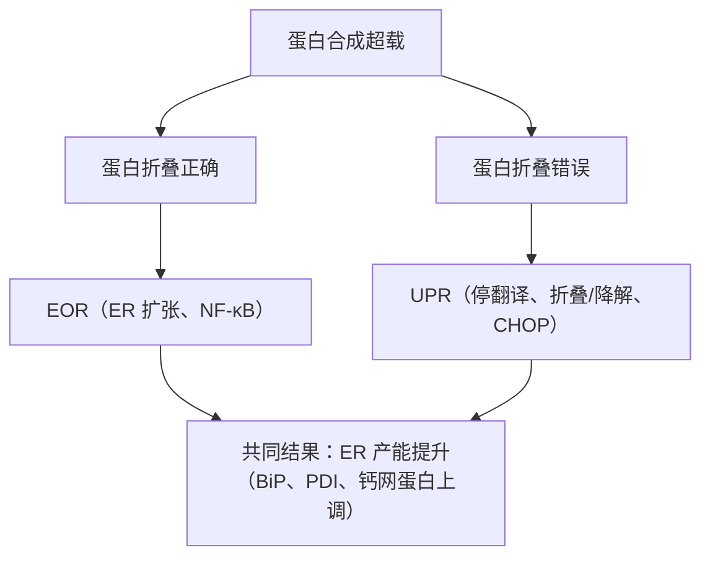
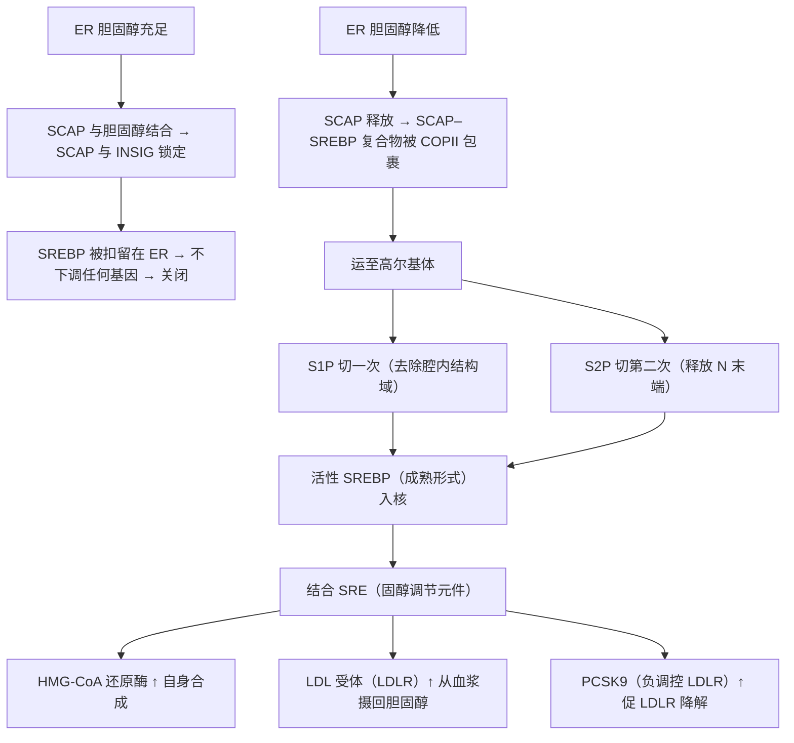

# ERS：内质网应激中的三个反应

> **内质网（ER）是"造蛋白"和"造脂"两条流水线的车间**，所以 ER 出问题时也分两类根源：**蛋白**（折不出、搬不动）与**脂**（胆固醇/磷脂不足或过量）。细胞给出的对应反应就是三个：
>
> | 反应 | 感知什么 | 核心解决 |
> |---|---|---|
> | **UPR** | 未折叠/错误折叠蛋白 | 折叠能力、降解能力 |
> | **EOR** | ER 腔内**蛋白负荷超载** | ER 体积、分泌通量 |
> | **固醇调节级联** | ER 胆固醇水平 | 胆固醇合成与摄取 |
>
> 三者共享 NF-κB / ATF 等转录枢纽，因此**常同时被激活、互相串扰**，不能简单当成三条平行线。

---

## 一、总览对比

| 维度 | **UPR**（未折叠蛋白反应） | **EOR**（ER 超载反应） | **固醇调节级联**（SREBP 通路） |
|---|---|---|---|
| 触发信号 | 未折叠蛋白（UPs）积聚 | **蛋白合成速率 > ER 加工/分泌能力**（即使折叠正确） | ER 胆固醇↓、甘油三酯↓、脂肪酸代谢变化 |
| 触发方式 | BiP 被占满 → 释放 PERK/ATF6/IRE1 | 折叠正确的蛋白太多，**不经过 BiP-UPR 轴** | SREBP/SCAP 感知胆固醇 → 移位 |
| 主要传感器 | BiP（GRP78） | NF-κB / TRAF2 等，尚在研究中 | SCAP 的 SSD 域 |
| 反应核心 | 先停翻译、后扩产能、不行就凋亡 | **扩大 ER 膜面积 + 上调分泌通路** | 上调 HMG-CoA 还原酶、LDLR 合成 |
| 时间尺度 | 秒~小时（可逆） | 小时级 | 小时~天 |
| 典型诱导剂 | **Tunicamycin**（阻断 N-糖基化）、Thapsigargin、DTT | **单纯过表达正确折叠的分泌蛋白**（如过表达胰岛素原、白蛋白、免疫球蛋白） | 甲羟戊酸缺乏、LDL 缺乏、环糊精抽提胆固醇 |
| 结局 | 适应 / 凋亡 | 适应为主（较少凋亡） | 代谢稳态恢复 |
| 关键转录因子 | ATF6、XBP1s、ATF4/CHOP | NF-κB、ATF6（重叠） | SREBP-2（胆固醇）、SREBP-1（脂肪酸/甘油三酯） |

![[ers-three-pathways.svg]]

---

## 二、UPR（未折叠蛋白反应）

> 详见 [[Bip]]。这里只作定位性总结。

**核心逻辑**：BiP 结合位点被未折叠蛋白占满 → 三个 ER 膜感受器（PERK、ATF6、IRE1）获得自由 → 三条支路。

| 支路 | 传感器 | 分子事件 | 功能 |
|---|---|---|---|
| **ATF6** | ATF6（90 kDa） | 运至高尔基体，被 S1P/S2P 双切成活性片段 → 入核 | 上调 BiP、PDI、ERp57、钙网蛋白 |
| **IRE1** | IRE1α/β | 寡聚化 → 内切核酸酶活性 → **剪接 XBP1 mRNA**（移码） | XBP1s 上调折叠酶、ERAD、脂质合成 |
| **PERK** | PERK | 自磷酸化 → 磷酸化 eIF2α → 全局翻译抑制 | 少数 mRNA 逃逸翻译：ATF4 → CHOP（凋亡开关） |

**关键特征**：UPR 感知的是 **BiP 的占用率**，不是蛋白总量。**折叠有问题的蛋白少而正确**时，UPR 不激活——这正是 EOR 存在的理由。

---

## 三、EOR（ER Overload Response，内质网超载反应）

### 3.1 定义与核心特征

EOR 指 **分泌蛋白合成速率超过 ER 加工与分泌能力**时启动的反应，**关键点在于这些蛋白本身折叠正常**。

| 特征 | 说明 |
|---|---|
| **不经过 UPR/BiP 轴** | 蛋白折叠正确，不占用 BiP 折叠位点 |
| **激活 NF-κB** | 通过非经典通路（常涉及 p50/p65 核易位） |
| **与 UPR 有交集** | 两者都上调 BiP、部分共享 ATF6 |
| **诱导 ER 扩张** | 增加 ER 膜面积以提升分泌通量 |
| **可独立于 CHOP** | EOR 通常不引发凋亡，以适应性为主 |

### 3.2 触发与实验证据

经典实验：在细胞中**过表达正确的分泌蛋白**（如胰岛素原、白蛋白、Ig 轻链），观察到：
- ER 膜面积显著扩张；
- BiP 与 PDI 表达上调；
- NF-κB 活化；
- **但不伴随 UPR 标志性变化**（如 XBP1 剪接、eIF2α 磷酸化程度较轻）。

> **生理对应**：浆细胞大量分泌抗体、胰腺 β 细胞大量分泌胰岛素、肝细胞分泌白蛋白时的**产能瓶颈**——蛋白本身没问题，是"**订单量**"压垮了车间。

### 3.3 与 UPR 的关系

> **易混点**：很多教材把 EOR 直接归入 UPR 讨论。严格说二者是**平行且可重叠**的两套反应——UPR 问"折得好不好"，EOR 问"订单多不多"。

---

## 四、固醇调节级联（SREBP 通路）

### 4.1 核心逻辑：胆固醇多了就"不许再合成"

细胞需要精确控制膜胆固醇水平，**感知点在 ER**——但合成车间在**胞质**（HMG-CoA 还原酶）。ER 如何远程调控？答案是 **SREBP/SCAP 穿梭机制**。

### 4.2 SREBP 家族分工

| 成员 | 主要调控 | 靶基因 |
|---|---|---|
| **SREBP-1a** | 胆固醇 + 脂肪酸 | 兼而有之 |
| **SREBP-1c** | **脂肪酸 / 甘油三酯合成** | 脂肪酸合成酶、ACC、SCD1 |
| **SREBP-2** | **胆固醇** | **HMG-CoA 还原酶（HMGCR）**、LDLR、PCSK9 |

### 4.3 三种 SREBP 加工方式（注意区分）

| 加工方式 | 触发条件 | 切割酶 | 产物 |
|---|---|---|---|
| **经典固醇调节** | ER 胆固醇↓ | S1P + S2P（在高尔基体） | 核形式 nSREBP |
| **应激应急加工** | ER 应激、ER 胆固醇耗竭 | S1P + S2P（**直接在 ER 膜上**） | 核形式 nSREBP |
| **ER 应激降解** | ER 应激、胆固醇正常 | 蛋白酶体（ERAD 相关） | 被降解，通路关闭 |

> **关键易混点**：ERS 条件下 SREBP 的命运取决于**胆固醇水平**。胆固醇耗竭 → 应急加工、上调合成；胆固醇正常而 ER 应激 → SREBP 被降解。这就是"脂应激"与"蛋白应激"在 SREBP 层面的分岔。

### 4.4 与临床的直接联系

| 靶点/药物 | 作用 | 意义 |
|---|---|---|
| **他汀类**（抑制 HMGCR） | 阻断胆固醇合成 | 第一线降脂药 |
| **依折麦布** | 抑制肠道胆固醇吸收 | 减少外源摄入 |
| **PCSK9 抑制剂**（单抗） | 阻止 LDLR 降解 | LDL 大幅下降 |
| SREBP-1c 过表达 | 脂肪肝、胰岛素抵抗 | 代谢病机制 |
| SREBP-2 激活 | 肿瘤生长需胆固醇 | 抗肿瘤靶点 |

---

## 五、三个反应的比较与整合

### 5.1 一张图看懂"感知对象"的差别

| 车间状态 | 激活反应 |
|---|---|
| 蛋白折坏了 | **UPR**（BiP 被占） |
| 蛋白订单太多但折得好 | **EOR**（NF-κB、ER 扩张） |
| 原料（胆固醇）不够 | **固醇调节级联**（SREBP 移位） |
| 蛋白折坏 + 订单多 | UPR + EOR **共同激活** |

### 5.2 交叉点

| 交叉分子 | 在三个反应中的角色 |
|---|---|
| **ATF6** | UPR 核心传感器；EOR 中也参与上调产能 |
| **NF-κB** | EOR 核心；ER 应激时也可被 UPR 间接激活 |
| **BiP** | UPR 核心；固醇调节中不受直接影响 |
| **S1P / S2P** | 切 ATF6（UPR）**也**切 SREBP（固醇调节）——**同一对蛋白酶，两套底物** |
| **IRE1** | 除剪 XBP1 外，还调控脂质合成基因 → 与固醇调节相连 |
| **ER 脂质组成** | 脂质异常本身可影响 BiP 功能 → 脂应激反向触发 UPR |

### 5.3 诱导剂对照（实验设计直接可用）

| 诱导剂 | 主要触发反应 | 机制 |
|---|---|---|
| **Tunicamycin** | UPR | 抑制 GlcNAc-1-磷酸转移酶 → 阻断 N-糖基化 → 折叠崩溃 |
| **Thapsigargin** | UPR（伴 Ca²⁺ 耗竭） | 抑制 SERCA → ER Ca²⁺ 排空 → 钙依赖折叠酶失活 |
| **2-巯基乙醇 / DTT** | UPR | 还原剂，破坏二硫键形成 |
| **过表达分泌蛋白** | **EOR** | 产能过载（蛋白本身折叠正确） |
| **β-巯基乙醇** | EOR | 增加蛋白输出需求 |
| **甲羟戊酸耗尽 / 甲羟戊酸缺乏** | 固醇调节级联 | 阻断胆固醇合成 → ER 胆固醇↓ → SREBP 活化 |
| **环糊精抽提胆固醇** | 固醇调节级联 | 直接从膜抽走胆固醇 |
| **T0901317**（LXR 激动剂） | 固醇调节级联 | 上调脂肪酸合成，间接抑制 SREBP-2 |

---

## 六、要点速记

> **ER 出问题分两类：蛋白问题和脂问题。**
>
> 1. **UPR**：蛋白折坏了 → BiP 占满 → PERK/ATF6/IRE1 → 停翻译、扩产能、不行凋亡
> 2. **EOR**：订单太多但折得好 → NF-κB + ER 扩张 → **不经过 BiP 轴**
> 3. **固醇调节级联**：ER 胆固醇降 → SCAP 释放 SREBP → 运高尔基体被 S1P/S2P 切开 → 上调 HMGCR、LDLR
>
> **一个关键分岔**：ERS 下 SREBP 命运取决于胆固醇水平——不够就活化，够就被降解。
>
> **一对共用的刀**：S1P/S2P 既切 ATF6（UPR）也切 SREBP（固醇调节）。

---

## 附：关键缩写对照

| 缩写 | 全称 | 说明 |
|---|---|---|
| **ER** | Endoplasmic reticulum | 内质网 |
| **ERS** | ER stress | 内质网应激 |
| **UPR** | Unfolded protein response | 未折叠蛋白反应 |
| **EOR** | ER overload response | ER 超载反应 |
| **UPs** | Unfolded proteins | 未折叠蛋白 |
| **SREBP** | Sterol regulatory element-binding protein | 固醇调节元件结合蛋白 |
| **SCAP** | SREBP cleavage-activating protein | SREBP 切割激活蛋白 |
| **INSIG** | Insulin-induced gene protein | 扣留 SREBP 的 ER 锚定蛋白 |
| **SSD** | Sterol-sensing domain | 固醇感知域（SCAP 感知胆固醇的部位） |
| **SRE** | Sterol response element | SREBP 结合的 DNA 序列 |
| **S1P / S2P** | Site-1 / Site-2 protease | 高尔基体蛋白酶 |
| **HMGCR** | HMG-CoA reductase | 胆固醇合成限速酶（他汀靶点） |
| **LDLR** | Low-density lipoprotein receptor | LDL 受体 |
| **PCSK9** | Proprotein convertase subtilisin/kexin type 9 | 促 LDLR 降解 |
| **BiP / GRP78** | Binding immunoglobulin protein | UPR 核心传感器 |
| **CHOP** | C/EBP homologous protein (DDIT3) | UPR 促凋亡因子 |
| **ERAD** | ER-associated degradation | ER 相关降解 |
| **LXR** | Liver X receptor | 胆固醇/脂肪酸感受核受体 |
| **NF-κB** | Nuclear factor kappa B | EOR 核心转录因子 |

---

## 相关笔记

- [[Bip]] —— UPR 的核心传感器与分子伴侣机制
- [[膜电位]] —— 跨膜转运与电化学梯度
- [[动态方法]] —— 活细胞成像与动态研究技术
