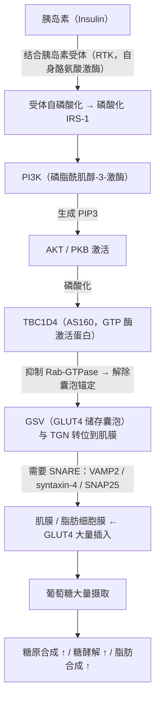
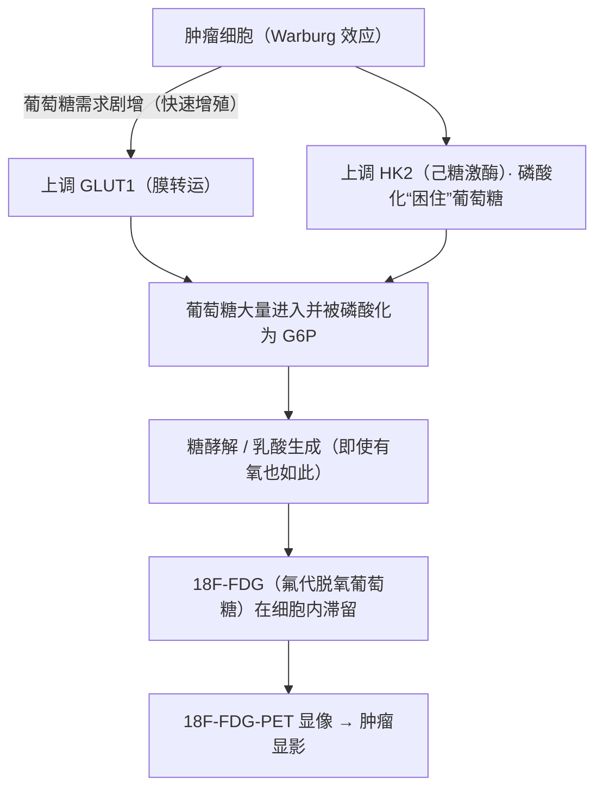

# GLUT 家族（葡萄糖转运蛋白家族）

> **核心命题**：GLUT（Glucose Transporter，**SLC2A 家族**）是哺乳动物细胞膜上的**钠不依赖性葡萄糖转运体**，采用**易化扩散（facilitated diffusion）**机制。共有 **13 个功能亚型（GLUT1–GLUT14）**，序列相似但**组织分布、底物特异性和调控方式截然不同**。
>
> 三条主线：
> - **结构上高度保守**：均为 **12 次跨膜螺旋（12-TM）**，折叠成同一个基本构象
> - **功能上分工明确**：分别负责葡萄糖、果糖、UDP-葡萄糖、尿酸等不同底物的跨膜转运
> - **调控上分层级**：只有 **GLUT4** 是**胰岛素应答性**的（唯一可被激素急性调控），其余为"基础型"转运体

---

## 一、家族概览

### 1.1 基本特征

| 项目 | 内容 |
|---|---|
| **家族命名** | **SGLT**（Sodium-Glucose Linked Transporter，钠-糖协同转运体） **GLUT**（Glucose Transporter，易化扩散型） |
| **基因家族** | **SLC2A**（Solute Carrier family 2A） |
| **亚型数量** | 哺乳动物 **13 个功能亚型**（GLUT1–GLUT12 + GLUT13）；另有 **GLUT4 假基因** |
| **蛋白大小** | **45–55 kDa**（约 500 个氨基酸） |
| **跨膜结构** | **12 次跨膜 α-螺旋（TM1–TM12）**；N 端和 C 端均在**胞质侧** |
| **转运方式** | **易化扩散**（顺浓度梯度，**不耗 ATP、不耦合 Na⁺**），**可逆** |
| **特异性** | 底物之间可区分但**不完全**（多数亚型也能转运其他己糖） |

> ⚠️ **最关键的区分**：**GLUT vs SGLT**
>
> | | **GLUT** | **SGLT** |
> |---|---|---|
> | 基因 | **SLC2A** | **SLC5A**（含 SGLT1/SGLT2） |
> | 机制 | **易化扩散**（被动、**不耗能**） | **Na⁺-葡萄糖协同转运**（**主动**，耗能） |
> | 方向 | 顺浓度梯度，**双向** |逆梯度，**单向** |
> | 部位 | **细胞膜** | **小肠上皮刷状缘**、**肾小管近曲小管** |
> | 代表 | **GLUT4**（肌肉/脂肪） | **SGLT1**（肠道）、**SGLT2**（肾，**SGLT2 抑制剂是重要降糖药**） |

### 1.2 三个亚类（基于序列同源性）

现代分类不再简单按编号，而是按**序列同源性 + 顶膜定位**分为三亚类：

| 亚类 | 成员 | 结构特征 | 共同功能 |
|---|---|---|---|
| **Class I（经典型）** | **GLUT1、GLUT2、GLUT3、GLUT4** | **顶膜型**（basolateral-type），有**糖基化位点**位于细胞外环 | **葡萄糖**转运；参与**代谢稳态与神经功能** |
| **Class II** | **GLUT5、GLUT7、GLUT9、GLUT11** | 顶膜型，但部分为**酸性的胞内转运体** | **果糖**（GLUT5/7/11）、**尿酸**（GLUT9） |
| **Class III** | **GLUT6、GLUT8、GLUT10、GLUT12** | 含**糖基化序列或溶酶体定位**信号；GLUT8 有**核定位信号（NLS）** | **核内/细胞器内**代谢，UDP-糖转运等 |

> 📌 **历史沿革**：早期按编号 GLUT1–GLUT5；1990 年代 Glaser 实验室通过系统发育分析发现分成三亚类，这套分类沿用至今。

---

## 二、结构：12 次跨膜螺旋

![[glut-topology-transport.svg]]

> **上半部分**：GLUT 的 12-TM 拓扑。紫色为 12 条跨膜螺旋，深紫横带为**中央四螺旋束（底物通道）**，橙色圆点标记 **TM11 的 N-I 位点**与 **TM7 的 Q 位点**——它们与 TM8 的 GL/GE 共同组成**家族保守三联体**。上方为含糖基化位点的胞外环（形成糖萼），下方为含核定位信号的长胞质环。
>
> **下半部分**：**交替进入机制**。外向开放（Of，胞质环闭合）与内向开放（If，外侧环闭合）交替出现，两个 6-TM 单元相对滑动（电梯机制）。**绝不让两侧同时开放**——防止质子/水短路。这决定了 GLUT 只能做**易化扩散**：不耗 ATP、可逆、不浓缩。

### 2.1 拓扑模型的确立

**Mueckler 等（1994, Neuron）** 用**水合性分析（hydropathy analysis）+ 表位定位实验（epitope mapping）** 证明：GLUT1 为 **12-TM 拓扑**，N/C 端均在胞质。

> 这是一个**方法论经典**：当时无法确定膜蛋白三维结构，只能靠"疏水性轮廓 + 抗体 epitope 定位 + 蛋白酶保护实验"组合推断拓扑。现代可以直接用冷冻电镜验证。

### 2.2 跨膜螺旋的分组

<svg viewBox="0 0 700 312" width="100%" style="max-width:700px;height:auto;display:block;margin:1rem auto" xmlns="http://www.w3.org/2000/svg">

  <text x="350" y="22" text-anchor="middle" font-size="13" stroke="none">胞外（Extracellular）</text>
  <text x="350" y="46" text-anchor="middle" font-size="10" stroke="none">胞外环 E1 · 糖基化位点 N-X-S/T（形成糖萼）</text>

  <rect x="24" y="68" width="652" height="150" fill="var(--lightgray)" opacity="0.16"/>
  <line x1="24" y1="68" x2="676" y2="68" stroke="currentColor" stroke-width="1" opacity="0.55"/>
  <line x1="24" y1="218" x2="676" y2="218" stroke="currentColor" stroke-width="1" opacity="0.55"/>

  <g stroke="currentColor" stroke-width="1.6" fill="none">
    <ellipse cx="52" cy="143" rx="10" ry="62"/>
    <ellipse cx="100" cy="143" rx="10" ry="62"/>
    <ellipse cx="148" cy="143" rx="10" ry="62"/>
    <ellipse cx="196" cy="143" rx="10" ry="62"/>
    <ellipse cx="244" cy="143" rx="10" ry="62"/>
    <ellipse cx="292" cy="143" rx="10" ry="62"/>
    <ellipse cx="408" cy="143" rx="10" ry="62"/>
    <ellipse cx="456" cy="143" rx="10" ry="62"/>
    <ellipse cx="504" cy="143" rx="10" ry="62"/>
    <ellipse cx="552" cy="143" rx="10" ry="62"/>
    <ellipse cx="600" cy="143" rx="10" ry="62"/>
    <ellipse cx="648" cy="143" rx="10" ry="62"/>

    <path d="M292,81 Q350,52 408,81"/>
    <path d="M456,218 Q480,244 504,218"/>
  </g>

  <g fill="currentColor" stroke="none">
    <circle cx="408" cy="143" r="4"/>
    <circle cx="456" cy="143" r="4"/>
    <circle cx="600" cy="143" r="4"/>
  </g>

  <g font-size="8.5" text-anchor="middle" stroke="none">
    <text x="52" y="232">TM1</text>
    <text x="100" y="232">TM2</text>
    <text x="148" y="232">TM3</text>
    <text x="196" y="232">TM4</text>
    <text x="244" y="232">TM5</text>
    <text x="292" y="232">TM6</text>
    <text x="408" y="232">TM7</text>
    <text x="456" y="232">TM8</text>
    <text x="504" y="232">TM9</text>
    <text x="552" y="232">TM10</text>
    <text x="600" y="232">TM11</text>
    <text x="648" y="232">TM12</text>
  </g>

  <text x="480" y="266" text-anchor="middle" font-size="10" stroke="none">胞内长连接环 I1 · 含 NLS（GLUT8）</text>
  <text x="24" y="286" font-size="9" stroke="none">⊙ 关键底物结合残基：Q（TM7）、GL+GE（TM8）、N-I（TM11），共同组成家族保守三联体</text>
  <text x="350" y="306" text-anchor="middle" font-size="13" stroke="none">胞质（Cytoplasm）</text>
</svg>

*上图：12-TM 拓扑——中央结合区由 TM7（Q）、TM8（GL/GE）、TM11（N-I）组成；TM6–TM7 的胞外环带糖基化位点，TM8–TM9 的胞内环最长并含 NLS。*

| 结构域 | 跨膜区段 | 关键残基 / 功能 |
|---|---|---|
| **N 端** | 胞质 | 短，糖基化位点（部分亚型）；GLUT4 的 N 端含**胰岛素调节序列**相关区域 |
| **胞外连接环 E1** | TM6–TM7 之间 | **含 N-糖基化位点**（N-X-S/T），形成**糖萼**（glycocalyx），决定与血脑屏障/转运体相互作用 |
| **中央结合区** | **TM7（Q）–TM8（GL/GE）–TM11（N-I）** | ⭐ **底物结合的核心三联体** |
| **胞内连接环 I1** | TM8–TM9 之间 | 长；含 **N 端 NLS**（GLUT8）；决定**亚细胞定位** |
| **C 端** | 胞质 | 短；可能含糖基化位点（GLUT4 除外） |

### 2.3 保守性最强的三个位点：家族特征序列

| 位点 | 位置 | 残基 | 作用 | 突变后果 |
|---|---|---|---|---|
| **Q 位点** | **TM7** | **谷氨酰胺（Q）** | 直接参与底物氢键；是**质子/水耦合**的关键 | Q 突变（GLUT1 Q282）→ **完全丧失转运活性** |
| **GL/GE 位点** | **TM8** | 甘氨酸-亮氨酸 / 谷氨酸 | 结合底物 | 突变 → Km 大幅上升 |
| **N-I 位点** | **TM11** | **天冬酰胺（N）-异亮氨酸（I）** | 糖基化位点相邻；**家族特征基序（signature motif）**，用于序列分类 | 突变 → 破坏折叠与转运 |

> 🔑 **家族分类学依据**：这三个保守位点（尤其 **TM11 的 N-I 基序**）是划分 Class I/II/III 的序列依据。**人 GLUT 的功能亚型在进化上高度保守，但组织分布与调控是各亚型的分化点。**

### 2.4 三维结构

| 研究 | 年份 | 贡献 |
|---|---|---|
| **GLUT1-1 与 BODIPY-精氨酸复合物** X 射线晶体结构（**Kaplan / Xue / Oguno 等，Nature**） | **2015** | 首个 GLUT 高分辨率结构；**外向开放构象（outward-facing, Of）**，分辨率约 3 Å；揭示底物从胞质侧进入的通路 |
| **apo GLUT1-1 结构**（Chacan 等 / Hearne 等） | 2015–2017 | **内向开放构象（inward-facing, If）**；确认为 **"elevator（电梯）/ 对称性交替"** 机制 |
| **冷冻电镜（cryo-EM）** | 2017 至今 | 多个亚型与底物/抑制剂复合物的高分辨率结构；**分子动力学（MD）模拟**揭示转运循环 |

**结构要点**
- 12 条 TM 组成**两个结构域**：TM1–TM6 为一个 6-TM 单元，TM7–TM12 为另一个，二者通过转运循环**相对滑动**
- **中央 4 螺旋束（TM4、TM5、TM7、TM11）** 围成底物通道；TM11 的 N 侧链与 Q 共同"夹住"葡萄糖
- **外侧连接环 E1** 折叠覆盖在转运体顶部，是糖萼与细胞外环境（糖基化）的接触面

### 2.5 转运机制：交替进入模型

| 概念 | 含义 |
|---|---|
| **交替进入（alternating access）** | 转运体**绝不让底物两侧同时开放**——防止质子/水短路 |
| **C1 / C3 构象** | C1：胞质环闭合、外侧开放；C3：外侧环闭合、胞质开放 |
| **"电梯"机制（elevator mechanism）** | 两个 6-TM 单元像电梯一样**相对滑动**，中央 4-螺旋束保持相对固定 |
| **可逆性** | 浓度梯度反向时，转运方向反转——**不消耗能量** |
| **净效应** | 只是**加快扩散**，不改变**稳态浓度分布** |

> 💡 **易化扩散的本质**：GLUT 只能**加快**葡萄糖跨膜的速率，**不能逆梯度浓缩**。这解释了为什么**GLUT 的作用不能被 SGLT 替代**——后者能逆梯度主动转运。

---

## 三、13 个亚型逐一详解

### 3.1 总览对照表

| 亚型 | 基因 | 组织分布 | 主要底物 | Km（葡萄糖） | 特征 | 疾病关联 |
|---|---|---|---|---|---|---|
| **GLUT1** | **SLC2A1** | 红细胞、血脑屏障、胎盘、多数组织 | 葡萄糖 | **1.5–2.6 mM** | 基础型；**肿瘤高表达**；**糖酵解标志物** | **GLUT1 缺陷综合征**、癫痫、肿瘤 |
| **GLUT2** | **SLC2A2** | 肝、**胰岛β细胞**、肾小管、肠上皮基底外侧 | 葡萄糖 | **~17 mM**（**高 Km**，低亲和力） | **"葡萄糖感受器"**；**高容量** | **Fanconi-Bickel 综合征** |
| **GLUT3** | **SLC2A3** | **神经元**、胎盘、小脑 | 葡萄糖 | **1.4–1.6 mM**（**高亲和力**） | 脑葡萄糖转运主力；**2-DG 高摄取** | **GLUT3 缺陷综合征**、发育迟缓 |
| **GLUT4** | **SLC2A4** | **骨骼肌**、**脂肪**、心肌 | 葡萄糖 | **~5 mM** | ⭐ **唯一胰岛素应答性**；**胰岛素调节型储存囊泡** | **2 型糖尿病**、胰岛素抵抗 |
| **GLUT5** | **SLC2A5** | **小肠刷状缘**、**精子** | **果糖** | 葡萄糖不转运 | 果糖专属；**精子获能** | 果糖不耐受 |
| **GLUT6** | **SLC2A6** | 脑（曾标注为假基因） | 己糖 | — | 近年发现为**功能糖基化转运体**；与 **HK3**、**GUT1** 偶联 | 神经功能 |
| **GLUT7** | **SLC2A7** | **内质网、线粒体**、肝 | **果糖-2-磷酸** | — | **细胞器内**糖代谢；**酸度依赖** | 糖代谢紊乱 |
| **GLUT8** | **SLC2A8** | 脂肪、肝、肾、**细胞核** | **果糖** | — | ⭐ **含核定位信号（NLS）**；**核果糖代谢**；与**应激颗粒**相关 | 代谢紊乱、应激 |
| **GLUT9** | **SLC2A9** | **肾小管**、肝、肠 | **尿酸（urate）** | — | ⭐ **URAT1**；**尿酸转运体（阴离子交换）**；**与痛风直接相关** | **痛风**、尿酸肾结石、**低尿酸血症** |
| **GLUT10** | **SLC2A10** | 骨骼、软骨、结缔组织 | **UDP-葡萄糖** | — | 为**糖基化反应供底物**（糖基化原料通道） | 2 型糖尿病关联 |
| **GLUT11** | **SLC2A11** | **心肌**、骨骼肌、肾 | **果糖-3-磷酸** | — | 肌肉能量代谢；**溶酶体靶向** | **扩张型心肌病** |
| **GLUT12** | **SLC2A12** | 脂肪、心、结肠 | 己糖 |较高 | 替代型 GLUT1；**胰岛素应答性（类似 GLUT4）** | 压力性青光眼可能相关 |
| **GLUT13** | **SLC2A13** | 脑 | — | — | 长期标注为**假基因**，现发现有表达 | 神经功能 |

---

### 3.2 GLUT1（SLC2A1）——"通用供能者"

| 维度 | 内容 |
|---|---|
| **组织分布** | **红细胞**（成熟红细胞唯一的糖来源）、**血脑屏障**（脑毛细血管内皮基底外侧）、**胎盘**、脂肪、肌肉、肾；**几乎所有组织** |
| **底物** | 葡萄糖（高亲和力，Km 1.5–2.6 mM）；也能转运 **2-脱氧葡萄糖（2-DG）**、**脱氧胆酸**等 |
| **关键特性** | 基础型表达，**不受胰岛素调控**；**膜上常驻**，半衰期长 |
| **生理作用** | ① 保证红细胞 ATP（红细胞无线粒体，**只能靠糖酵解**） ② 为脑提供葡萄糖（**血脑屏障的"门控"**） ③ 多数细胞的**基础糖摄取** |
| **病理意义** | 🟢 **肿瘤标志物**：多数实体瘤（**Warburg 效应**）高表达 GLUT1 → **FDG-PET** 显像的分子基础 🔴 **GLUT1 缺陷综合征（GLUT1DS1 / De Vivo 病）**：SLC2A1 杂合突变，轻度高血糖 + 癫痫 + 运动发育迟缓 + 低 CSF 葡萄糖 🔴 表达升高与**癫痫**（尤其婴儿期）、**肿瘤预后不良**相关 |

> 🧠 **记忆点**：**红细胞 + 脑** 是 GLUT1 的两个标志性岗位。
> **FDG-PET 显像能看肿瘤，就是因为肿瘤细胞像红细胞一样"贪吃糖"——高表达 GLUT1（+ HK2）**。

---

### 3.3 GLUT2（SLC2A2）——"葡萄糖感受器"

| 维度 | 内容 |
|---|---|
| **组织分布** | **肝细胞**、**胰岛 β 细胞**、肾小管上皮、**肠上皮基底外侧** |
| **底物** | 葡萄糖（**高 Km，~17 mM——低亲和力、高容量**） |
| **关键特性** | **Km 极高** →只有当血糖**大幅升高**时才开始大量转运 → 使 β 细胞能**感知血糖浓度** |
| **生理作用（核心）** | ⭐ **胰岛 β 细胞的"葡萄糖感受器"**： 低血糖时血糖 < 5 mM → GLUT2 转运少，**葡萄糖激酶（sensor）活性低** → 不分泌胰岛素 高血糖时血糖 > 10 mM → GLUT2 转运多 → **代谢流增大** → ATP/ADP 比值升高 → **K_ATP 通道关闭** → **Ca²⁺ 内流** → **胰岛素分泌** |
| **病理意义** | 🔴 **Fanconi-Bickel 综合征**（SLC2A2 突变）：肝肾糖原贮积病 + **肾性 Fanconi 综合征** + 低血糖 🔴 肝细胞 GLUT2 表达下调 → **胰岛素抵抗** |

> 🧠 **记忆点**：**GLUT2 的高 Km 是"设计出来的"**——它让 β 细胞只在高血糖时满负荷工作，实现**"血糖阈值式"的胰岛素分泌开关**。这是理解 **SGLT2 抑制剂**（达格列净等）药理的钥匙：**它们专攻肾小管的 SGLT2**，而非 GLUT2。

---

### 3.4 GLUT3（SLC2A3）——"神经专用"

| 维度 | 内容 |
|---|---|
| **组织分布** | **神经元（尤其小脑）**、**血脑屏障内皮**、胎盘；**脑内表达最高的 GLUT** |
| **底物** | 葡萄糖（**Km 1.4–1.6 mM，高亲和力**）；**2-DG 摄取能力极强** |
| **关键特性** | 对葡萄糖亲和力高于 GLUT1，在**低血糖**时仍能高效摄取 |
| **生理作用** | **脑神经元的主要葡萄糖转运体**；保证大脑在血糖波动时优先获得葡萄糖 |
| **病理意义** | 🔴 **GLUT3 缺陷综合征（GLUT3DS1）**：SLC2A3 突变 → 发育迟缓、**难治性癫痫**、小脑萎缩 🟢 **肿瘤**：GLUT3 高表达与**肺癌、乳腺癌预后**相关 🟢 **FDG-PET 的第二靶点**（GLUT3 对 2-DG 亲和力高，脑显像基础） |

> 🧠 **记忆点**：**脑 = GLUT3**，**红细胞/脑屏障 = GLUT1**。两者分工明确。

---

### 3.5 GLUT4（SLC2A4）——⭐ 唯一胰岛素应答的转运体

这是整个家族**调控机制最复杂、研究最深入**的亚型。

| 维度 | 内容 |
|---|---|
| **组织分布** | **骨骼肌**、**脂肪组织**、心肌（**胰岛素敏感组织**） |
| **底物** | 葡萄糖（Km ~5 mM） |
| **关键特性** | ⭐ **胰岛素应答性（insulin-responsive）**：静息时主要在**细胞内囊泡**中，胰岛素刺激后**转位到细胞膜** |
| **半衰期** | 膜上 GLUT4半衰期仅 **~30 min**（迅速被内吞回收） |

#### 胰岛素调控的分子级联

#### 两种互相独立的调控途径

| 途径 | 触发 | 信号通路 | 意义 |
|---|---|---|---|
| **胰岛素途径** | 胰岛素 → 胰岛素受体 | IRS-1 → PI3K → AKT → TBC1D4 | 餐后血糖摄取 |
| **运动/收缩途径** | **肌收缩** | **AMPK**、**CaMK**、**NO/cGMP**、**Rac1** | ⚠️ **不依赖胰岛素受体**！运动时血糖摄取**独立**于胰岛素 |
| **温度/应激** | 热休克 | 急性可独立于胰岛素 | 烧伤/危重症时血糖耐受 |

> 💡 **运动与胰岛素"协同但不依赖"**——这解释了为什么 **2 型糖尿病患者运动仍能降血糖**，即使胰岛素信号受损。

#### 囊泡组装的分子部件

| 部件 | 作用 |
|---|---|
| **GSV（GLUT4 Storage Vesicle）** | 储存 GLUT4 的专用囊泡；**表达 sortilin**，与 dystrophin 相关 |
| **IRAP（胰岛素调节氨基肽酶）** | GSV 上的**支架蛋白**，识别胰岛素调节序列（IRS）；pH 依赖（pH 6.5） |
| **TUG（tethering factor for UNC-93-like protein, TUG）** | 连接 GSV 到 **syntaxin-4**；**TUG 蛋白本身是脂肪中 GLUT4 转位所必需** |
| **HOPS / FHOPS 复合体** | 靶向 SNARE，介导 GSV 停泊 |
| **DMT/IRAP 相关蛋白** | 定位与分选 |

#### 病理意义

| 疾病 | GLUT4 相关机制 |
|---|---|
| **2 型糖尿病** | GLUT4 转位**受损** → 骨骼肌与脂肪**胰岛素抵抗**（不是"受体缺陷"） |
| **特发性胰岛素抵抗综合征** | GLUT4（或其他胰岛素作用环节）基因突变 |
| **TUG 敲除小鼠** | 脂肪细胞 GLUT4 转位缺陷 → **瘦素抵抗** |
| **运动性胰岛素抵抗** | 长期高脂饮食后 GLUT4 表达下降 |

> 🧠 **记忆点**：**GLUT4 是唯一"由激素控制"的糖转运体**。它是理解**胰岛素抵抗**这一核心病理概念的最直接模型。

---

### 3.6 GLUT5（SLC2A5）——"果糖专属通道"

| 维度 | 内容 |
|---|---|
| **组织分布** | ⭐ **小肠上皮刷状缘（apical）**；**精子尾部**；乳腺 |
| **底物** | **果糖（fructose）**——**几乎不转运葡萄糖** |
| **关键特性** | **底物专一性极高**；不参与葡萄糖转运；**独立于 GLUT2** |
| **生理作用（1）** | **膳食果糖吸收**：果糖 → **GLUT5** → 肠上皮 → 底侧 → **GLUT2** → 血液（**底侧膜才有 GLUT2**） → 解释"果糖吸收通路与葡萄糖不同" |
| **生理作用（2）** | ⭐ **精子获能（capacitation）**：精子获能过程中 **GLUT5 上调**，为精子提供能量以完成受精 |
| **临床意义** | 果糖不耐受（遗传性果糖不耐受：ALDOB 缺陷，与 GLUT5 无关） **GLUT5 高表达与肿瘤**（部分肿瘤以果糖为燃料）相关 |

> ⚠️ **注意区分**：
> - **果糖不耐受**（ALDOB 醛缩酶 B 缺陷）——是**代谢酶**病，不是 GLUT5 病
> - **GLUT5** 是**转运体**，只负责把果糖送进细胞

---

### 3.7 GLUT8（SLC2A8）——"核内的果糖通道"

| 维度 | 内容 |
|---|---|
| **组织分布** | 脂肪、**肝细胞核**、肾、肠、**细胞核**；多个亚型（GLUT8a1/a2/a3） |
| **底物** | **果糖**；也转运葡萄糖 |
| **关键特性** | ⭐ **含有两个核定位信号（NLS）**——在**第 1102–1117 位氨基酸**（另有报道的 N 端区域） |
| **生理作用** | **核内果糖代谢**：核内有独立于胞质的糖代谢；GLUT8 把果糖送入细胞核，为核内反应供能 |
| **病理意义** | 与**应激颗粒（stress granules）**相关；GLUT8 在应激状态下从胞质转位到核内；代谢紊乱相关研究正在积累 |

> 💡 **GLUT8 的意义**：它是唯一被证实**功能性地进入细胞核**的 GLUT，把"膜转运体"的经典模型推向新层次。

---

### 3.8 GLUT9（SLC2A9）——"尿酸转运体（URAT1）"

这是与**痛风**直接相关的亚型，临床意义极强。

| 维度 | 内容 |
|---|---|
| **别名** | **URAT1（Urate Reabsorption Transporter 1）** |
| **组织分布** | **肾近曲小管**（主要）、肝、肠上皮基底外侧、关节、滑膜 |
| **底物** | ⭐ **尿酸（urate，单价阴离子）**——不是葡萄糖！ |
| **机制** | **阴离子交换**（urate/anion exchanger）：重吸收**尿酸阴离子**，同时排出其他单价阴离子（如 Cl⁻、HCO₃⁻）；**依赖胞外 Na⁺ 梯度** |
| **生理作用** | 肾脏**重吸收约 90% 的尿酸**——由 **URAT1（近曲小管重吸收）** + **GLUT（基底外侧外排）** 完成 |
| **病理意义** | 🔴 **SLC2A9 失功能变异 → 低尿酸血症（hypouricemia）**：尿酸排泄增加，血尿酸低 🔴 **SLC2A9 表达升高 → 高尿酸血症与痛风**：肾小管重吸收过多尿酸 |

#### 降尿酸药物的三条作用靶点

| 药物类别 | 靶点 | 机制 | 代表药 |
|---|---|---|---|
| **抑制生成** | **黄嘌呤氧化酶（XO）** | 抑制尿酸**合成** | 别嘌醇、非布司他 |
| **抑制重吸收** | ⭐ **URAT1 = GLUT9** | 阻断肾小管重吸收尿酸 → 增加排泄 | **苯溴马隆**、**拉布立芬** |
| **促进排泄** | **ABCG2** | 促进尿酸分泌 | 丙磺舒 |

> 🧠 **记忆点**：**GLUT9 = 痛风的转运体靶点**。降尿酸药有一类正是**直接抑制 GLUT9/URAT1**。
> **临床交叉**：**SGLT2 抑制剂（降糖药）也有轻度降尿酸作用**——因为肾小管中 SGLT2 与 URAT1 的**转运耦合**。

---

### 3.9 其他亚型要点

#### GLUT7（SLC2A7）
- **底物：果糖-2-磷酸（F2P）**
- **定位：内质网、线粒体**（在**细胞器腔内**转运己糖）
- **pH/酸度依赖**：功能受腔内酸性环境影响
- 意义：细胞器内的**糖代谢稳态**，非膜表面转运

#### GLUT6（SLC2A6）
- 长期被标注为**假基因**，**近年研究发现是有功能的转运体**
- 可被**糖基化修饰**（运输中会被送达细胞膜）
- 与**己糖激酶 3（HK3）**及 **GUT1** 相互作用参与糖代谢
- 主要在**脑**中表达

#### GLUT10（SLC2A10）
- ⭐ **底物：UDP-葡萄糖**（不是游离葡萄糖！）
- **组织：骨骼、软骨、结缔组织**
- **功能：把 UDP-葡萄糖输出到细胞外**，为细胞外**糖基化反应**（合成蛋白聚糖、胶原）提供底物
- 独特性：**转运核苷酸糖**，是"糖基化原料通道"
- 与 **2 型糖尿病、结缔组织代谢**相关

#### GLUT11（SLC2A11）
- **底物：果糖-3-磷酸**（不是葡萄糖！）
- **组织：心肌、骨骼肌、肾**
- 意义：肌肉中**果糖代谢**通路；**溶酶体靶向**（可被溶酶体降解，调节自身水平）
- **敲除小鼠**出现**扩张型心肌病（DCM）**、线粒体功能障碍
- 🔴 **与心肌病直接相关**

#### GLUT12（SLC2A12）
- **转运己糖，Km 较高**
- **组织：脂肪、心肌、结肠**
- ⭐ **类似 GLUT4 的胰岛素应答性**——是第二个受胰岛素调控的 GLUT！
- 可能与**压力性青光眼**、结肠代谢相关

#### GLUT13（SLC2A13）
- 长期标注为**假基因**
- 现有研究显示**在脑中有表达**，功能待阐明

---

## 四、GLUT 与疾病

### 4.1 遗传病

| 疾病 | 基因 | 表型 | 机制 |
|---|---|---|---|
| **GLUT1 缺陷综合征** （GLUT1DS1 / **De Vivo 病**） | **SLC2A1**（杂合） | 轻型低血糖、**癫痫**（婴儿/儿童）、运动发育迟缓、语言障碍、低 CSF 葡萄糖 | 血脑屏障葡萄糖转运↓ |
| **Fanconi-Bickel 综合征** | **SLC2A2** | **肝肾糖原贮积病** + **肾性Fanconi 综合征** + 低血糖 | 肝/肾 GLUT2 缺陷 |
| **GLUT3 缺陷综合征** | **SLC2A3** | 发育迟缓、**难治性癫痫**、小脑萎缩 | 脑葡萄糖转运↓ |
| **低尿酸血症1 型** | **SLC2A9** | 尿酸排泄↑、**低尿酸血症**、可能肾结石风险 | URAT1 失功能 |
| **高尿酸血症/痛风易感** | **SLC2A9** 多态性 | 血尿酸↑、**痛风** | URAT1 表达↑ |
| **扩张型心肌病** | **SLC2A11** | 心肌功能障碍 | 心肌果糖代谢受损 |
| **压力性青光眼易感** | **SLC2A12** | — | GLUT12 功能异常 |

### 4.2 肿瘤生物学：FDG-PET 的分子基础

> 🔑 **GLUT1 是肿瘤的"糖摄取入口"，FDG-PET 的分子基础就是"肿瘤高表达 GLUT1 + HK2"**。这也解释了为何炎症组织（TBI 后的脑、肌肉拉伤）也会 FDG 高摄取——GLUT1 表达同样上调。

### 4.3 其他病理关联

| 病理 | GLUT 关联 | 说明 |
|---|---|---|
| **糖尿病** | GLUT4↓、GLUT2 表达改变 | **胰岛素抵抗的核心是 GLUT4 转位障碍** |
| **心血管疾病** | GLUT4↓（心肌）、GLUT11↓ | 心肌能量利用障碍 |
| **神经退行** | GLUT1/3↓ | 脑葡萄糖供应↓ → ATP 不足 |
| **肿瘤** | GLUT1/3↑ | 糖摄取↑，FDG-PET 显影 |
| **感染** | GLUT1 表达改变 | 病原体劫持宿主糖摄取 |
| **妊娠糖尿病** | GLUT2/4 变化 | 胎盘葡萄糖转运异常 |

---

## 五、研究方法

### 5.1 表达与定位

| 方法 | 用途 |
|---|---|
| **Western blot / qPCR** | GLUT 表达水平 |
| **免疫荧光 / 共聚焦** | 亚细胞定位（GLUT4 囊泡 vs 膜） |
| **生物素化表面标记 + 免疫沉淀** | 区分**膜上** vs **胞内** GLUT4（关键！） |
| **超分辨显微镜（STORM/PALM）** | 单分子定位与计数 |
| **FRAP** | GLUT4 在膜上的侧向扩散动力学 |

### 5.2 葡萄糖摄取功能测定

| 方法 | 原理 | 应用 |
|---|---|---|
| **2-NBDG 摄取** | 荧光类似物 2-脱氧-7-硝基苯并吡喃-2-去氧葡萄糖，经 GLUT 进入后发出绿色荧光 | **流式细胞术** / **活细胞成像**；**最常用的功能检测** |
| **放射性3H-2-DG / 14C-葡萄糖摄取** | 放射性示踪，液体闪烁计数 | 金标准定量 |
| **PET / PET-CT（18F-FDG）** | 活体葡萄糖代谢成像 | 临床肿瘤诊断 |
| **13C 或18O 磁共振波谱（MRS）** | 体内糖代谢速率 | 临床/转化研究 |
| **微流控-荧光寿命成像（FLIM）** | 活细胞 GLUT 转运动态 | 高端研究 |
| **膜泡化实验（vesiculation）** | 分离纯化含 GLUT4 的囊泡，体外验证 | 机制研究 |

### 5.3 药理学工具

| 工具 | 靶点 | 说明 |
|---|---|---|
| **2-NBDG** | GLUT 底物（荧光） | 功能检测 + 流式 |
| **WZB117** | **GLUT1** | **选择性 GLUT1 抑制剂** |
| **STF-31** | **GLUT1** | 阻断葡萄糖摄取；抗肿瘤研究工具 |
| **BAY-876** | **GLUT1** | 高效临床前抑制剂 |
| **Cytochalasin B** | GLUT（多亚型） | 阻断 GLUT 与肌动蛋白结合 |
| **根皮苷（Phlorizin）** | **SGLT1/SGLT2** | 经典 SGLT 抑制剂（研究用） |
| **2-脱氧葡萄糖（2-DG）** | GLUT 底物 + HK | 糖酵解抑制剂；GLUT3 高亲和 → 脑选择性毒性 |

---

## 六、要点速记

| 要点 | 内容 |
|---|---|
| **家族** | **SLC2A**，13 个亚型，**45–55 kDa** |
| **结构** | ⭐ **12 次跨膜**，N/C 端在胞质；保守 **Q（TM7）、GL/GE（TM8）、N-I（TM11）** |
| **机制** | **易化扩散**（不耗 ATP、不耦合 Na⁺、可逆）；**交替进入**+**电梯机制** |
| **与 SGLT 区别** | GLUT = SLC2A，**被动**；SGLT = SLC5A，**Na⁺ 协同主动** |
| **分类** | Class I（GLUT1-4，糖）/ Class II（GLUT5/7/9/11，果糖+尿酸）/ Class III（GLUT6/8/10/12，核内+UDP-糖） |
| **GLUT1** | **红细胞 + 血脑屏障**；**肿瘤标志物**；**FDG-PET 基础**；缺陷→GLUT1 缺陷综合征 |
| **GLUT2** | **胰岛 β 细胞 + 肝**；**高 Km（17 mM）→ 葡萄糖感受器**；缺陷→Fanconi-Bickel |
| **GLUT3** | **神经元**；高亲和力；缺陷→难治性癫痫 |
| **GLUT4** | ⭐ **唯一胰岛素应答性**；**骨骼肌 + 脂肪**；IRS-1→PI3K→AKT→TBC1D4→GSV 转位；**2 型糖尿病核心** |
| **GLUT5** | **果糖专属**；小肠刷状缘 + **精子获能** |
| **GLUT8** | 含 **NLS**，核内果糖代谢 |
| **GLUT9** | ⭐ **URAT1 尿酸转运体**；**痛风/低尿酸血症**；苯溴马隆靶点 |
| **GLUT10** | **UDP-葡萄糖**转运，供糖基化；骨骼/软骨 |
| **GLUT11** | 果糖-3-磷酸；**心肌**；敲除→扩张型心肌病 |
| **检测方法** | **2-NBDG 摄取**（流式/成像）、放射性 3H-2DG、**18F-FDG PET** |
| **抑制剂** | WZB117 / STF-31 / BAY-876（GLUT1）；Cytochalasin B（多亚型）；2-DG（GLUT3 高亲和） |

---

## 七、常见误区澄清

| 误区 | 正确认识 |
|---|---|
| ❌ "GLUT 是耗能的主动转运" | ✅ **GLUT 是易化扩散，被动、不耗 ATP**。耗能的糖转运是 **SGLT（Na⁺ 协同）** |
| ❌ "GLUT 能把葡萄糖浓缩到细胞内" | ❌ 不能。**只能加快顺梯度扩散**，不改变稳态分布 |
| ❌ "所有 GLUT 都转运葡萄糖" | ❌ **GLUT5/7/11 转果糖类**，**GLUT9 转尿酸**，**GLUT10 转 UDP-葡萄糖** |
| ❌ "所有 GLUT 都受胰岛素调控" | ❌ ⭐ **只有 GLUT4（和 GLUT12）是胰岛素应答性**。其余是基础型 |
| ❌ "GLUT2 高亲和力高所以重要" | ❌ **GLUT2 是高 Km（低亲和力）、高容量**。这个特性让它成为**葡萄糖感受器** |
| ❌ "果糖不耐受是 GLUT5 缺陷" | ❌ 遗传性果糖不耐受是 **ALDOB（醛缩酶 B）** 缺陷。GLUT5 只是**转运果糖**的通道 |
| ❌ "GLUT 与肿瘤无关，只是代谢问题" | ✅ **GLUT1 是肿瘤核心标志物**，临床 FDG-PET 就是测它 |
| ❌ "高血糖是因为 GLUT 太多" | ⚠️ 更常见的是**受体后信号缺陷**（GLUT4 转位障碍）；单纯增加 GLUT 不一定能降血糖 |
| ❌ "GLUT9 也转运葡萄糖" | ❌ **GLUT9（URAT1）主要转运尿酸阴离子**，与葡萄糖转运无关 |
| ❌ "GLUT 只在细胞膜上" | ❌ 部分亚型在**细胞器膜**（GLUT7 内质网/线粒体）、**细胞核**（GLUT8）或**溶酶体**（GLUT11） |

---

## 附：关键缩写对照

| 缩写 | 全称 | 中文 |
|---|---|---|
| **GLUT** | Glucose Transporter | 葡萄糖转运蛋白 |
| **SLC2A** | Solute Carrier family 2A | 溶质载体家族 2A |
| **SGLT** | Sodium-Glucose Linked Transporter | 钠-葡萄糖协同转运体 |
| **SLC5A** | Solute Carrier family 5A | SGLT 的基因家族 |
| **GSV** | GLUT4 Storage Vesicle | **GLUT4 储存囊泡** |
| **IRAP** | Insulin-Regulated Aminopeptidase | **胰岛素调节氨基肽酶**（GSV 支架） |
| **TUG** | tethering factor for UNC-93-like protein | GLUT4 转位系链因子 |
| **TGN** | Trans-Golgi Network | **反式高尔基网络** |
| **TBC1D4 / AS160** | — | Akt 底物，GTP 酶激活蛋白 |
| **SNARE** | SNARE protein | 膜融合机器（VAMP2/syntaxin-4/SNAP25） |
| **HOPS / FHOPS** | Huntingin-interacting protein complex | 靶向 SNARE 复合体 |
| **PI3K / AKT / PKB** | Phosphoinositide 3-kinase / Protein kinase B | 胰岛素下游激酶 |
| **IRS-1** | Insulin Receptor Substrate-1 | 胰岛素受体底物 |
| **PIP3** | Phosphatidylinositol-(3,4,5)-trisphosphate | 第二信使 |
| **HK2** | Hexokinase 2 | **己糖激酶 2**（"困住"葡萄糖） |
| **2-DG** | 2-Deoxyglucose | **2-脱氧葡萄糖**（GLUT 底物 + HK 抑制剂） |
| **2-NBDG** | 2-Nitro-7-benzofurazan-4-yl-2-deoxy-D-glucose | 荧光葡萄糖类似物 |
| **FDG** | 18F-Fluorodeoxyglucose | **¹⁸F 标记脱氧葡萄糖**（PET 示踪剂） |
| **Of / If** | Outward-facing / Inward-facing | **外向开放 / 内向开放构象** |
| **elevator model** | — | **电梯机制**（两 6-TM 单元相对滑动） |
| **NLS** | Nuclear Localization Signal | **核定位信号**（GLUT8） |
| **URAT1** | Urate Reabsorption Transporter 1 | **尿酸重吸收转运体 1**（= GLUT9） |
| **F2P / F3P** | Fructose-2-phosphate / -3-phosphate | **果糖-2/3-磷酸** |
| **ALDOB** | Fructose-bisphosphate aldolase | **果糖二磷酸醛缩酶**（果糖不耐受相关） |
| **XO** | Xanthine Oxidase | **黄嘌呤氧化酶**（降尿酸药靶点） |
| **ABCG2** | ATP-binding cassette subfamily G member 2 | 尿酸分泌转运体 |
| **Warburg effect** | — | **瓦尔堡效应**（肿瘤有氧糖酵解） |
| **MD simulation** | Molecular Dynamics | 分子动力学模拟 |

---

> **总结**
> **GLUT 家族的核心逻辑是"结构保守、功能分化、调控分层"**。
>
> - **结构上**：全部 12-TM，保守的 **Q / GL-GE / N-I** 三联体构成底物通道，"电梯式"交替进入实现易化扩散——**一次被动但高效的设计**。
> - **功能上**：GLUT1-4 转葡萄糖、GLUT5/7/11 转果糖类、**GLUT9 转尿酸（痛风靶点）**、**GLUT10 转 UDP-葡萄糖（糖基化原料）**——**同一骨架，不同口袋**。
> - **调控上**：⭐ **只有 GLUT4 是胰岛素应答的**——它通过 **GSV 囊泡在胞质与膜之间转运**，构成"胰岛素→PI3K→AKT→TBC1D4→SNARE"的完整信号链，也是 **2 型糖尿病胰岛素抵抗**的核心环节。
>
> 临床上，**GLUT1 是 FDG-PET显像的分子基础**，**GLUT9 是降尿酸药的直接靶点**，**SGLT2 抑制剂**（不同基因家族）通过肾小管糖钠共转运发挥降糖+降尿酸双重作用。