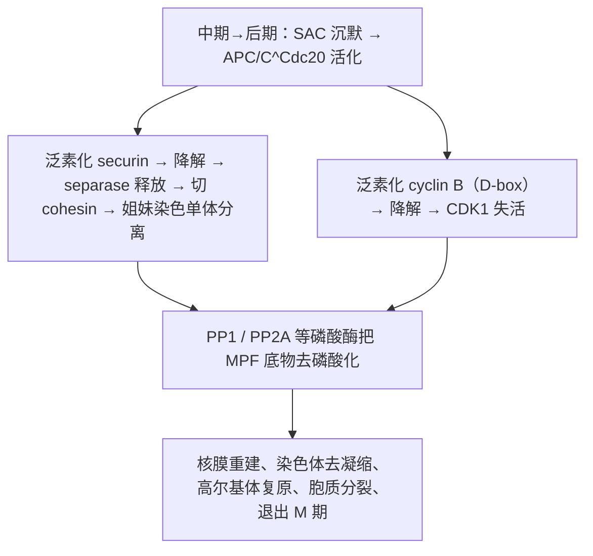
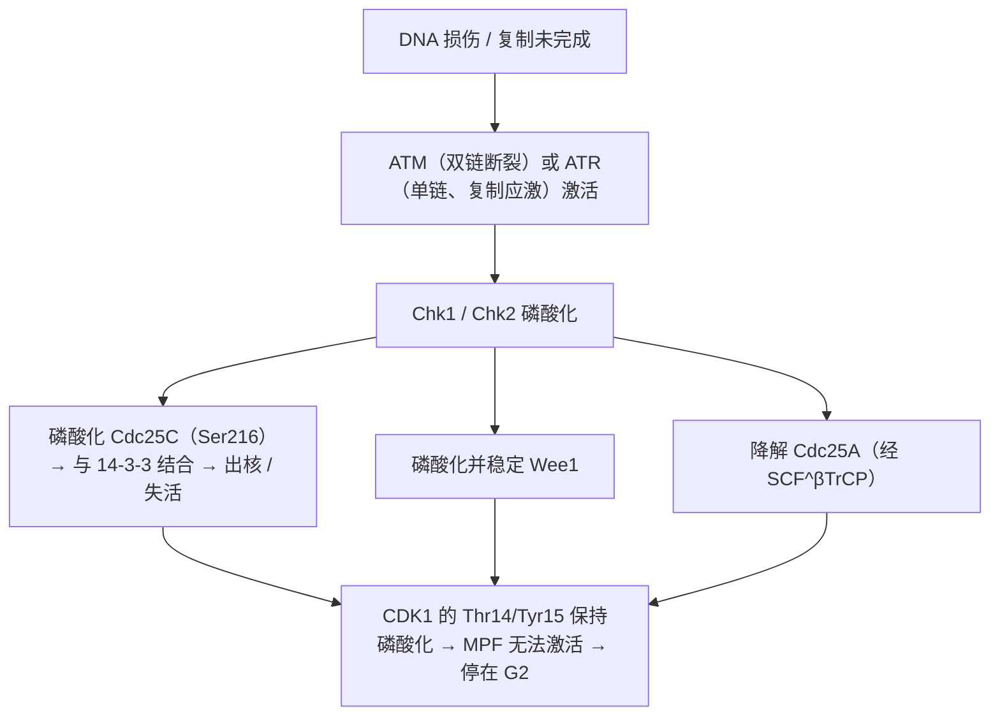

# MPF 与细胞周期调控相关蛋白

> **一句话**：细胞周期的推进靠 **Cyclin–CDK 复合物的激酶活性周期性振荡**。**MPF = CDK1 + cyclin B**，是驱动 G2→M 的核心引擎；它被 **Wee1（抑制性磷酸化）/ Cdc25（去磷酸化）** 做成一个全或无的开关，被 **APC/C** 降解 cyclin B 而关闭。其余周期蛋白、CKI、检查点激酶、泛素连接酶，都是这台引擎的**档位、刹车与不可逆棘轮**。
>
> **三层框架**：**引擎**（Cyclin–CDK）→ **开关**（磷酸化 / 去磷酸化，可逆）→ **销毁**（泛素–蛋白酶体，不可逆）。

---

## 一、总览：谁在管什么

| 层次 | 蛋白 / 复合体 | 作用 | 是否可逆 |
|---|---|---|---|
| **引擎** | Cyclin D/E/A/B、CDK1/2/4/6、CDK7 | 磷酸化底物，推动时相转换 | 活性可逆 |
| **激活开关** | **CAK**（CDK7–cyclin H）、**Cdc25** | 给激活磷酸、去掉抑制磷酸 | 可逆 |
| **刹车开关** | **Wee1 / Myt1** | 给 CDK1 加抑制性磷酸 | 可逆 |
| **CKI（抑制蛋白）** | INK4 家族（p16 等）、CIP/KIP 家族（p21/p27/p57） | 直接结合并抑制 Cyclin–CDK | 可逆 |
| **泛素连接酶** | **SCF**、**APC/C^Cdc20**、**APC/C^Cdh1** | 降解 cyclin、CKI、securin 等 | **不可逆** |
| **检查点激酶** | ATM / ATR → Chk1 / Chk2 → p53 | 感知损伤、压住开关 | 可逆 |
| **复制许可** | ORC、Cdc6、Cdt1、MCM2-7、geminin | 保证 DNA 每周期只复制一次 | — |
| **G1 闸门** | **Rb–E2F** | 生长因子依赖的限制点（R point） | — |

> **最核心的一句话**：**CDK 蛋白量在整个周期基本恒定，周期性变化的是 cyclin 的合成与降解**。所以「周期引擎」不是被造出来又拆掉，而是被反复"装上配件—拆除配件"。

---

## 二、MPF 的发现（三个诺奖级实验）

| 年份 | 人物 | 实验 | 结论 |
|---|---|---|---|
| 1971 | Masui & Markert | 把孕酮刺激的**蛙卵母细胞细胞质**注入未成熟卵母细胞 → 诱导生发泡破裂（GVBD） | 胞质中存在可转移的「**成熟促进因子 MPF**」 |
| 1970s | Leland Hartwell |  budding yeast **cdc 突变体**筛选 | 找到一批控制细胞分裂周期的基因（CDC28 等） |
| 1982 | Tim Hunt | 海胆/蛤蜊卵中发现**每周期合成后突然消失**的蛋白 | 命名为 **cyclin** |
| 1980s | Paul Nurse | 裂殖酵母 **cdc2** 突变（wee 小细胞 / cdc2-3w 提前分裂） | 鉴定 **CDK1（p34^cdc2）**，并揭示 Wee1–Cdc25 的开关 |
| 1988 | Maller / Lohka 等 | 纯化 MPF | **MPF = CDK1 + cyclin B**，具组蛋白 H1 激酶活性 |

> 2001 年 **Hartwell、Hunt、Nurse** 共享诺贝尔生理学或医学奖。三套系统（蛙卵、酵母、海胆卵）最后指向同一台机器，是细胞生物学最漂亮的汇流之一。

**两个名字都成立**：MPF 既叫 **Maturation-Promoting Factor**（卵母细胞成熟），也叫 **M-Phase Promoting Factor**（体细胞 M 期进入），现在通用后者。

---

## 三、MPF 的组成与激活：一个双稳态开关

![[mpf-activation-switch.svg]]

### 3.1 组成

| 亚基 | 名称 | 特点 |
|---|---|---|
| 催化亚基 | **CDK1**（p34^cdc2 / CDC2） | 蛋白量**恒定**，单独无活性；需结合 cyclin 才有激酶构象 |
| 调节亚基 | **cyclin B** | 从 S/G2 开始积累，M 期末被**骤然降解**；含 **D-box** 降解信号 |
| 辅助 | **CAK** = CDK7–cyclin H–MAT1 | 磷酸化 CDK1 **Thr161**（T 环），是活性所必需 |
| 辅助 | **Suc1 / Cks1** | 磷酸化底物对接适配亚基，帮助识别多磷酸化底物 |

### 3.2 激活的四步（关键：先"蓄势"，再"松刹车"）

1. **CDK1 + cyclin B 结合** → 构象变化，但尚被抑制
2. **CAK 磷酸化 Thr161**（激活位）→ 具备活性潜力
3. **Wee1/Myt1 磷酸化 Thr14 / Tyr15**（抑制位）→ 形成「pre-MPF」，蓄势但不放行 ★
4. **Cdc25C 脱去 Thr14/Tyr15 的磷酸** → MPF 瞬间爆发活化 → 进入 M 期

> **pre-MPF 是核心概念**：cyclin B 早在 G2 就积累够了，MPF 却一直"哑火"，因为 Wee1 把 CDK1 按在抑制性磷酸化状态。**进入 M 期不是靠 cyclin B 合成到位，而是靠 Cdc25 松开刹车**——这解释了为什么 G2→M 是**突变式开关**而非渐变。

### 3.3 正反馈造就"全或无"

活性 MPF 一旦出现，会同时：
- **磷酸化并激活 Cdc25C** → 更多 MPF 被去磷酸化
- **磷酸化并抑制 Wee1**（并促其降解）→ 更少抑制性磷酸
- 再叠加 **Plk1** 同样激活 Cdc25、抑制 Wee1

结果是一个**双稳态正反馈环**：要么全关（G2），要么全开（M），中间态不稳定。这让整群细胞可以**同步、快速、不可逆地**进入 M 期。

> **实验意味**：把 MPF 活性逐步滴定，细胞不会"半进入 M 期"；越过阈值就是全有。这是系统生物学里双稳态开关的教科书案例。

### 3.4 MPF 磷酸化的底物 → M 期形态变化

| 底物 | 磷酸化后果 |
|---|---|
| **核纤层蛋白 lamin A/C/B** | 核纤层解聚 → **核膜解体** |
| **凝缩素 condensin**（SMC2/4）、组蛋白 H3 | **染色体凝缩** |
| 微管相关蛋白、MAP4、stathmin | 微管动态剧增 → **纺锤体形成** |
| GM130、GRASP65 | **高尔基体碎裂** |
| 核仁蛋白、核孔复合体组分 | 核仁消失、核孔拆解 |
| Cdc20 / APC/C 亚基 | 为后续**自身关闭**埋下伏笔 |

---

## 四、MPF 的关闭：退出 M 期靠"销毁"

> **方向性从哪来**：**进入 M 期靠去磷酸化（可逆），退出 M 期靠蛋白水解（不可逆）**。所以周期只能往前走，不会倒回去。这是整个细胞周期设计里最精妙的一点。
>
> **APC/C^Cdh1** 在后期末到 G1 继续降解 cyclin B、Plk1、Aurora A、Cdc20、Skp2、geminin，把细胞**锁在低 CDK 活性的 G1 状态**，为下一轮复制许可创造条件。

---

## 五、Cyclin–CDK 全景：各时相的组合

![[cell-cycle-regulators-map.svg]]

| 时相 | 主导复合物 | 关键底物 / 事件 | 主要负调控 |
|---|---|---|---|
| **G1 早期** | **cyclin D–CDK4/6** | 单磷酸化 **Rb**，感受生长因子 | p16^INK4A、p15 |
| **G1 晚期 / R 点** | **cyclin E–CDK2** | 超磷酸化 Rb → 释放 E2F → S 期基因转录 | p21、p27 |
| **S 期** | **cyclin A–CDK2** | 复制起点发放、磷酸化 Cdc6/Cdt1 **防再复制**、中心体复制 | p21、p27 |
| **G2** | **cyclin A–CDK1** | 准备 M 期、激活 Plk1 | Wee1 / Myt1 |
| **M 期** | **cyclin B–CDK1 = MPF** ★ | 核膜解体、凝缩、纺锤体、高尔基碎裂 | Wee1（入期前）、APC/C（退出） |

**其他 CDK（不直接驱动周期）**

| CDK | 搭档 | 功能 |
|---|---|---|
| **CDK7** | cyclin H | 既作 **CAK**（激活 CDK1/2/4/6），又是 TFIIH 亚基参与转录起始 |
| CDK8 / CDK9 | cyclin C / T | 转录调控（Mediator、P-TEFb） |
| CDK5 | p35/p39 | 神经元迁移、细胞骨架（非周期） |

---

## 六、CKI：两大家族别混

| 家族 | 成员 | 靶点特异性 | 上游诱导 |
|---|---|---|---|
| **INK4** | p15^INK4B、p16^INK4A、p18、p19 | **专一抑制 CDK4/6**，阻止 cyclin D 结合 | p16 由衰老、癌基因应激诱导；**常见抑癌基因**，甲基化/缺失见于多种肿瘤 |
| **CIP/KIP** | **p21^Cip1/Waf1**、**p27^Kip1**、p57^Kip2 | **广谱**：cyclin E/A–CDK2、cyclin B–CDK1，也参与 CDK4/6 复合物组装 | p21 由 **p53** 诱导（DNA 损伤）；p27 由 TGF-β、接触抑制、血清饥饿上调 |

> **易错点**：INK4 是"专一打 CDK4/6"，CIP/KIP 是"广谱打 CDK2/1"。很多题把 p21 说成只抑制 CDK4/6，是错的。
>
> **p27 的降解是进 S 期的必要步骤**：SCF^Skp2 识别被 CDK2 磷酸化的 p27（phosphodegron）→ 降解 → cyclin E–CDK2 彻底释放活性 → 正反馈越过 R 点。

---

## 七、磷酸化开关与检查点：损伤时怎么"压住"MPF

### 7.1 G2/M 检查点（最直接管 MPF）

| 干预 | 后果 |
|---|---|
| **咖啡因 / UCN-01（Chk1 抑制剂）** | **废除 G2/M 检查点** → 带损伤强行入 M → 有丝分裂灾难 |
| **AZD1775 / MK-1775（Wee1 抑制剂）** | 去掉刹车 → p53 缺陷肿瘤被迫提前入 M → **合成致死**（临床联合吉西他滨） |
| **RO-3306（CDK1 抑制剂）** | 可逆停在 **G2/M 边界**，洗脱后集体同步入 M（实验最干净的同步化） |

### 7.2 三条检查点一览

| 检查点 | 感知信号 | 传感→效应链 | 直接结果 |
|---|---|---|---|
| **G1/S（DNA 损伤）** | DSB、UV | ATM/ATR → Chk1/2 → **p53 稳定** → **p21** ↑ → 抑制 CDK2 → Rb 保持低磷酸化 | G1 阻滞；也可走 Cdc25A 降解的快速通路 |
| **Intra-S** | 复制叉停滞 | ATR → Chk1 → 抑制晚期起点发放、稳定复制叉 | 减慢 S 期，防止叉坍塌 |
| **G2/M** | 未修复损伤 / 未复制完 | Chk1/2 → Cdc25C 失活 → CDK1 保持抑制性磷酸化 | 不进 M 期 |
| **SAC（中期）** | 动粒未附着 / 无张力 | Mps1 → Mad2/BubR1 → **MCC 抑制 APC/C^Cdc20** | 停中期（详见 [[阻断]]） |

> **p53 的双重结局**：损伤可修复 → p21 暂时阻滞；损伤过重 → p53 诱导 **Bax/PUMA/NOXA** → 凋亡，或诱导 **p16** → 细胞衰老。

---

## 八、泛素连接酶：不可逆的方向性

| E3 | 激活子 / 调控 | 活跃时相 | 主要底物 | 作用 |
|---|---|---|---|---|
| **SCF**（Skp1–Cul1–F-box） | **组成型活性**，靠底物先被磷酸化形成 **phosphodegron** 才识别 | 全周期 | 见下 | 降解抑制因子、推动 G1/S |
| ├ SCF^Skp2 | — | G1/S | **p27**、p21 | 释放 CDK2 活性 |
| ├ SCF^βTrCP | — | S/G2、损伤时 | **Cdc25A**、Emi1 | 阻断 CDK2、解除 APC/C 抑制 |
| └ SCF^FBW7 | — | S/G2 | **cyclin E**、Myc、Notch、Jun | 防止 cyclin E 过量 |
| **APC/C^Cdc20** | 被 M 期 CDK1 磷酸化激活；**受 SAC/MCC 抑制** | 中期→后期 | **securin、cyclin B**（D-box） | 启动后期 + 关闭 MPF |
| **APC/C^Cdh1** | 后期末 Cdc20 下降、CDK 活性降低后接管（识别 **KEN box / D-box**） | 后期末 → G1 | cyclin B、Plk1、Aurora A、Cdc20、Skp2、**geminin** | 维持 G1 低 CDK、允许复制许可 |

> **SCF 与 APC/C 的调控逻辑正好相反**：**SCF 一直开着，靠"底物被磷酸化"决定降解谁**；**APC/C 平时关着，靠"激活子 + 磷酸化 + 解除 SAC"决定何时开**。前者管"选谁"，后者管"何时"。
>
> **降解信号**：cyclin B / securin 用 **D-box（RxxL）**；Cdh1 底物常用 **KEN box**；SCF 底物用 **phosphodegron**。

---

## 九、Rb–E2F：G1 的限制点（R point）

- **无生长因子**：cyclin D 低 → Rb 低磷酸化 → 结合并抑制 E2F（招募 HDAC）→ 停在 G1。
- **有生长因子**：Ras/MAPK → cyclin D ↑ → cyclin D–CDK4/6 单磷酸化 Rb → cyclin E–CDK2 超磷酸化 Rb → E2F 释放 → 转录 cyclin E、cyclin A、Cdc6、MCM、DNA Pol α、TK、DHFR → 正反馈自我维持 ★ → 越过 R 点：此后即使撤掉生长因子也照走完本周期。

| 刹车 | 机制 |
|---|---|
| **p16^INK4A** | 抑制 CDK4/6 → Rb 保持低磷酸化 → 停 G1 |
| **p21 / p27** | 抑制 CDK2 → 无法超磷酸化 Rb |
| TGF-β | 上调 p15/p27、下调 c-Myc |

> **临床**：**CDK4/6 抑制剂**（帕博西林 palbociclib、瑞博西尼 ribociclib、阿贝西利 abemaciclib）联合内分泌治疗用于 **HR+/HER2− 晚期乳腺癌**，前提是 **Rb 功能完整**（Rb 缺失则无效，是耐药机制之一）。

---

## 十、复制许可（licensing）：每周期只复制一次

| 步骤 | 时相 | 事件 |
|---|---|---|
| 1 | **G1（低 CDK）** | **ORC** 结合起点 → **Cdc6 + Cdt1** 装载 **MCM2-7 双六聚体** → 形成 **pre-RC**（许可完成） |
| 2 | **S 期** | **CDK2–cyclin A / E** 与 **DDK（Cdc7–Dbf4）** 激活起点 → CMG 解旋酶（Cdc45–MCM–GINS）启动双向复制 |
| 3 | 防再复制 | 见下四重机制 |
| 4 | 后期末 / G1 | **APC/C^Cdh1 降解 geminin** → Cdt1 解放 → 下一轮许可 |

**四重防再复制机制**

1. CDK2 磷酸化 **Cdc6** → 出核 / 被降解；
2. **geminin** 结合并抑制 **Cdt1**，且 Cdt1 被 **SCF^Skp2 / CRL4^Cdt2**（PCNA 依赖）降解；
3. CDK 磷酸化 **ORC**、降低其再装载能力；
4. **MCM 随复制叉离开起点**，起点上无解旋酶可再用。

> **与细菌对比**（见 [[快生长和慢生长]]）：细菌用 **DnaA-ATP 阈值 + RIDA + SeqA 隔离** 保证 oriC 一周期只起始一次；真核用 **licensing 与起始分属 G1/S 两个不同 CDK 状态**，逻辑相通、零件完全不同。

---

## 十一、经典实验与常用工具

| 工具 / 实验 | 用途 | 要点 |
|---|---|---|
| **非洲爪蟾卵提取物**（cell-free） | 体外重建细胞周期、测 MPF 活性 | 用**组蛋白 H1 激酶活性**作为 MPF 读出；可加入重组 cyclin B 驱动多轮振荡 |
| **cdc2 突变体** | 鉴定 CDK1 | `cdc2-3w` 提前分裂（wee 表型）、`cdc2-1w` 阻滞 G2 |
| **wee1 突变体** | 证明抑制性磷酸化存在 | 细胞**过小就分裂**（wee = 苏格兰语"小"） |
| **双胸腺嘧啶核苷阻断** | G1/S 同步化 | 两次 2 mM thymidine |
| **Nocodazole + shake-off** | M 期同步化 | 详见 [[阻断]] |
| **RO-3306** | G2/M 边界可逆阻断，洗脱后同步入 M | 做 M 期磷酸化研究首选，无药物残留干扰 |
| **血清饥饿** | 使细胞进入 **G0** | 再血清刺激可同步进入 G1 |
| **流式 PI 染色** | 分析 DNA 含量分布（G1 / S / G2M 峰） | 需配合 BrdU/EdU 区分 S 期 |

**常用抑制剂速查**

| 化合物 | 靶点 | 用途 |
|---|---|---|
| Palbociclib / Ribociclib / Abemaciclib | **CDK4/6** | 临床抗肿瘤（HR+ 乳腺癌） |
| **RO-3306** | CDK1 | 实验同步化 |
| Flavopiridol / Dinaciclib | 广谱 CDK | 研究/临床 |
| **AZD1775（MK-1775）** | **Wee1** | 与 DNA 损伤药合成致死 |
| UCN-01 / 咖啡因 | Chk1 | 废除 G2/M 检查点（实验用） |
| MG132 / 硼替佐米 | 26S 蛋白酶体 | 阻止 cyclin B / securin 降解，卡在中期 |
| Nutlin-3 | MDM2 | 稳定 p53，诱导 p21 |

---

## 十二、常见误区澄清

| 误区 | 纠正 |
|---|---|
| ❌ "MPF 是一种蛋白" | ✅ 是 **CDK1 + cyclin B 的复合物**（异二聚体），且需 CAK 磷酸化 Thr161 |
| ❌ "CDK 蛋白量周期性升降" | ✅ **CDK 量恒定**；周期性合成与降解的是 **cyclin** |
| ❌ "cyclin B 积够了就进 M 期" | ✅ G2 时 cyclin B 已充足，但被 **Wee1 的 Thr14/Tyr15 抑制磷酸**压住（pre-MPF），要 **Cdc25 去磷酸化**才放行 |
| ❌ "MPF 活性是慢慢升上去的" | ✅ 正反馈（激活 Cdc25 / 抑制 Wee1）造成**双稳态、全或无**的开关 |
| ❌ "退出 M 期靠磷酸酶把 MPF 关掉" | ✅ 主要靠 **APC/C^Cdc20 降解 cyclin B**（蛋白水解，不可逆），磷酸酶只负责把底物复位 |
| ❌ "p21 / p27 专一抑制 CDK4/6" | ✅ 那是 **INK4 家族（p16）**；CIP/KIP 是**广谱**抑制 CDK2/1 |
| ❌ "SCF 和 APC/C 差不多" | ✅ **SCF 组成型活性、靠底物磷酸化选靶；APC/C 周期性激活、靠激活子与 SAC 定时** |
| ❌ "SAC 抑制 CDK1" | ✅ SAC 抑制的是 **APC/C^Cdc20**，与 CDK1 活性无直接关系（详见 [[阻断]]） |
| ❌ "Wee1 是 CDK，Cdc25 是激酶" | ✅ **Wee1 是酪氨酸激酶**（给 CDK1 加抑制磷酸）；**Cdc25 是磷酸酶**（去掉它） |
| ❌ "MPF 只在 M 期存在" | ✅ cyclin B 从 S/G2 就积累，只是处于**无活性的 pre-MPF** 状态 |
| ❌ "DNA 损伤直接抑制 CDK1" | ✅ 经 **ATM/ATR → Chk1/2 → Cdc25C 失活 + Wee1 稳定**，间接维持 CDK1 抑制性磷酸化 |

---

## 十三、要点速记

> **一台引擎、一个开关、一次销毁**
>
> 1. **MPF = CDK1 + cyclin B**；CDK1 恒定，cyclin B 周期性合成/降解
> 2. **激活四步**：结合 cyclin B → CAK 磷酸化 **Thr161** → Wee1 加 **Thr14/Tyr15**（pre-MPF）→ **Cdc25 去磷酸化**爆发
> 3. **正反馈双稳态**：活性 MPF 激活 Cdc25、抑制 Wee1（Plk1 助阵）→ 全或无进入 M 期
> 4. **底物**：lamin → 核膜解体；condensin/H3 → 凝缩；MAP → 纺锤体；GM130 → 高尔基碎裂
> 5. **关闭**：**APC/C^Cdc20** 降解 securin（→separase 切 cohesin）+ cyclin B；**APC/C^Cdh1** 锁住 G1
> 6. **方向性**：**进入靠可逆的去磷酸化，退出靠不可逆的蛋白水解**
> 7. **时相组合**：D–CDK4/6 → E–CDK2 → A–CDK2 → A/B–CDK1
> 8. **刹车**：INK4（p16，专一 CDK4/6）／CIP-KIP（p21/p27/p57，广谱）
> 9. **E3 逻辑**：SCF 恒定靠底物磷酸化选靶；APC/C 靠激活子 + 解除 SAC 定时
> 10. **R 点**：Rb 超磷酸化 → 释放 E2F → 越过 R 点后不再依赖生长因子
> 11. **licensing**：G1 装 MCM（低 CDK），S 期起始（高 CDK），靠 Cdc6/Cdt1/geminin/ORC 防再复制

---

## 附：关键缩写对照

| 缩写 | 全称 | 说明 |
|---|---|---|
| **MPF** | M-phase / maturation-promoting factor | CDK1–cyclin B 复合物 |
| **CDK** | Cyclin-dependent kinase | 周期蛋白依赖性激酶 |
| **CAK** | CDK-activating kinase | CDK7–cyclin H–MAT1，磷酸化 Thr161 |
| **pre-MPF** | — | 已结合 cyclin B、Thr161 已磷酸化，但 Thr14/Tyr15 仍被抑制的蓄势状态 |
| **Wee1 / Myt1** | — | 给 CDK1 加抑制性磷酸的激酶 |
| **Cdc25** | Cell division cycle 25 | 双特异性磷酸酶，去掉 Thr14/Tyr15 磷酸 |
| **CKI** | CDK inhibitor | 周期蛋白依赖性激酶抑制因子 |
| **INK4** | Inhibitor of CDK4 | p15/p16/p18/p19，专一 CDK4/6 |
| **CIP/KIP** | CDK-interacting protein / kinase inhibitory protein | p21/p27/p57，广谱 |
| **APC/C** | Anaphase-promoting complex / cyclosome | E3 泛素连接酶，降解 cyclin B 与 securin |
| **SCF** | Skp1–Cullin1–F-box | E3，识别 phosphodegron |
| **D-box / KEN box** | Destruction box / KEN-box | APC/C 识别的降解信号（RxxL / KEN） |
| **MCC** | Mitotic checkpoint complex | Mad2–BubR1–Bub3–Cdc20，SAC 效应体 |
| **SAC** | Spindle assembly checkpoint | 纺锤体组装检查点 |
| **securin / separase / cohesin** | — | 后期启动三元件，详见 [[阻断]] |
| **Rb** | Retinoblastoma protein | G1 闸门，结合抑制 E2F |
| **E2F** | E2 promoter-binding factor | S 期基因转录因子 |
| **R point** | Restriction point | G1 限制点，越过后不再依赖生长因子 |
| **ORC / pre-RC** | Origin recognition complex / pre-replicative complex | 复制起点识别 / 复制前复合体 |
| **MCM2-7** | Minichromosome maintenance 2-7 | 复制解旋酶核心，licensing 标志 |
| **Cdc6 / Cdt1** | — | 装载 MCM 的许可因子 |
| **geminin** | — | 抑制 Cdt1，防再复制；G1 被 APC/C^Cdh1 降解 |
| **DDK / CMG** | Dbf4-dependent kinase / Cdc45–MCM–GINS | 起点激活激酶 / 活性解旋酶 |
| **ATM / ATR** | Ataxia telangiectasia mutated / ATM-Rad3-related | DSB / 复制应激传感激酶 |
| **Chk1 / Chk2** | Checkpoint kinase 1/2 | 效应激酶，压住 Cdc25 |
| **Plk1** | Polo-like kinase 1 | 促 G2/M、激活 Cdc25、抑制 Wee1 |
| **GVBD** | Germinal vesicle breakdown | 生发泡破裂，MPF 经典读出 |

---

## 相关笔记

- [[阻断]] —— SAC、APC/C、securin/cohesin，以及 RO-3306 / Nocodazole 等同步化与阻断剂
- [[快生长和慢生长]] —— 细菌 DnaA / RIDA / 起始质量，与真核 licensing 对比
- [[分裂方式]] —— 有丝分裂与减数分裂的时相和形态
- [[动态方法]] —— 活细胞成像追踪 cyclin 振荡与 CDK 活性（FRET 传感器）
- [[动物细胞培养]] —— 细胞同步化与细胞周期的实验操作
