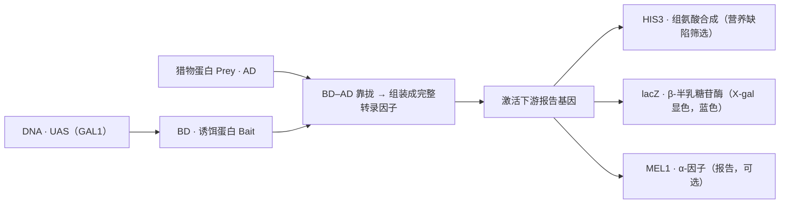
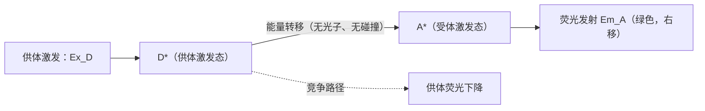
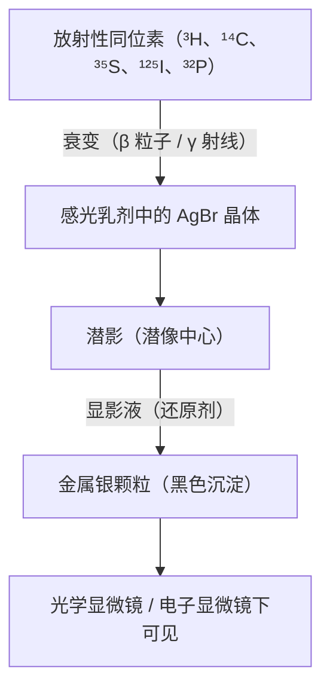

# 动态方法（细胞生物学动态研究技术）

"动态方法"的核心特征是：**在活细胞（live-cell）条件下实时观测分子事件的时间进程**，而非固定时间点的静态快照（static method，如固定免疫荧光、组化）。

本文档涵盖四大经典动态技术：

| # | 技术 | 观测对象 | 能回答的核心问题 |
|---|---|---|---|
| 1 | **荧光漂白恢复技术（FRAP）** | 荧光标记分子 | 这个分子**能不能动**？移动速率多少？ |
| 2 | **酵母双杂交技术（Y2H）** | 蛋白质–蛋白质 | 这两个蛋白**在不在同一空间相遇**？ |
| 3 | **荧光共振能量转移技术（FRET）** | 分子内/分子间距离 | 两个分子**距离多近**？（Å 级） |
| 4 | **放射自显影技术（Autoradiography）** | 放射性标记物 | 这个分子**在哪、在哪一层**？ |

---

## 一、荧光漂白恢复技术（FRAP, Fluorescence Recovery After Photobleaching）

### 1. 原理

1979 年由 **Axelrod、施耐德（Schneider）** 等人建立。

荧光标记的分子被**定点高强度激光漂白（Photobleaching）**后，该区域荧光强度骤降至背景。随后观察荧光强度能否**随时间自行恢复**。

恢复的动力学来源于：**未被漂白的标记分子从周围区域通过扩散或主动运输进入漂白区**。

<svg viewBox="0 0 700 330" width="100%" style="max-width:700px;height:auto;display:block;margin:1rem auto" xmlns="http://www.w3.org/2000/svg" role="img" aria-label="FRAP 荧光恢复曲线">
  <line x1="80" y1="270" x2="660" y2="270" stroke="currentColor" stroke-width="1.2"/>
  <line x1="80" y1="270" x2="80" y2="40" stroke="currentColor" stroke-width="1.2"/>
  <text x="620" y="290" font-size="12" text-anchor="middle" stroke="none">时间</text>
  <text x="30" y="160" font-size="12" text-anchor="middle" stroke="none" transform="rotate(-90 30 160)">荧光强度</text>

  <line x1="80" y1="90" x2="650" y2="90" stroke="currentColor" stroke-width="1" stroke-dasharray="5 4" opacity="0.45"/>
  <line x1="300" y1="70" x2="300" y2="270" stroke="currentColor" stroke-width="1" stroke-dasharray="4 4" opacity="0.5"/>

  <path d="M100,90 H300 L300,235 C345,232 365,150 405,125 C450,105 500,102 650,100" fill="none" stroke="currentColor" stroke-width="2.2" stroke-linejoin="round"/>

  <g font-size="11.5" stroke="none">
    <text x="470" y="84">平台（完全恢复）</text>
    <text x="300" y="292" text-anchor="middle">漂白瞬间</text>
    <text x="420" y="182">← 恢复速率决定于分子移动性</text>
    <text x="306" y="252" font-size="10.5">I₀</text>
    <text x="96" y="84" font-size="10.5">I_pre</text>
  </g>
</svg>

*上图：FRAP 的典型恢复曲线。移动分数（Mobile Fraction）=（I∞ − I₀）/（I_pre − I₀）。*

**两个核心参数**

| 参数 | 计算方式 | 生物学意义 |
|---|---|---|
| **移动分数** Mobile Fraction (Mf) | Mf = (I_∞ − I₀) / (I_pre − I₀) | 能自由扩散的比例。 **Mf = 1.0** → 全部自由扩散（膜内在蛋白、细胞质蛋白） **Mf < 1.0 且平台不再上升** → 存在** immobile fraction**（结合于细胞骨架/膜锚定的部分），如网格蛋白包裹的膜蛋白、连接蛋白锚定的受体 |
| **半恢复时间** t₁/₂ | 达到总恢复量一半所需时间 | 反映**移动速度**。 理论公式（圆形漂白区）：D = 0.2249 × w₀² / t₁/₂（w₀ 为漂白区半径，μm） 扩散系数越小 → t₁/₂ 越长 → 移动越慢 |

> **扩散系数 D 参考值**：小分子在细胞质 ~10⁻⁹ m²/s；膜蛋白在膜上侧向扩散 ~10⁻¹² ~ 10⁻⁹ m²/s；核内蛋白 ~10⁻¹⁴ m²/s（受核骨架限制）

### 2. 实验流程

1. **标记**：转染荧光融合蛋白（GFP/RFP/mCherry），或用荧光抗体、脂质体染料标记
2. **定位**：共聚焦显微镜下找到目标区域（细胞膜、细胞质、核内）
3. **漂白**：
   - **点漂白（Point Bleaching）**：用最小激光功率、最短驻留时间（<1 ms）打成一个小点
   - **线漂白（Line Bleaching）**：划一条直线，测**垂直方向**扩散系数
   - **区域漂白（Spot Bleaching）**：漂白整个细胞或某个胞器
4. **采集**：以 **1–10 帧/秒** 连续扫描（时间分辨的关键），采集 50–100 帧
5. **拟合**：用指数衰减模型（如 single exponential）拟合恢复曲线，得 t₁/₂
6. **对照**：
   - 4°C 冷却（抑制代谢）→ 若恢复停止，说明依赖能量
   - ATP 耗竭（叠氮化钠 + 无糖培养基）→ 区分被动扩散 vs 主动运输
   - 施加**赤藜糖醇**（erythritol，高渗）→ 造成可逆渗透休克，细胞内液流失，区分膜流动与胞内流动

### 3. 应用

- **膜流动性研究**：Byington、Edidin（1970）用 FRAP 证明**细胞膜侧向流动**（细胞融合实验）
- **膜蛋白锚定性质**：鉴定跨膜 vs 脂锚定（ GPI 锚定蛋白可被磷脂酶处理清除）
- **细胞骨架依赖性运动**：轴突中颗粒的**微管依赖**长距离运输；黏附斑蛋白、半桥粒蛋白的 immobile fraction
- **核内蛋白定位**：核孔复合体介导的扩散
- **细胞极性建立**：黏附蛋白向侧膜定向运输
- **胞吐/内吞动力学**：囊泡与质膜的融合回收

### 4. 变体

| 技术 | 特点 |
|---|---|
| **FRAP（点漂白）** | 最经典，测扩散系数 |
| **FRAPM（FRAP Monitor，扫描漂白）** | 漂白区域随时间移动，反映**定向运输** |
| **RICS（Raft Imaging with Correlation Spectroscopy）** | 点扩散函数拟合，得运动矢量 |
| **FRAP on inverse FRAP** | 漂白区外标记后测"回流" |
| **SPT（单分子颗粒追踪）** | 与 FRAP 互补，直接追踪单个分子轨迹 |
| **流式细胞术 FRAP（FCFRAP）** | 细胞群整体膜脂质流动性的快速测量 |

### 5. 局限

- ❌ 时间分辨率有限（**毫秒–秒**），无法捕捉快速事件
- ❌ **光毒性**：强激光导致细胞损伤、蛋白交联
- ❌ **漂白区大小受光学衍射极限约束**（~200 nm）
- ❌ 需区分"扩散进入"与"被绑定后释放"——同一曲线两种机制可能拟合相似
- ❌ 无法判断**分子是否真正自由**（immobile fraction 解释有歧义）

---

## 二、酵母双杂交技术（Y2H, Yeast Two-Hybrid）

### 1. 原理

1989–1991 年由 **Stanley Fields** 和 **Marc Vidal** 建立。

**转录因子的结构模块化原理**（酵母 **GAL4** 系统）：

| 模块 | 功能 | 单独是否有效 |
|---|---|---|
| **DNA 结合结构域（BD / GAL4-DBD）** | 识别 **GAL1 启动子**上游的 **UAS** 序列 | ❌ 单独无法激活报告基因 |
| **转录激活结构域（AD / GAL4-AD）** | 招募转录机器，启动下游基因转录 | ❌ 单独无法定位到启动子 |

**核心设计**：把一个已知蛋白（诱饵，bait）融合到 **BD**，把待测蛋白（猎物，prey）融合到 **AD**。若两者**相互作用**，就能把 BD 与 AD 拉到一起，形成完整转录因子 → 激活报告基因。

**酵母遗传背景选择**
- 宿主：**Saccharomyces cerevisiae AH109**（或 **Y187**）
- 报告基因：
  - **HIS3** → 在 **SD/-His/-Trp/-Leu/-Ade** 缺乏培养基上生长
  - **lacZ** → **X-gal + IPTG** 显色（蓝色）
  - **MEL1** → 检测单杂交（DNA–蛋白相互作用），可与 β-半乳糖苷酶检测联用
- **载体**：pGBKT7（BD）、pGADT7（AD），**多克隆位点（MCS）+ 诱饵蛋白需单独克隆，猎物蛋白保持原始开放阅读框**

### 2. 实验流程

1. **诱饵蛋白克隆**到 BD 载体 → Western blot 确认**正常表达**
   - ⚠️ 若诱饵本身自激活（autoactivate），需删去转录激活域或降低水平
2. **猎物库构建**：
   - 传统：cDNA 融合表达文库（随机片段，**筛到的是片段而非全长**）
   - 现代：**基因组文库 / 蛋白互作组（Interactome）文库**
3. **共转化**（顺序转化）：
   - 先转 BD 载体到 AH109（**先转 Bait 更安全**）→ 铺 SD/-Trp 平板
   - 再转猎物文库 → **缺口修复（gap repair）** 或 酵母直接转染
4. **选择**：铺 **SD/-His/-Trp/-Ade/-Leu + X-gal + IPTG**
5. **筛选阳性克隆**：
   - 挑选蓝色、生长良好的克隆，**液体培养诱导（加 **3′-AT** 或 **his3 抑制**）**
   - **PCR 鉴定插入片段**（载体通用引子）
   - **测序**确认猎物身份
6. **验证**（关键一步，不可省略）：
   - **反向验证**：Bait ⇄ Prey 互换位置再筛一次
   - **对照设置**：
     | 对照 | 目的 |
     |---|---|
     | 空载体（Empty vector） | 阴性对照，检测自激活 |
     | **Known positive pair** | 阳性对照，确认系统工作 |
     | **LAM/CIP（自激活检查）** | 排除诱饵自激活 |
   - **进一步验证**：GST pull-down（体外）、Co-IP（体内）、BiFC/FRET（活细胞定位）、酵母三杂交（Y3H）

### 3. 应用

- **构建蛋白互作网络（Interactome）**：已知诱饵钓出未知猎物 → 系统绘制功能模块
- **验证蛋白相互作用**：功能互补、疾病突变体与野生型的相互作用差异
- **筛选药物靶点**：找能阻断某相互作用的小分子
- **验证蛋白功能假说**：若 A–B 已知相互作用，用 Y2H 找 A–C，推测 C 与 B 同通路
- **研究复合体组装**：核孔复合体、COPII 囊泡转运、RNA 剪切复合体
- **筛抗肿瘤抗体靶点**：病毒蛋白–宿主蛋白互作图谱（HPV、HIV）

### 4. 局限

- ❌ **假阴性率高**（最常见问题）：
  - 诱饵蛋白折叠不良（融合标签位置不当）
  - 猎物在酵母中**表达量低或不正确折叠**
  - 融合标签**遮挡了相互作用位点**
  - 相互作用**依赖翻译后修饰**（酵母缺乏哺乳动物 PTM）
  - 相互作用需要**第三蛋白**存在
  - **核定位问题**：许多哺乳动物核蛋白在酵母核中无法正确定位
- ❌ **假阳性**：
  - "**rubber-hands effect**"（橡皮手效应）：自激活的诱饵经多次传代后随机突变获得激活能力
  - 猎物蛋白自身激活报告基因
  - 文库中混入的转录因子片段
- ⚠️ **酵母是单细胞生物**，无法反映哺乳动物细胞中的**时空特异性**（如细胞周期依赖、细胞类型依赖的相互作用）

---

## 三、荧光共振能量转移技术（FRET, Förster Resonance Energy Transfer）

### 1. 原理

理论由 **Gerhard Förster** 于 1947 年提出，1974 年首次在生物体系中实现。

**两种荧光染料（**Donor 供体 / Acceptor 受体**）距离足够近（**1–10 nm**，即 0.01–0.100 μm）时，激发供体的能量可**无光子交换**地转移给受体。

**三个必要条件**
1. **光谱重叠**：供体发射光谱与受体激发光谱**有重叠**
2. **偶极取向**：供体与受体**过渡偶极**需相对平行（κ² = 2/5 ~ 6/5，液体中取 **κ² = 2/5**）
3. **距离 < 10 nm**：F 效率与距离的六次方成反比

**FRET 效率** $E = 1 - I_{DA}/I_D$：$I_{DA}$ 为供受体共表达时供体的荧光强度，$I_D$ 为只有供体时的强度。

**Perrin–Forster 公式**

$$F_{RET} = \frac{1}{1 + (r/R_0)^n}, \quad n = 6$$

其中 **R₀（Forster 半径）** = 供受体处于 50% 转移效率时的距离，典型值 **2–8 nm**。

**R₀ 六大影响因素**
1. **供体量子产率 Φ_D**（越高越好）
2. **光谱重叠积分 J**（越大越好）
3. **受体消光系数 ε_A**（越大越好）
4. **供受体距离 r**
5. **介质折射率 n**（细胞质 ~1.36）
6. **偶极取向因子 κ²**

**常用 FRET 对（青色对青色变体）**

| 供体 | 发射 | 受体 | 激发 | R₀ | 特点 |
|---|---|---|---|---|---|
| **CFP** | 475 nm | **YFP** | 458 nm | 4.9 nm | 最经典对，光漂白强 |
| **ECFP / EYFP** | 475 nm | **EYFP** | 458 nm | ~5.5 nm | 增强型，抗漂白好 |
| **Clover** | 505 nm | **mRuby3** | 505 nm | ~6.1 nm | 亮度高，光稳定 |
| **mClover3** | 518 nm | **mRuby3** | 506 nm | 7.2 nm | **目前最优对之一** |
| **mNeonGreen** | 517 nm | **mRuby3** | 506 nm | ~6.8 nm | 亮度最高 |
| **GFP（Donor）** | 509 nm | **mCherry** | 488 nm | ~5.1 nm | 可与流式、显微兼容 |
| **BFP → GFP** | — | — | — | ~3.3 nm | 短距离（钙调蛋白 Ca²⁺ 指示常用） |

> ⚠️ 关键点：**供体和受体的激发光谱必须高度分离**，否则**直接激发泄漏**和**串联激发（crosstalk）** 造成假阳性。

### 2. 检测方法

#### （1）共聚焦显微镜 FRET（sensitized emission / FLIM）

| 方法 | 原理 | 优点 | 局限 |
|---|---|---|---|
| **敏化发射（Sensitized Emission）** | 测受体的 FLER（荧光-红-绿发射比）随距离变化 | 快速、成像 | 需严格扣除**直接激发**与**串联激发** |
| **FLIM**（Fluorescence Lifetime Imaging） | 测供体**荧光寿命 τ_D**，FRET 使 τ_D 缩短 | **不受浓度/漂白/背景光影响**，最可靠 | 需脉冲激发（TCSPC） |
| ** acceptor photobleaching** | 强激发漂白受体，若供体荧光升高 → 存在 FRET | 简单、绝对定量 | 破坏样品，仅单点 |
| **STED-FRET / SIM-FRET / PALM-STORM** | 超分辨 + FRET | **纳米尺度分子计数/定位** | 设备昂贵、技术复杂 |

**FLIM-FRET 判据**
- **E = 1 − τ_DA/τ_D**（τ_D 为无受体时的供体寿命）
- 效率提高时，受体上升的 **FLER（依赖供体激发）** > 1.05，而**直接激发受体**（依赖受体激发）< 1.05，且**去敏化光漂白**显著减少 → 确证 FRET

#### （2）流式细胞术 FRET
- 用 **488 nm** 激发供体，测 FLER
- **高速度**（每秒数千细胞），适合**筛选**和**群体分析**
- 常用于 **Homo-FRET（同一分子内两相同荧光团）** 和蛋白聚集检测

#### （3）FRET 光谱-时间（FLIM）— 细胞内浓度测定
利用 **FRET 供受体能量比** 与**供体/受体总浓度**的二维关系，做**双重归一化处理**，可实现**细胞内单个蛋白分子的绝对定量**（尤其配合 **Spectral FRET**）

### 3. 应用

- **蛋白质相互作用活细胞验证**（与 Y2H 互补）
- **构象变化与开关机制**：
  - **钙调蛋白 Ca²⁺ 感应**：Cameleon 传感器
  - **蛋白激酶活性**：PKA 的 **AKAR 底物**，磷酸化使底物展开、FRET 改变（**越来越多……**）
  - **鸟嘌呤核苷酸交换因子**（Ras 开关）
- **受体二聚化**：**BRET**（生物发光共振能量转移，供体为荧光素酶，受体为荧光蛋白）
- **锌传感器**：调色蛋白类传感器
- **膜融合/病毒入侵**：GP41 与细胞受体距离变化
- **单分子构象动力学**：smFRET 追踪单个分子构象变化速率

### 4. 局限

- ❌ **距离窗口窄**：只报告 1–10 nm，更远的相互作用无法检出
- ❌ **标记干扰**：荧光蛋白（~27 kDa）体积大，可能**遮挡相互作用位点**或改变蛋白折叠/定位
- ❌ **串联激发（crosstalk）**：供体激发光也会激发受体，产生假阳性
- ❌ **光漂白与过表达**：强激光损伤细胞，高表达量改变互作平衡
- ❌ **取向因子 κ² 未知**：分子在细胞内**取向随机分布**，导致 FRET 效率解释存在 ±30% 误差
- ❌ **背景**：细胞内**自发荧光**、**内源 NADH/FAD**（细胞内荧光背景极高）

---

## 四、放射自显影技术（Autoradiography）

### 1. 原理

把**放射性同位素标记的物质**引入细胞或生物样品中，利用其**衰变发射的射线/粒子**使**感光乳剂（photographic emulsion）**上的**卤化银晶体（AgBr / AgCl）**发生**潜影（latent image）**，经显影定影后在显微镜下观察。

### 2. 同位素选择

| 同位素 | 半衰期 | 衰变类型 | 射程 | 能量 | 特点与用途 |
|---|---|---|---|---|---|
| **³H（氚）** | **12.3 年** | β⁻（低能） | **极短（~1 μm）** | 最低（0.018 MeV） | 🏆 **分辨率最高**；定位精确至亚细胞器；需**数周至数月**曝光 |
| **¹⁴C** | 5730 年 | β⁻ | 短 | 中（0.156 MeV） | 半衰期长、辐射强，适合**长时间**追踪（如代谢稳定性） |
| **³⁵S** | 87.5 天 | β⁻ | 短 | 中（0.167 MeV） | **含硫氨基酸（Met/Cys）**代谢标记常用，**放射性活度高**、曝光时间短 |
| **³H-亮氨酸/苯丙氨酸** | — | — | — | — | **蛋白质合成**的经典标记（脉冲-追踪实验） |
| **¹²⁵I** | 59.4 天 | γ + β | 中 | 中 | **放射免疫分析（RIA）**；碘化酪氨酸/甲状腺素；易造成样品辐射损伤 |
| **³²P** | **14.3 天** | β⁻ | **较长（~3 mm）** | 高（1.71 MeV） | 活度高、**曝光时间极短（数天）**；**DNA 复制实验**；但分辨率差、易污染 |
| **³³P** | 25.3 天 | β⁻ | 中 | 中 | **分子生物学首选**——活度介于 ³H 与 ³²P 之间，射程短 |
| **⁵⁹Fe** | 44.5 天 | β⁻ / γ | — | — | 铁代谢、血红蛋白合成 |
| **¹⁴C-碳酸氢盐** | 5730 年 | β⁻ | — | — | **糖、脂质、氨基酸**代谢通量 |

> **选择原则**：要**高分辨率** → ³H；要**短曝光** → ³²P/³⁵S；要**测 DNA/RNA** → ³²P/³³P。

### 3. 技术类型

#### （1）宏观自显影（Macroautoradiography）— 组织水平
| 类型 | 用途 |
|---|---|
| **整体自显影（Whole-body）** | 放射性药物的**体内分布**（如 ³⁵S-蛋氨酸、¹⁴⁶1 标记白蛋白） |
| **接触自显影（Contact）** | 把组织/切片紧贴 X 光胶片，曝光后显影 |
| **间接（投射）自显影** | 用厚切片，靠射线穿透后成像 |

#### （2）微观自显影（Microautoradiography）— 细胞水平
- 涂片或切片浸渍**核乳剂**，曝光后显影 → 银粒分布
- **细胞水平**：哪种细胞掺入了标记物
- **亚细胞水平**：标记物在细胞内的**分布**（核 vs 胞质 vs 膜）

#### （3）超微自显影（Ultrastructural autoradiography, UEM/EMAR）— **亚细胞器水平**
- 电镜切片（50–80 nm）涂核乳剂 → 曝光数周至数月 → TEM 观察
- 🏆 **唯一的"活细胞时序"亚细胞定位技术**——可以把**放射性标记物追踪到细胞器层面**
- 代表性应用：**Palay & Chao（1962）神经元内蛋白质运输的核糖体颗粒追踪**

#### （4）放射免疫分析（RIA）
- 用**放射性标记的已知物质**（如 ¹²⁵I 标记胰岛素）与待测**未标记物**竞争结合抗体
- 依据**标准曲线**定量（放射活度与待测物浓度**反比**）
- 现代已被 **ELISA / 化学发光免疫分析（CLIA）** 取代

### 4. 应用

- **DNA 复制实验（Meselson-Stahl 1958）**：
  1. 大肠杆菌在 **¹⁵NH₄Cl** 培养基中培养多代 → DNA 全部为"重"（¹⁵N + H）
  2. 转至 **¹⁴NH₄Cl** 培养基 → 每隔数分钟取样
  3. **CsCl 密度梯度离心 + 放射自显影**
  4. 结果：**一代后全为杂合带（¹⁵N/¹⁴N）**；**二代后出现轻带（¹⁴N/¹⁴N）** → 证明 DNA 为**半保留复制**
- **脉冲-追踪实验（Pulse-Chase）**：追踪蛋白质从粗面内质网 → 高尔基体 → 分泌的路径
- **细胞内物质分布与转运**：分泌蛋白、脂蛋白的合成与转运
- **代谢研究**：糖酵解、脂肪酸合成通路
- **细胞动力学（细胞增殖周期）**：**³H-胸腺嘧啶核苷（TdR）** 标记 S 期细胞，**标记有丝分裂分数（Labeled Mitosis Index）** 测定细胞周期时长
- **DNA 损伤修复**：**彗星试验（Comet Assay）** 用 ³H/32P 标记 DNA，检测迁移程度
- **药代动力学与示踪研究**：放射性标记药物的体内分布

### 5. 局限

- ❌ **分辨率差**（除 ³H 外）：³²P 射程可达数毫米，**几乎无亚细胞定位能力**
- ❌ **曝光时间长**：³H 需数周–数月；期间**样品可能降解、污染银粒**
- ❌ **辐射损伤**：高活度同位素（尤其 ³²P、¹²⁵I）对细胞造成** DNA 链断裂**，影响实验结果
- ❌ **安全与法规**：需要**放射防护资质**、专用屏蔽设施；废物处理成本高
- ❌ **定量困难**：银粒密度与放射性活度的关系需**自显影定量（grain counting）** 校准
- ❌ **被现代技术取代**：
  | 传统放射自显影 | 现代替代 |
  |---|---|
  | ³H-TdR | **BrdU/EdU + Click 化学 + 免疫荧光**（EdU Click-iT™） |
  | ³⁵S-Met 标记蛋白 | **SILAC**（稳定同位素标记氨基酸）、荧光蛋白、**TMT 质谱** |
  | ³²P 标记核酸 | **荧光标记核酸**、**Nanopore 测序** |
  | 银粒计数 | **共聚焦定量成像**、**电子显微镜同位素成像** |

---

## 五、技术横向对比

| 维度 | FRAP | Y2H | FRET | 放射自显影 |
|---|---|---|---|---|
| **对象** | 荧光标记分子 | 蛋白–蛋白互作 | 分子间距离/构象 | 放射性标记物分布 |
| **活细胞？** | ✅ 是 | ❌ 酵母（活，但非原生） | ✅ 是 | ⚠️ 需固定（超微） |
| **时间分辨** | ms–s | 天–周 | ns（寿命）/ms | 小时–月 |
| **空间分辨** | ~200 nm | 细胞水平 | **Å–10 nm** | ³H 亚微米；其他 μm |
| **可定量？** | ✅ Mf、D | 半定量（半定量比色） | ✅ FRET 效率 | 银粒计数 |
| **通量** | 中 | **高**（文库筛选） | 低–中 | 低 |
| **假阳性风险** | 低 | **高**（自激活） | **高**（crosstalk） | 低 |
| **假阴性风险** | 中 | **很高**（折叠/修饰） | 高（>10 nm 检不出） | 中 |
| **活细胞必需？** | ✅ 必须 | ✅ 需活酵母 | ✅ 必须 | ⚠️ 常规需固定 |

---

## 六、选择建议（实操决策）

| 你的问题 | 首选技术 | 理由 |
|---|---|---|
| 这个膜蛋白**能不能自由侧向扩散**？ | **FRAP** | 直接测 Mf，定量 |
| 蛋白 A 和蛋白 B **是否相互作用**？ | **Y2H 初筛** + **Co-IP / Pull-down 验证** | Y2H 快，但假阳性/假阴性多，**必须验证** |
| 蛋白 A 和 B **相距多远**（<10 nm）？ | **FRET** | 唯一能测 Å–10 nm 距离 |
| 蛋白构象在**刺激后是否改变**？ | **FLIM-FRET / smFRET** | 活细胞实时 |
| 这个蛋白**在细胞的哪个部位**？ | **免疫荧光 / 活细胞成像** | 更快更简单 |
| 这个蛋白**在细胞器哪一层**？ | **超微自显影（EMAR）** | 唯一亚细胞器级活细胞定位 |
| 我要做**全基因组蛋白互作筛选**？ | **Y2H / 亲和纯化-MS / BioID / AP-MS** | Y2H 传统但规模大 |
| 我要找**近 200 nm 内**的分子邻居？ | **BioID / TurboID**（20 nm 内）、** proximity labeling** | 比 FRAP/FRET 覆盖更宽 |

---

## 七、延伸：相关现代技术（补充视野）

| 技术 | 能做什么 | 与传统方法关系 |
|---|---|---|
| **超分辨显微镜** (STED/PALM/STORM/SIM) | 突破衍射极限（~20 nm） | **突破 FRET 的"只能看贴在一起"的局限** |
| **单分子追踪 SPT** | 逐个分子轨迹、跳跃扩散 | 取代 FRAP，能区分**diffusion / confined / directed** 三种运动 |
| **BioID / TurboID** | 生物素标记邻近蛋白（20 nm） | FRET 距离上限的替代方案 |
| **AP-MS / 交联质谱** | 大规模互作组 | Y2H 的"质谱版" |
| **LIGER / MULTI-seq** | **单细胞多组学联合定位** | 蛋白 + 代谢 + 基因组在同一细胞中 |
| **CRISPR 敲除 + 光漂白恢复** | 蛋白缺失后定位变化 | FRAP 的"因果版" |
| **遗传编码的荧光团** | 标记线粒体、突触、特定细胞器 | 活细胞不需抗体 |
| **活细胞代谢标记**（Nascent RNA/SCAN-seq） | 单细胞分辨翻译 | 传统放射标记的现代替代 |

---

## 附：关键缩写对照

| 缩写 | 全称 | 中文 |
|---|---|---|
| **FRAP** | Fluorescence Recovery After Photobleaching | 荧光漂白恢复技术 |
| **Mf** | Mobile Fraction | 移动分数 |
| **D** | Diffusion Coefficient | 扩散系数 |
| **Y2H** | Yeast Two-Hybrid | 酵母双杂交 |
| **BD / AD** | Binding Domain / Activation Domain | DNA 结合域 / 转录激活域 |
| **UAS** | Upstream Activating Sequence | 上游激活序列 |
| **GAL4** | — | 酵母金蛋白转录因子 |
| **His3 / lacZ / MEL1** | — | 报告基因（营养缺陷 / 显色 / α-因子） |
| **RIP / coIP** | — | 免疫共沉淀 |
| **GST pull-down** | — | 体外亲和层析验证 |
| **FRET** | Förster Resonance Energy Transfer | 荧光共振能量转移 |
| **R₀** | Förster Radius | Forster 半径（50% 效率距离） |
| **FLER** | FRET Light Emission Ratio | 荧光-红/绿发射比 |
| **FLIM** | Fluorescence Lifetime Imaging Microscopy | 荧光寿命成像 |
| **TCSPC** | Time-Correlated Single Photon Counting | 时间相关单光子计数 |
| **BRET** | Bioluminescence Resonance Energy Transfer | 生物发光共振能量转移 |
| **smFRET** | single-molecule FRET | 单分子 FRET |
| **κ²** | — | 偶极取向因子 |
| **RIA** | Radioimmunoassay | 放射免疫分析 |
| **EMAR / UEM** | Electron Microscopic Autoradiography | 电镜自显影 |
| **U → W → A** | ³⁵S-Met → pulse → autoradiograph | 脉冲-追踪实验 |
| **PULSE → CHASE** | 短时标记 → 追踪 | 放射性脉冲追踪 |
| **X-gal / IPTG** | — | 显色底物 / 诱导剂 |
| **5-AT / 3-AT** | — | 抗筛选（his3） |
| **GFP / CFP / YFP / RFP** | 绿/青/黄/红荧光蛋白 | 不同波长荧光报告蛋白 |
| **mClover3 / mRuby3** | — | 先进的 FRET 荧光对 |

---

> **一句话总结**：
> - **FRAP** 告诉你分子**能不能跑、跑多快**（动态性）
> - **Y2H** 告诉你蛋白**认不认识对方**（相互作用，体外）
> - **FRET** 告诉你蛋白**贴得有多近**（活细胞纳米尺度）
> - **放射自显影** 告诉你**分子被送到了哪一层**（时空追踪）
>
> 四者不是竞争关系，而是**从不同尺度回答同一个生物学问题：分子在细胞里如何协作**。现代趋势是**活细胞 + 纳米尺度 + 高通量**，即 FRET + 超分辨 + BioID + 单细胞组学的组合。