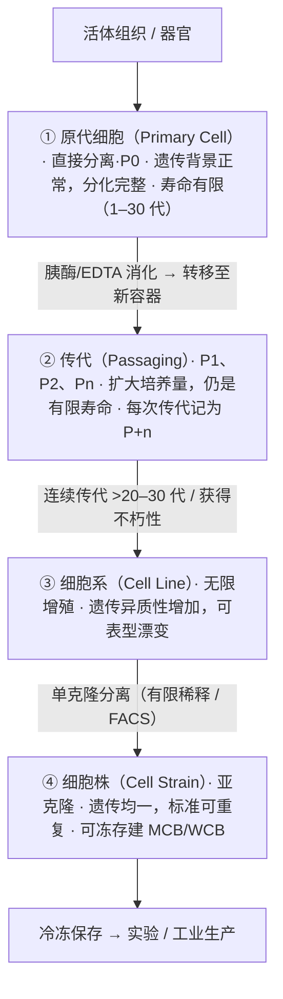

# 动物细胞培养

动物细胞培养（Animal Cell Culture）是将**离体动物组织或细胞**置于人工条件下，提供适宜环境以保持存活、生长或增殖的过程。它是细胞生物学、药物开发、疫苗生产和再生医学的核心工具。

---

## 〇、四个阶段总览：原代 → 传代 → 细胞系 → 细胞株

这是动物细胞培养最核心的一条主线。四个术语代表细胞**来源、处理历史、遗传稳定性**的不同层级。

![[cell-culture-four-stages.svg]]

> **纵向看**：寿命从"有限 → 有限 → 无限 → 无限"，**均一性从低到高**（④ 是单克隆来源），但**遗传稳定性递减**——这正是"越传代越偏离原始组织表型"的根源（P1 最接近原组织，P5+ 需警惕漂变）。
>
> **横向对比**：① 与 ② 的共同点是寿命有限，区别在于② 已脱离"直接分离"状态；② 与 ③ 的分水岭是**获得不朽性**；③ 与 ④ 的分水岭是**单克隆化带来的遗传均一性**。

文本版流程图（便于复制）

---

## 一、阶段①：原代细胞（Primary Cells）

### 来源与定义
直接从**活体组织或器官**分离获得的细胞，是"第一次传代之前"的全部细胞。分离方式包括**组织块法**（剪碎后自然贴壁或酶解）与**酶解/机械消化法**。

### 特点

| 维度 | 特点 |
|---|---|
| **遗传背景** | 正常 **2n**，接近原有组织的遗传背景 |
| **表型** | **保留组织特异性功能**：肝细胞糖原合成、肾细胞尿素合成、神经元电信号转导、巨噬细胞吞噬 |
| **寿命** | **有限**，受 **Hayflick 限制**（约 50 次群体倍增 / 1–30 代），随后衰老、**失去克隆能力**、最终死亡 |
| **克隆能力** | 高，但需要**基质/配基**（如透明质酸）辅助贴壁 |
| **均一性** | **差**，组织中多种细胞混杂（成纤维细胞、上皮细胞、内皮细胞、免疫细胞） |
| **代次标记** | **P0** = 原代直接分离；**P1** = 首次传代后 |

### 培养方法

**（a）基质与配基**

| 组分 | 作用 | 常用浓度/说明 |
|---|---|---|
| **聚二甲基硅氧烷（PDMS）** | 抗粘附、易后处理 | 适用于特定培养与细胞分离 |
| **透明质酸（HA）** | 促进细胞**粘附**、增加形态多样性 | **1 mg/L** |
| **胶原 / 纤维连接蛋白 / 层粘连蛋白** | 提供贴壁信号 | 原代上皮/内皮常用 |
| **Matrigel** | 3D 培养支架 | 类器官（Organoid）、干细胞 |

**（b）培养基成分**

| 类别 | 常见组分 | 作用与浓度 |
|---|---|---|
| **基础培养基** | DMEM、RPMI 1640、Ham's F-12 | 基础盐 + 缓冲 + 碳源 |
| **血清** | **10–15% 胎牛血清（FBS）**（原代常用 10%） | 提供生长因子、贴附因子；稳定预期效果 |
| **无机盐类** | NaCl、KCl、Mg²⁺、Ca²⁺、磷酸盐 | 维持渗透压与 pH |
| **水溶性维生素** | 维生素 A、B、C、D、E（约 1 mg/L） | 促进存活与分裂；血清中已含 |
| **激素** | 胰岛素、类固醇、皮质醇、甲状腺激素等 | 促进增殖、分化；常补加 **胰岛素 + 维生素 B₁₂ + 类固醇** |
| **抗生素** | **青霉素 100 U/L**、**庆大霉素 10 mg/L**、链霉素 | 防止细菌污染 |
| **氨基酸** | 必需氨基酸 + **NEAA** | 合成蛋白/核酸原料 |

**（c）培养条件**

| 参数 | 条件 |
|---|---|
| **温度** | **37°C ± 0.5°C** |
| **CO₂** | **5–10%**，维持 **pH 7.2–7.4** |
| **相对湿度** | **95–98%**，防止表面脱水 |
| **氧气** | 5% O₂（培养箱）/ 可低氧培养（2–5%）模拟体内 |

### 常见原代细胞

| 细胞来源 | 特征功能 | 重要性 |
|---|---|---|
| **小鼠/人肝原代细胞** | 肝糖原合成、葡萄糖-6-磷酸脱氢酶活性、CYP 酶 | 药物肝毒性、高分子药物代谢 |
| **小鼠/人肾原代细胞** | 葡萄糖-1,6-二磷酸、**尿素**合成 | 肾毒性测试（尿毒症模型） |
| **小鼠腹腔巨噬细胞** | 吞噬功能 | 免疫毒理学 |
| **神经元** | 神经信号转导、神经调节网络 | 神经药物开发 |
| **原代肝细胞（PHH）** | 肝代谢（Ⅰ/Ⅱ 相）、转运体 | **药物代谢（DMPK）金标准** |

---

## 二、阶段②：传代（Passaging / Subculture）

### 定义
当培养皿/瓶达到 **80–90% 汇合度（Confluence）** 时，用**胰酶/EDTA**消化使细胞脱离基质，收集、离心，重悬并接种至新容器的过程。记录记为 **P+1**。

### 目的
延长存活时间、**扩大培养规模**、**建立连续培养体系**。

### 标准操作

| 步骤 | 操作 | 参数 |
|---|---|---|
| **1. 弃液** | 吸去培养液，PBS 轻洗 1–2 次 | 去除残余血清（**中和胰酶**） |
| **2. 消化** | 加 **0.25% 胰蛋白酶 + EDTA** | **37°C，1–2 min**；镜下观察细胞变圆、间隙增大即停 |
| **3. 终止** | 加含 **10–20% FBS** 的培养基 | 血清胰酶抑制剂中止消化 |
| **4. 吹打** | 吹打成单细胞悬液 | **动作轻**，避免机械创伤 |
| **5. 离心** | **800–1,000 rpm，10 min**（或 300×g，5 min） | 弃上清 |
| **6. 重悬/接种** | 重悬至新容器 | **传代比（Split Ratio）常用 1:2 ~ 1:10** |

### 关键控制点

| 问题 | 后果 | 处理 |
|---|---|---|
| **过早传代** | 细胞未充分扩增，**浪费培养基**、细胞量不足 | 等到 80–90% 汇合度 |
| **过晚传代** | **接触抑制**引发衰老或凋亡 | 及时传代；**原代细胞**尤为敏感 |
| **传代比过大** | 稀释过度、适应期延长 | 悬浮/快速增殖细胞可加大传代比 |
| **消化过度** | 细胞损伤、活力下降 | 镜下monitor，1–2 min 足够 |
| **胰酶浓度过高** | 表面蛋白被降解，影响贴壁 | 用 **0.05–0.25%**，血清及时中和 |

### 关键节点：原代 → 细胞系的转折
原代细胞**首次传代（P1）后**，若仍保持有限寿命 → 仍属**原代系列**；若连续传代后**获得持续增殖能力**（>20–30 代）→ 进入**细胞系**阶段。

> ⚠️ **P1 是最接近原始状态的实验材料**。传代过多（**P5+**）常已发生明显**表型漂变**。

---

## 三、阶段③：细胞系（Cell Line）

### 定义
经**连续传代**（通常 **>20–30 代**，或达到稳定增殖期）后形成的、可**持续培养**的细胞群体。

### 两种类型

| 类型 | 定义 | 寿命 | 代表 |
|---|---|---|---|
| **有限细胞系** Finite Cell Line | 已脱离原代直接状态，但仍有一定传代限制 | 有限 | 某些人源成纤维细胞系（BJ、MRC-5） |
| **无限细胞系** Immortalized / Continuous Cell Line | 获得**不朽性（Immortality）** | 无限 | **HeLa、HEK293、CHO、COS-7、NS0** |

### 不朽性的三条获得途径

| 途径 | 机制 | 代表细胞 |
|---|---|---|
| **自然癌变** | 体内肿瘤组织直接建立 | **HeLa**（宫颈癌，Henrietta Lacks） |
| **病毒转化** | 病毒基因整合/表达改变细胞周期 | **HEK293**（腺病毒 E1A/E1B）、**COS-7**（SV40 大 T 抗原） |
| **化学/物理诱导** | 特定处理诱导永生化 | 部分成纤维细胞系 |

> 📌 **HEK293** 是**腺病毒 E1 基因**转化的（不是 SV40）；**HEK293T** 进一步表达 **SV40 大 T 抗原**，转染效率更高。**COS-7** 表达 **SV40 大 T 抗原**。三者常被混淆。

### 特点

| 维度 | 特点 |
|---|---|
| **增殖** | 无限分裂，倍增时间稳定（**HEK293 ~24 h**） |
| **形态** | **相对均一**，生长曲线简洁（对数期快） |
| **遗传** | **遗传异质性增加**，随代数累积突变；**染色体可能异常**（数目与结构畸变） |
| **表型** | 可能发生**表型漂变（Phenotypic Drift）**；**异质性增加** |
| **血清依赖** | 部分细胞（HeLa、HEK293）**无血清也可存活**；多数仍需 10% FBS |
| **生长特性** | 接触抑制减弱（失去密度依赖性抑制） |

### 常用培养条件

- **基础培养基**：DMEM、RPMI 1640、Ham's F-12、McCoy's 5A
- **血清**：10% FBS / 10% 冷冻血清 / 无血清（表达用 CD-CHO、FreeStyle 293）
- **血清替代与添加**：胰岛素、维生素、氨基酸、脂肪酸、透明质酸
- **温度** 37°C；**CO₂** 5–10%；**湿度** 95–98%
- **悬浮培养**：加入抗剪切保护剂 **PVA/明胶**，控制溶氧 DO 10–30%、pH 7.0–7.4、渗透压 280–320 mOsm/kg

---

## 四、阶段④：细胞株（Cell Strain / Subclone）

### 定义
从**细胞系中经单克隆分离**（Single Clone / Limiting Dilution / Colony Picking / FACS）获得的、**遗传结构均一**的亚群体。强调**克隆均一性**与**遗传稳定性**。

### 与细胞系的关系

| 概念 | 本质 | 是否均一 |
|---|---|---|
| **细胞系** | 整体连续培养群体 | ❌ 可能含**多克隆混合** |
| **细胞株** | 细胞系中的**亚克隆（Subclone / Subline）** | ✅ **均一** |

### 单克隆分离方法

| 方法 | 原理 | 效率/准确性 |
|---|---|---|
| **有限稀释法** | 0.5–1 细胞/mL，每孔 0.1 mL | 最常用；需**重复 2–3 轮**，通常加**饲养细胞**（腹腔巨噬细胞、NIH 3T3） |
| **软琼脂集落法** | 0.8% 琼脂铺底 + 0.4% 半固体上层 | 单细胞形成独立圆形集落，**克隆环**挑取 |
| **FACS 单细胞分选** | 抗 IgG 荧光标记 + Index Sorting | 可**同时筛选产量与特异性**；需流式仪 |
| **显微操作法** | 倒置镜下玻璃微吸管挑单细胞 | **100% 单克隆**，极耗时 |

### 常见细胞株举例

| 细胞株 | 所属细胞系 | 亚株特征 |
|---|---|---|
| **HEK293T** | HEK293 | 含 **SV40 大 T 抗原**，**转染效率更高** |
| **CHO-K1** | CHO | 适合**贴壁培养** |
| **CHO-S / CHO-DG44** | CHO | 适合**悬浮培养**，便于无血清重组蛋白生产 |
| **HepG2 vs HepaRG** | 人肝癌系 | 分化状态不同：HepG2 较低分化，HepaRG 更接近正常肝细胞 |
| **HeLa-S3** | HeLa | 更适合形成单克隆（本身不易成株） |
| **Lenti-293** | HEK293 | 慢病毒包装优化株 |

### 重要意义

- **标准化实验**：同一细胞株 → 实验可重复性
- **基因工程**：构建**稳定转染株**必须经**单克隆筛选**
- **生产一致性**：生物制药强制要求使用**固定细胞株**
- **细胞库体系**：
  - 原始细胞系
    - **MCB**（Master Cell Bank，主细胞库）——早期代次，量小、备用
      - **WCB**（Working Cell Bank，工作细胞库）——日常使用
        - 生产/实验用细胞
  选 **HEK293T + MCB/WCB** 是 GMP 生物制品的通行做法。

---

## 五、四阶段关键区别总表

| 维度 | ① 原代细胞 | ② 传代过程 | ③ 细胞系 | ④ 细胞株 |
|---|---|---|---|---|
| **来源** | 活体直接分离 | 原代→新容器 | 连续传代建立 | 细胞系→单克隆筛选 |
| **代次** | P0 | P1, P2… | 通常 >20–30 代 | 基于细胞系进一步克隆 |
| **寿命** | 有限（1–30 代） | 延长但仍有限 | 无限（或有限但稳定） | 无限，且均一稳定 |
| **染色体** | 正常 2n | 接近正常 | 可能异常（癌变/转化） | 同细胞系，但均一 |
| **表型** | 接近原组织 | 逐渐适应培养 | 可能漂变 | 均一性加强 |
| **均一性** | 差（多种细胞混杂） | — | 中等 | **高** |
| **克隆性** | — | — | 混合 | **单克隆** |
| **应用重点** | 毒理学 / 安全性 / 真实模型 | 扩大培养量 | 大规模生产 / 病毒 / 基因表达 | 标准化实验 / 生产一致性 |

### 应用选择建议

| 目标 | 推荐 |
|---|---|
| 追求**生物学真实性**（肝毒性、药物代谢） | **原代细胞**（尤其 **PHH**）或短期传代（**P1–P3**）原代细胞 |
| 需要**大规模、可重复、可长期冻存** | 稳定**细胞系/细胞株**（CHO、HEK293T） |
| 需要**单克隆性与遗传均一性**（稳定转染株、抗体生产株） | 必须从细胞系**筛选单克隆细胞株** |
| 重组蛋白**工业生产** | **CHO** 亚株（CHO-S/CHO-DG44）+ 无血清悬浮培养 + MCB/WCB |

---

## 六、典型细胞系及用途速查

| 细胞系 | 来源 | 特点 | 常用用途 |
|---|---|---|---|
| **HEK293 / HEK293T** | 人胚胎肾（**腺病毒 E1 / SV40 大 T 抗原**） | 高效转染，表达强 | 单抗生产、病毒载体（AAV/慢病毒）、基因研究 |
| **CHO-K1 / CHO-S** | 中国仓鼠卵巢 | **分泌重组蛋白能力强**；CHO-S 适合悬浮 | 单抗、疫苗、生物制品（工业主力） |
| **HeLa** | 人宫颈癌（Henrietta Lacks，1951） | 无限分裂，无需血清，存活久 | 病毒学、肿瘤学、药物毒理 |
| **HepG2 / Huh7** | 人肝癌 | 表达 CYP 肝药酶 | 药物代谢、肝损伤毒理 |
| **A549** | 人肺泡癌 | 易培养、稳定 | 呼吸系统药物筛选 |
| **MCF-7** | 人乳腺癌 | 雌激素受体阳性 | 乳腺癌研究 |
| **PC3 / DU145** | 人前列腺癌 | — | 前列腺癌研究 |
| **COS-7** | 非洲绿猴肾（**SV40 大 T 抗原**） | 瞬时表达效率高 | 表达载体、蛋白表达 |
| **NIH 3T3** | 小鼠胚胎成纤维细胞（**SV40 大 T 抗原**） | 高密度贴附、无细胞毒性 | 转染、信号转导 |
| **C2C12** | 小鼠骨骼肌前体 | 可**分化**为肌管 | 肌肉发育、疾病模型 |
| **Sf9** | 草地贪夜蛾（昆虫） | 悬浮、高密度、成本低 | **重组蛋白/疫苗**生产 |
| **Jurkat / THP-1** | 人 T 淋巴细胞系 | 悬浮 | 免疫学、T 细胞功能 |
| **iPSC（诱导多能干细胞）** | 成纤维细胞重编程 | ** pluripotency**，可分化为三胚层细胞 | 再生医学、疾病模型、药物筛选 |

---

## 七、培养基速查表

| 类别 | 常用基础培养基 | 适用细胞 | 关键补充成分 |
|---|---|---|---|
| **通用贴壁细胞** | DMEM (High Glucose) | HEK293, HeLa, CHO, 成纤维细胞 | 10% FBS, 1% P/S, 可选 1% NEAA |
| **悬浮/淋巴细胞** | RPMI 1640 | Jurkat, THP-1, 淋巴瘤细胞 | 10% FBS, 1% P/S, 50 μM β-巯基乙醇 |
| **原代上皮/内皮** | DMEM/F12 (1:1) | 原代肝细胞、肾小管、气管上皮 | 10% FBS, ITS, EGF, Hydrocortisone, Cholera Toxin |
| **干细胞/胚胎干细胞** | Knockout DMEM / mTeSR / E8 | hESC, iPSC | bFGF (10–20 ng/mL), LIF (小鼠), ROCK 抑制剂（传代时） |
| **无血清/蛋白表达** | CD-CHO, CD293, FreeStyle 293/F17 | CHO 悬浮表达、HEK293 悬浮表达 | 无需血清，含脂质、微量元素、生长因子 |
| **代谢/毒理** | Williams' E, Hepato-STIM | 原代肝细胞 | 辅加**限定型胰岛素/转铁蛋白**以减少干扰 |

> **FBS** = 胎牛血清；**P/S** = 青霉素/链霉素；**NEAA** = 非必需氨基酸；**ITS** = 胰岛素-转铁蛋白-硒

---

## 八、常见污染识别与处理

| 污染类型 | 显微镜特征 | 来源 | 处理 |
|---|---|---|---|
| **细菌** | 培养基迅速变黄/浑浊，小圆点或杆状运动 | 操作不洁、血清/培养基污染 | 弃培养、器械高压灭菌、环境消毒 |
| **真菌** | 丝状菌丝/分枝，培养基变浑浊或变色 | 空气、水浴箱、培养箱 | 彻底清洁培养箱、更换水盘，必要时熏蒸 |
| **支原体** | **光镜下不可见**；细胞生长缓慢、脱落、形态异常 | 血清、操作者口腔、交叉污染 | **PCR/荧光染色（Mycoplasma PCR Kit）** 检测；阳性用高温法（41°C）或抗生素法（**Minocycline / Plasmocin / Tylosin**）清除，或直接弃用 |
| **病毒** | **细胞病变效应（CPE）**：融合、溶解、空泡化 | 细胞系本身携带（如某些瘤株） | 阳性细胞系弃用；严格分区操作 |
| **交叉污染** | 形态突然改变、生长速率异常 | 同一生物安全柜操作不同细胞、共用试剂 | **STR 分型鉴定**、单独器材、分时段操作 |
| **真菌孢子** | 圆球状、分裂 | 环境空气 | 密闭培养、湿棉布擦拭 |

> ⚠️ **支原体是最隐蔽的污染**：光镜看不见，但可改变细胞代谢、免疫表型与实验结果。**定期 PCR 检测是硬要求**。

---

## 九、冷冻保存与复苏标准流程

### 冷冻保存
1. 取**对数生长期**细胞，汇合度 **80–90%**
2. 胰酶消化 → 离心（**300×g, 5 min**）→ 弃上清
3. **冻存液**：**90% FBS + 10% DMSO**（或商业化无血清冻存液）
4. 调整浓度 **1–5×10⁶ cells/mL**，分装冻存管（1 mL/管）
5. **程序降温**：**−80°C 冰盒（~1°C/min）过夜** → **液氮罐（−196°C）**长期保存
6. 记录：细胞名、**代次(P数)**、日期、浓度、冻存液配方、罐位

> ⚠️ **DMSO 在慢降温时毒性大**（防止细胞内冰晶 + 减少 DMSO 渗透伤害），**必须慢降温**。**液氮气相保存**比液相更安全（防爆管）。

### 复苏
1. 液氮取出 → **37°C 水浴快速摇动融化（<1 min）**
2. 转移至 15 mL 离心管，缓慢加入**预温培养基（含 10% FBS）**稀释 DMSO
3. 离心（**300×g, 5 min**）→ 弃上清（去除 DMSO）→ 重悬新鲜培养基
4. 接种培养瓶，**首日不换液**以利贴壁；次日换液观察状态
5. **活力检测**：Trypan Blue / AO-PI，**>70% 可接受，理想 >90%**
6. **传代 1–2 次后再用于正式实验**

---

## 十、质量控制清单

| 项目 | 频率 | 方法 | 合格标准 |
|---|---|---|---|
| **形态观察** | 每日/每次传代 | 倒置显微镜 10×/20× | 形态特异、折光性好、**无空泡/碎片** |
| **生长曲线/倍增时间** | 新建株/定期 | 计数板/自动计数仪 | 符合该株历史数据（如 HEK293 ~24 h） |
| **支原体检测** | 每月 / 每次新株入库 | **PCR / 荧光染料** | **阴性** |
| **STR 分型 / 物种鉴定** | 入库 / 发表前 / 每年 | STR-PCR / COI 测序 | 与母本株匹配（≥80%），**无交叉污染** |
| **病毒检测** | 入库 / 按法规 | ELISA / PCR | 指标病毒阴性 |
| **细胞活力** | 复苏后 / 传代时 | Trypan Blue / AO/PI | **>90%**（复苏后 >70% 可接受） |
| **分化/功能标志** | 实验前 | qPCR / WB / Flow / 功能测定 | 表达关键标志物（如 **CYP3A4、Albumin**） |
| **无菌检查** | 定期 | 培养 + 微生物检验 | 无菌生长 |

---

## 十一、细胞状态判读

| 状态 | 显微特征 | 处理 |
|---|---|---|
| **正常** | **扁平、边界清晰、透明、生长密度均匀** | 可正常传代 |
| **应激/衰老** | **大小不一、边缘模糊、有水平裂纹**，细胞延迟存活 | 传代过晚或培养条件异常，及时换液或传代 |
| **凋亡** | **细胞皱缩（shrinkage）、染色质浓缩、膜起泡（blebbing）、凋亡小体** | 弃用；检查诱导因素 |
| **坏死** | 细胞肿胀、膜破裂、内容物外溢、碎片增多 | 弃用；多为物理损伤或营养耗尽 |

> **方向性原则**：**原代细胞**对换液频率和密度更敏感 → 需密切监测；**无限细胞系**容错度高 → 但仍需定期 STR 与支原体检。

---

## 十二、常见问题解决

| 问题 | 解决方法 |
|---|---|
| **培养基过酸/过碱** | 调 pH 到 **7.2–7.4**，核对 **CO₂ 浓度**（pH 与 CO₂ 呈反相关） |
| **贴壁能力差** | 添加**透明质酸/胶原/纤连蛋白**，调整胰酶活度，稳定基质；血清质量 |
| **污染** | 加强无菌操作、**抗生素预防**、定期**支原体 PCR** |
| **细胞寿命短** | 检查营养成分、培养条件、血清比例；避免传代过密 |
| **细胞长不起来** | 换批号血清、提高细胞密度至最低临界密度、延长静置时间 |
| **细菌污染疑似** | 先取样测**抗生素敏感性**，**不要急于弃用**（可尝试挽救） |
| **转染效率低** | 用 **HEK293T** 而非 HEK293；优化 **DNA:转染试剂** 比例、无血清、细胞状态与汇合度 |

---

## 附：常用缩写对照

| 缩写 | 全称 | 中文 |
|---|---|---|
| **FBS / HS** | Fetal Bovine Serum / Horse Serum | 胎牛血清 / 马血清 |
| **P/S** | Penicillin / Streptomycin | 青霉素 / 链霉素 |
| **NEAA** | Non-Essential Amino Acids | 非必需氨基酸 |
| **ITS** | Insulin-Transferrin-Selenium | 胰岛素-转铁蛋白-硒 |
| **P0 / P1 / Pn** | Passage 0 / 1 / n | 第 0 / 1 / n 代 |
| **PDL** | Population Doubling Level | 群体倍增水平 |
| **MCB / WCB** | Master / Working Cell Bank | 主细胞库 / 工作细胞库 |
| **CPE** | Cytopathic Effect | 细胞病变效应 |
| **STR** | Short Tandem Repeat | 短串联重复序列（指纹图谱） |
| **DMSO** | Dimethyl Sulfoxide | 二甲基亚砜 |
| **ROCKi** | ROCK Inhibitor | ROCK 抑制剂（Y-27632） |
| **bFGF / EGF** | Basic FGF / Epidermal GF | 碱性成纤维细胞 / 表皮生长因子 |
| **HA** | Hyaluronic Acid | 透明质酸 |
| **bFGF** | Basic Fibroblast Growth Factor | 基础成纤维细胞生长因子 |
| **PDMS** | Polydimethylsiloxane | 聚二甲基硅氧烷 |
| **DO** | Dissolved Oxygen | 溶氧 |
| **DMSO** | — | 冷冻保护剂 |
| **FBS 灭活** | Heat-inactivated FBS | **56°C 30 min 灭活**补体，贴壁细胞培养常用 |
| **PHH** | Primary Human Hepatocytes | 原代人肝细胞 |
| **iPSC** | induced Pluripotent Stem Cell | 诱导多能干细胞 |
| **HAMA** | Human Anti-Mouse Antibody | 人抗鼠抗体 |

---

> **总结**
> - **原代细胞**：保留组织特异性功能，但寿命有限、耗时长、成本高、血清依赖 → 用于**毒理学、安全性评估、疾病模型**。
> - **细胞系**：可无限增殖，培养条件稳定，便于大规模生产，但可能**表型漂变**、遗传异质性增加 → 用于**生物制品、病毒生产、基因表达**。
> - **细胞株**：由细胞系单克隆化而来，**遗传均一、标准可重复**，是**工业生产一致性与实验可重复性的核心保障**。
> - **传代**：贯穿全过程的放大手段，但**次数越多越偏离原始表型**（P1 最接近原组织，P5+ 需警惕漂变）。

> 记住：**细胞培养** 是一个系统化过程，优质的细胞是成功的基础，而正确的培养方法是成功的保障。选择的目标决定了你该用**原代细胞**（要真实）还是**细胞株**（要可控、可重复、能规模化）。