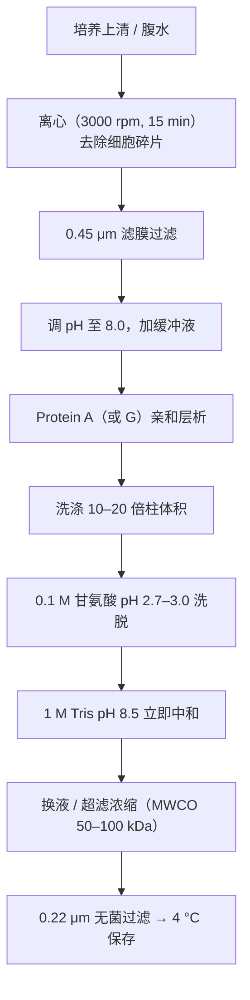
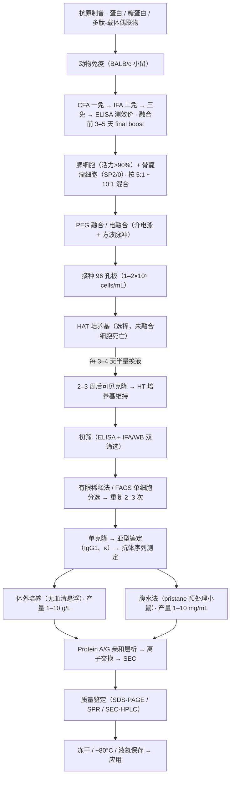

# 单克隆抗体（Monoclonal Antibody, mAb）

单克隆抗体是由**单一 B 细胞克隆**分泌、只针对**单一抗原决定簇（表位）**的均一性抗体。与多克隆抗体相比，它具有**特异性强、均一性高、可大量重复生产**三大优势，是现代生物制药（单抗药物占生物药市场最大份额）的核心技术。

---

## 一、核心概念与术语

| 术语 | 英文 | 含义 |
|---|---|---|
| **抗原决定簇** | Epitope | 抗原分子上被抗体识别的特定部位，决定特异性 |
| **半抗原** | Hapten | 本身无免疫原性，但与载体结合后具有免疫原性的小分子 |
| **载体** | Carrier | 常为 **BSA（牛血清白蛋白）**、**KLH（钥匙孔蝰蛇血蓝蛋白）**、**OVA（卵清白蛋白）** |
| **佐剂** | Adjuvant | 增强免疫原性，常用 **弗氏完全佐剂（CFA，含卡介苗）**、**不完全佐剂（IFA）**、** alum 铝盐**、**CpG ODN** |
| **杂交瘤** | Hybridoma | B 淋巴细胞 × 骨髓瘤细胞融合形成的杂种细胞，兼具"分泌特异性抗体"和"无限增殖"两大能力 |
| **HAT 选择培养基** | — | 含 **H**（次黄嘌呤）、**A**（氨基蝶呤）、**T**（胸腺嘧啶核苷），配合 HGPRT⁻ 的骨髓瘤细胞实现选择 |
| **有限稀释法** | Limiting Dilution | 使每孔仅含 1 个细胞，保证单克隆来源 |
| **有限性细胞株** | Finite Cell Line | 如 **SP2/0、NS0、P3X63Ag8.653**，有传代极限，需定期融合 |
| **无限性细胞株** | Continuous Cell Line | 如 **CHO、HEK293、 myeloma 细胞**，可无限传代 |

> **为什么必须融合？**
> B 淋巴细胞：能分泌特异性抗体，但**寿命有限**（体外最多传 20 代左右）
> 骨髓瘤细胞：**无限增殖**，但**不分泌抗体**（或抗体水平极低）
> 两者融合 → 兼具两者优点，且 HAT 筛选后剩下的都是融合成功的杂交瘤。

---

## 二、制备流程总览

![[mab-production-workflow.svg]]

> **流程的每一步都在解决同一个问题**：既要"**只认一个表位**"（特异性），又要"**能无限量生产**"（可持续性）。
>
> - **①→②** 解决抗体来源：用多价免疫获得高亲和力 B 细胞
> - **②** 是全流程的**核心巧思**——把"会分泌抗体但寿命有限"的脾细胞，与"能无限增殖但不分泌抗体"的骨髓瘤细胞**融合**，一举补齐两个短板
> - **③** 是**筛选**（HAT 让三种命运分道扬镳），**⑤** 是**纯化**（有限稀释确保单克隆）
> - **⑥→⑧** 是**工业化**：从实验室级放大到临床用药级

文本版流程图（便于复制）

- 抗原制备/选择 → 动物免疫（多次、多点、佐剂增强）
- 脾脏/B 淋巴细胞分离 → 体外与骨髓瘤细胞融合（PEG / 电融合）
- HAT 选择培养（7–14 天，未融合细胞死亡，杂交瘤存活）
- HT 培养基 → 抗体初筛（ELISA / 免疫荧光 / 免疫沉淀）
- 有限稀释法单克隆化（软琼脂集落形成 / 有限稀释 / FACS 单细胞分选）→ 重复 2–3 次
- 扩大培养 → 腹水法或体外培养制备大量抗体
- 纯化（盐析 / 层析 / 亲和层析）→ 鉴定 → 冷冻/冻干保存

---

## 三、详细步骤

### 1. 抗原制备与免疫

**抗原要求**
- **理想抗原**：分子量 > 10 kDa、结构复杂、含多个异源表位的**蛋白或多肽**
- **小分子（<10 kDa）**：需偶联载体（BSA、KLH）成为完全抗原
- **半抗原载体选择原则**：BSA 载体可能与目标抗体已有交叉反应背景，可换 **OVA、KLH、TT（破伤风类毒素）**
- **特殊抗原**：
  - 糖类/脂类 → 需特殊佐剂或**糖肽偶联**
  - 核酸/蛋白复合物 → 天然免疫识别强
  - 细胞表面分子 → 可直接用**完整细胞/固定细胞**免疫，或用**膜蛋白提取物**

**免疫程序（典型方案）**

| 阶段 | 时间 | 操作 | 目的 |
|---|---|---|---|
| **预免疫** | −21 天 | 抗原 + CFA，腹腔/多点免疫，采**阴性血清**作对照 | 取得同型背景，验证抗血清效价 |
| **一免** | 第 0 天 | 抗原 + CFA，多点（腹股沟、腋下、背部）皮内/腹腔 | 建立初级免疫应答 |
| **二免** | 第 14–21 天 | 抗原 + IFA，加强免疫 | 产生记忆细胞 |
| **三免/多免** | 每 14–21 天 | 抗原 + IFA，不加佐剂也可 | 提升亲和力与效价 |
| **检测** | 每次免疫后 7–10 天 | 尾静脉采血，**ELISA 测效价** | 效价达 **10⁵–10⁶** 即可融合 |
| **融合前** | 融合前 **3–5 天** | **仅免疫一次（无佐剂）加强免疫**（Final Boost） | 保证脾脏中处于**分裂高峰**的 B 细胞最多，**融合率最高** |

> **关键点**：融合效率与脾脏中**处于有丝分裂高峰的活化 B 细胞**数量正相关。融合前 3–5 天加强免疫是提高产量最有效的手段。

**宿主选择**
- **BALB/c 小鼠**（最常用）→ 骨髓瘤用 **SP2/0**（鼠-鼠杂交瘤，抗体为**小鼠 IgG**）
- **FVB/N 小鼠** → **p63.6Ag8.653**
- **rat** → 大鼠骨髓瘤
- **Human → human hybridoma**：需用 **HBV immortalization** 或人源骨髓瘤

---

### 2. 融合（Fusion）

**细胞准备**
| 细胞 | 来源 | 要求 |
|---|---|---|
| **脾细胞** | 免疫后小鼠脾脏 | **活力 > 90%**，计数准确（B 淋巴细胞约占脾细胞 50%） |
| **骨髓瘤细胞** | 培养传代 | **处于对数生长期**，**活力 > 90%**，**HGPRT⁻（TK⁻）**，无支原体 |
| **比例** | — | **脾:B 瘤 = 5:1 ~ 10:1**（1 个脾脏约 1×10⁸ 脾细胞，配 1×10⁷ 瘤细胞） |

**融合方法**

**(a) PEG 融合（经典法）**
1. 脾细胞 + 骨髓瘤细胞混合，离心（1000 rpm, 5 min）弃上清
2. 加入 **50% PEG 1500（pH 7.4–8.0， Merck 1500 级）**，**1 min 内逐滴加入**，用滴管轻柔吹打
3. **PEG 作用严格控制在 90 s–2 min**，超过则毒性大、融合率反降
4. 加入 10 mL 无血清培养基**稀释** PEG（终止融合）
5. 离心弃上清 → 制成细胞悬液

**(b) 电融合（更可控，近年主流）**
- 用**低电导率融合液**（Mannitol + Ca²⁺/Mg²⁺ 缓冲液）
- **介电泳（DEP）**：非均匀电场使同种细胞聚成"珍珠链"排成一列
- **方波脉冲**（1–5 kV/cm，30–50 μs）使相邻细胞膜融合
- 优点：**融合率可提高 5–10 倍**，**无 PEG 毒性**，参数可控可重复
- 缺点：需要专用设备（Electroporation/Cell Fusion System）

**融合率计算**
$$\text{融合率} = \frac{\text{融合细胞数}}{\text{总细胞数}} \times 100\% \quad (\approx 10^{-5} \sim 10^{-4})$$
实际杂交瘤产率：每只鼠约 **10³–10⁵ 个杂交瘤克隆。

---

### 3. HAT 选择培养（Selection）

**原理（代谢互补/嘌呤 salvage pathway 缺陷互补）**

| 细胞类型 | HGPRT⁻/TK⁻ | 能否在 HAT 中生长 | 原因 |
|---|---|---|---|
| **未融合的脾细胞** | 正常 | ❌ 死亡 | 有 salvage 通路，但**培养 7–14 天后自身死亡**（非无限增殖） |
| **未融合的骨髓瘤** | **HGPRT⁻** | ❌ 死亡 | 不能 salvage；氨基蝶呤阻断 de novo 合成，无外源嘌呤可救 |
| **脾-瘤融合细胞（杂交瘤）** | **HGPRT 正常（来自脾细胞）** | ✅ 存活 | salvage 通路 + **无限增殖（来自瘤细胞）**，双优势 |
| **瘤-瘤融合** | HGPRT⁻ | ❌ 死亡 | 无 salvage |
| **脾-脾融合** | 正常 | ❌ 死亡 | 无无限增殖能力 |

**培养基配方要点**
- **HAT** = 次黄嘌呤（H, 10⁻⁴ M）+ **氨基蝶呤**（A, 0.5×10⁻⁴ M）+ **胸腺嘧啶核苷**（T, 10⁻⁴ M）
- **HT**（只含 H + T，不含 A）：融合后第 7–14 天，氨基蝶呤毒性逐渐消失，**改用 HT 培养基维持**
- 基础：**RPMI 1640 或 DMEM** + **10–15% FBS（或 20% 马血清）** + 1% P/S
- **添加物**：**2 mM L-谷氨酰胺**、**1 mM 丙酮酸钠**、**1 mM MEM 非必需氨基酸**、**0.1 mM 嘌呤霉素**（可选）
- 接种密度：HAT 培养基中 **1–2×10⁵ cells/mL**，加至 96 孔板（100 µL/孔）
- **每 3–4 天半量换液**一次（小心吸出上清，避免吹散贴壁/悬浮的杂交瘤克隆）
- **2–3 周后**肉眼可见克隆，转入 HT 培养基

> **为何用马血清？** 血清中的多胺（ spermidine、spermine）能**促进杂交瘤细胞的存活与增殖**，因此 HS（Horse Serum）常优于 FBS。

---

### 4. 抗体筛选与克隆化

#### 4.1 初次筛选（Antibody Screening）

从混合的杂交瘤群体中筛出**产目标抗体且浓度高**的克隆。常用方法：

| 方法 | 原理 | 优点 | 局限 |
|---|---|---|---|
| **ELISA**（间接法 / 夹心法 / 竞争法） | 检测结合可溶性抗原或固相化抗原 | 定量、高通量、可自动化 | 依赖抗原构象正确，可能假阳性（固相化导致变性） |
| **间接免疫荧光（IFA）** | 固定细胞 + 二抗荧光 | 可识别**天然构象表位**（适合细胞表面分子、膜蛋白） | 通量低、需逐孔观察 |
| **免疫印迹（Western blot）** | 电泳分离后检测 | 判断**分子量特异性** | 需高质量抗体作二抗识别鼠 IgG |
| **免疫沉淀 / IP** | 沉淀靶蛋白复合物 | 可判断**生理性复合物** | 通量低 |
| **功能实验** | 中和/阻断、补体激活、细胞毒 | 最有价值（治疗性抗体必须有功能） | 通量极低，二轮筛选用 |
| **Protein A/G 柱纯化 + SDS-PAGE** | 快速判断抗体产量与纯度 | 判断单克隆性 | 耗时 |

**最佳实践**：**双筛选**（先用 ELISA 做高通量初筛 → 再用 IFA/Western 做特异性确认）。

#### 4.2 单克隆化（Cloning / Subcloning）

**为什么必须单克隆化？**
HAT 筛选后虽然所有细胞都是杂交瘤，但**一个融合事件产生的克隆可能包含 2 个以上融合细胞**（多核融合或二次融合），会分泌**两种不同抗体**。必须通过**单细胞克隆化**确保"一个细胞—一种抗体"。

**方法 1：有限稀释法（Limiting Dilution）— 最常用**
1. 将杂交瘤以 **0.5–1 个细胞/mL** 稀释（用血细胞计数板准确计数）
2. 每孔加 **0.1 mL**（即 0.05–0.1 个细胞/孔），96 孔板
3. 加饲养细胞（**腹腔巨噬细胞、NIH 3T3 细胞**，约 1×10⁵ cells/孔）提供因子支持
4. 7–14 天后观察：**仅单孔有细胞生长**即为单克隆
5. **重复 2–3 轮**，确认克隆率 > 95%

**验证单克隆性的确证指标**
- **软琼脂集落形成实验**：单细胞在软琼脂中形成**单一集落**
- **抗体亚型同型**：单克隆只表达**一种 IgG 亚类/轻链**（可用同型特异性抗体检测）
- **IgG 序列测定**：多次传代后抗体序列不变

**方法 2：软琼脂集落分离**
- 0.8% 琼脂糖铺底 → 杂交瘤在 0.4% 半固体琼脂上层铺板
- 单细胞在两相琼脂界面形成**独立圆形集落**
- 用**克隆环（Cloning Ring）**或**微量吸管**挑取单个集落传至 96 孔板

**方法 3：FACS 单细胞分选**
- 用**抗小鼠 IgG 荧光抗体**标记细胞（所有杂交瘤都抗 IgG）
- 依 **FSC/SSC + 荧光强度**分选单个细胞入孔（**Index Sorting** 可同时记录每个克隆的抗体结合特性）
- 可搭配**自动化单细胞分液系统（Single Cell Sorting, Cluony）**
- 优点：可**同时筛选"抗体产量高 + 抗原特异性强"**的克隆
- 缺点：需流式细胞仪，成本高

**方法 4：显微操作法（Micromanipulation）**
- 在倒置显微镜下，用**玻璃微吸管**直接吸出**单个**细胞置于液滴/96 孔板
- **100% 单克隆**，但极耗时、需高度技巧

---

### 5. 大规模制备（Antibody Production）

#### 5.1 体外培养法（In Vitro）

| 培养方式 | 培养基 | 产量 | 说明 |
|---|---|---|---|
| **悬浮培养** | **无血清 + 无蛋白培养基**（CD-CHO、Freestyle F17、UltraCHO） | **1–5 g/L**（可达 10 g/L） | 现代主流；**无动物源成分**，安全性高，适合临床用药 |
| **贴壁培养** | DMEM + 10–15% FBS | 0.05–0.5 mg/mL | 传统方法，产量低、含 FBS 不适合药用 |
| **载体表达** | 转染/转导 mAb 基因入 CHO/HEK293 | 视载体而定 | 用于**无血清稳定株**构建与工艺开发 |

**悬浮培养补充要点**
- 抗血清蛋白（Anti-CHO DG44/CHO-K1）：去除了 **抗 ApE/CHO 细胞污染**
- 添加**谷氨酰胺（GlutaMAX）**、**中性蛋白胨/蛋白酶抑制剂**
- 悬浮适应：逐步降低 **剪切力**（特定搅拌转速）、加入 **聚乙烯醇（PVA）**或 **明胶**作为**抗剪切保护剂**
- 控制 **DO（溶氧）10–30%**、**pH 7.0–7.4**、渗透压 **280–320 mOsm/kg**

#### 5.2 腹水法（Ascites）— 经典高产量法

**原理**：小鼠腹腔内注射 **pristane（降植烷，1 mL）或 Freund 不完全佐剂**，使腹腔毛细血管/腹膜发生**炎症反应与血管通透性升高**，便于注入的杂交瘤细胞定植增殖并**积聚腹水**。

**流程**
1. 选择 **8–12 周龄 BALB/c 小鼠**（先用血清学鉴定**同一品系且无特定病原**）
2. 前 3 天腹腔注射 **pristane 0.5–1 mL/只**
3. 注射 **5×10⁶ 杂交瘤细胞**（PBS 或完全培养基 0.5–1 mL）腹腔
4. **7–14 天**后小鼠腹部膨隆（可达 **3–20 mL 腹水**）
5. **无菌穿刺**（26G 针头，下腹部）抽取腹水 → 3000 rpm 离心 10 min 去除细胞和血细胞
6. **腹水抗体浓度可达 1–10 mg/mL**（是体外法的 100–1000 倍）

**注意与限制**
- ⚠️ **动物福利**：需符合实验动物伦理（3R 原则），欧洲已**全面禁止**临床级抗体的腹水生产
- ⚠️ **杂蛋白污染**：腹水含小鼠自身 IgG，需**亲和层析**纯化
- ⚠️ **内毒素/病毒**风险；活体生产难以质量标准化
- → **工业/临床用抗体现已全面转向无血清悬浮培养**

---

### 6. 抗体纯化（Purification）

**基本流程（Protein A/G 亲和层析为核心）**

**各层析方法对比**

| 方法 | 分离依据 | 用途 |
|---|---|---|
| **Protein A / G 亲和** | 结合 Fc 区（IgG） | **首选**，一步纯化，>95% 纯度 |
| **离子交换（IEX）** | 蛋白净电荷（等电点 pI） | 精制、去核酸/内毒素 |
| **疏水层析（HIC）** | 疏水性差异 | 去除病毒、宿主蛋白（HCP） |
| **分子排阻（SEC）** | 分子大小 | 去除**聚集体**，分离单体/二聚体 |
| **亲和（抗原偶联柱）** | 特异结合靶抗原 | **去除残余靶蛋白**，验证特异性 |
| **离子交换膜层析（SPTFF）** | 瞬时病毒清除 | 病毒安全（工艺需求） |

> ⚠️ **低 pH 洗脱的风险**：重链/轻链之间可能发生**断裂或去酰胺化**。必须**快速洗脱 + 立即中和**。对抗体 Fc 片段敏感的 mAb，建议用**预装柱的 neutralizing buffer** 或在洗脱缓冲液中加入 **精氨酸**保护。

---

### 7. 质量鉴定与表征（Characterization）

| 类别 | 检测项目 | 方法 | 合格标准 |
|---|---|---|---|
| **纯度** | SDS-PAGE（还原/非还原） | 银染、考马斯亮蓝 | **重链 50 kDa / 轻链 25 kDa**，纯度 >95% |
| **分子量** | SEC-HPLC | HPLC | IgG ~150 kDa |
| **浓度** | 紫外吸收 A280 | Nanodrop | ε = 1.4（1 mg/mL ≈ 1.4 A280） |
| **特异性** | ELISA / Western / IFA / IP-MS | — | 只结合目标抗原，不结合其它蛋白 |
| **亲和力（Kd）** | SPR | Biacore | 通常 **10⁻⁹ ~ 10⁻¹² M** |
| **效价** | 间接 ELISA | 抗体梯度稀释 | 以抗体浓度或稀释度表示 |
| **亚型** | 同型特异性抗抗体 | ELISA | 小鼠 IgG1/IgG2a/IgG2b 等 |
| **纯合性** | Light Chain Isotype Kit | — | κ/λ 单一 |
| **热稳定性** | DSF（差示扫描荧光量热） | — | Tm ≥ 60–70°C |
| **聚集** | SEC / DLS | — | 聚集体 < 0.5% |
| **内毒素** | 凝胶法/光度法/鲎试剂 | — | 临床级 < 0.5 EU/dose |
| **交叉反应** | 多组织/多物种交叉反应谱 | 免疫组化 | 阴性 |

**更精细的结构分析（药物开发阶段）**
- **质谱（MS/MS）**：鉴定序列、测糖基化位点与糖型（G0F/G1F/G2F）
- **CD / 二级结构**：评估折叠稳定性
- **X 射线晶体学 / 冷冻电镜（cryo-EM）**：解析 Fab-抗原复合物 **3D 结构**，指导亲和力成熟
- **糖基化分析**：CHO 表达抗体有 **Fc 糖基化**（影响 FcγR 结合与 ADCC），无血清培养需优化 **Mn²⁺、甘露糖、UDP-半乳糖** 等补加策略

---

### 8. 保存

- **短期**：4°C 保存于无菌管（0.1% 叠氮钠防腐，**但叠氮钠会破坏 HRP**，检测前须除去）
- **长期**：−80°C 冷冻（避免反复冻融）→ **液氮 −196°C**（更稳定，1–5 年）
- **抗体浓度**：0.5–2 mg/mL（避免低浓度吸附损失），缓冲体系 **PBS pH 7.4 + 0.1% BSA/0.05% Tween-20**（防止低浓度吸附在管壁）
- **冻干**：加 **5–10% 蔗糖/甘露醇** 保护剂 → 冻干粉 −20°C 保存，复溶后 4°C

---

## 四、多克隆抗体 vs 单克隆抗体

| 特征 | 多克隆抗体（PAb） | **单克隆抗体（mAb）** |
|---|---|---|
| **来源** | 多个 B 细胞克隆 | **单一 B 细胞克隆** |
| **特异性** | 多表位，交叉反应多 | **单一表位，特异性高** |
| **均一性** | 异质性（分子量、电荷、亲和力各异） | **均一**（单分子类型） |
| **亲和力** | 相对较低（表位亲和力平均） | **高**（经过亲和力成熟） |
| **批间一致性** | 差（依赖动物个体和免疫状态） | **极好**（可无限重复生产） |
| **可重复生产** | ❌ 有限 | ✅ **无限**（依赖永生化细胞株） |
| **成本** | 低（动物免疫即可） | **高**（细胞株构建 + 筛选 + 纯化成本高） |
| **应用** | 免疫诊断、科研（ChIP/WB/FC） | **治疗性抗体、诊断试剂、标准品** |

---

## 五、常见问题与解决方案

| 问题 | 可能原因 | 解决方法 |
|---|---|---|
| **融合率低** | 脾细胞活力差 / 瘤细胞比例不当 / 融合太慢 | 活力 >90%；调整比例 5:1~10:1；PEG 加液 90 s 内完成 |
| **杂交瘤不成活** | pH 偏低 / PEG 毒性 / 血清不足 | 融合后次日**用不含 PEG 的完全培养基换液**；用马血清；避免超过 1 min |
| **HAT 中全死** | 血清不够 / 腺苷拮抗剂过量 / 瘤细胞 HGPRT⁻ 不彻底 | 换优质血清；降低 A 浓度；确认瘤细胞表型 |
| **抗体不分泌** | 脾细胞来源不对（应取**免疫后 3–5 天脾脏**）/ 融合的是非 B 细胞 | 取**脾脏全部细胞**混合（含 T 细胞但只有 B 细胞分泌抗体）即可；确认免疫质量 |
| **融合率正常但 ELISA 全阴** | 抗原构象改变 / 抗体针对非目标 / 抗体检不出 | 用**多种检测方法**（ELISA+IFA+WB）平行；检测**免疫原原液**；设阳性对照 |
| **单克隆化失败（板里多个克隆）** | 计数不准 / 悬液未充分混匀 | 用**血细胞计数板 + 台盼蓝**精确计数；每次稀释后**充分振荡混匀**；接种后**静置 30 min** 再入 CO₂ 箱 |
| **抗体产量骤降** | 支原体污染 / 细胞过度老化 / 换液过频 | **PCR 检测支原体**；复温复苏早期冻存；2–3 天换液一次 |
| **纯度低（杂带多）** | 上清未澄清 / 柱子未平衡 / pH 未调 | 离心+过滤充分；柱平衡 5–10 CV；上样前调 pH 8.0、离子强度 |
| **SDS-PAGE 断链** | pH 洗脱过低、时间过长 | **洗脱液立即中和**，缩短洗脱时间 |
| **内毒素超标** | 培养体系污染 / 内毒素残留 | 用**超纯水/试剂**；改用无血清培养基；纯化后除内毒素柱处理 |

---

## 六、延伸：重组单抗与人源化

传统杂交瘤产生的是**鼠源抗体**（mAb），临床应用存在两个核心问题：
1. **免疫原性（Human Anti-Mouse Antibody, HAMA）** —— 患者产生抗鼠抗体，影响疗效并可能引发过敏
2. **效应功能有限** —— 鼠 IgG1 几乎不激活人 FcγR，ADCC 弱

**改进策略（递进式）**

| 类型 | 结构特点 | 人源化程度 | 免疫原性 | ADCC |
|---|---|---|---|---|
| **鼠源（Murine）** | 全鼠 | 0% | 高 | 弱 |
| **嵌合（Chimeric）** | 鼠 **Fab** + 人 **Fc** | ~30% | 中 | 中/强 |
| **人源化（Humanized）** | **CDR 移植**（6 个 CDR 取自鼠）+ 人框架 | ~90% | 低 | 强 |
| **全人（Fully Human）** | 全部序列人源 | 100% | 极低 | 强 |
| **Fab 片段** | 无 Fc | — | 低 | **无**（用于阻断类药物） |

**全人抗体的制备途径**
- **噬菌体展示文库筛选**（Phage Display）：从健康供者获取 B 细胞 → 扩增 VH/VL → 构建 scFv 噬菌体文库（10⁹–10¹¹ 克隆）→ 活菌淘洗筛选特异性 → 表达为 IgG
- **转基因小鼠**（HuMab-Mouse、XenoMouse）：小鼠基因组被替换为人免疫球蛋白基因座 → 免疫后直接获得**全人单抗**
- **单个 B 细胞克隆化 + NGS**：单细胞分选 IgG⁺ B 细胞 → 单细胞 RT-PCR 扩增重轻链 → 建库测序 → 表达

**增强效应功能的工程化设计**
- **Fc 效应器功能增强**：LALA-PG（打除 FcγR 结合）、三突变体、**增强 FcγRIIIa 结合** → 强化 ADCC
- **ADCC 增强抗体制剂**：加入 **抗 CD3 双特异性抗体**或**检查点抑制剂联合**
- **ADC（抗体偶联药物）**：抗体 + 药物毒素（linker：可裂解型 / 不可裂解型）
- **双特异性抗体（Bi-specific）**：双特异 T 细胞衔接器（BiTE，如 **Blinatumomab**）、双抗 HER2 双表位

---

## 七、应用领域

| 领域 | 典型应用 | 代表药物/试剂 |
|---|---|---|
| **肿瘤治疗** | 阻断生长信号、ADCC、抗体偶联药物、双抗 | **Trastuzumab（曲妥珠）**、**Rituximab（利妥昔）**、**Pembrolizumab（帕博利）**、**Blinatumomab** |
| **自身免疫/炎症** | 中和细胞因子、阻断受体 | **TNF-α 抗体（Adalimumab/英夫利）**、**IL-6R 抗体**、**Nivolumab** |
| **感染性疾病** | 中和病毒/毒素 | **狂犬病单抗**、**SARS/COVID 抗体（依稀奇单抗等）**、**HBV 中和抗体** |
| **移植/器官移植** | 抗排斥 | **抗 CD25（Daclizumab）**、**ATG（兔源多抗）** |
| **体外诊断（IVD）** | ELISA、化学发光侧向层析 | 早孕棒、肿瘤标志物（AFP/CEA/CA19-9）抗体 |
| **科研工具** | WB / IF / IP / FC / IHC / 免疫沉淀 | 研究用单抗（Sigma、Abcam 等） |
| **蛋白功能研究** | 封闭抗原表位、诱导/阻断信号 | 研究级功能抗体 |

---

## 八、完整流程图

---

## 附：关键缩写对照

| 缩写 | 全称 | 中文 |
|---|---|---|
| **mAb** | Monoclonal Antibody | 单克隆抗体 |
| **PEG** | Polyethylene Glycol | 聚乙二醇（融合剂） |
| **HAT** | Hypoxanthine-Aminopterin-Thymidine | HAT 选择培养基 |
| **HGPRT** | Hypoxanthine-Guanine Phosphoribosyltransferase | 次黄嘌呤-鸟嘌呤磷酸核糖转移酶 |
| **SP2/0** | — | 小鼠骨髓瘤细胞系（常用融合亲本） |
| **NS0** | — | 非致瘤小鼠骨髓瘤细胞系（常用融合亲本） |
| **ELISA** | Enzyme-Linked Immunosorbent Assay | 酶联免疫吸附测定 |
| **IFA / CFA** | Incomplete/Complete Freund's Adjuvant | 不完全/完全弗氏佐剂 |
| **BSA / KLH / OVA** | Bovine Serum Albumin / Keyhole Limpet Hemocyanin / Ovalbumin | 牛血清白蛋白 / 钥匙孔蝰蛇血蓝蛋白 / 卵清白蛋白 |
| **Protein A/G** | — | 抗 IgG Fc 亲和蛋白（层析介质） |
| **SPR** | Surface Plasmon Resonance | 表面等离子体共振 |
| **AFM / DF** | Affinity / Dissociation constant | 亲和力 / 解离常数（Kd） |
| **CHO** | Chinese Hamster Ovary | 中国仓鼠卵巢 |
| **DMEM** | Dulbecco's Modified Eagle Medium | 杜尔贝科改良伊格尔培养基 |
| **FBS / HS** | Fetal Bovine Serum / Horse Serum | 胎牛血清 / 马血清 |
| **DMSO** | Dimethyl Sulfoxide | 二甲基亚砜 |
| **A280** | 吸光度（280 nm） | 蛋白浓度定量 |
| **PD-1 / HER2** | — | 程序性死亡受体 1 / 人表皮生长因子受体 2 |
| **ADCC / CDC** | Antibody-Dependent Cell-mediated Cytotoxicity / Complement-Dependent Cytotoxicity | 抗体依赖细胞介导杀伤 / 补体依赖杀伤 |
| **HAMA** | Human Anti-Mouse Antibody | 人抗鼠抗体 |
| **ADC / BiTE** | Antibody-Drug Conjugate / Bispecific T-cell Engager | 抗体偶联药物 / 双特异性 T 细胞衔接器 |
| **AI** | Artificial Intelligence | 人工智能（单抗筛选中的新工具） |

---

> **一句话总结**：单克隆抗体的本质是"**一个 B 细胞克隆 + 一个抗体分子 + 一条可无限重复的生产线**"。它的全部技术环节——**免疫、融合、选择、克隆化、放大、纯化、表征**——都围绕同一个目标服务：**确保每一次拿到的抗体完全一致，且只认一个表位**。