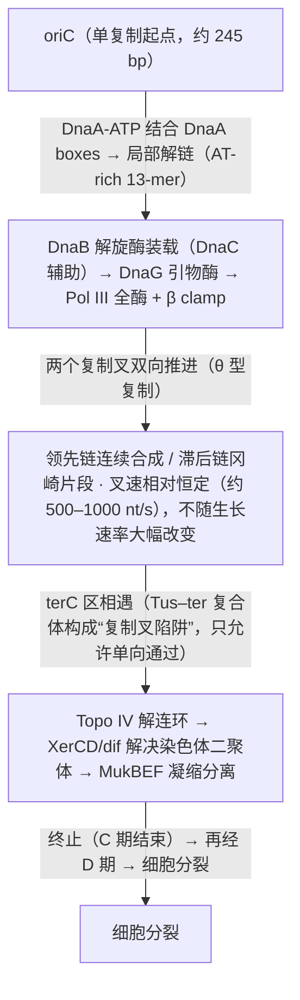

# 细菌的生长、复制、分裂：快生长与慢生长

> **一句话**：**生长是"变长"、复制是"抄 DNA"、分裂是"切一刀"** —— 三件事由三套分子机器执行，时间尺度彼此独立。慢生长时它们顺序排队（一轮复制 → 一次分裂）；快生长时**倍增时间 τ 短于复制加分裂所需的 C+D（约 60 min）**，细胞只能在前一轮复制还没结束时就启动下一轮，形成**嵌套的多叉复制（multifork replication）**，于是子细胞一出生，染色体就已经带着正在跑的复制叉。
>
> **判据只有一条**：**τ ≥ C+D 是慢生长；τ < C+D 是快生长。**

---

## 一、先把三个过程拆开（最常混的地方）

| 过程 | 到底在做什么 | 执行机器 | 耗时（*E. coli*, 37 ℃ 富营养） | 典型观测指标 |
|---|---|---|---|---|
| **生长**（growth） | 生物量增加、细胞**纵向伸长**（不是变胖） | 核糖体合成蛋白；**elongasome**（MreB、RodA、PBP2）定向插入肽聚糖 | 连续进行，指数式 | OD₆₀₀、细胞长度、蛋白/质量 |
| **复制**（replication） | 染色体 DNA 从 oriC 双向复制到 terC | **replisome**（DnaA、DnaB、DnaG、Pol III 全酶、β clamp） | **C 期 ≈ 40 min** | ³H-胸苷掺入、DNA/质量比、流式 DNA 含量 |
| **分裂**（division） | 中部形成隔膜，一分为二 | **divisome**（FtsZ 的 Z 环、FtsA/ZipA、FtsI/PBP3） | **D 期 ≈ 20 min**（复制终止→分裂完成） | 细胞数、隔膜形态 |

> **三者可以解耦，这是全篇的前提**。抑制分裂（头孢氨苄、SOS 的 SulA）→ 细胞继续伸长、继续复制，变成**多核丝状体**；抑制复制（羟基脲）→ 细胞仍可伸长一段时间；抑制蛋白合成（氯霉素）→ 已起始的复制能跑完，但不再新起始、也不分裂。

![[bacterial-three-machines.svg]]

---

## 二、复制：C 期与"起始质量"阈值

### 2.1 一轮复制的分子事件

### 2.2 起始是唯一的调控关卡

| 机制 | 作用 |
|---|---|
| **DnaA-ATP 积累** | 活性形式达阈值才起始；ATP 型 DnaA 与 ADP 型比例是核心开关 |
| **RIDA**（Hda + β clamp） | 复制开始后把 DnaA-ATP 水解成 DnaA-ADP，**防止同一周期内再起始** |
| **SeqA / Dam 甲基化** | 新复制的 oriC 处于半甲基化状态，被 SeqA 隔离（sequestration）一段时间 |
| **datA / DARS** | 分别滴定 DnaA、促进 ADP→ATP 再生，精细调节可用 DnaA 池 |
| **同步起始** | 一个细胞内所有 oriC **在同一时刻一起起始**，保证子细胞染色体拷贝数一致 |

### 2.3 ★ 起始质量恒定（Donachie, 1968）

> 细胞不是"按时间表"起始复制，而是**按体积/质量**起始：**每个 oriC 对应一个恒定的起始质量 Mᵢ**，且 Mᵢ 基本**不随生长速率改变**。

- 细胞指数长大，当 质量 / oriC 数 达到 Mᵢ 时，所有 oriC 同步点火。
- 推论 1：τ 越短 → 细胞越大、oriC 越多、单位质量的 DNA 起始事件越频繁。
- 推论 2：细胞体积近似满足 **V ∝ 2^((C+D)/τ)** —— 快生长细胞明显更大。
- 推论 3：**生长定律**：核糖体占蛋白的质量分数与生长速率近似线性正相关；快生长菌把大量资源投给 rRNA/核糖体。

---

## 三、分裂：D 期与"不能切到染色体"

| 环节 | 分子机制 |
|---|---|
| **Z 环形成** | FtsZ（微管蛋白同源 GTP 酶）在中部聚合成环，招募 FtsA、ZipA 及下游 divisome |
| **位置选择①：Min 系统** | MinC/MinD/MinE 在两极间振荡，使 MinC（FtsZ 抑制因子）**平均浓度在细胞中部最低** → 抑制两极分裂 |
| **位置选择②：核区闭塞** | SlmA（*E. coli*）/ Noc（*B. subtilis*）结合染色体 DNA 并抑制 FtsZ 聚合 → **染色体没搬走就不许在其上方切** |
| **隔膜合成** | FtsI（PBP3）等合成 septal 肽聚糖，内陷并收缩 |
| **染色体最后清理** | Topo IV 解连环、XerCD/dif 解二聚体；**FtsK** 作为 DNA 转位酶把残留 DNA 泵出闭合中的隔膜 |
| **损伤时刹车** | DNA 损伤 → SOS 反应 → **SulA 抑制 FtsZ** → 细胞丝状化，延迟分裂等修复完成 |

> **分裂与复制的协调点是"终止 + 分离"**：不要求复制全部结束后才开始长隔膜，但**必须有不含染色体的中部区域**才能让 Z 环收缩。复制与分离越快完成，D 期越短。

---

## 四、时间参数：C、D、B 与 τ

| 参数 | 定义 | 典型值 |
|---|---|---|
| **C 期** | 一轮染色体复制所需时间 | ≈ 40 min |
| **D 期** | 复制终止 → 细胞分裂完成 | ≈ 20 min |
| **C + D** | **一次起始到"由它导致的那次分裂"的固定延迟** | ≈ 60 min |
| **τ** | 倍增时间（世代时间） | 富营养 20–30 min；贫营养 ≥ 60 min 至数小时 |
| **B 期** | 分裂 → 下一次起始的间隔（类似真核 G1） | 慢生长为正；**快生长消失（起始提前到上一代）** |

> **C 和 D 对生长速率相对不敏感**，τ 却可以差 10 倍以上。**变化的是起始频率与重叠轮数，不是把复制本身变快** —— 这是理解快慢生长最关键的一句。

---

## 五、慢生长 vs 快生长（核心）

![[bacterial-C-D-slow-fast.svg]]

### 5.1 慢生长：τ ≥ C+D（顺序模式）

- 一轮起始 → C 期复制 → 终止 → D 期 → 分裂 → **B 期等待** → 下一轮起始。
- **无重叠**：一个细胞里最多一对复制叉（2 个 forks）。
- 出生时染色体基本是**未复制的 1 份**（ori 1 个、ter 1 个）。
- 每次分裂染色体数 1 → 2，逻辑上与真核细胞周期"顺序推进"很像。
- 细胞**小**、核糖体少、DNA/质量比低、ppGpp 偏高（严格反应）。
- 典型条件：贫碳源（乙酸、甘油）、低温、营养限制、稳定期前。

### 5.2 快生长：τ < C+D（重叠 / 多叉模式）

**矛盾**：细胞每 20 min 就要分裂一次，但一次复制加分裂要 60 min。若等复制完再分裂，最快也只能 60 min 一代。

**解法**：**提前起始、并行跑**。这一次分裂所需要的染色体，其复制早在**上一代甚至上两代**就开始了。

| 特征 | 说明 |
|---|---|
| **多叉复制**（multifork / nested replication） | 多个复制周期在时间上重叠，同一细胞内同时运行 4–8 个复制叉 |
| **起始提前的代数** | n ≈ (C+D)/τ；τ=20 min 时 n ≈ 3，即**起始比分裂早 3 代** |
| **起始与分裂都每 τ 一次** | 只是彼此错开 (C+D)，形成稳定的错位流水线 |
| **出生时染色体已部分复制** | 子细胞一出生就带有正在运行的复制叉和多份 ori，**没有"G1 期"** |
| **ori : ter 拷贝比** | ≈ 2^(C/τ)；τ=20、C=40 时约 **4 : 1**（ori  proximal 区域剂量高） |
| **复制叉速度不变** | 快生长不是"叉跑得更快"，是**同时开更多叉** |
| 细胞形态 | **更大**、更长，DNA 含量高，核糖体占比高，ppGpp 低 |

> 精确数值随菌株、温度、培养基而变，重点是**数量级与逻辑**：τ 每缩短一半，重叠轮数与 ori 剂量大致翻倍。

### 5.3 完整对照表

| 维度 | **慢生长** | **快生长** |
|---|---|---|
| 倍增时间 τ | ≥ C+D（≥ ~60 min） | < C+D（20–40 min 常见） |
| C 期长度 | ~40 min | ~40 min（**基本不变**） |
| D 期长度 | ~20 min | ~20 min（**基本不变**） |
| **B 期** | **存在**（分裂后等一段时间才起始） | **消失**（起始提前到母代/祖母代） |
| 复制周期 | 一轮接一轮，顺序 | **多轮重叠、嵌套** |
| 同时运行的复制叉 | 2 个 | 4–8 个或更多 |
| ori : ter 拷贝比 | ≈ 1 : 1 | 可达 **4 : 1** 甚至更高 |
| 出生时染色体 | 未复制的 1 份 | **已部分复制、带活跃复制叉** |
| 起始发生在 | 当代 | **上一代 / 上两代** |
| 细胞体积 | 小 | **大**（V 随 (C+D)/τ 指数增大） |
| 核糖体 / rRNA | 少，rRNA 转录低 | **多**，生长定律线性相关 |
| (p)ppGpp | 偏高（严格反应） | 低 |
| 基因剂量效应 | 几乎无 | **ori 近端基因剂量显著升高** |
| 对抗复制/分裂药物 | 相对不敏感 | 更敏感（复制叉多、分裂频繁） |
| 典型培养 | 贫碳源、低温、限制培养 | LB、丰富培养基、最适温度 |

### 5.4 一个漂亮的推论：基因剂量与基因组布局

- 快生长时 oriC 附近区域的拷贝数是 terC 附近的数倍 → **ori 近端基因天然高表达**。
- 进化因此把** rRNA 操纵子（*E. coli* 有 7 个 rrn）与核糖体蛋白基因集中在 oriC 附近**，正好服务快生长对核糖体的巨大需求。
- 实验判据：把同一报告基因分别插入 ori 近端与 ter 近端，**快生长时两者表达差可达数倍，慢生长时接近 1:1**。
- 这解释了为什么细菌基因组上基因的位置不是随机的。

---

## 六、Cooper–Helmstetter 模型

| 关系 | 含义 |
|---|---|
| 分裂时刻 = 起始时刻 + (C+D) | **固定延迟**，与 τ 无关 |
| 起始间隔 = 分裂间隔 = τ | 稳态下两条流水线同频、错位运行 |
| 重叠轮数 n ≈ (C+D)/τ | 决定一个细胞内同时跑几轮复制 |
| ori : ter ≈ 2^(C/τ) | 基因剂量效应 |
| 平均 DNA 含量 ∝ 2^((C+D)/τ) | 快生长细胞 DNA 多 |
| 起始质量 Mᵢ 恒定 | 把"时间控制"转化为"体积控制" |

### run-out 实验：C、D 期是怎么测出来的

1. 取**稳态培养**的细胞。
2. 加**利福平**（rifampicin）：阻断转录，不允许新的复制起始。
3. 加**头孢氨苄**（cephalexin）：阻断分裂，细胞不裂、不稀释结果。
4. 继续孵育：已经启动的复制叉把各自那轮复制跑完，然后全停。
5. **流式细胞术**测单细胞 DNA 含量。

- 结果呈**离散峰**（如 2C、4C、8C…），峰的数目 = 起始时 oriC 的拷贝数。
- 由此反推每个细胞有多少个正在运行的复制叉、C 期多长；配合细胞数变化可求 D 期。
- **设计精髓**：用"只让存量跑完、禁止新增"把动态过程冻结成静态分布，是细菌细胞周期研究的经典范式。

---

## 七、营养转换：从慢到快不是瞬间完成的

| 转换 | 立即发生 | 滞后发生 | 过渡期表型 |
|---|---|---|---|
| **Shift-up**（加富营养） | rRNA/核糖体合成迅速上调、起始质量更快达到 | 分裂速率约滞后 **C+D** 才跟上 | 细胞先变**长变大**，几代后才按新 τ 缩短周期 |
| **Shift-down**（减贫） | 严格反应：(p)ppGpp 骤升 → 抑制 rRNA 转录与复制起始 | 已启动的复制与分裂仍会继续几代 | 细胞逐代变**小**，DNA/质量比下降 |

> **稳态生长（balanced growth）**：所有组分（蛋白、RNA、DNA、细胞数）以同一比速率指数增长，此时 τ 才有明确意义。营养转换期间处于**非稳态**，直接用 τ 套公式会出错。

---

## 八、与真核细胞周期的根本差异

| 维度 | 细菌 | 真核 |
|---|---|---|
| 复制起点 | 通常**单 ori**（单 replicon） | 成千上万个起点，成簇按时序激活 |
| 复制时段 | 无专门"S 期"，可与分裂/生长重叠 | 严格限定在 **S 期** |
| "一次且仅一次" | DnaA-ATP 阈值 + RIDA + SeqA 隔离 | **licensing**（ORC/Cdc6/Cdt1/MCM）+ CDK 周期 |
| 复制比周期长时 | **多叉重叠、提前起始** | 不允许；S 期必须短于细胞周期 |
| 周期划分 | 无 G1/S/G2/M；用 C、D、B 期描述 | G1 → S → G2 → M，检查点分明 |
| 驱动逻辑 | **体积/起始质量**（生长驱动） | **CDK 振荡 + 检查点**（时钟驱动） |
| 区室 | 无核膜，复制/转录/翻译同区室偶联 | 核内复制、胞质翻译，时空分离 |

> **一句话对比**：真核用"周期时钟"保证复制只做一次；细菌用"长到某个体积就点火"来协调，代价是快生长时必须容忍多个复制叉同时跑。

---

## 九、常见误区澄清

| 误区 | 纠正 |
|---|---|
| ❌ "生长就是分裂" | ✅ **生长（伸长/增重）、复制（抄 DNA）、分裂（切隔膜）是三套机器、三个时间尺度**，可各自被抑制而互不影响 |
| ❌ "*E. coli* 20 min 分裂一次，所以 DNA 复制只要 20 min" | ✅ 复制仍需 **C ≈ 40 min**；靠**多叉重叠、提前 3 代起始**实现，不是复制变快 |
| ❌ "快生长时 C 期缩短了" | ✅ C、D 对生长速率**相对不敏感**；变的是**起始频率与重叠轮数** |
| ❌ "一个细菌细胞只有一条染色体" | ✅ 快生长时含多份部分复制的染色体等价物、多个 ori 与 4–8 个复制叉 |
| ❌ "子细胞出生时染色体是未复制的 1C" | ✅ 仅慢生长如此；**快生长出生即带活跃复制叉** |
| ❌ "多叉复制是让复制叉跑得更快" | ✅ 叉速基本恒定，**是并行开了更多叉** |
| ❌ "慢生长没有复制起始调控" | ✅ 慢生长有明确的 **B 期**，靠起始质量阈值控制何时点火 |
| ❌ "抑制分裂会抑制生长" | ✅ 抑制 FtsZ（SulA、头孢氨苄）→ 细胞继续伸长与复制，形成**多核丝状体** |
| ❌ "ori 与 ter 拷贝数总是 1:1" | ✅ 快生长时 **ori:ter ≈ 2^(C/τ)**，可达 4:1，产生基因剂量效应 |
| ❌ "营养一加富，分裂立刻变快" | ✅ 核糖体先上调、细胞先变大，分裂速率滞后约 **C+D** 才跟上 |

---

## 十、要点速记

> **判据只有一条：τ 与 C+D 比大小**
>
> 1. **三件事解耦**：生长＝伸长（elongasome）／复制＝C 期（replisome）／分裂＝D 期末（divisome，FtsZ）
> 2. **C ≈ 40 min，D ≈ 20 min，C+D ≈ 60 min** —— 起始到对应分裂的**固定延迟**
> 3. **慢生长 τ ≥ C+D**：顺序模式、有 B 期、2 个复制叉、出生时 1 份未复制染色体、细胞小
> 4. **快生长 τ < C+D**：**多叉重叠**、起始提前 (C+D)/τ ≈ 3 代、B 期消失、ori:ter ≈ 4:1、出生即带复制叉、细胞大
> 5. **起始质量 Mᵢ 恒定**（Donachie）：按体积点火，不是按时间表；体积 ∝ 2^((C+D)/τ)
> 6. **快生长不是复制变快，是同时开更多叉**
> 7. **推论**：ori 近端基因剂量高 → rRNA/核糖体蛋白基因集中在 oriC 附近
> 8. **真核用时钟（CDK + licensing），细菌用体积（起始质量 + 多叉）**

---

## 附：关键缩写对照

| 缩写 | 全称 | 说明 |
|---|---|---|
| **τ** | Doubling / generation time | 倍增时间 |
| **C 期** | Chromosome replication period | 一轮复制所需时间，≈ 40 min |
| **D 期** | Division period | 复制终止到分裂完成，≈ 20 min |
| **B 期** | Between division and initiation | 分裂到下一轮起始的间隔（类 G1） |
| **oriC / terC** | Origin / terminus of chromosome | 复制起点 / 终止区 |
| **DnaA / DnaB / DnaG** | — | 起始蛋白 / 解旋酶 / 引物酶 |
| **Pol III** | DNA polymerase III holoenzyme | 主复制聚合酶；β clamp 为滑动钳 |
| **RIDA** | Regulatory inactivation of DnaA | Hda + β clamp 水解 DnaA-ATP，防再起始 |
| **SeqA** | Sequestration A | 结合半甲基化 oriC，隔离新起点 |
| **Dam** | DNA adenine methylase | 提供甲基化状态以供 SeqA 识别 |
| **Tus–ter** | Terminus utilization substance | 复制叉陷阱，限定终止区 |
| **Topo IV** | Topoisomerase IV | 解连环（decatenation） |
| **XerCD / dif** | — | 位点特异重组，解决染色体二聚体 |
| **MukBEF** | — | SMC 类凝缩复合体，帮助染色体分离 |
| **FtsZ / Z-ring** | Filamenting temperature-sensitive Z | 微管蛋白同源 GTP 酶，分裂环骨架 |
| **divisome / elongasome** | — | 分裂机器 / 伸长机器 |
| **MreB** | — | 肌动蛋白同源物，指导侧壁肽聚糖插入 |
| **MinCDE** | Min system | 振荡定位，抑制两极形成 Z 环 |
| **SlmA / Noc** | Nucleoid occlusion factors | 核区闭塞，染色体上方不许分裂 |
| **SulA** | SOS-inducible FtsZ inhibitor | DNA 损伤时延迟分裂，造成丝状化 |
| **Mᵢ** | Initiation mass | 每个 oriC 对应的恒定起始质量 |
| **(p)ppGpp** | Guanosine tetra/pentaphosphate | 严格反应信号分子 |
| **multifork** | Multifork replication | 多叉／嵌套重叠复制 |
| **C–H 模型** | Cooper–Helmstetter model | 描述 C、D、τ 与起始/分裂时序的经典模型 |
| **run-out** | Replication run-out experiment | 利福平 + 头孢氨苄，测复制叉数与 C/D 期 |

---

## 相关笔记

- [[分裂方式]] —— 原核二分裂与真核有丝/减数分裂对比
- [[阻断]] —— 分裂与复制的抑制剂（含 FtsZ、微管靶点）
- [[动态方法]] —— 活细胞成像追踪复制叉与 Z 环动态
- [[翻译]] —— 细菌转录翻译偶联与核糖体（生长定律的分子基础）
- [[表达类型]] —— 基因表达调控与严格反应
