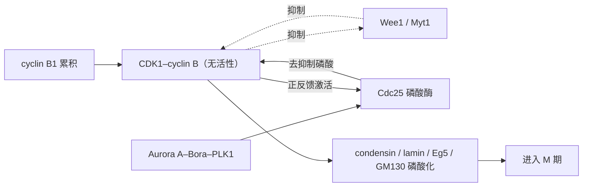
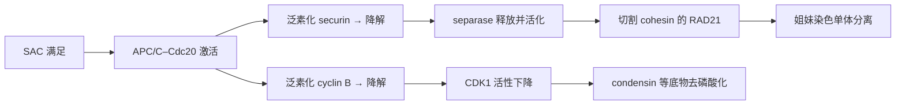

# 有丝分裂（mitosis）

> 相关笔记：[[Ca]]（非整倍体与染色体不稳定）、[[染色体带]]（核型与显带）、[[端粒与端粒酶]]（每次复制端粒缩短）、[[翻译]]（M 期整体翻译下调）

## 0. 一句话概括

有丝分裂是细胞周期 M 期的**核分裂**部分（与**胞质分裂**合称 M 期）。它要完成三件事：

1. **把复制好的染色体精确二分**——靠纺锤体产生力、动粒建立连接、纺锤体组装检查点（SAC）把关。
2. **把细胞质与细胞器大致均分**——靠 RhoA–肌动球蛋白收缩环与中体。
3. **重建两个完整的细胞核**——核膜、核孔、核仁都要重新装配。

它的本质是一次**"力学 + 时序"的工程**：微管提供力和轨道，激酶与磷酸酶构成时钟，泛素连接酶负责不可逆的"点火"，检查点负责质量门。**没有新的 DNA 合成**（DNA 在 S 期已复制），只有分配与重建。

---

## 1. 在细胞周期中的位置与时长

M 期紧接 G2 期，结束后进入 G1（或 G0）。经典分期按**染色体行为**划分，不是按时间均匀划分：

| 分期 | 主要事件 | 哺乳动物细胞参考时长 |
|---|---|---|
| **前期（prophase）** | 染色体凝缩、中心体分离、核仁消失 | 15–30 min |
| **前中期（prometaphase）** | 核膜破裂、动粒捕获微管、SAC 激活 | 10–20 min |
| **中期（metaphase）** | 染色体排列于赤道板、张力平衡、SAC 满足 | 5–10 min |
| **后期（anaphase）** | 姐妹染色单体分离、两极推开 | 2–5 min |
| **末期（telophase）** | 核膜核仁重建、染色体去凝缩 | 10–20 min（与胞质分裂重叠） |

- M 期总时长在典型哺乳动物培养细胞中约 **30–60 min**，只占整个细胞周期的 5% 左右。
- 早期胚胎卵裂可短至十几分钟（几乎无 G1/G2）；酵母的核分裂是"封闭式"（核膜不破裂），与动物的"开放式"不同。
- 严格说，"前中期"是形态学上人为切出的一段，分子事件是连续的。

<svg xmlns="http://www.w3.org/2000/svg" width="1260" height="700" viewBox="0 0 1260 700">
<rect width="1260" height="700" fill="#ffffff"/>
<text x="630" y="42" text-anchor="middle" font-family="Noto Sans CJK SC, sans-serif" font-size="23" font-weight="bold" fill="#1F2937">有丝分裂的五个阶段：染色体、纺锤体与胞质分裂</text>
<rect x="40" y="70" width="220" height="300" rx="10" fill="#FCFCFD" stroke="#D5DBE1" stroke-width="1.2"/>
<rect x="280" y="70" width="220" height="300" rx="10" fill="#FCFCFD" stroke="#D5DBE1" stroke-width="1.2"/>
<rect x="520" y="70" width="220" height="300" rx="10" fill="#FCFCFD" stroke="#D5DBE1" stroke-width="1.2"/>
<rect x="760" y="70" width="220" height="300" rx="10" fill="#FCFCFD" stroke="#D5DBE1" stroke-width="1.2"/>
<rect x="1000" y="70" width="220" height="300" rx="10" fill="#FCFCFD" stroke="#D5DBE1" stroke-width="1.2"/>
<ellipse cx="150" cy="200" rx="82" ry="90" fill="#F8FBFF" stroke="#9DB4CC" stroke-width="1.5"/>
<ellipse cx="150" cy="200" rx="58" ry="62" fill="#EEF2F7" stroke="#8C9BB0" stroke-width="1.5" stroke-dasharray="5 4"/>
<g transform="rotate(-25 124 174)">
<path d="M 119.0 165.0 Q 123.2 174.0 119.0 187.0" fill="none" stroke="#34495E" stroke-width="5.6" stroke-linecap="round"/>
<path d="M 129.0 165.0 Q 124.8 174.0 129.0 187.0" fill="none" stroke="#5D6D7E" stroke-width="5.6" stroke-linecap="round"/>
<circle cx="117.6" cy="174.0" r="1.6" fill="#A93226"/>
<circle cx="130.4" cy="174.0" r="1.6" fill="#A93226"/>
</g>
<g transform="rotate(15 158 166)">
<path d="M 153.0 157.0 Q 157.2 166.0 153.0 179.0" fill="none" stroke="#34495E" stroke-width="5.6" stroke-linecap="round"/>
<path d="M 163.0 157.0 Q 158.8 166.0 163.0 179.0" fill="none" stroke="#5D6D7E" stroke-width="5.6" stroke-linecap="round"/>
<circle cx="151.6" cy="166.0" r="1.6" fill="#A93226"/>
<circle cx="164.4" cy="166.0" r="1.6" fill="#A93226"/>
</g>
<g transform="rotate(65 148 204)">
<path d="M 143.0 195.0 Q 147.2 204.0 143.0 217.0" fill="none" stroke="#34495E" stroke-width="5.6" stroke-linecap="round"/>
<path d="M 153.0 195.0 Q 148.8 204.0 153.0 217.0" fill="none" stroke="#5D6D7E" stroke-width="5.6" stroke-linecap="round"/>
<circle cx="141.6" cy="204.0" r="1.6" fill="#A93226"/>
<circle cx="154.4" cy="204.0" r="1.6" fill="#A93226"/>
</g>
<g transform="rotate(-38 180 208)">
<path d="M 175.0 199.0 Q 179.2 208.0 175.0 221.0" fill="none" stroke="#34495E" stroke-width="5.6" stroke-linecap="round"/>
<path d="M 185.0 199.0 Q 180.8 208.0 185.0 221.0" fill="none" stroke="#5D6D7E" stroke-width="5.6" stroke-linecap="round"/>
<circle cx="173.6" cy="208.0" r="1.6" fill="#A93226"/>
<circle cx="186.4" cy="208.0" r="1.6" fill="#A93226"/>
</g>
<g transform="rotate(72 126 230)">
<path d="M 121.0 221.0 Q 125.2 230.0 121.0 243.0" fill="none" stroke="#34495E" stroke-width="5.6" stroke-linecap="round"/>
<path d="M 131.0 221.0 Q 126.8 230.0 131.0 243.0" fill="none" stroke="#5D6D7E" stroke-width="5.6" stroke-linecap="round"/>
<circle cx="119.6" cy="230.0" r="1.6" fill="#A93226"/>
<circle cx="132.4" cy="230.0" r="1.6" fill="#A93226"/>
</g>
<g transform="rotate(-55 164 232)">
<path d="M 159.0 223.0 Q 163.2 232.0 159.0 245.0" fill="none" stroke="#34495E" stroke-width="5.6" stroke-linecap="round"/>
<path d="M 169.0 223.0 Q 164.8 232.0 169.0 245.0" fill="none" stroke="#5D6D7E" stroke-width="5.6" stroke-linecap="round"/>
<circle cx="157.6" cy="232.0" r="1.6" fill="#A93226"/>
<circle cx="170.4" cy="232.0" r="1.6" fill="#A93226"/>
</g>
<circle cx="92" cy="150" r="3.6" fill="#1A73E8"/>
<line x1="97.0" y1="150.0" x2="107.0" y2="150.0" stroke="#1A73E8" stroke-width="1.0" opacity="0.75"/>
<line x1="95.5" y1="153.5" x2="102.6" y2="160.6" stroke="#1A73E8" stroke-width="1.0" opacity="0.75"/>
<line x1="92.0" y1="155.0" x2="92.0" y2="165.0" stroke="#1A73E8" stroke-width="1.0" opacity="0.75"/>
<line x1="88.5" y1="153.5" x2="81.4" y2="160.6" stroke="#1A73E8" stroke-width="1.0" opacity="0.75"/>
<line x1="87.0" y1="150.0" x2="77.0" y2="150.0" stroke="#1A73E8" stroke-width="1.0" opacity="0.75"/>
<line x1="88.5" y1="146.5" x2="81.4" y2="139.4" stroke="#1A73E8" stroke-width="1.0" opacity="0.75"/>
<line x1="92.0" y1="145.0" x2="92.0" y2="135.0" stroke="#1A73E8" stroke-width="1.0" opacity="0.75"/>
<line x1="95.5" y1="146.5" x2="102.6" y2="139.4" stroke="#1A73E8" stroke-width="1.0" opacity="0.75"/>
<line x1="92.0" y1="150.0" x2="118.1" y2="122.0" stroke="#1A73E8" stroke-width="1.0" opacity="0.6"/>
<circle cx="208" cy="150" r="3.6" fill="#1A73E8"/>
<line x1="213.0" y1="150.0" x2="223.0" y2="150.0" stroke="#1A73E8" stroke-width="1.0" opacity="0.75"/>
<line x1="211.5" y1="153.5" x2="218.6" y2="160.6" stroke="#1A73E8" stroke-width="1.0" opacity="0.75"/>
<line x1="208.0" y1="155.0" x2="208.0" y2="165.0" stroke="#1A73E8" stroke-width="1.0" opacity="0.75"/>
<line x1="204.5" y1="153.5" x2="197.4" y2="160.6" stroke="#1A73E8" stroke-width="1.0" opacity="0.75"/>
<line x1="203.0" y1="150.0" x2="193.0" y2="150.0" stroke="#1A73E8" stroke-width="1.0" opacity="0.75"/>
<line x1="204.5" y1="146.5" x2="197.4" y2="139.4" stroke="#1A73E8" stroke-width="1.0" opacity="0.75"/>
<line x1="208.0" y1="145.0" x2="208.0" y2="135.0" stroke="#1A73E8" stroke-width="1.0" opacity="0.75"/>
<line x1="211.5" y1="146.5" x2="218.6" y2="139.4" stroke="#1A73E8" stroke-width="1.0" opacity="0.75"/>
<line x1="208.0" y1="150.0" x2="181.9" y2="122.0" stroke="#1A73E8" stroke-width="1.0" opacity="0.6"/>
<text x="150" y="396" text-anchor="middle" font-family="Noto Sans CJK SC, sans-serif" font-size="16" font-weight="bold" fill="#1F2937">① 前期（prophase）</text>
<text x="150" y="420" text-anchor="middle" font-family="Noto Sans CJK SC, sans-serif" font-size="10.8" fill="#4B5563">染色体凝缩：condensin II 轴向压缩</text>
<text x="150" y="439" text-anchor="middle" font-family="Noto Sans CJK SC, sans-serif" font-size="10.8" fill="#4B5563">中心体分离，星体微管开始生长</text>
<text x="150" y="458" text-anchor="middle" font-family="Noto Sans CJK SC, sans-serif" font-size="10.8" fill="#4B5563">核仁消失，核膜仍完整</text>
<ellipse cx="390" cy="200" rx="88" ry="82" fill="#F8FBFF" stroke="#9DB4CC" stroke-width="1.5"/>
<circle cx="328" cy="200" r="3.6" fill="#1A73E8"/>
<line x1="333.0" y1="200.0" x2="341.0" y2="200.0" stroke="#1A73E8" stroke-width="1.0" opacity="0.75"/>
<line x1="331.5" y1="203.5" x2="337.2" y2="209.2" stroke="#1A73E8" stroke-width="1.0" opacity="0.75"/>
<line x1="328.0" y1="205.0" x2="328.0" y2="213.0" stroke="#1A73E8" stroke-width="1.0" opacity="0.75"/>
<line x1="324.5" y1="203.5" x2="318.8" y2="209.2" stroke="#1A73E8" stroke-width="1.0" opacity="0.75"/>
<line x1="323.0" y1="200.0" x2="315.0" y2="200.0" stroke="#1A73E8" stroke-width="1.0" opacity="0.75"/>
<line x1="324.5" y1="196.5" x2="318.8" y2="190.8" stroke="#1A73E8" stroke-width="1.0" opacity="0.75"/>
<line x1="328.0" y1="195.0" x2="328.0" y2="187.0" stroke="#1A73E8" stroke-width="1.0" opacity="0.75"/>
<line x1="331.5" y1="196.5" x2="337.2" y2="190.8" stroke="#1A73E8" stroke-width="1.0" opacity="0.75"/>
<circle cx="452" cy="200" r="3.6" fill="#1A73E8"/>
<line x1="457.0" y1="200.0" x2="465.0" y2="200.0" stroke="#1A73E8" stroke-width="1.0" opacity="0.75"/>
<line x1="455.5" y1="203.5" x2="461.2" y2="209.2" stroke="#1A73E8" stroke-width="1.0" opacity="0.75"/>
<line x1="452.0" y1="205.0" x2="452.0" y2="213.0" stroke="#1A73E8" stroke-width="1.0" opacity="0.75"/>
<line x1="448.5" y1="203.5" x2="442.8" y2="209.2" stroke="#1A73E8" stroke-width="1.0" opacity="0.75"/>
<line x1="447.0" y1="200.0" x2="439.0" y2="200.0" stroke="#1A73E8" stroke-width="1.0" opacity="0.75"/>
<line x1="448.5" y1="196.5" x2="442.8" y2="190.8" stroke="#1A73E8" stroke-width="1.0" opacity="0.75"/>
<line x1="452.0" y1="195.0" x2="452.0" y2="187.0" stroke="#1A73E8" stroke-width="1.0" opacity="0.75"/>
<line x1="455.5" y1="196.5" x2="461.2" y2="190.8" stroke="#1A73E8" stroke-width="1.0" opacity="0.75"/>
<g transform="rotate(20 356 166)">
<path d="M 350.8 157.0 Q 355.2 166.0 350.8 179.0" fill="none" stroke="#34495E" stroke-width="5.8" stroke-linecap="round"/>
<path d="M 361.2 157.0 Q 356.8 166.0 361.2 179.0" fill="none" stroke="#5D6D7E" stroke-width="5.8" stroke-linecap="round"/>
<circle cx="349.3" cy="166.0" r="1.6" fill="#A93226"/>
<circle cx="362.7" cy="166.0" r="1.6" fill="#A93226"/>
</g>
<line x1="328.0" y1="200.0" x2="351.0" y2="166.0" stroke="#C0392B" stroke-width="1.15" opacity="0.85"/>
<g transform="rotate(-30 400 160)">
<path d="M 394.8 151.0 Q 399.2 160.0 394.8 173.0" fill="none" stroke="#34495E" stroke-width="5.8" stroke-linecap="round"/>
<path d="M 405.2 151.0 Q 400.8 160.0 405.2 173.0" fill="none" stroke="#5D6D7E" stroke-width="5.8" stroke-linecap="round"/>
<circle cx="393.3" cy="160.0" r="1.6" fill="#A93226"/>
<circle cx="406.7" cy="160.0" r="1.6" fill="#A93226"/>
</g>
<line x1="452.0" y1="200.0" x2="405.0" y2="160.0" stroke="#C0392B" stroke-width="1.15" opacity="0.85"/>
<g transform="rotate(70 372 202)">
<path d="M 366.8 193.0 Q 371.2 202.0 366.8 215.0" fill="none" stroke="#34495E" stroke-width="5.8" stroke-linecap="round"/>
<path d="M 377.2 193.0 Q 372.8 202.0 377.2 215.0" fill="none" stroke="#5D6D7E" stroke-width="5.8" stroke-linecap="round"/>
<circle cx="365.3" cy="202.0" r="1.6" fill="#A93226"/>
<circle cx="378.7" cy="202.0" r="1.6" fill="#A93226"/>
</g>
<line x1="328.0" y1="200.0" x2="367.0" y2="202.0" stroke="#C0392B" stroke-width="1.15" opacity="0.85"/>
<g transform="rotate(-50 416 194)">
<path d="M 410.8 185.0 Q 415.2 194.0 410.8 207.0" fill="none" stroke="#34495E" stroke-width="5.8" stroke-linecap="round"/>
<path d="M 421.2 185.0 Q 416.8 194.0 421.2 207.0" fill="none" stroke="#5D6D7E" stroke-width="5.8" stroke-linecap="round"/>
<circle cx="409.3" cy="194.0" r="1.6" fill="#A93226"/>
<circle cx="422.7" cy="194.0" r="1.6" fill="#A93226"/>
</g>
<line x1="452.0" y1="200.0" x2="421.0" y2="194.0" stroke="#C0392B" stroke-width="1.15" opacity="0.85"/>
<g transform="rotate(40 394 226)">
<path d="M 388.8 217.0 Q 393.2 226.0 388.8 239.0" fill="none" stroke="#34495E" stroke-width="5.8" stroke-linecap="round"/>
<path d="M 399.2 217.0 Q 394.8 226.0 399.2 239.0" fill="none" stroke="#5D6D7E" stroke-width="5.8" stroke-linecap="round"/>
<circle cx="387.3" cy="226.0" r="1.6" fill="#A93226"/>
<circle cx="400.7" cy="226.0" r="1.6" fill="#A93226"/>
</g>
<line x1="452.0" y1="200.0" x2="399.0" y2="226.0" stroke="#C0392B" stroke-width="1.15" opacity="0.85"/>
<g transform="rotate(-20 430 226)">
<path d="M 424.8 217.0 Q 429.2 226.0 424.8 239.0" fill="none" stroke="#34495E" stroke-width="5.8" stroke-linecap="round"/>
<path d="M 435.2 217.0 Q 430.8 226.0 435.2 239.0" fill="none" stroke="#5D6D7E" stroke-width="5.8" stroke-linecap="round"/>
<circle cx="423.3" cy="226.0" r="1.6" fill="#A93226"/>
<circle cx="436.7" cy="226.0" r="1.6" fill="#A93226"/>
</g>
<line x1="452.0" y1="200.0" x2="435.0" y2="226.0" stroke="#C0392B" stroke-width="1.15" opacity="0.85"/>
<g transform="rotate(15 352 226)">
<path d="M 346.8 217.0 Q 351.2 226.0 346.8 239.0" fill="none" stroke="#34495E" stroke-width="5.8" stroke-linecap="round"/>
<path d="M 357.2 217.0 Q 352.8 226.0 357.2 239.0" fill="none" stroke="#5D6D7E" stroke-width="5.8" stroke-linecap="round"/>
<circle cx="345.3" cy="226.0" r="1.6" fill="#A93226"/>
<circle cx="358.7" cy="226.0" r="1.6" fill="#A93226"/>
</g>
<line x1="328.0" y1="200.0" x2="347.0" y2="226.0" stroke="#C0392B" stroke-width="1.15" opacity="0.85"/>
<path d="M 332 194 Q 390 178 448 194" fill="none" stroke="#C0392B" stroke-width="1" opacity="0.45"/>
<text x="390" y="396" text-anchor="middle" font-family="Noto Sans CJK SC, sans-serif" font-size="16" font-weight="bold" fill="#1F2937">② 前中期（prometaphase）</text>
<text x="390" y="420" text-anchor="middle" font-family="Noto Sans CJK SC, sans-serif" font-size="10.8" fill="#4B5563">核膜破裂（NEBD），核质混合</text>
<text x="390" y="439" text-anchor="middle" font-family="Noto Sans CJK SC, sans-serif" font-size="10.8" fill="#4B5563">动粒逐步捕获微管，建立双向连接</text>
<text x="390" y="458" text-anchor="middle" font-family="Noto Sans CJK SC, sans-serif" font-size="10.8" fill="#4B5563">SAC 激活：只要有一个动粒未连接就等待</text>
<ellipse cx="630" cy="200" rx="88" ry="82" fill="#F8FBFF" stroke="#9DB4CC" stroke-width="1.5"/>
<circle cx="566" cy="200" r="3.6" fill="#1A73E8"/>
<line x1="571.0" y1="200.0" x2="578.0" y2="200.0" stroke="#1A73E8" stroke-width="1.0" opacity="0.75"/>
<line x1="569.5" y1="203.5" x2="574.5" y2="208.5" stroke="#1A73E8" stroke-width="1.0" opacity="0.75"/>
<line x1="566.0" y1="205.0" x2="566.0" y2="212.0" stroke="#1A73E8" stroke-width="1.0" opacity="0.75"/>
<line x1="562.5" y1="203.5" x2="557.5" y2="208.5" stroke="#1A73E8" stroke-width="1.0" opacity="0.75"/>
<line x1="561.0" y1="200.0" x2="554.0" y2="200.0" stroke="#1A73E8" stroke-width="1.0" opacity="0.75"/>
<line x1="562.5" y1="196.5" x2="557.5" y2="191.5" stroke="#1A73E8" stroke-width="1.0" opacity="0.75"/>
<line x1="566.0" y1="195.0" x2="566.0" y2="188.0" stroke="#1A73E8" stroke-width="1.0" opacity="0.75"/>
<line x1="569.5" y1="196.5" x2="574.5" y2="191.5" stroke="#1A73E8" stroke-width="1.0" opacity="0.75"/>
<circle cx="694" cy="200" r="3.6" fill="#1A73E8"/>
<line x1="699.0" y1="200.0" x2="706.0" y2="200.0" stroke="#1A73E8" stroke-width="1.0" opacity="0.75"/>
<line x1="697.5" y1="203.5" x2="702.5" y2="208.5" stroke="#1A73E8" stroke-width="1.0" opacity="0.75"/>
<line x1="694.0" y1="205.0" x2="694.0" y2="212.0" stroke="#1A73E8" stroke-width="1.0" opacity="0.75"/>
<line x1="690.5" y1="203.5" x2="685.5" y2="208.5" stroke="#1A73E8" stroke-width="1.0" opacity="0.75"/>
<line x1="689.0" y1="200.0" x2="682.0" y2="200.0" stroke="#1A73E8" stroke-width="1.0" opacity="0.75"/>
<line x1="690.5" y1="196.5" x2="685.5" y2="191.5" stroke="#1A73E8" stroke-width="1.0" opacity="0.75"/>
<line x1="694.0" y1="195.0" x2="694.0" y2="188.0" stroke="#1A73E8" stroke-width="1.0" opacity="0.75"/>
<line x1="697.5" y1="196.5" x2="702.5" y2="191.5" stroke="#1A73E8" stroke-width="1.0" opacity="0.75"/>
<line x1="630" y1="132" x2="630" y2="268" stroke="#9CA3AF" stroke-width="1" stroke-dasharray="4 4"/>
<g transform="rotate(0 630 150)">
<path d="M 623.8 141.0 Q 629.1 150.0 623.8 167.0" fill="none" stroke="#34495E" stroke-width="6.4" stroke-linecap="round"/>
<path d="M 636.2 141.0 Q 630.9 150.0 636.2 167.0" fill="none" stroke="#5D6D7E" stroke-width="6.4" stroke-linecap="round"/>
<circle cx="622.3" cy="150.0" r="1.9" fill="#A93226"/>
<circle cx="637.7" cy="150.0" r="1.9" fill="#A93226"/>
</g>
<line x1="566.0" y1="200.0" x2="619.0" y2="150.0" stroke="#C0392B" stroke-width="1.3" opacity="0.9"/>
<line x1="694.0" y1="200.0" x2="641.0" y2="150.0" stroke="#C0392B" stroke-width="1.3" opacity="0.9"/>
<g transform="rotate(0 630 175)">
<path d="M 623.8 163.0 Q 629.1 175.0 623.8 189.0" fill="none" stroke="#34495E" stroke-width="6.4" stroke-linecap="round"/>
<path d="M 636.2 163.0 Q 630.9 175.0 636.2 189.0" fill="none" stroke="#5D6D7E" stroke-width="6.4" stroke-linecap="round"/>
<circle cx="622.3" cy="175.0" r="1.9" fill="#A93226"/>
<circle cx="637.7" cy="175.0" r="1.9" fill="#A93226"/>
</g>
<line x1="566.0" y1="200.0" x2="619.0" y2="175.0" stroke="#C0392B" stroke-width="1.3" opacity="0.9"/>
<line x1="694.0" y1="200.0" x2="641.0" y2="175.0" stroke="#C0392B" stroke-width="1.3" opacity="0.9"/>
<g transform="rotate(0 630 200)">
<path d="M 623.8 191.0 Q 629.1 200.0 623.8 217.0" fill="none" stroke="#34495E" stroke-width="6.4" stroke-linecap="round"/>
<path d="M 636.2 191.0 Q 630.9 200.0 636.2 217.0" fill="none" stroke="#5D6D7E" stroke-width="6.4" stroke-linecap="round"/>
<circle cx="622.3" cy="200.0" r="1.9" fill="#A93226"/>
<circle cx="637.7" cy="200.0" r="1.9" fill="#A93226"/>
</g>
<line x1="566.0" y1="200.0" x2="619.0" y2="200.0" stroke="#C0392B" stroke-width="1.3" opacity="0.9"/>
<line x1="694.0" y1="200.0" x2="641.0" y2="200.0" stroke="#C0392B" stroke-width="1.3" opacity="0.9"/>
<g transform="rotate(0 630 225)">
<path d="M 623.8 213.0 Q 629.1 225.0 623.8 239.0" fill="none" stroke="#34495E" stroke-width="6.4" stroke-linecap="round"/>
<path d="M 636.2 213.0 Q 630.9 225.0 636.2 239.0" fill="none" stroke="#5D6D7E" stroke-width="6.4" stroke-linecap="round"/>
<circle cx="622.3" cy="225.0" r="1.9" fill="#A93226"/>
<circle cx="637.7" cy="225.0" r="1.9" fill="#A93226"/>
</g>
<line x1="566.0" y1="200.0" x2="619.0" y2="225.0" stroke="#C0392B" stroke-width="1.3" opacity="0.9"/>
<line x1="694.0" y1="200.0" x2="641.0" y2="225.0" stroke="#C0392B" stroke-width="1.3" opacity="0.9"/>
<g transform="rotate(0 630 250)">
<path d="M 623.8 241.0 Q 629.1 250.0 623.8 267.0" fill="none" stroke="#34495E" stroke-width="6.4" stroke-linecap="round"/>
<path d="M 636.2 241.0 Q 630.9 250.0 636.2 267.0" fill="none" stroke="#5D6D7E" stroke-width="6.4" stroke-linecap="round"/>
<circle cx="622.3" cy="250.0" r="1.9" fill="#A93226"/>
<circle cx="637.7" cy="250.0" r="1.9" fill="#A93226"/>
</g>
<line x1="566.0" y1="200.0" x2="619.0" y2="250.0" stroke="#C0392B" stroke-width="1.3" opacity="0.9"/>
<line x1="694.0" y1="200.0" x2="641.0" y2="250.0" stroke="#C0392B" stroke-width="1.3" opacity="0.9"/>
<path d="M 570 200 Q 630 170 690 200" fill="none" stroke="#C0392B" stroke-width="1" opacity="0.38"/>
<path d="M 570 200 Q 630 230 690 200" fill="none" stroke="#C0392B" stroke-width="1" opacity="0.38"/>
<text x="630" y="396" text-anchor="middle" font-family="Noto Sans CJK SC, sans-serif" font-size="16" font-weight="bold" fill="#1F2937">③ 中期（metaphase）</text>
<text x="630" y="420" text-anchor="middle" font-family="Noto Sans CJK SC, sans-serif" font-size="10.8" fill="#4B5563">染色体着丝粒排在赤道板上</text>
<text x="630" y="439" text-anchor="middle" font-family="Noto Sans CJK SC, sans-serif" font-size="10.8" fill="#4B5563">姐妹动粒受相反方向张力（连接正确）</text>
<text x="630" y="458" text-anchor="middle" font-family="Noto Sans CJK SC, sans-serif" font-size="10.8" fill="#4B5563">SAC 满足 → APC/C–Cdc20 启动后期</text>
<ellipse cx="870" cy="200" rx="100" ry="72" fill="#F8FBFF" stroke="#9DB4CC" stroke-width="1.5"/>
<circle cx="794" cy="200" r="3.6" fill="#1A73E8"/>
<line x1="799.0" y1="200.0" x2="806.0" y2="200.0" stroke="#1A73E8" stroke-width="1.0" opacity="0.75"/>
<line x1="797.5" y1="203.5" x2="802.5" y2="208.5" stroke="#1A73E8" stroke-width="1.0" opacity="0.75"/>
<line x1="794.0" y1="205.0" x2="794.0" y2="212.0" stroke="#1A73E8" stroke-width="1.0" opacity="0.75"/>
<line x1="790.5" y1="203.5" x2="785.5" y2="208.5" stroke="#1A73E8" stroke-width="1.0" opacity="0.75"/>
<line x1="789.0" y1="200.0" x2="782.0" y2="200.0" stroke="#1A73E8" stroke-width="1.0" opacity="0.75"/>
<line x1="790.5" y1="196.5" x2="785.5" y2="191.5" stroke="#1A73E8" stroke-width="1.0" opacity="0.75"/>
<line x1="794.0" y1="195.0" x2="794.0" y2="188.0" stroke="#1A73E8" stroke-width="1.0" opacity="0.75"/>
<line x1="797.5" y1="196.5" x2="802.5" y2="191.5" stroke="#1A73E8" stroke-width="1.0" opacity="0.75"/>
<circle cx="946" cy="200" r="3.6" fill="#1A73E8"/>
<line x1="951.0" y1="200.0" x2="958.0" y2="200.0" stroke="#1A73E8" stroke-width="1.0" opacity="0.75"/>
<line x1="949.5" y1="203.5" x2="954.5" y2="208.5" stroke="#1A73E8" stroke-width="1.0" opacity="0.75"/>
<line x1="946.0" y1="205.0" x2="946.0" y2="212.0" stroke="#1A73E8" stroke-width="1.0" opacity="0.75"/>
<line x1="942.5" y1="203.5" x2="937.5" y2="208.5" stroke="#1A73E8" stroke-width="1.0" opacity="0.75"/>
<line x1="941.0" y1="200.0" x2="934.0" y2="200.0" stroke="#1A73E8" stroke-width="1.0" opacity="0.75"/>
<line x1="942.5" y1="196.5" x2="937.5" y2="191.5" stroke="#1A73E8" stroke-width="1.0" opacity="0.75"/>
<line x1="946.0" y1="195.0" x2="946.0" y2="188.0" stroke="#1A73E8" stroke-width="1.0" opacity="0.75"/>
<line x1="949.5" y1="196.5" x2="954.5" y2="191.5" stroke="#1A73E8" stroke-width="1.0" opacity="0.75"/>
<path d="M 842.0 152.8 L 832.0 160.0 L 842.0 167.2" fill="none" stroke="#34495E" stroke-width="5.2" stroke-linecap="round" stroke-linejoin="round"/>
<circle cx="830.4" cy="160" r="2.0" fill="#A93226"/>
<path d="M 898.0 152.8 L 908.0 160.0 L 898.0 167.2" fill="none" stroke="#5D6D7E" stroke-width="5.2" stroke-linecap="round" stroke-linejoin="round"/>
<circle cx="909.6" cy="160" r="2.0" fill="#A93226"/>
<line x1="794.0" y1="200.0" x2="830.0" y2="160.0" stroke="#C0392B" stroke-width="1.2" opacity="0.85"/>
<line x1="946.0" y1="200.0" x2="910.0" y2="160.0" stroke="#C0392B" stroke-width="1.2" opacity="0.85"/>
<path d="M 842.0 172.8 L 832.0 180.0 L 842.0 187.2" fill="none" stroke="#34495E" stroke-width="5.2" stroke-linecap="round" stroke-linejoin="round"/>
<circle cx="830.4" cy="180" r="2.0" fill="#A93226"/>
<path d="M 898.0 172.8 L 908.0 180.0 L 898.0 187.2" fill="none" stroke="#5D6D7E" stroke-width="5.2" stroke-linecap="round" stroke-linejoin="round"/>
<circle cx="909.6" cy="180" r="2.0" fill="#A93226"/>
<line x1="794.0" y1="200.0" x2="830.0" y2="180.0" stroke="#C0392B" stroke-width="1.2" opacity="0.85"/>
<line x1="946.0" y1="200.0" x2="910.0" y2="180.0" stroke="#C0392B" stroke-width="1.2" opacity="0.85"/>
<path d="M 842.0 192.8 L 832.0 200.0 L 842.0 207.2" fill="none" stroke="#34495E" stroke-width="5.2" stroke-linecap="round" stroke-linejoin="round"/>
<circle cx="830.4" cy="200" r="2.0" fill="#A93226"/>
<path d="M 898.0 192.8 L 908.0 200.0 L 898.0 207.2" fill="none" stroke="#5D6D7E" stroke-width="5.2" stroke-linecap="round" stroke-linejoin="round"/>
<circle cx="909.6" cy="200" r="2.0" fill="#A93226"/>
<line x1="794.0" y1="200.0" x2="830.0" y2="200.0" stroke="#C0392B" stroke-width="1.2" opacity="0.85"/>
<line x1="946.0" y1="200.0" x2="910.0" y2="200.0" stroke="#C0392B" stroke-width="1.2" opacity="0.85"/>
<path d="M 842.0 212.8 L 832.0 220.0 L 842.0 227.2" fill="none" stroke="#34495E" stroke-width="5.2" stroke-linecap="round" stroke-linejoin="round"/>
<circle cx="830.4" cy="220" r="2.0" fill="#A93226"/>
<path d="M 898.0 212.8 L 908.0 220.0 L 898.0 227.2" fill="none" stroke="#5D6D7E" stroke-width="5.2" stroke-linecap="round" stroke-linejoin="round"/>
<circle cx="909.6" cy="220" r="2.0" fill="#A93226"/>
<line x1="794.0" y1="200.0" x2="830.0" y2="220.0" stroke="#C0392B" stroke-width="1.2" opacity="0.85"/>
<line x1="946.0" y1="200.0" x2="910.0" y2="220.0" stroke="#C0392B" stroke-width="1.2" opacity="0.85"/>
<path d="M 842.0 232.8 L 832.0 240.0 L 842.0 247.2" fill="none" stroke="#34495E" stroke-width="5.2" stroke-linecap="round" stroke-linejoin="round"/>
<circle cx="830.4" cy="240" r="2.0" fill="#A93226"/>
<path d="M 898.0 232.8 L 908.0 240.0 L 898.0 247.2" fill="none" stroke="#5D6D7E" stroke-width="5.2" stroke-linecap="round" stroke-linejoin="round"/>
<circle cx="909.6" cy="240" r="2.0" fill="#A93226"/>
<line x1="794.0" y1="200.0" x2="830.0" y2="240.0" stroke="#C0392B" stroke-width="1.2" opacity="0.85"/>
<line x1="946.0" y1="200.0" x2="910.0" y2="240.0" stroke="#C0392B" stroke-width="1.2" opacity="0.85"/>
<path d="M 798 200 L 942 200" stroke="#C0392B" stroke-width="1" opacity="0.32"/>
<g stroke="#374151" stroke-width="1.4" fill="none" marker-end="url(#ar)"><line x1="850" y1="286" x2="812" y2="286"/><line x1="890" y1="286" x2="928" y2="286"/></g>
<text x="870" y="396" text-anchor="middle" font-family="Noto Sans CJK SC, sans-serif" font-size="16" font-weight="bold" fill="#1F2937">④ 后期（anaphase）</text>
<text x="870" y="420" text-anchor="middle" font-family="Noto Sans CJK SC, sans-serif" font-size="10.8" fill="#4B5563">separase 切割 cohesin，姐妹染色单体分开</text>
<text x="870" y="439" text-anchor="middle" font-family="Noto Sans CJK SC, sans-serif" font-size="10.8" fill="#4B5563">A：动粒微管解聚，着丝粒被拉向两极</text>
<text x="870" y="458" text-anchor="middle" font-family="Noto Sans CJK SC, sans-serif" font-size="10.8" fill="#4B5563">B：极微管滑动、两极推开</text>
<path d="M 1024 200 C 1024 140 1062 130 1076 154 C 1094 168 1126 168 1144 154 C 1158 130 1196 140 1196 200 C 1196 260 1158 270 1144 246 C 1126 232 1094 232 1076 246 C 1062 270 1024 260 1024 200 Z" fill="#F8FBFF" stroke="#9DB4CC" stroke-width="1.5"/>
<ellipse cx="1066" cy="200" rx="25" ry="31" fill="#EEF2F7" stroke="#8C9BB0" stroke-width="1.4" stroke-dasharray="4 3"/>
<g transform="rotate(40 1057 188)">
<path d="M 1054.4 183.0 Q 1056.6 188.0 1054.4 195.0" fill="none" stroke="#34495E" stroke-width="3.4" stroke-linecap="round"/>
<path d="M 1059.6 183.0 Q 1057.4 188.0 1059.6 195.0" fill="none" stroke="#5D6D7E" stroke-width="3.4" stroke-linecap="round"/>
</g>
<g transform="rotate(-30 1073 197)">
<path d="M 1070.4 192.0 Q 1072.6 197.0 1070.4 204.0" fill="none" stroke="#34495E" stroke-width="3.4" stroke-linecap="round"/>
<path d="M 1075.6 192.0 Q 1073.4 197.0 1075.6 204.0" fill="none" stroke="#5D6D7E" stroke-width="3.4" stroke-linecap="round"/>
</g>
<g transform="rotate(65 1062 210)">
<path d="M 1059.4 205.0 Q 1061.6 210.0 1059.4 217.0" fill="none" stroke="#34495E" stroke-width="3.4" stroke-linecap="round"/>
<path d="M 1064.6 205.0 Q 1062.4 210.0 1064.6 217.0" fill="none" stroke="#5D6D7E" stroke-width="3.4" stroke-linecap="round"/>
</g>
<ellipse cx="1154" cy="200" rx="25" ry="31" fill="#EEF2F7" stroke="#8C9BB0" stroke-width="1.4" stroke-dasharray="4 3"/>
<g transform="rotate(40 1145 188)">
<path d="M 1142.4 183.0 Q 1144.6 188.0 1142.4 195.0" fill="none" stroke="#34495E" stroke-width="3.4" stroke-linecap="round"/>
<path d="M 1147.6 183.0 Q 1145.4 188.0 1147.6 195.0" fill="none" stroke="#5D6D7E" stroke-width="3.4" stroke-linecap="round"/>
</g>
<g transform="rotate(-30 1161 197)">
<path d="M 1158.4 192.0 Q 1160.6 197.0 1158.4 204.0" fill="none" stroke="#34495E" stroke-width="3.4" stroke-linecap="round"/>
<path d="M 1163.6 192.0 Q 1161.4 197.0 1163.6 204.0" fill="none" stroke="#5D6D7E" stroke-width="3.4" stroke-linecap="round"/>
</g>
<g transform="rotate(65 1150 210)">
<path d="M 1147.4 205.0 Q 1149.6 210.0 1147.4 217.0" fill="none" stroke="#34495E" stroke-width="3.4" stroke-linecap="round"/>
<path d="M 1152.6 205.0 Q 1150.4 210.0 1152.6 217.0" fill="none" stroke="#5D6D7E" stroke-width="3.4" stroke-linecap="round"/>
</g>
<line x1="1078.0" y1="195.8" x2="1142.0" y2="195.8" stroke="#B03A2E" stroke-width="0.9" opacity="0.55"/>
<line x1="1078.0" y1="197.9" x2="1142.0" y2="197.9" stroke="#B03A2E" stroke-width="0.9" opacity="0.55"/>
<line x1="1078.0" y1="200.0" x2="1142.0" y2="200.0" stroke="#B03A2E" stroke-width="0.9" opacity="0.55"/>
<line x1="1078.0" y1="202.1" x2="1142.0" y2="202.1" stroke="#B03A2E" stroke-width="0.9" opacity="0.55"/>
<line x1="1078.0" y1="204.2" x2="1142.0" y2="204.2" stroke="#B03A2E" stroke-width="0.9" opacity="0.55"/>
<rect x="1103" y="194" width="14" height="12" rx="3" fill="#E8B4B8" stroke="#B03A2E" stroke-width="1"/>
<g stroke="#1A73E8" stroke-width="1.3" fill="none"><path d="M 1100 126 L 1100 138 M 1120 126 L 1120 138"/><path d="M 1100 274 L 1100 262 M 1120 274 L 1120 262"/></g>
<text x="1110" y="396" text-anchor="middle" font-family="Noto Sans CJK SC, sans-serif" font-size="16" font-weight="bold" fill="#1F2937">⑤ 末期 + 胞质分裂</text>
<text x="1110" y="420" text-anchor="middle" font-family="Noto Sans CJK SC, sans-serif" font-size="10.8" fill="#4B5563">核膜、核孔与核仁重建，染色体去凝缩</text>
<text x="1110" y="439" text-anchor="middle" font-family="Noto Sans CJK SC, sans-serif" font-size="10.8" fill="#4B5563">RhoA–ROCK–肌球蛋白 II 环收缩</text>
<text x="1110" y="458" text-anchor="middle" font-family="Noto Sans CJK SC, sans-serif" font-size="10.8" fill="#4B5563">中体形成 → ESCRT-III 完成 abscission</text>
<rect x="40" y="474" width="1180" height="146" rx="10" fill="#FFFDF8" stroke="#E5D6B8" stroke-width="1.3"/>
<g transform="rotate(0 210 547)">
<path d="M 195.0 503.0 Q 207.8 547.0 195.0 609.0" fill="none" stroke="#2C3E50" stroke-width="12.0" stroke-linecap="round"/>
<path d="M 225.0 503.0 Q 212.2 547.0 225.0 609.0" fill="none" stroke="#5D6D7E" stroke-width="12.0" stroke-linecap="round"/>
<circle cx="193.6" cy="547.0" r="3.4" fill="#A93226"/>
<circle cx="226.4" cy="547.0" r="3.4" fill="#A93226"/>
</g>
<line x1="180" y1="547" x2="244" y2="547" stroke="#B5651D" stroke-width="1" stroke-dasharray="3 3"/>
<line x1="197.0" y1="517.0" x2="148.0" y2="517.0" stroke="#8C6D46" stroke-width="1.1" opacity="0.9"/>
<line x1="188.0" y1="544.0" x2="148.0" y2="544.0" stroke="#8C6D46" stroke-width="1.1" opacity="0.9"/>
<line x1="240.0" y1="549.0" x2="272.0" y2="549.0" stroke="#8C6D46" stroke-width="1.1" opacity="0.9"/>
<line x1="223.0" y1="585.0" x2="272.0" y2="585.0" stroke="#8C6D46" stroke-width="1.1" opacity="0.9"/>
<text x="144" y="521" text-anchor="end" font-family="Noto Sans CJK SC, sans-serif" font-size="12" fill="#4B3A24">短臂（p 臂）</text>
<text x="144" y="549" text-anchor="end" font-family="Noto Sans CJK SC, sans-serif" font-size="12" fill="#4B3A24">着丝粒（初级缢痕）</text>
<text x="276" y="553" font-family="Noto Sans CJK SC, sans-serif" font-size="12" fill="#8C1D18">动粒（kinetochore）</text>
<text x="276" y="589" font-family="Noto Sans CJK SC, sans-serif" font-size="12" fill="#4B3A24">长臂（q 臂）</text>
<text x="58" y="498" font-family="Noto Sans CJK SC, sans-serif" font-size="13" font-weight="bold" fill="#4B3A24">染色体结构</text>
<text x="430" y="504" font-family="Noto Sans CJK SC, sans-serif" font-size="12.5" fill="#374151">一条染色体由两条姐妹染色单体组成，在着丝粒处相连；S 期复制后形成，后期被 separase 切开。</text>
<text x="430" y="528" font-family="Noto Sans CJK SC, sans-serif" font-size="12.5" fill="#374151">着丝粒（centromere）是 DNA 层面的“地址”，由 CENP-A 核小体标记，可遗传但不由序列决定。</text>
<text x="430" y="552" font-family="Noto Sans CJK SC, sans-serif" font-size="12.5" fill="#374151">动粒（kinetochore）是组装在着丝粒两侧的蛋白机器（NDC80 复合物直接抓微管），一侧一个。</text>
<text x="430" y="576" font-family="Noto Sans CJK SC, sans-serif" font-size="12.5" fill="#374151">按着丝粒位置可分为中着丝粒、亚中着丝粒、近端着丝粒与端部着丝粒染色体；人类 46 条共 92 个动粒。</text>
<text x="430" y="600" font-family="Noto Sans CJK SC, sans-serif" font-size="12" fill="#6B7280">动粒是 SAC 的信号发生地：未连接时招募 Mad1/Mad2，抑制 APC/C。</text>
<text x="40" y="648" font-family="Noto Sans CJK SC, sans-serif" font-size="11.5" fill="#6B7280">红色＝微管（动粒纤维/极微管）；蓝色星芒＝中心体与星体微管；深色棒状＝姐妹染色单体；暗红小点＝动粒。</text>
<text x="40" y="670" font-family="Noto Sans CJK SC, sans-serif" font-size="11.5" fill="#6B7280">哺乳动物细胞 M 期总时长约 30–60 min：前期 15–30 min，前中期 10–20 min，中期 5–10 min，后期 2–5 min，末期与胞质分裂 10–20 min。</text>
<defs><marker id="ar" markerWidth="9" markerHeight="9" refX="7" refY="3.5" orient="auto"><path d="M0,0 L7,3.5 L0,7 z" fill="#374151"/></marker></defs>
</svg>

---

## 2. 参与的物质：先把"零件清单"摆全

有丝分裂涉及数百种蛋白，但按功能可归为八类。**下面这张清单是理解后面各期机制的地图**。

### 2.1 微管系统与马达蛋白

| 分子 | 身份 | 在 M 期做什么 | 失活/缺失的后果 |
|---|---|---|---|
| α/β-微管蛋白 | 微管的基本单元 | 组装纺锤体微管；β-微管蛋白的 GTP 水解驱动动态不稳定 | 无纺锤体，SAC 永久激活 |
| γ-微管蛋白环复合物（γ-TuRC） | 成核因子 | 在中心体与动粒附近起始微管成核 | 纺锤体双极性建立失败 |
| augmin（HAUS 复合物） | 分支成核因子 | 在已有微管侧壁产生新微管，放大纺锤体 | 微管密度不足、染色体整队变慢 |
| 中心体（中心粒对 + PCM） | 微管组织中心 | 复制、分离、成熟；招募 γ-TuRC、pericentrin | 双极纺锤体缺陷、多极纺锤体 |
| Eg5（KIF11，kinesin-5） | 四聚体正端马达 | 滑动反平行微管，驱动中心体分离与后期 B | 单极纺锤体（monastrol 表型） |
| CENP-E（KIF10） | 动粒相关马达 | 沿极微管把染色体"拖"向赤道；后期协助 poleward 运动 | 整队延迟、染色体错配 |
| MCAK（KIF2C） | 动粒/着丝粒去聚合酶 | 剥离错误连接、纠正 attachment | 错误连接增多、SAC 延迟 |
| 细胞质动力蛋白（dynein） | 负端马达 | 皮质锚定拉极、动粒旁路运输、核膜破裂时撕裂膜 | 纺锤体定位与旋转异常 |
| NuMA | 核有丝分裂器蛋白 | 与 dynein 组成皮质复合物，拉纺锤体 | 纺锤体无法正确定位 |
| PRC1 / KIF4A | 中央纺锤体蛋白 | 交联并束缚反平行微管，稳定重叠区 | 后期 B 与胞质分裂缺陷 |
| CLASP / EB1 | 微管正端追踪蛋白 | 稳定动粒纤维正端，维持连接 | 动粒纤维过短、分离错误 |
| TPX2 | 微管结合蛋白 | 激活 Aurora A、促微管成核 | 纺锤体组装失败 |

> 概念区分：**动粒纤维（kinetochore MT）**连接动粒与极；**极微管（polar MT）**在中央重叠；**星体微管（astral MT）**伸向皮质，负责定位与拉力。

### 2.2 动粒与着丝粒

| 分子 | 身份 | 作用 |
|---|---|---|
| **CENP-A** | H3 变体 | 着丝粒的"表观标记"，决定动粒位置，可遗传 |
| CENP-B / CENP-C / CENP-N / CENP-T-W | CCAN 复合物 | 构建动粒内板，CENP-C 结合 MIS12 |
| **NDC80 复合物**（Ndc80/Hec1/Nuf2） | 外板核心 | 直接结合微管，是"抓手" |
| KNL1 / MIS12 复合物 / ZW10 | 外板支架 | 招募 SAC 蛋白、动力蛋白 |
| Ska 复合物 | 外板辅助 | 加强 NDC80 与微管的结合（"套环"） |
| **Mad1 / Mad2** | SAC 传感器 | 未连接动粒上富集，催化 MCC 组装 |
| **BubR1 / Bub1 / Bub3** | SAC 激酶与支架 | 招募 Mad2、感知张力；Bub1 还磷酸化 H2A |
| **Mps1** | SAC 上游激酶 | 磷酸化 KNL1，是 SAC 启动的必要条件 |
| **Aurora B**（CPC：Aurora B + INCENP + Survivin + Borealin） | 染色体乘客复合物 | 错误连接的"纠错器"，磷酸化 NDC80 削弱低张力连接 |
| PP1 / PP2A | 磷酸酶 | 正确连接后去磷酸化，锁存稳定状态 |

### 2.3 染色体结构与姐妹黏连

| 分子 | 作用 | 关键点 |
|---|---|---|
| **condensin I / II**（SMC2–SMC4 + CAP 亚基） | 环状马达，把染色质挤压成短棒 | II 型在核内先启动，I 型在核膜破裂后进入 |
| **拓扑异构酶 IIα** | 解开姐妹染色体间的缠结（decatenation） | 抑制后染色体无法分离（"连环体"） |
| **cohesin**（SMC1–SMC3 + RAD21 + SA1/2） | 把姐妹染色单体"粘"在一起 | 前期大部分被移除，着丝粒附近保留至后期 |
| **shugoshin（Sgo1）+ PP2A** | 保护着丝粒 cohesin 不被提前磷酸化 | 减数分裂中尤其关键 |
| **separase** | 半胱氨酸蛋白酶 | 后期切割 RAD21，是"切断黏连"的剪刀 |
| **securin** | separase 的抑制蛋白 | 被 APC/C 降解后释放 separase |
| 组蛋白 H1 / H3（S10 磷酸化） | 染色质压缩与"有丝分裂标记" | H3S10ph 由 Aurora B 催化，Haspin 提供 H3T3ph 招募 CPC |
| PARP1 / 其他 | 参与染色体轴与 DNA 损伤响应 | 机制仍在研究中 |

### 2.4 激酶–磷酸酶时钟

| 分子 | 角色 | 说明 |
|---|---|---|
| **CDK1–cyclin B1** | M 期总开关 | 磷酸化数十个底物：condensin、lamin、Eg5、GM130、anillin 等 |
| **Wee1 / Myt1** | 抑制性激酶 | 磷酸化 CDK1 的 T14/Y15，压制提前进入 M 期 |
| **Cdc25A/B/C** | 激活型磷酸酶 | 去除 T14/Y15 抑制磷酸，形成正反馈"全或无"开关 |
| **Aurora A** | 中心体成熟、纺锤体组装 | 与 TPX2、Bora 协作激活 PLK1 |
| **PLK1** | 中心体分离、NEBD、胞质分裂 | 底物众多，是"多面手" |
| **Aurora B** | 纠错、SAC 张力感知、胞质分裂 | 在着丝粒与中央纺锤体间"换岗" |
| **Mps1** | SAC 与动粒纠错 | 抑制剂可强行越过 SAC |
| **Greatwall（MASTL）–ENSA–PP2A-B55** | 抑制磷酸酶 | 维持 CDK1 底物的磷酸化状态，防止"提前逆转" |
| **PP1 / PP2A** | 逆转磷酸化 | 后期–末期去磷酸化的执行者 |

### 2.5 泛素–蛋白酶体系统

| 分子 | 作用 |
|---|---|
| **APC/C（后期促进复合物/cyclosome）** | E3 泛素连接酶，M 期的"计时炸弹" |
| **Cdc20** | APC/C 在中期–后期的激活亚基；被 SAC 直接抑制 |
| **Cdh1** | APC/C 在后期–G1 的亚基，维持 cyclin B 低水平 |
| **securin / cyclin B1** | APC/C 的关键底物：一个放开剪刀，一个关掉时钟 |
| **26S 蛋白酶体** | 执行降解 |

### 2.6 核膜、核孔与核仁

| 分子 | 作用 |
|---|---|
| **lamin A/C、lamin B** | 核纤层；CDK1 磷酸化后解聚，末期去磷酸化后重新聚合 |
| **BAF（BANF1）** | 结合染色质与膜，参与核膜重建；VRK1 磷酸化调节其周期行为 |
| **emerin 等 LEM 蛋白** | 连接核纤层与内核膜 |
| **核孔蛋白（Nup153、POM121、Nup98 等）** | NEBD 时解体为亚复合物，末期重新组装 |
| **Ran–RCC1–RanGAP** | RanGTP 梯度在 NEBD 后消失，末期在染色质周围重建，驱动核运输恢复 |
| **importin β / NTF2** | 核运输载体，随 RanGTP 梯度重新分配 |
| **ESCRT-III（CHMP4B）、VPS4、spastin** | 核膜封闭与后续 abscission 的膜剪切机器 |
| **NPM1（核磷蛋白）** | 核仁重建的核心；磷酸化状态随 M 期切换 |

### 2.7 胞质分裂装置

| 分子 | 作用 |
|---|---|
| **RhoA** | 分裂沟的"分子开关"，活化后成环 |
| **Ect2** | RhoGEF，被中央纺锤体招募并激活 |
| **centralspindlin（MKLP1/KIF23 + MgcRacGAP）** | 中央纺锤体核心，招募 Ect2 |
| **ROCK / Citron 激酶** | RhoA 下游，激活肌球蛋白 II |
| **formin（如 DIAPH3）** | 成核线性肌动蛋白 |
| **肌球蛋白 II、F-肌动蛋白** | 收缩环的动力与轨道 |
| **anillin、septin 2/7/9** | 支架，把收缩环与膜、微管连起来 |
| **PIP2 等磷脂** | 定位收缩环、参与膜形变 |
| **ALIX / TSG101 / CHMP4B** | abscission 阶段的膜剪切 |

### 2.8 离子、能量与细胞器

| 项目 | 在 M 期的特殊性 |
|---|---|
| **ATP** | 马达蛋白、激酶、蛋白酶体、肌动球蛋白收缩都耗能；M 期能量需求高 |
| **GTP** | 微管蛋白聚合与动态不稳定；Ran 梯度 |
| **Ca²⁺** | 局部瞬变参与核膜重建、abscission 与收缩环调节 |
| **Mg²⁺** | 所有激酶反应与 ATP 使用的辅因子 |
| **磷脂（PIP2、磷脂酸、神经酰胺）** | 膜形变与分裂沟定位 |
| **ER / 高尔基 / 线粒体** | 高尔基体在 M 期"碎裂"（GM130、GRASP65 磷酸化），末期重装；线粒体经 Drp1 分裂后分配 |
| **核糖体** | 整体翻译下调（帽依赖翻译受抑），但仍有局部翻译 |

---

## 3. G2/M 转换：CDK1 这个"总开关"

进入有丝分裂不是"渐变"，而是**开关式**的：

1. G2 晚期 cyclin B1 累积，与 CDK1 结合形成无活性复合物（被 Wee1/Myt1 磷酸化压制）。
2. **Aurora A–Bora–PLK1** 与 **Cdc25** 被激活，Cdc25 去掉 CDK1 的抑制磷酸。
3. CDK1 活化 → 进一步激活 Cdc25、抑制 Wee1 → **正反馈**，几十秒内完成全或无的跃迁。
4. **Greatwall–ENSA** 抑制 PP2A-B55，防止磷酸化被立刻"擦掉"。
5. CDK1 磷酸化大量底物：condensin（凝缩）、lamin（核膜解体）、Eg5（纺锤体）、GM130（高尔基碎裂）、anillin（胞质分裂预备）……

> 这个"双稳态开关"的意义：**避免细胞停在半进入 M 期的危险中间态**。一旦越过阈值，后续步骤就像多米诺骨牌，不需要 CDK1 再逐个指挥。

---

## 4. 前期：凝缩、分离、准备

### 4.1 染色体凝缩

- **condensin II** 在核内先启动，做"轴向缩短"；核膜破裂后 **condensin I** 进入，进一步压缩并形成短棒状。
- **拓扑异构酶 IIα** 负责解开姐妹染色单体之间的缠结（decatenation），否则后期会"拉不断"。
- 组蛋白修饰同步发生：**H3S10 磷酸化**（Aurora B）、H3T3 磷酸化（Haspin）、H1 磷酸化，既促进凝缩，也是"这是有丝分裂染色体"的标志。
- 结果：人类 46 条染色体，每条由两条姐妹染色单体组成，直径约 0.5–1 μm，长度数 μm；DNA 被压缩约 $10^{4}$ 倍。

> 一个常见误解：凝缩不是"把 DNA 卷得更紧"这么简单，而是由 SMC 复合物（condensin、cohesin）以 ATP 驱动的**环挤压（loop extrusion）**重塑染色质拓扑。

### 4.2 中心体分离与成熟

- 中心体在 S/G2 期完成复制（Plk4 是复制钥匙），此时两个中心粒仍连在一起。
- 前期由 **Nek2、separase** 等解除连接，再由 **Eg5** 沿反平行微管滑动，加上**皮质 dynein** 拉拽，把两个中心体推向细胞两侧。
- 同时 **PCM 成熟**：招募 γ-TuRC、pericentrin、TPX2，显著提高微管成核能力。
- **植物细胞与部分卵细胞没有中心体**，仍能由染色质途径（RanGTP、TPX2、augmin）组装双极纺锤体——说明中心体是"加速器"而非"必需品"。

### 4.3 纺锤体的起始

两条并行的成核途径：

- **中心体途径**：γ-TuRC 在中心体处成核，形成星体微管。
- **染色质途径**：RanGTP 在染色体周围高，释放 TPX2 等成核因子，在染色体附近产生微管；再由 **augmin** 在已有微管上分支，迅速放大数量。

### 4.4 核仁解体

rRNA 转录停止，NPM1 等核仁蛋白被 CDK1 磷酸化，核仁结构消失。**核仁的消失不是"被消化"，而是组分重新分配**，末期还要靠 NOR（rDNA 位点）重建。

### 4.5 核膜此时仍完整

前期末核膜整体还在，但**核孔复合体已开始解体**（部分核孔蛋白磷酸化），为即将到来的破裂做铺垫。这解释了为什么"前期末"常被描述为"核膜仍可见但已不完整"。

---

## 5. 前中期：破膜、抓取、纠错

### 5.1 核膜破裂（NEBD）

- CDK1 磷酸化 **lamin A/C 与 lamin B** → 核纤层丝解聚。
- **微管（dynein 沿核膜拉动）机械撕裂**核膜，形成膜泡与大破口。
- 核膜残片并入内质网，核孔复合体解离成亚复合物。
- **RanGTP 梯度消失**，核内外蛋白自由混合——这是"核质混合"的分子含义。
- BAF 去磷酸化后结合染色质，为末期重新包膜"预留接口"。

### 5.2 动粒如何抓住微管

- 动粒是三层结构：**内板**（CENP-A 染色质、CCAN）、**外板**（NDC80、KNL1、MIS12）、**冠层**（SAC 蛋白、dynein）。
- **NDC80 复合物**带正电的"尾"与微管负电表面结合，Ska 复合物像"套环"加固。
- 微管以 **search-and-capture** 方式随机探索，抓住动粒后被稳定；未抓住的动粒持续发出等待信号。

### 5.3 四种连接与"纠错"

| 连接类型 | 状态 | 结果 |
|---|---|---|
| **单极连接（monotelic）** | 只有一个动粒被抓住 | 无法产生张力，SAC 持续激活 |
| **同极连接（syntelic）** | 姐妹动粒连到**同一极** | 会拉向同一侧，必须纠正 |
| **错向连接（merotelic）** | 一个动粒同时连到**两极** | 张力不足、易产生滞后染色体，SAC 难以察觉（最危险） |
| **双极连接（amphitelic）** | 姐妹动粒分别连两极 | 正确，产生张力 |

纠错机制：

- **Aurora B 的"距离传感器"**：位于着丝粒内侧，靠磷酸化 NDC80 削弱结合；只有**产生张力**把动粒拉开、使 NDC80 远离 Aurora B，磷酸化才被 PP1/PP2A 去除，连接被"锁定"。
- **MCAK** 主动剥除错误连接的微管。
- 张力还由 **BubR1、Bub1** 感知，参与 SAC 的"张力分支"。

### 5.4 染色体整队（congression）

- **CENP-E** 沿极微管把染色体向赤道"拖"，**dynein** 也参与。
- **Kif18A** 在中央区限制微管动态，防止染色体"过冲"。
- 结果：所有染色体在赤道板附近形成宽度约 1 μm 的"赤道带"。

### 5.5 纺锤体组装检查点（SAC）

**逻辑**：只要还有**哪怕一个**动粒未正确连接，就不许进入后期。

1. 未连接动粒上，**Mps1** 磷酸化 KNL1，招募 **Mad1–Mad2**。
2. Mad2 构象变化（开放→闭合），与 **BubR1–Bub3–Cdc20** 组装成 **MCC（有丝分裂检查点复合物）**。
3. MCC 结合并抑制 **APC/C**，使其无法泛素化 securin 与 cyclin B。
4. 所有动粒正确连接后，MCC 停止产生、迅速解离，APC/C 被释放。

SAC 的两个"分支"：**连接分支**（是否有微管）与**张力分支**（是否被正确拉扯），二者共同决定是否放行。SAC 的强度与未连接动粒的数量相关，但**一个**就足以延迟后期——这是"全或无"的经典例子。

---

## 6. 中期：排列、张力、放行

- **形态标志**：染色体排列在赤道板上，姐妹动粒朝向相反两极，纺锤体呈双极"桶状"。
- **力学标志**：姐妹动粒受到方向相反、大小相近的拉力，着丝粒区被"撑开"（centromere stretch），这是纠错完成、连接正确的物理证据。
- **生化标志**：SAC 满足 → APC/C 被 Cdc20 结合并被磷酸化激活 → 泛素化开始。
- **中期为什么短**：一旦最后一条染色体就位，APC/C 在数十秒内被激活，后期几乎立即开始。

> 紫杉醇、诺考达唑等药物会让细胞"卡在中期"（SAC 持续激活），长时间后细胞走向凋亡或多倍体——这正是抗肿瘤药的细胞学基础，也是"化疗为什么作用于快速分裂细胞"的核心解释。

---

## 7. 后期：切断黏连，拉开两极

### 7.1 触发链条（不可逆的"点火"）

- **separase** 切割 RAD21 后，cohesin 环打开，姐妹染色单体在着丝粒处"断开"。
- 前期已移除染色体臂上的大部分 cohesin，只保留着丝粒附近的"最后一圈"——**后期切断的正是这一圈**。
- cyclin B 降解使 CDK1 活性骤降，为末期去凝缩与核膜重建铺路。

### 7.2 后期 A：动粒微管缩短

- 动粒微管在**正端解聚**，染色体被"收线"拉向极（"吃豆人"模型）。
- 同时存在**微管流（flux）**：微管整体向极移动，动粒随之下行。
- 速度约 **1–2 μm/min**，是细胞内可见的最快定向运动之一。
- 分子参与：NDC80 与微管的"滑动离合器"、MCAK、Kif2 家族的促解聚活性。

### 7.3 后期 B：两极推开

- **中央区反平行微管滑动**：Eg5、KIF4A、MKLP1 与 PRC1 交联并推动。
- **皮质 dynein–NuMA** 锚定星体微管并向外拉。
- **星体微管伸长**，细胞随之拉长，为分裂沟定位提供几何线索。
- 后期 A 与 B 同时进行，只是相对贡献因细胞类型而异。

### 7.4 分离出错的后果

| 错误 | 结果 |
|---|---|
| **滞后染色体（lagging chromosome）** | 未进入子核 → **微核** → 染色体碎裂（chromothripsis）、炎症信号 |
| **不分离（nondisjunction）** | 子细胞获得 47/45 条染色体 → 非整倍体（如 21 三体、Turner） |
| **merotelic 连接残留** | 染色体被拉向一侧，子细胞核型异常 → 肿瘤中的 CIN |
| **多极纺锤体** | 染色体分向 3 个以上极 → 子细胞染色体严重失衡 |

这也解释了为什么"有丝分裂的保真性"是抑癌屏障：**p53 会在非整倍体出现后诱导停滞或凋亡**，p53 失活的细胞才能容忍非整倍体并继续演化（参见 [[Ca]]）。

---

## 8. 末期：重建两个"家"

### 8.1 染色体去凝缩

CDK1 失活 → condensin、H1 等底物被 PP1/PP2A 去磷酸化 → 染色体松散，染色质重新变成"弥散"状态。**去凝缩是转录重启的前提**。

### 8.2 核膜重建

1. **RanGTP 梯度重建**：RCC1 结合染色质，在染色体周围产生高 RanGTP；RanGAP 在胞质维持低水平。
2. **膜泡与管状 ER 在染色体表面聚集融合**，形成双层膜。
3. **lamin 去磷酸化后聚合**，在膜内侧重新组装核纤层。
4. **BAF、emerin 等 LEM 蛋白**把膜与染色质"钉"在一起。
5. **核孔复合体重新插入**（POM121、Nup153 等），核运输恢复。
6. **ESCRT-III** 参与膜封闭的"最后缝合"。

### 8.3 核仁重建

在 **NOR（rDNA 位点，人类位于 13、14、15、21、22 号染色体短臂）** 周围，NPM1 等蛋白重新聚集，RNA 聚合酶 I 重启，核仁重新出现。**核仁的数目与位置是病理学判断细胞恶性程度的一个线索**（参见 [[染色体带]] 中的 N 带/NOR 银染）。

### 8.4 细胞器分配

- **高尔基体**：M 期被 CDK1 磷酸化 GM130/GRASP65 而"碎裂"成小堆，末期去磷酸化后重新装配——这保证了两个子细胞都能得到高尔基体。
- **内质网**：与核膜连续，随核膜重建而重新组织。
- **线粒体**：Drp1 介导分裂，随机分配。
- **溶酶体、核糖体、中心体**：随机或半随机分配；中心体在下一周期 S 期再复制一次。

---

## 9. 胞质分裂：把细胞"掐断"

### 9.1 分裂沟的定位

- **中央纺锤体**（反平行微管重叠区）上的 **centralspindlin（MKLP1 + MgcRacGAP）** 招募 **Ect2**。
- Ect2 是 RhoGEF，在赤道皮质局部激活 **RhoA**。
- RhoA 活化形成一条"赤道带"，决定**在哪里**收缩——所以分裂沟的位置由纺锤体"指定"，而不是随机。

### 9.2 收缩环

- **ROCK / Citron 激酶**激活**肌球蛋白 II**；**formin** 成核线性肌动蛋白。
- 肌动蛋白–肌球蛋白 II 环持续收缩，膜内陷形成分裂沟。
- **anillin** 把收缩环与膜、微管、septin 连接；**septin** 纤维在环旁形成支架。
- 收缩需要 ATP，也受 Ca²⁺ 与 PIP2 调节。

### 9.3 中体与 abscission

- 收缩到最后，两个子细胞间只剩一束微管 + 致密基质，即**中体（midbody）**。
- **ESCRT-III（CHMP4B）、VPS4、ALIX、TSG101** 在中体两侧组装，完成膜剪切（abscission）。
- **spastin** 切断中体微管；局部 Ca²⁺ 升高、神经酰胺等脂质改变协助膜融合/断裂。
- abscission 失败 → 双核细胞 → 多倍体 → 基因组不稳定（肿瘤中常见）。

### 9.4 特殊情况

- **不对称分裂**：干细胞通过纺锤体定向、极性蛋白（PAR、aPKC）分配，把"命运决定因子"只给一个子细胞。
- **合胞体**：果蝇早期胚胎只做核分裂不做胞质分裂。
- **植物细胞**：没有收缩环，靠**成膜体（phragmoplast）**运输囊泡，在中央形成**细胞板**，最终成为新的细胞壁。
- **封闭式有丝分裂**：真菌等核膜不破裂，纺锤体在核内组装。

---

## 10. 保真性从哪来：三层保障

| 层次 | 机制 | 失效后果 |
|---|---|---|
| **复制层（S 期）** | 复制起点 licensing、复制叉检查点、姐妹染色单体黏连建立 | 复制不全、姐妹染色体不对称 |
| **连接层（前中期）** | search-and-capture、Aurora B 纠错、MCAK、张力感知 | 错误连接、滞后染色体 |
| **时序层（中期）** | SAC（Mps1–Mad2–MCC–APC/C） | 提前分离、非整倍体 |

数量级参考：正常哺乳动物细胞每次分裂每条染色体的分离错误率约 $10^{-4}$–$10^{-5}$；46 条染色体意味着每次分裂仍有可测量的错误概率——**演化正是建立在这种"不完美"之上**。

---

## 11. 有丝分裂 vs 减数分裂

| 项目 | 有丝分裂 | 减数分裂 |
|---|---|---|
| 分裂次数 | 1 次 | 2 次（MI + MII） |
| 子细胞 | 2 个，染色体数与母细胞相同（2n→2n） | 4 个，单倍体（2n→n） |
| 同源染色体配对（联会） | 无 | 有（偶线期，联会复合体） |
| 交叉互换 | 无（有丝分裂中极少） | 有（粗线期，形成交叉） |
| 姐妹染色单体分离时机 | 唯一一次后期 | MII 才分离；MI 分离的是同源染色体 |
| 着丝粒黏连蛋白 | RAD21 | **Rec8**，由 shugoshin 保护 |
| 中期排列 | 单条染色体排列 | MI 为同源染色体对排列（二价体） |
| 时长 | 约 1 小时 | 数天至数十年（人卵母细胞可停滞数十年） |
| 目的 | 增殖、修复、组织更新 | 产生配子、产生遗传多样性 |

---

## 12. 研究工具与药物：怎么"卡住"有丝分裂

| 工具 | 机制 | 用途 |
|---|---|---|
| **诺考达唑 / 秋水仙素** | 抑制微管聚合 | 中期阻滞、同步化（摇落法收集圆形有丝分裂细胞） |
| **紫杉醇 / 多西他赛** | 稳定微管、抑制解聚 | 抗肿瘤；也用于诱导中期阻滞 |
| **长春碱类** | 抑制微管聚合 | 抗肿瘤 |
| **monastrol** | Eg5 抑制剂 | 单极纺锤体表型，研究双极建立 |
| **ZM447439 / 巴瑞替尼类 Aurora B 抑制剂** | 抑制纠错 | 研究 SAC 与染色体分离 |
| **BI 2536 / volasertib** | PLK1 抑制剂 | 抗肿瘤试验 |
| **Mps1 抑制剂（reversine 等）** | 绕过 SAC | 研究"SAC 与存活"的耦联 |
| **RO-3306** | CDK1 抑制剂 | 把细胞可逆地停在 G2/M |
| **胸苷双阻断** | 阻断 DNA 合成 | S 期同步化 |
| **H2B-GFP / 微管荧光标记 / SiR-DNA** | 活细胞成像 | 观察染色体与纺锤体动态 |
| **低温或压片 + 秋水仙素** | 制备中期染色体 | 核型分析、显带（见 [[染色体带]]） |

---

## 13. 常见误区

1. **"有丝分裂就是细胞分裂"**——有丝分裂只是**核分裂**；胞质分裂是独立且可被单独阻断的过程（可产生双核细胞）。
2. **"染色体在前期复制"**——DNA 复制发生在 S 期；前期只是把已复制的染色质**凝缩**。
3. **"纺锤体只由中心体发出"**——染色质途径与 augmin 分支成核同样重要；植物细胞根本没有中心体。
4. **"动粒＝着丝粒"**——着丝粒是染色体上的 DNA/染色质区域（CENP-A 标记），动粒是组装在该区域上的蛋白机器。
5. **"SAC 检查 DNA 损伤"**——SAC 检查的是**动粒–微管连接与张力**；DNA 损伤由 G1/S、G2/M 的 ATM/ATR–p53 通路负责。
6. **"SAC 满足需要所有染色体都完美对齐"**——严格说是所有动粒都建立了**正确的双极连接**；排列是结果，不是判据。
7. **"后期只靠微管缩短"**——后期 A（微管解聚）与后期 B（极微管滑动、两极推开）同时存在。
8. **"秋水仙素让细胞不分裂"**——它让细胞**卡在中期**，长期处理后走向凋亡或多倍体，而非"安静地不分裂"。
9. **"所有真核细胞都有中心体"**——植物、部分卵细胞与某些原生生物没有，仍能形成双极纺锤体。
10. **"有丝分裂一定是对称的"**——干细胞与部分祖细胞通过不对称分裂实现命运分化；对称性由纺锤体方向与极性决定。

---

## 14. 一页速记

- **三件事**：分染色体（纺锤体 + 动粒 + SAC）、分细胞质（RhoA–肌动球蛋白环）、建两个核（lamin + 核孔 + 核仁）。
- **一个总开关**：CDK1–cyclin B1；Wee1 压制、Cdc25 激活、正反馈形成全或无。
- **五个阶段**：前期凝缩与中心体分离 → 前中期破膜抓取纠错 → 中期排列与 SAC 放行 → 后期切 cohesin 并拉开 → 末期重建 + 胞质分裂。
- **一把剪刀**：APC/C^Cdc20 → 降解 securin → separase → 切 RAD21 → 姐妹分离。
- **一个传感器**：Aurora B 靠"距离/张力"判断连接对错；SAC 靠 Mps1–Mad2–MCC 抑制 APC/C。
- **两个后期**：A 靠动粒微管解聚（约 1–2 μm/min），B 靠极微管滑动 + 皮质 dynein。
- **最容易混淆的三对**：着丝粒 vs 动粒；SAC vs DNA 损伤检查点；核分裂 vs 胞质分裂。
- **数字**：M 期 30–60 min；染色体压缩约 $10^{4}$ 倍；人 46 条染色体、92 个动粒；分离错误率约 $10^{-4}$–$10^{-5}$。
