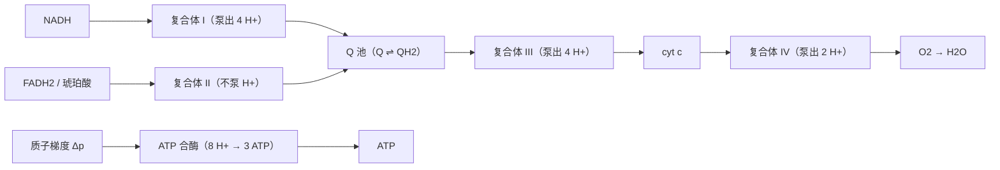

# 氧化磷酸化（Oxidative Phosphorylation, OXPHOS）

> **一句话**：NADH / FADH₂ 把电子交给呼吸链，电子逐级传递到 O₂；每一步释放的能量不直接用来成键，而是"存"成跨内膜的**质子梯度（Δp）**，最后由 ATP 合酶把 H⁺ 的回流转化为 ADP + Pi → ATP。
>
> 三个关键词：**电子传递**（氧化）、**质子梯度**（能量中间货币）、**磷酸化**（ATP 合成）。

---

## 一、总览

| 项目 | 内容 |
|---|---|
| 位置 | 线粒体内膜（嵴）；细菌/古菌在质膜 |
| 组成 | 呼吸链（复合体 I–IV + Q + cyt c）+ ATP 合酶（复合体 V） |
| 电子供体 | NADH、FADH₂（以及琥珀酸、脂酰-CoA 等经 Q 进入） |
| 终末受体 | O₂ → H₂O |
| 能量中间体 | 质子动力势 $\Delta p$（膜电位 + pH 差） |
| 净反应 | $\mathrm{NADH + H^+ + \tfrac12 O_2 \rightarrow NAD^+ + H_2O}$，$\Delta E^{\circ\prime}=+1.136\ \mathrm V$，$\Delta G^{\circ\prime}\approx-219\ \mathrm{kJ/mol}$ |
| 产率 | NADH ≈ 2.5 ATP；FADH₂ ≈ 1.5 ATP（哺乳动物） |
| 总效率 | 约 50–60%（其余以热的形式散失） |

**逻辑链**（务必记住顺序）：

---

## 二、呼吸链的分子组成

### 1. 复合体 I（NADH:泛醌氧化还原酶）

- **结构**：L 形，哺乳动物约 45 个亚基（14 个核心亚基 + 31 个"超数"亚基）；亲水臂伸向基质，疏水臂嵌在膜内。
- **氧化还原中心**：FMN → 一串铁硫簇（Fe-S）→ 位于膜臂与亲水臂交界处的 Q 结合位点。
- **反应**：NADH → NAD⁺ + 2e⁻ + H⁺；2e⁻ 经 FMN/Fe-S 传给 Q，Q + 2H⁺ + 2e⁻ → QH₂（H⁺ 来自基质）。
- **质子泵**：每 2e⁻ 泵出 **4 H⁺**。机制可概括为：Q 位点的氧化还原反应产生"构象波"，沿膜臂传到几个类似反向转运体的亚基（ND2、ND4、ND5 等），把 H⁺ 泵到膜间隙。
- **意义**：NADH 的主要入口；复合体 I 也是 ROS 产生的重要位点之一（FMN 位点与 Q 结合位点均可泄漏电子给 O₂）。
- **抑制**：鱼藤酮（rotenone）、piericidin A、阿米妥（amytal）。

### 2. 复合体 II（琥珀酸脱氢酶，SDH）

- **结构**：4 个亚基（黄素蛋白 SDHA、铁硫蛋白 SDHB、两个膜亚基 SDHC/SDHD）；含 FAD、Fe-S 与血红素 b560。
- **反应**：琥珀酸 → 延胡索酸（TCA 循环的一步），FAD → FADH₂，电子经 Fe-S → Q。
- **关键点**：**不泵质子**。所以经复合体 II 进入的电子（FADH₂）只在下游 III、IV 产生梯度，ATP 产率低（≈1.5）。
- **抑制**：丙二酸（malonate，竞争性）、TTFA、carboxin。
- **临床**：SDHB/SDHC/SDHD 突变与嗜铬细胞瘤/副神经节瘤相关。

### 3. 复合体 III（细胞色素 bc₁，Q:cyt c 氧化还原酶）

- **结构**：二聚体；哺乳动物约 11 个亚基。核心为细胞色素 b（两个血红素 $b_{\mathrm{L}}$、$b_{\mathrm{H}}$）、Rieske 铁硫蛋白、细胞色素 c₁。
- **两个 Q 位点**：$Q_{\mathrm{o}}$（朝向膜间隙）与 $Q_{\mathrm{i}}$（朝向基质）。
- **Q 循环**（重点）：
  1. QH₂ 在 $Q_{\mathrm{o}}$ 被氧化：2H⁺ 释放到膜间隙，2e⁻ 分两路——一路经 Rieske → c₁ → cyt c；另一路经 $b_{\mathrm{L}}$ → $b_{\mathrm{H}}$ → $Q_{\mathrm{i}}$。
  2. 在 $Q_{\mathrm{i}}$，Q 接受 2e⁻ 与基质来的 2H⁺，被还原为 QH₂。
  3. **净效果**：每氧化 1 个 QH₂，向膜间隙释放 **4 H⁺**（2 个来自 QH₂，2 个由基质泵入），并还原 **2 个 cyt c**。
- **意义**：把 2e⁻ 的"一次性"传递拆成两步，既传递电子又泵质子；Q 循环也是 ROS（$Q_{\mathrm{o}}$ 半醌）的来源。
- **抑制**：抗霉素 A（$Q_{\mathrm{i}}$）、myxothiazol/stigmatellin（$Q_{\mathrm{o}}$）、阿托伐醌（$Q_{\mathrm{o}}$，抗疟药）。

### 4. 复合体 IV（细胞色素 c 氧化酶）

- **结构**：哺乳动物约 13–14 个亚基；核心亚基 COX1、COX2、COX3 由线粒体基因编码。
- **氧化还原中心**：$Cu_{\mathrm{A}}$（COX2）→ 血红素 a → 血红素 a₃–$Cu_{\mathrm{B}}$（COX1，O₂ 结合位点）。
- **反应**：cyt c（Fe²⁺）→ $Cu_{\mathrm{A}}$ → heme a → heme a₃/$Cu_{\mathrm{B}}$ → O₂；每 2e⁻ 消耗 2 个基质 H⁺、生成 1 个 H₂O。
- **质子泵**：每 2e⁻ 泵出 **2 H⁺**（经 D 通道/K 通道进入的质子参与化学与泵送）。
- **意义**：决定呼吸链的"终末速度"；O₂ 不足时整条链停摆。
- **抑制**：氰化物、叠氮化物、CO、H₂S（均作用于 heme a₃–$Cu_{\mathrm{B}}$）。

### 5. 移动电子载体

- **泛醌（Q / CoQ10）**：脂溶性，可在膜内扩散；一次接受 **2e⁻ + 2H⁺**，在 Q 池中循环；是 I、II 与 III 之间的"集线器"。
- **细胞色素 c**：可溶性，位于膜间隙侧；一次只传 **1e⁻**；在 III 与 IV 之间往返。凋亡时 cyt c 释放到胞质，激活 caspase（与 OXPHOS 无关的"兼职"）。
- **其他电子入口**：β-氧化产生的 FADH₂ 经 **ETF-QO** 传给 Q；甘油-3-磷酸脱氢酶（G3PDH）、二氢乳清酸脱氢酶（DHODH）也直接把电子交给 Q。它们都绕开复合体 I，产 ATP 较少。

---

## 三、化学渗透：质子梯度怎么建立、怎么用

### 1. 质子动力势

$$\Delta p=\Delta\psi-\frac{2.3RT}{F}\Delta\mathrm{pH}$$

- $\Delta\psi$：膜电位（内负外正），约 −150～−180 mV；
- $\Delta\mathrm{pH}$：基质偏碱，约 0.5～1 个单位（约 30～60 mV）；
- 合计约 **180～220 mV**，每摩尔 H⁺ 约 **20 kJ** 自由能；
- 线粒体中 $\Delta\psi$ 贡献约 3/4，$\Delta\mathrm{pH}$ 约 1/4（与"纯 pH 梯度"的叶绿体不同）。

### 2. 三个前提（Mitchell 的化学渗透假说，1961；1978 诺贝尔化学奖）

1. 呼吸链把 H⁺ 从基质泵到膜间隙；
2. 内膜对 H⁺ **不通透**（除 ATP 合酶与少量泄漏），梯度得以维持；
3. ATP 合酶允许 H⁺ 回流，并把回流的自由能用于 ATP 合成。

**经典证据**：
- **Jagendorf 酸-碱跳跃实验**（1966）：叶绿体类囊体先在酸性缓冲中平衡，再转入含 ADP + Pi 的碱性缓冲，**黑暗中**也能合成 ATP——说明 ΔpH 本身就足以驱动合成。
- **Racker 重建实验**：脂质体中共嵌细菌视紫红质（光驱动质子泵）与 ATP 合酶，光照即可合成 ATP——证明两个组件可以"解耦"重组。
- **解偶联剂与离子载体**：DNP/FCCP 消除 Δp，呼吸加快但 ATP 不合成；缬氨霉素（K⁺ 载体）只消 Δψ，尼日霉素（H⁺/K⁺ 交换）只消 ΔpH——可用它们拆分两种梯度成分。

### 3. 质子账本（每 2e⁻）

| 步骤 | 泵出 H⁺ | 说明 |
|---|---|---|
| 复合体 I（NADH） | 4 | NADH → Q |
| 复合体 II（琥珀酸） | 0 | 不泵质子 |
| 复合体 III | 4 | 每 QH₂；2 个来自 QH₂，2 个来自基质 |
| 复合体 IV | 2 | 每 2e⁻；另消耗 2 个基质 H⁺ 生成水 |
| **NADH 合计** | **10** | → 约 2.5 ATP |
| **FADH₂ 合计** | **6** | → 约 1.5 ATP |

> 注意：复合体 IV 消耗的 2 个 H⁺ 属于 O₂ 还原的化学计量，通常不额外计入"泵出"数；不同教材的"10 H⁺"口径即按上表。

### 4. ATP 合酶（简述，详见单独笔记）

- 结构：F1（α3β3γδε，基质侧催化）+ Fo（c8 + a，膜内质子通道）+ 外周柄（b、OSCP、d、F6）。
- 机制：H⁺ 经 a 的两个半通道使 c-Glu 质子化/去质子化 → c 环旋转（每个 H⁺ 转 45°）→ γ 旋转 → β 依次 O→L→T → ATP 释放。
- 计量：c8 时 8 H⁺/圈 → 3 ATP（2.7 H⁺/ATP）；加上磷酸载体与 ATP/ADP 转位酶的耗能，整体约 **4 H⁺/ATP**。
- 可逆：Δp 崩溃时可水解 ATP 泵质子；IF1 在缺血时抑制水解。
- 详见 [[ATP合酶]]。

---

## 四、全过程（按顺序走一遍）

1. **底物氧化产生 NADH/FADH₂**
   - 糖酵解（胞质）→ 丙酮酸；丙酮酸脱氢酶复合体 → 乙酰-CoA；TCA 循环产生 NADH、FADH₂、GTP。
   - 脂肪酸 β-氧化产生 NADH、FADH₂（后者经 ETF-QO 交给 Q）。
   - 胞质 NADH 需经**穿梭系统**进入线粒体（见第五节）。

2. **复合体 I：NADH → Q**
   - NADH 结合亲水臂，2e⁻ 经 FMN、Fe-S 链到 Q 位点；Q 还原为 QH₂。
   - 同时 4 H⁺ 被泵到膜间隙；基质 H⁺ 浓度下降。

3. **复合体 II：琥珀酸 → Q（可选入口）**
   - 琥珀酸氧化为延胡索酸，FADH₂ 的电子经 Fe-S 给 Q；**不泵质子**。

4. **Q 池**：把 2e⁻ 从 I/II 送到 III；QH₂ 在膜内扩散。

5. **复合体 III：Q 循环**
   - QH₂ 在 $Q_{\mathrm{o}}$ 氧化，2H⁺ 释放到膜间隙；2e⁻ 分路（Rieske→cyt c；$b_{\mathrm{L}}$→$b_{\mathrm{H}}$→$Q_{\mathrm{i}}$）。
   - $Q_{\mathrm{i}}$ 处 Q 被还原为 QH₂（消耗基质 2H⁺）；净泵出 4 H⁺，2 个 cyt c 被还原。

6. **cyt c → 复合体 IV**
   - 2 个 cyt c（Fe²⁺）依次把 1e⁻ 交给 $Cu_{\mathrm{A}}$ → heme a → heme a₃/$Cu_{\mathrm{B}}$。
   - O₂ + 4e⁻ + 4H⁺ → 2H₂O（H⁺ 来自基质）；每 2e⁻ 泵出 2 H⁺。

7. **质子梯度达到稳态**
   - 膜间隙 H⁺ 高、基质 H⁺ 低；Δψ 内负外正；内膜像"充电的电容器"。
   - 梯度既驱动 ATP 合成，也驱动底物转运（如 ATP/ADP、Pi、丙酮酸、Ca²⁺ 等）。

8. **ATP 合酶回收能量**
   - H⁺ 经 Fo 回流基质；c 环旋转 → γ 旋转 → β 的 O/L/T 循环 → ATP。
   - ATP 在基质生成，经 ATP/ADP 转位酶（ATP 出、ADP 入，受 Δψ 驱动）与磷酸载体输出/输入。

9. **ATP 的"去向"**
   - 胞质消耗 ATP → ADP 回线粒体 → 再磷酸化；形成"ATP/ADP 循环"。
   - 线粒体自身也用 ATP（如蛋白导入、复制转录）。

**总反应式**（以 NADH 为例）：

$$\mathrm{NADH + H^+ + \tfrac12 O_2 \rightarrow NAD^+ + H_2O}\qquad \Delta G^{\circ\prime}\approx-219\ \mathrm{kJ/mol}$$

以琥珀酸为例：

$$\text{琥珀酸} + \tfrac12\,\mathrm{O_2} \rightarrow \text{延胡索酸} + \mathrm{H_2O}\qquad \Delta E^{\circ\prime}=+0.785\ \mathrm V,\ \Delta G^{\circ\prime}\approx-151\ \mathrm{kJ/mol}$$

---

## 五、能量学与化学计量

### 1. 电子为什么"愿意"往下走：氧化还原电位

| 半反应 | $E^{\circ\prime}$ (V) |
|---|---|
| NAD⁺ + 2e⁻ + H⁺ → NADH | −0.320 |
| 延胡索酸 + 2e⁻ + 2H⁺ → 琥珀酸 | +0.031 |
| Q + 2e⁻ + 2H⁺ → QH₂ | +0.045 |
| cyt c (Fe³⁺) + e⁻ → cyt c (Fe²⁺) | +0.254 |
| ½O₂ + 2e⁻ + 2H⁺ → H₂O | +0.816 |

- 电子从低电位流向高电位；每一步的 $\Delta E$ 决定该步能泵出几个 H⁺。
- NADH → Q：$\Delta E\approx 0.365\ \mathrm V$，$\Delta G\approx-70\ \mathrm{kJ/mol}$ → 泵 4 H⁺；
- QH₂ → cyt c：$\Delta E\approx 0.21\ \mathrm V$ → 泵 4 H⁺；
- cyt c → O₂：$\Delta E\approx 0.56\ \mathrm V$ → 泵 2 H⁺。

### 2. 为什么 ATP 产率是 2.5 / 1.5

- NADH：10 H⁺ → 10 / 4 ≈ **2.5 ATP**；
- FADH₂（经 II）：6 H⁺ → 6 / 4 ≈ **1.5 ATP**；
- 旧教材的 3 / 2 来自不同的 H⁺/ATP 假设（如 c10、转运耗能估计不同）；现代哺乳动物数据多用 2.5 / 1.5。

### 3. 穿梭系统决定"胞质 NADH 值多少 ATP"

| 穿梭系统 | 机制 | 折算 |
|---|---|---|
| **苹果酸-天冬氨酸穿梭** | 胞质 NADH → 苹果酸 → 基质 NADH → 复合体 I | 2.5 ATP |
| **甘油-3-磷酸穿梭** | 胞质 NADH → 甘油-3-磷酸 → 线粒体 FADH₂ → Q | 1.5 ATP |

- 肝、心等以苹果酸-天冬氨酸为主；骨骼肌、脂肪组织更多用甘油-3-磷酸穿梭。
- 因此"1 分子葡萄糖产多少 ATP"依组织而异：糖酵解 2 ATP + 2 NADH + TCA 2 GTP + 10 NADH + 2 FADH₂ → 约 **30–32 ATP**（经典值）。

### 4. 能量账

- NADH 氧化释放约 220 kJ/mol；2.5 ATP × 约 50 kJ/mol ≈ 125 kJ/mol → 效率约 **55%**。
- ATP 合成反应 $\Delta G^{\circ\prime}=+30.5\ \mathrm{kJ/mol}$，细胞内实际约 +45～+55 kJ/mol；3 个 H⁺（约 60 kJ）刚好够用，因此反应**接近平衡**，酶容易反向运转。
- 未捕获的能量以热散失；这也是棕色脂肪"解偶联产热"的物理基础。

---

## 六、调节

- **ADP 是关键限速因素**（呼吸控制）：ADP 增多 → ATP 合酶加速 → 质子回流加快 → 呼吸链加速；ADP 耗尽则慢下来。
- **Chance 状态**（氧电极经典描述）：
  - State 3：底物 + O₂ + ADP 充足，耗氧快，ATP 合成；
  - State 4：ADP 耗尽，耗氧慢（仅维持质子泄漏）；
  - State 2：缺底物；State 5：缺氧。
  - **呼吸控制比（RCR）** = State 3 / State 4，反映线粒体"健康度"。
- **O₂ 与底物供应**：缺氧时 OXPHOS 下降，HIF-1α 稳定、糖酵解上调。
- **质子泄漏与解偶联**：基础代谢中有相当比例质子经泄漏回流；棕色脂肪的 **UCP1** 受去甲肾上腺素/寒冷激活，把 Δp 直接转为热。
- **其他**：Ca²⁺、甲状腺激素、超复合体（I+III₂+IV 的"呼吸体"）与心磷脂（cardiolipin）影响效率与稳定性；运动/饥饿改变底物偏好。

---

## 七、抑制剂与解偶联剂（实验与药理的核心工具）

| 试剂 | 靶点 | 效果 |
|---|---|---|
| **鱼藤酮**、piericidin A | 复合体 I | 阻断 NADH → Q；呼吸下降 |
| **丙二酸**、TTFA | 复合体 II | 阻断琥珀酸 → Q |
| **抗霉素 A** | 复合体 III $Q_{\mathrm{i}}$ | 阻断 Q 循环，$Q_{\mathrm{o}}$ 半醌积累 → ROS |
| **myxothiazol / stigmatellin** | 复合体 III $Q_{\mathrm{o}}$ | 阻断 QH₂ 氧化 |
| **阿托伐醌** | 复合体 III $Q_{\mathrm{o}}$ | 抗疟药/抗弓形虫 |
| **氰化物、CO、叠氮、H₂S** | 复合体 IV（heme a₃–$Cu_{\mathrm{B}}$） | 阻断 O₂ 还原，致死性 |
| **寡霉素** | ATP 合酶 Fo | 阻断 H⁺ 回流；呼吸因"背压"而减慢 |
| **DCCD** | ATP 合酶 c-Glu | 共价锁死旋转 |
| **DNP、FCCP** | 内膜（质子载体） | 解偶联：Δp 消失，耗氧**加快**、ATP 不合成 |
| **缬氨霉素** | K⁺ 载体 | 只消 Δψ（K⁺ 内流中和内负电荷） |
| **尼日霉素** | H⁺/K⁺ 反向交换 | 只消 ΔpH |
| **二甲双胍** | 复合体 I（部分抑制） | 降低肝糖异生；临床抗高血糖 |
| **bedaquiline** | 分枝杆菌 ATP 合酶 | 抗结核（不针对人酶） |

> 区分"抑制"与"解偶联"：抑制剂让耗氧下降；解偶联剂让耗氧上升但 ATP 产率下降（P/O 趋近 0）。

---

## 八、病理与药理

- **mtDNA 突变（母系遗传、异质性 + 阈值效应）**：
  - **LHON**：ND1/ND4/ND6（复合体 I），无痛性中心视力丧失，男性多见；
  - **MELAS**：m.3243A>G（MT-TL1，tRNA-Leu），乳酸酸中毒、卒中样发作；
  - **MERRF**：m.8344A>G（MT-TK），肌阵挛癫痫、破碎红纤维；
  - **NARP / Leigh**：MT-ATP6 m.8993T>G（L156R）或 T>C（L156P），ATP 合酶缺陷。
- **核基因/装配因子**：复合体 I 亚基（NDUFS1、NDUFS4 等）突变 → Leigh 样表型；复合体 IV 装配因子 **SURF1** 突变 → Leigh；复合体 III 装配因子 BCS1L → GRACILE/BJORN 综合征。
- **复合体 II**：SDHB/C/D 突变 → 嗜铬细胞瘤/副神经节瘤（"代谢酶变成抑癌基因"的经典例子）。
- **ROS 与损伤**：复合体 I、III 产生超氧化物；缺血-再灌注时电子传递与 O₂ 供给不匹配，ROS 爆发；MnSOD/谷胱甘肽系统负责清除。
- **药物/毒物**：氰化物（工业/火灾烟雾）、CO（血红蛋白 + 复合体 IV）、二甲双胍（I）、阿托伐醌（III）、bedaquiline（细菌 V）；历史上 DNP 曾被用作减肥药，因高热致死被禁用。
- **棕色脂肪**：UCP1 解偶联，寒冷/去甲肾上腺素激活，产热而非产 ATP。

---

## 九、常见误区

1. **"O₂ 直接氧化 NADH"**：电子经黄素、Fe-S、Q、cyt c 逐级传递，O₂ 只在复合体 IV 接收电子。
2. **"复合体 II 也泵质子"**：不泵；这是 FADH₂ 产 ATP 较少的根本原因。
3. **"Q 只传电子"**：Q 同时结合/释放 H⁺（2e⁻/2H⁺），Q 循环是泵质子的关键。
4. **"P/O 是固定整数"**：取决于 c 环数目、转运耗能、质子泄漏、穿梭系统与组织。
5. **"电子传递的能量直接用于 ATP 成键"**：能量先存为 Δp；ATP 合酶再"花"质子梯度。
6. **"解偶联剂抑制呼吸"**：相反，它让呼吸加快（P/O↓）。
7. **"寡霉素直接阻断呼吸链"**：它阻断 ATP 合酶，呼吸因产物/质子"背压"而减慢；去掉 ADP 也能造成类似效果。
8. **"ATP 合酶只在线粒体"**：细菌/叶绿体有同源酶；V 型 ATP 酶（溶酶体）方向相反，抑制剂不同（巴弗洛霉素）。
9. **"Δp 主要是 pH 差"**：线粒体以 Δψ 为主（约 3/4）；叶绿体才以 ΔpH 为主。
10. **"氧化磷酸化 = 呼吸链"**：OXPHOS 包含电子传递 **和** 磷酸化两步；只测耗氧不能证明 ATP 合成。

---

## 十、自测

1. 写出 NADH 经呼吸链到 O₂ 的四步电子路径，并标出每步泵出的 H⁺ 数。
2. 为什么琥珀酸氧化只产约 1.5 ATP，而 NADH 产约 2.5？从复合体功能和 H⁺ 账本两方面解释。
3. Q 循环中"4 个 H⁺ 来自哪里"？抗霉素 A 与 myxothiazol 的作用位点有何不同？
4. 用 Jagendorf 实验和 Racker 重建实验说明"化学渗透"的核心证据。
5. 解释：为什么解偶联剂使耗氧上升、P/O 下降？为什么寡霉素使耗氧下降？
6. 一患者线粒体复合体 IV 的 SURF1 缺失，可能出现什么表型？为什么 mtDNA 突变常呈"阈值效应"？

---

## 相关

- [[ATP合酶]]
