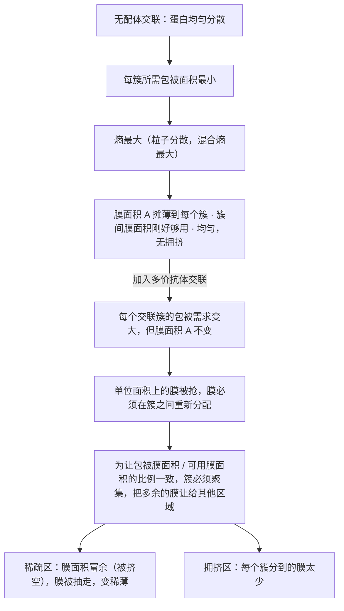
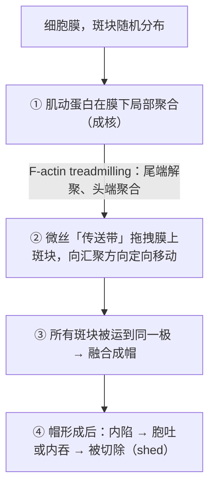
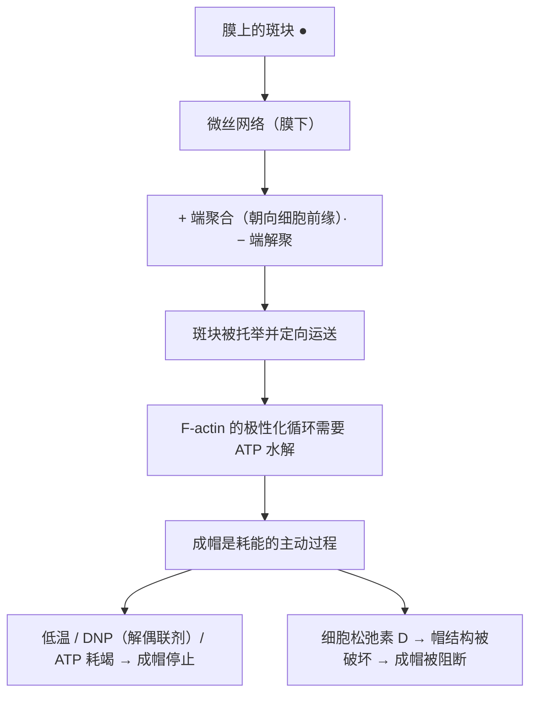
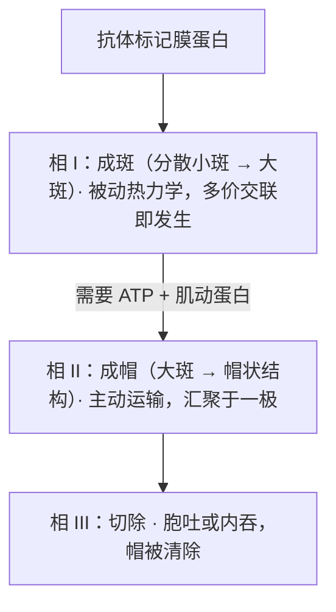

# 细胞膜现象：成斑现象与成帽现象

> **核心命题**：成斑（Patching）与成帽（Capping）是**膜蛋白在细胞表面重新分布**的两种经典现象，由 1970–1974 年间 Taylor、Gilula、Frye、Edidin 等人的细胞融合实验建立。
>
> **一句话区分**：
> - **成斑** = 膜蛋白在**膜平面内**被抗体交联后**被动聚集**成斑点 → 由**膜面积守恒的热力学**驱动，**不耗能**
> - **成帽** = 斑点进一步汇聚到细胞**一极**形成帽状结构 → 需**肌动蛋白细胞骨架 + ATP**，**是耗能的主动过程**

---

## 一、术语与历史

| 术语 | 英文 | 发现者 / 年份 | 关键贡献 |
|---|---|---|---|
| **成斑现象** | Patching（斑纹形成） | **K. C. Gilula, Eiden & Sato（1974）** | 用**人–鼠融合细胞**发现膜蛋白可聚成大斑点 |
| **成帽现象** | Capping（成帽） | **D. E. Taylor, C. Reid, M. Hough（1971, Nature）** | 用**抗组蛋白抗体**标记 HeLa 细胞，发现标记物集中到一极成"帽" |
| **细胞融合实验** | Homotypic Fusion | **Frye & Edidin（1970）** | 首创**人–鼠双标记**（HLA 抗原 + 鼠抗原）融合实验，追踪膜蛋白侧向移动 |
| **双标记实验** | Double Label Experiment | Frye & Edidin | **区分"融合"与"共成簇"** 的决定性方法 |

> 📌 **Frye & Edidin 的方法学意义**：把人源细胞（抗 HLA 抗体标记，绿色）与鼠源细胞（抗鼠抗原，红色）融合成异核双核细胞，放置数分钟后用 **双标记（Double Label）** 观察。若人抗原与鼠抗原**均匀混杂**，说明它们在**同一膜池**中自由扩散 → 膜蛋白是**侧向流动的液体**。这就是**细胞膜流动性学说（Singer & Nicolson, 1972）**的关键实验证据。

---

## 二、成斑现象（Patching）

### 2.1 现象描述

用**双价或多价抗体**（二价 IgG 交联抗原；植物凝集素如**花生凝集素 PHA、ConA** 也是多价配体）标记**细胞表面膜蛋白**后，标记物不再均匀散布，而是：
1. 先聚成**许多分散的小斑点**（spots / patches）
2. 随时间推移，小斑点**相互合并**，最终形成**少数几个致密的大斑点**

| 时间 | 分布形态 |
|---|---|
| t = 0（标记后立即） | 均匀分布 |
| t = 2 min | 小斑点，逐渐合并 |
| t = 10 min → 数十分钟 | 几个致密的大斑 |

**关键特征**
| 特征 | 说明 |
|---|---|
| **发生位置** | **膜平面内**（lateral），**不涉及跨膜翻转（flip-flop）** |
| **驱动机制** | **被动热力学过程**，膜面积守恒 |
| **能量需求** | **不耗 ATP**（低温、低 ATP 仍能发生） |
| **细胞骨架** | **不依赖肌动蛋白微丝**（但可被细胞松弛素 D 部分影响，因其影响膜流动性） |
| **发生条件** | **膜蛋白必须被多价配体交联**（单克隆抗体若不交联则不发生） |
| **时间尺度** | 数分钟至数十分钟 |
| **结果** | 斑块不消失，直到**内吞（endocytosis）**或**膜融合**时被清除 |

### 2.2 机制：膜面积守恒的热力学

这是成斑的**核心原理**，也是最漂亮的一步。

**前提条件**
- 膜是**封闭的**（closed sheet），总膜面积 **A_total 是固定的**
- 膜蛋白被交联成**复合物（cluster）**后，复合物体积变大
- 膜有**不可压缩性**——膜面积不能增加

**热力学逻辑**

**定量化**：设膜上有 N 个簇（第 i 个簇需要包被面积 A_i），总膜面积 A_total。膜面积是**守恒的分配问题**：

第 $i$ 簇周围的膜浓度：

$$c_i = \frac{A_i}{S_i}$$

其中 $S_i$ 为该簇周围的实际膜面积；约束 $\sum_i S_i = A_{total}$（总膜面积守恒）。平衡时所有 $c_i$ 相等 → 周围膜面积按需求 $A_i$ 成比例分配，即 $A_i \propto S_i$。

**结论**：这个分配的最优解就是**所有簇聚成一个大团**——因为**合并 n 个簇只减少一次边界界面**，界面能最小化。这等价于**油滴聚并（coalescence）**的热力学。

**用公式表述斑块生长动力学**
斑块内的配体密度 ρ 满足：
斑块半径增长：

$$\frac{dR}{dt} \propto D \cdot C - \gamma \cdot \frac{1}{R}$$

其中 $D$ 为扩散系数，$C$ 为膜面积过载程度，$\gamma$ 为表面张力。

- **D 越大**（膜流动性好、温度高）→ 成斑**快**
- **C 越大**（抗体浓度越高、交联越密）→ 斑块长得**越大**
- **γ** 是界面能，阻碍小斑合并 → 决定**临界斑块大小**

### 2.3 成斑的证据链

| 实验 | 观察 | 结论 |
|---|---|---|
| **加入交联抗体 vs  Fab 单体** | IgG 交联 → 成斑；**Fab 单价片段不成斑** | 成斑**必须多价交联** |
| **逐渐降低抗体浓度** | 交联密度↓ → 斑块变小、出现更多小斑 | 成斑程度**依赖交联密度** |
| **双标记（double label）** | 两种不同膜蛋白**混合在同斑**中 | 斑是**非特异的**、由膜面积守恒驱动，不是特定蛋白聚集 |
| **低温 / 低 ATP** | 仍能成斑 | **不耗能**，是热力学过程 |
| **细胞松弛素 D（阻断肌动蛋白聚合）** | 斑块形成仍发生，但**斑块合并受限** | 成斑本身不依赖肌动蛋白，但后续转帽依赖 |
| **人为降低膜面积**（压缩、脂质抽提） | 成斑增强 | 膜面积越紧张，成斑越显著 |
| **FRAP 测量** | 成斑后被交联的膜蛋白**侧向扩散系数下降** | 交联复合物的移动性低于单体 |

> 🔑 **双标记实验是最关键的判别**：如果斑块是**特定膜蛋白相互识别**的结果，那么两种不同标记的蛋白会形成**独立的斑**；实际结果是**混杂在同一斑块中**——这就证明了**斑块是被动形成的"膜流"产物**，不携带分子特异性信息。

---

## 三、成帽现象（Capping）

### 3.1 现象描述

某些膜表面成分（尤其是**核纤层蛋白 lamin**、以及**酸性糖蛋白**）被抗体标记后，不是分散成斑，而是**全部汇聚到细胞的一极**，形成一个致密的**新月形/帽状（crescent / cap）**结构。

<svg viewBox="0 0 720 320" width="100%" style="max-width:720px;height:auto;display:block;margin:1rem auto" xmlns="http://www.w3.org/2000/svg" role="img" aria-label="成帽现象的细胞侧视图">
  <ellipse cx="360" cy="160" rx="280" ry="105" fill="none" stroke="currentColor" stroke-width="1.8"/>
  <path d="M140,100 A265,95 0 0 0 140,220" fill="none" stroke="currentColor" stroke-width="10" opacity="0.28"/>

  <g fill="currentColor" stroke="none">
    <circle cx="150" cy="105" r="4.5"/><circle cx="168" cy="122" r="4.5"/>
    <circle cx="140" cy="140" r="4.5"/><circle cx="160" cy="158" r="4.5"/>
    <circle cx="145" cy="178" r="4.5"/><circle cx="166" cy="196" r="4.5"/>
    <circle cx="150" cy="214" r="4.5"/><circle cx="185" cy="112" r="4.5"/>
    <circle cx="192" cy="140" r="4.5"/><circle cx="180" cy="170" r="4.5"/>
    <circle cx="196" cy="198" r="4.5"/><circle cx="206" cy="155" r="4.5"/>
    <circle cx="210" cy="182" r="4.5"/><circle cx="128" cy="160" r="4.5"/>
    <circle cx="126" cy="192" r="4.5"/><circle cx="132" cy="120" r="4.5"/>
    <circle cx="176" cy="216" r="4.5"/><circle cx="202" cy="120" r="4.5"/>
  </g>
  <g fill="currentColor" stroke="none" opacity="0.75">
    <circle cx="470" cy="140" r="4"/><circle cx="500" cy="165" r="4"/>
    <circle cx="540" cy="130" r="4"/><circle cx="575" cy="160" r="4"/>
    <circle cx="610" cy="146" r="4"/><circle cx="490" cy="192" r="4"/>
    <circle cx="530" cy="200" r="4"/><circle cx="568" cy="194" r="4"/>
    <circle cx="604" cy="184" r="4"/><circle cx="452" cy="172" r="4"/>
  </g>

  <line x1="150" y1="58" x2="150" y2="96" stroke="currentColor" stroke-width="1" opacity="0.6"/>
  <line x1="360" y1="262" x2="360" y2="286" stroke="currentColor" stroke-width="1" opacity="0.6"/>

  <g font-size="12" stroke="none">
    <text x="40" y="42">帽（致密染色带）</text>
    <text x="692" y="42" text-anchor="end">后端（分散斑块）</text>
    <text x="360" y="306" text-anchor="middle">细胞膜（侧视）</text>
  </g>
</svg>

*上图：帽形成后，标记物集中到细胞一极形成致密染色带，其余区域只剩分散斑块。*

**关键特征**

| 特征 | 说明 |
|---|---|
| **发生位置** | 需要**膜的**跨膜垂直运动（**膜内陷 / 内卷，invagination）** 把膜抽向一极 |
| **驱动机制** | **细胞骨架依赖的主动运输** |
| **能量需求** | **需 ATP**（低温、ATP 耗竭、2,4-二硝基苯酚 DNP 处理 → **抑制成帽**） |
| **骨架成分** | **肌动蛋白微丝（F-actin）** + **肌球蛋白 II（myosin II）** |
| **抑制剂** | **细胞松弛素 D（cytochalasin D，阻断肌动蛋白聚合）** → **完全抑制** |
| **驱动力** | 双向**微丝聚合/解聚**（F-actin 的"传送带"，treadmilling）驱动膜流动 |
| **终点** | 帽形成后**被切除（shed）**——通过**胞吐**或**内吞**进入细胞 |
| **时间尺度** | 数分钟 |

### 3.2 经典实验

| 实验 | 系统 | 发现 |
|---|---|---|
| **Taylor, Reid & Hough（1971）** | **HeLa 细胞 + 抗组蛋白抗体** | 核表面抗原标记后迅速汇聚成帽 |
| **抗 lamin 抗体** | 多种哺乳动物细胞 | **核纤层蛋白**成斑、成帽最典型 |
| **冷血动物 vs 哺乳动物** | 有核细胞 vs 哺乳动物成熟红细胞 | **哺乳动物红细胞不能成帽**（无核、无细胞骨架） |
| **抗血型抗原抗体** | 有核细胞 | 抗体诱导的抗原**聚集**初期为**斑块**，后期才**成帽** |
| **秋水仙素（colchicine）** | 微管 | **微管不是成帽必需**（但影响膜流动的方向性） |

> 📌 **关键区分**：**红细胞（无核）不能成帽但能成斑**。这个对比证明了**成帽需要细胞骨架的主动运输**，而**成斑只是被动过程**。这是区分两者机制的经典证据。

### 3.3 机制：肌动蛋白-肌球蛋白的"传送带"模型

**具体机制分解**

| 步骤 | 分子事件 |
|---|---|
| **1. 斑块起点** | 抗体交联产生多个分散的小斑 |
| **2. 微丝重组** | 在细胞一极形成**肌动蛋白极性网络**（actin cap / polar cap） |
| **3. 定向运动** | 微丝的**聚合-解聚循环（treadmilling）** + **肌球蛋白 II** 提供动力，沿微丝把膜向两极输送 |
| **4. 汇聚** | 斑块沿微丝网络向同一极运输并**融合**成致密帽 |
| **5. 切除** | 帽的膜**内陷**，通过**微囊泡脱落（blebbing）**或**溶酶体/内体降解**被清除 |

**驱动力来源：F-actin 的 treadmilling**

> ⚠️ **注意**：不同细胞类型的成帽机制略有差异——**迁移细胞（lamellipodium）**的成帽多与**微丝-肌球蛋白**相关；**悬浮细胞**的成帽则更多依赖**微管**。但**肌动蛋白骨架是必需成分**这一点是一致的。

---

## 四、成斑 vs 成帽：完整对比

![[patching-vs-capping.svg]]

> **左侧 panel｜成斑**：0 min 多价抗体交联后均匀分布 → 数分钟小斑合并成大斑。驱动力是**膜面积守恒**的被动热力学。
> **右侧 panel｜成帽**：大斑沿微丝被主动运向一极→ 汇聚成致密帽 → 被切除。需**耗 ATP**。
> **底部**：判别机制的经典实验——**哺乳动物成熟红细胞无核无骨架 → 能成斑、不能成帽**。

| 维度 | **成斑（Patching）** | **成帽（Capping）** |
|---|---|---|
| **膜维度** | 平面内（lateral） | 需**跨膜垂直运动**（内陷） |
| **驱动力** | **膜面积守恒的热力学** | **肌动蛋白-肌球蛋白主动运输** |
| **能量（ATP）** | ❌ 不需要 | ✅ **必需** |
| **细胞骨架** | ❌ 不依赖（肌动蛋白非必需） | ✅ **肌动蛋白微丝 + 肌球蛋白 II 必需** |
| **细胞松弛素 D** | 基本不影响（仅间接） | ✅ **完全阻断** |
| **低温 / DNP** | 仍能发生 | ✅ **抑制** |
| **多价配体** | ✅ **必须**（抗体交联是前提） | ✅ 通常也是抗体诱导 |
| **时间尺度** | 数分钟～数十分钟 | 数分钟 |
| **空间位置** | 全表面分散 → 若干大斑 | 全部汇聚到**一极** |
| **终点** | 斑块持续存在或被内吞 | 帽被**切除（shed）** |
| **哺乳动物红细胞** | ✅ 可成斑 | ❌ **不能成帽**（无核、无骨架） |
| **生物学意义** | 证明膜蛋白**可侧向移动**、膜有**流动性** | 证明膜蛋白与**细胞骨架的偶联**；是**细胞极性建立的模型** |
| **经典实验** | Gilula et al. 1974（人-鼠融合细胞） | Taylor et al. 1971（HeLa + 抗组蛋白） |

### 两者的关系：先后相继

> 💡 **两者是同一过程的两个阶段**：成斑是被动的第一步，成帽是耗能的第二步。**成斑可以在无核、无骨架的红细胞中发生；成帽不能**——这个对比精确地分离了两者的机制基础。

---

## 五、成斑与成帽的实验方法

### 5.1 标准实验流程

1. **细胞准备**
2. **标记**：抗膜蛋白抗体（或植物凝集素 PHA / ConA）标记
3. **孵育**：37°C 孵育不同时间（0 / 2 / 5 / 10 / 20 / 40 min）
4. **固定**：4% 多聚甲醛
5. **二抗标记**：荧光二抗（FITC/TRITC）
6. **观察**：荧光显微镜观察标记物分布
7. **量化**：斑块/帽的数量、大小、荧光强度分布

### 5.2 关键对照设计

| 对照 | 操作 | 预期结果 |
|---|---|---|
| **交联 vs 非交联** | **IgG（多价）** vs **Fab（单价）** | IgG 成斑；**Fab 不成斑** → 证明交联必要性 |
| **有核 vs 无核** | 哺乳动物细胞 vs **红细胞** | 都成斑；**仅前者成帽** |
| **有骨架 vs 破坏骨架** | 对照 vs **细胞松弛素 D** | 成斑不受影响；**成帽被阻断** |
| **有 ATP vs 无 ATP** | 对照 vs **DNP / 低温 / 无糖培养基** | 成斑不受影响；**成帽被抑制** |
| **双标记** | 蛋白 A-FITC + 蛋白 B-TRITC | 若共成斑 → 成斑**非特异** |
| **固定时机** | 不同时间点固定 | 观察动态变化（**必须在不同时间点取样，不能用活细胞连续观察代替**） |

### 5.3 定量指标

| 指标 | 方法 | 含义 |
|---|---|---|
| **斑块密度**（patches/mm²） | 荧光图像分析 | 交联密度、聚集程度 |
| **斑块平均面积** | ImageJ 分析 | 成斑进展 |
| **帽的面积/细胞表面积比** | 荧光强度集中度 | 成帽程度 |
| **帽的数量/细胞** | 计数 | 极性程度 |
| **FRET/FRET 效率** | 荧光共振能量转移 | 蛋白在斑内的**紧密聚集程度** |
| **FRAP 恢复速率** | 荧光漂白恢复 | 交联后移动性变化 |
| **质谱（LC-MS/MS）** | 斑块膜组分分析 | 成斑/成帽中的**脂质与蛋白组分**（如 **脂筏**组分） |

---

## 六、生物学意义与应用

### 6.1 理论贡献

| 发现 | 意义 |
|---|---|
| **膜蛋白侧向流动** | 支持 **Singer & Nicolson（1972）流动镶嵌模型** |
| **膜面积守恒** | 建立"**膜是受限的二维流体**"概念 |
| **膜-骨架偶联** | 第一次证明**膜蛋白被细胞骨架约束** |
| **有核 vs 无核细胞差异** | 分离"被动扩散"与"主动运输"两个机制 |

### 6.2 现代应用与延伸

| 领域 | 应用 |
|---|---|
| **脂筏（Lipid Raft）研究** | 成斑/成帽本身就是**膜脂质与蛋白相分离的宏观表现**；抗交联后的富集区域与脂筏部分重叠 |
| **膜蛋白聚集与疾病** | **亨廷顿病、阿尔茨海默病、朊病毒病**中膜蛋白异常聚集 |
| **肿瘤细胞表面抗原** | 成帽影响**肿瘤相关抗原（TAAs）**的免疫逃逸与抗体治疗 |
| **B/T 细胞受体交联** | 受体聚簇启动**下游信号**；是**免疫突触（immunological synapse）**的组成 |
| **细胞极性与迁移** | 成帽与**前后极性建立**、**伪足形成**直接相关 |
| **纤毛/鞭毛形成** | 纤毛基部蛋白的**定向聚集**是纤毛发生的关键步骤 |
| **伤口修复** | 上皮细胞在损伤边缘的**定向迁移与极性建立** |
| **跨膜信号转导** | 成斑 = **信号平台的自发形成**（无需外部信号） |
| **药理学** | 环孢素A、FK506 等**免疫抑制剂**部分通过干扰肌动蛋白重组影响成帽 |
| **生物物理研究** | 成斑是研究**膜-骨架相互作用**的经典模型系统 |

> 🔬 **现代联系**：成斑现象是**脂筏（lipid raft）发现的历史源头之一**。1970–1974 年的膜流动性研究，直接启发了后来对**膜脂质微区（membrane microdomains）**的探索。

---

## 七、常见问题与误区

| 问题 / 误区 | 解答 |
|---|---|
| **❌ "成斑和成帽是一回事"** | ❌ **机制完全不同**。成斑 = 被动热力学（不耗能，不依赖骨架）；成帽 = 主动运输（耗能，需肌动蛋白） |
| **❌ "成帽需要微管"** | ❌ **主要依赖微丝**。秋水仙素（微管抑制剂）对成帽影响小；**细胞松弛素 D（微丝抑制剂）**才有效 |
| **❌ "所有膜蛋白都能成斑"** | ❌ **必须被多价配体交联**。单价 Fab 片段不能成斑 |
| **❌ "所有细胞都能成帽"** | ❌ **哺乳动物成熟红细胞不能成帽**（无核、无细胞骨架） |
| **❌ "成斑需要能量"** | ❌ **不需要**。低温、ATP 耗竭下仍能发生 |
| **❌ "帽是细胞主动"形成的形态"** | ✅ 帽本身是被动汇聚形成的**形态**，但**汇聚过程**是主动耗能的 |
| **❌ "成斑说明膜蛋白自由移动"** | ⚠️ 更准确：成斑说明**膜蛋白能侧向移动但受限制**——交联成簇后移动性下降，且骨架会限制移动范围 |
| **❌ "标记后直接在活细胞镜下观察"** | ⚠️ 标准做法是**不同时间点固定后荧光观察**（活细胞长时间观察有光毒性） |

---

## 八、要点速记

| 要点 | 内容 |
|---|---|
| **成斑定义** | 膜蛋白被**多价抗体/凝集素交联**后，在膜平面内**被动聚集**成大斑点 |
| **成斑机制** | **膜面积守恒的热力学**：簇变大→需要更多膜→膜重新分配→簇聚集以最小化界面 |
| **成斑能耗** | ❌ 不耗 ATP，不依赖细胞骨架 |
| **成斑必要性** | **多价配体**是前提（Fab 单价片段无效） |
| **成帽定义** | 膜蛋白（尤其 lamin）经抗体标记后**汇聚于一极**形成致密帽状结构 |
| **成帽机制** | **肌动蛋白微丝 treadmilling + 肌球蛋白 II** 的定向主动运输 |
| **成帽能耗** | ✅ 耗 ATP；**细胞松弛素 D 阻断** |
| **关键证据** | **哺乳动物红细胞：能成斑、不能成帽**（无核无骨架）→ 分离两机制 |
| **双标记意义** | 两种蛋白**共成斑** → 证明斑块是**非特异性**的膜流产物 |
| **后续步骤** | 帽形成后被**切除（shed）**——胞吐或内吞 |
| **理论意义** | 支持**流动镶嵌模型**、建立**膜-骨架偶联**概念、脂筏研究的历史源头 |

---

## 附：关键缩写对照

| 缩写 | 全称 | 中文 |
|---|---|---|
| **Patching** | — | 成斑现象 |
| **Capping** | — | 成帽现象 |
| **Frye & Edidin** | — | 1970 细胞融合双标记实验的作者 |
| **Taylor et al.** | — | 1971 年发现成帽现象 |
| **Gilula et al.** | — | 1974 年研究成斑现象 |
| **Fab** | Fragment antigen-binding | 抗原结合片段（**单价、不交联**） |
| **IgG** | Immunoglobulin G | 免疫球蛋白 G（**二价、可交联**） |
| **PHA** | Phytohemagglutinin | 植物血凝素（**多价凝集素**） |
| **ConA** | Concanavalin A | **刀豆凝集素 A**（多价，与甘露糖结合） |
| **Cytochalasin D** | — | 细胞松弛素 D（**阻断肌动蛋白聚合**） |
| **Colchicine** | — | 秋水仙素（**微管抑制剂**） |
| **DNP** | 2,4-Dinitrophenol | 2,4-二硝基苯酚（**解偶联剂**，耗尽 ATP） |
| **F-actin** | Filamentous actin | **肌动蛋白丝/微丝** |
| **Myosin II** | — | **肌球蛋白 II**（微丝马达蛋白） |
| **Treadmilling** | — | **微丝聚合-解聚循环**（传送带机制） |
| **Immunological synapse** | — | **免疫突触**（T/B 细胞受体聚簇区） |
| **Lamin** | — | **核纤层蛋白**（成斑/成帽的经典底物） |
| **Shedding** | — | **脱落/切除**（帽的清除） |
| **BLEB** | Blebbing | **膜出芽/囊泡化** |
| **Invagination** | — | **内陷**（帽形成的膜结构变化） |

---

> **总结**
> **成斑**是**膜面积守恒**驱动的**被动**聚集——多价配体交联出的大簇"抢"膜，膜被重新分配，簇为了最小化界面而合并。它**不耗能、不依赖骨架**，连哺乳动物红细胞都能做。
>
> **成帽**是**肌动蛋白-肌球蛋白**驱动的**主动**运输——F-actin treadmilling 像传送带把斑块运到一极，汇聚成致密的帽，随后被切除。它**需ATP、被细胞松弛素 D 阻断**，需要完整的细胞骨架。
>
> **两者相继发生**：先被动成斑，再主动成帽，最终被清除。这个看似简单的现象序列，**揭示了膜的二维流体性质、膜的受限性、以及膜与细胞骨架的偶联**——是细胞膜生物学最经典的实验模型之一。