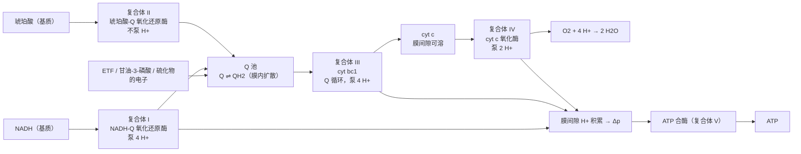

# 电子传递链（呼吸链）

> 相关笔记：[[氧化磷酸化]]、[[ATP合酶]]

## 0. 一句话概括

电子传递链（electron transport chain, ETC），又称呼吸链（respiratory chain），位于线粒体内膜。它由四个蛋白复合体（I–IV）和两个可移动电子载体（Q、cyt c）组成，把 NADH 与 FADH₂ 携带的电子沿氧化还原电位由低到高逐级交给 O₂；释放的自由能用于把 H⁺ 从基质泵到膜间隙，建立质子动力势 Δp。Δp 再由 ATP 合酶转化为 ATP。

分工可以这样记：

- **ETC＝"充电"**：化学能 → 电化学势能（Δp）。
- **ATP 合酶＝"放电"**：电化学势能 → ATP 的磷酸酐键能。

电子传递本身**不产生 ATP**，也不消耗 ATP；它只负责把能量"存"进质子梯度。

---

## 1. 总体版图

四个复合体在内膜上的排布、辅基与功能：

| 复合体 | 别名 | 亚基数（哺乳动物） | 关键辅基 | 电子入口 → 出口 | 泵 H⁺ | 典型抑制剂 |
|---|---|---|---|---|---|---|
| I | NADH–Q 氧化还原酶 | 45（14 个核心） | FMN、8 个 Fe-S 簇 | NADH → Q | 4 | 鱼藤酮、粉蝶霉素 A |
| II | 琥珀酸–Q 氧化还原酶 | 4 | FAD、2Fe-2S/4Fe-4S/3Fe-4S、heme b | 琥珀酸 → Q | 0 | TTFA、丙二酸 |
| III | cyt bc₁ 复合体 | 11 | heme $b_{\mathrm{L}}$、$b_{\mathrm{H}}$、c₁、Rieske 2Fe-2S | QH₂ → cyt c | 4 | 抗霉素 A、粘噻唑 |
| IV | cyt c 氧化酶 | 13 | $Cu_{\mathrm{A}}$、heme a、heme a₃–$Cu_{\mathrm{B}}$ | cyt c → O₂ | 2 | CN⁻、N₃⁻、CO、H₂S |

> 记忆抓手：**I、III、IV 是"泵"，II 是"汇"**。复合体 II 不泵质子，但它把 FADH₂ 的电子送进 Q 池，因此仍是呼吸链的一环。

---

## 2. 电子载体：谁在运电子

| 载体 | 化学本质 | 位置 | 作用 |
|---|---|---|---|
| NAD⁺/NADH | 烟酰胺核苷酸 | 基质（可溶） | 双电子供体，把代谢物脱下的氢交给复合体 I |
| FAD/FMN | 核黄素辅基 | 结合在复合体 I、II 上 | 接受双电子，再拆成单电子传给 Fe-S |
| 铁硫簇（Fe-S） | 铁与半胱氨酸硫/无机硫 | 复合体 I、II、III（Rieske） | 单电子"接力棒"，靠 Fe²⁺/Fe³⁺ 变价 |
| 血红素 b | 原卟啉 IX + Fe | 复合体 II、III | 单电子传递；$b_{\mathrm{L}}$ 低电位、$b_{\mathrm{H}}$ 高电位 |
| 血红素 c₁ | 血红素共价结合蛋白 | 复合体 III | 把电子交给 cyt c |
| 血红素 a / a₃ | 带甲酰基的血红素 | 复合体 IV | a 传电子，a₃ 与 $Cu_{\mathrm{B}}$ 组成 O₂ 结合位点 |
| 铜中心 $Cu_{\mathrm{A}}$ / $Cu_{\mathrm{B}}$ | 双核 / 单核铜 | 复合体 IV | $Cu_{\mathrm{A}}$ 接收 cyt c 电子；$Cu_{\mathrm{B}}$ 参与 O₂ 还原 |
| 辅酶 Q（Q） | 脂溶性苯醌 | 内膜疏水区，可自由扩散 | **双电子/双质子**载体，在 Q 池中循环 |
| cyt c | 可溶血红素蛋白（104 aa） | 膜间隙 | 唯一可溶的电子载体，在 III 与 IV 之间穿梭 |

### 氧化还原电位：电子"往低处流"

电子自发从**低 E°′** 流向**高 E°′**，自由能变化为：

$$\Delta G^{\circ\prime} = -nF\Delta E^{\circ\prime}$$

| 电对 | E°′（V，pH 7） |
|---|---|
| NAD⁺/NADH | −0.32 |
| 琥珀酸/延胡索酸 | +0.031 |
| Q/QH₂ | +0.045 |
| cyt $b_{\mathrm{L}}$ | 约 −0.10 |
| cyt $b_{\mathrm{H}}$ | +0.077 |
| Rieske [2Fe-2S] | +0.28 |
| cyt c | +0.254 |
| heme a | +0.29 |
| heme a₃–$Cu_{\mathrm{B}}$ | +0.35 |
| O₂/H₂O | +0.816 |

因此整条链的方向是：**NADH（−0.32）→ Q（+0.045）→ cyt c（+0.254）→ O₂（+0.816）**。O₂ 电位最高，所以它是天然的最后电子受体；这也是"为什么必须有氧"的热力学答案。

> 电子的实际传递靠"隧穿"，供体与受体中心距离一般不超过约 14 Å。复合体内部大量 Fe-S 簇/血红素就是为缩短这一步一步的距离而存在的。

---

## 3. 复合体 I：NADH–Q 氧化还原酶

### 结构

- 哺乳动物约 **45 个亚基**，其中 **14 个为核心亚基**，在原核到人之间高度保守。
- 7 个由线粒体 DNA 编码（ND1、ND2、ND3、ND4、ND4L、ND5、ND6），其余由核基因编码（NDUFV1、NDUFV2、NDUFS1–8 等）。
- 形状像一个"L"：疏水臂嵌在内膜，亲水臂伸向基质。
- 亲水臂顶端是 NADH 结合位与 **FMN**；沿亲水臂排列 **8 个 Fe-S 簇**（N1a、N1b、N2、N3、N4、N5、N6a、N6b）。**N2 是入口簇**，直接接受 FMN 传来的电子。
- 膜内部分有多个"泵模块"，由 NDUFS2、NDUFS7、NDUFS8、NDUFS3 等构成质子通道。

### 反应

**NADH + Q + 5H⁺（基质） → NAD⁺ + QH₂ + 4H⁺（膜间隙）**

注意：Q 还原成 QH₂ 需要 2 个 H⁺，其中 1 个来自 NADH 的 hydride（H⁻），另 1 个从基质取；所以左侧写 5 个基质 H⁺、右侧 4 个泵出。

### 机制

1. NADH 把 2 个电子交给 FMN，FMN 变 FMNH₂。
2. FMNH₂ 分两次把单电子经 N2 → N3 → N4 → N5 → N6 → N6a 传下去，最后交给 Q，生成半醌再生成 QH₂。
3. 电子传入时，NDUFS2 的一段 β-折叠与 NDUFS7/NDUFS8 的 α-螺旋发生构象摆动，像"活塞"一样推动膜内质子通道，把 4 个 H⁺ 泵到膜间隙。
4. 复合体 I 还能进行**反向电子传递（RET）**：当 Δp 很高而 NADH 不足时，电子可从 QH₂ 逆流回 NAD⁺ 生成 NADH（缺氧/缺血再灌注时重要，伴随 ROS 产生）。

### 抑制剂与病理

- 鱼藤酮（rotenone）、粉蝶霉素 A（piericidin A）结合 Q 位点，阻断 Q 还原。
- 复合体 I 是呼吸链中最常出问题的复合体。**LHON**（Leber 遗传性视神经病变）常见于 MT-ND1 m.3460G>A、MT-ND4 m.11778G>A、MT-ND6 m.14484T>C；严重缺陷可致 Leigh 综合征。
- 组装需要大量 NDUFAF 系列装配因子（如 NDUFAF1–8、ACAD9）。

---

## 4. 复合体 II：琥珀酸–Q 氧化还原酶

### 结构

- **只有 4 个亚基**，全部由核基因编码：
  - **SDHA**：黄素蛋白，含 FAD，是琥珀酸结合与脱氢的位点。
  - **SDHB**：铁硫蛋白，含 2Fe-2S、4Fe-4S、3Fe-4S 三种簇。
  - **SDHC / SDHD**：两个膜锚定亚基，含一个血红素 b，把复合体固定在内膜并参与 Q 结合。
- 它同时是**三羧酸循环的一步**（琥珀酸 → 延胡索酸），也是唯一嵌入内膜的 TCA 酶。

### 反应

**琥珀酸 + Q → 延胡索酸 + QH₂**

### 为什么"不泵质子"

- 琥珀酸/延胡索酸的 E°′（+0.031）与 Q/QH₂（+0.045）几乎持平，ΔE°′ 只有约 0.014 V，ΔG°′ 仅约 −2.7 kJ/mol。
- 这点能量不足以驱动质子泵，复合体 II 也没有演化出质子通道。
- 后果是：**FADH₂ 的电子只能"半路"进入 Q 池，绕过复合体 I**，因此每个 FADH₂ 少泵 4 个 H⁺，P/O 只有 NADH 的约 60%。

### 抑制剂与病理

- 丙二酸（malonate）与琥珀酸竞争；TTFA、carboxin 阻断 Q 位点。
- SDHB/SDHC/SDHD 突变与**副神经节瘤、嗜铬细胞瘤、胃肠道间质瘤**密切相关（SDH 功能丧失 → 琥珀酸累积 → 表观遗传改变）。

---

## 5. Q 池与复合体 III：Q 循环

### 辅酶 Q 的三态

Q 在膜内自由扩散，以三种氧化态存在：

- **Q**（全氧化型，醌）
- **QH₂**（全还原型，氢醌）
- **Q•⁻**（半醌自由基，中间态）

它一次能搬 **2 个电子 + 2 个质子**，是呼吸链里少见的"双电子/双质子"载体。所有进入 Q 池的电子（复合体 I、II、ETF-Q 氧化还原酶、甘油-3-磷酸脱氢酶、硫化物氧化酶等）在这里汇合。

### 复合体 III 结构

- 哺乳动物 **11 个亚基**，以**二聚体**形式工作。
- 催化核心三个：
  - **cyt b**（MT-CYB，线粒体基因编码）：两个血红素，$b_{\mathrm{L}}$（低电位，靠近膜间隙）与 $b_{\mathrm{H}}$（高电位，靠近基质）。
  - **Rieske 铁硫蛋白**（UQCRFS1）：[2Fe-2S]，高位点。
  - **cyt c₁**（UQCRC1）：把电子交给 cyt c。
- 两个 Q 结合位点：
  - $Q_{\mathrm{o}}$：朝向膜间隙，QH₂ 在此被氧化（"o"＝out）。
  - $Q_{\mathrm{i}}$：朝向基质，Q 在此被还原（"i"＝in）。

### Q 循环的分步过程

以氧化 1 个 QH₂、还原 2 个 cyt c 为一个循环：

1. **QH₂ 进入 $Q_{\mathrm{o}}$**。它的两个电子在此"分叉"（bifurcation），走两条不同电位的路。
2. **电子 1（高电位路）**：QH₂ → Rieske [2Fe-2S] → cyt c₁ → cyt c。这一步 ΔE 大，释放的能量用来"锁住"另一个电子。
3. **电子 2（低电位路）**：QH₂ → $b_{\mathrm{L}}$ → $b_{\mathrm{H}}$ → $Q_{\mathrm{i}}$ 位点。走这条"绕路"是 Q 循环的精髓：它把本来会一次性释放的能量拆成两段，使质子泵送成为可能。
4. QH₂ 被氧化后变成 Q，同时把 **2 个 H⁺ 释放到膜间隙**。
5. 在 $Q_{\mathrm{i}}$，一个 Q（或半醌）接受来自 $b_{\mathrm{H}}$ 的电子，并从**基质**取 **2 个 H⁺**，经 Q•⁻ 变成 QH₂。
6. 净反应：

**QH₂ + 2 cyt c（氧化型） + 2H⁺（基质） → Q + 2 cyt c（还原型） + 4H⁺（膜间隙）**

**质子账**：$Q_{\mathrm{o}}$ 释放 2 个（来自 QH₂）+ $Q_{\mathrm{i}}$ 从基质取走 2 个（相当于把这 2 个也"搬"了出去）＝ 净 4 H⁺ 出现在膜间隙。这就是"1 个 QH₂ 泵 4 个 H⁺"的来历，也是 Q 循环最容易被记错的地方。

> 二聚体意义：一个单体的 $Q_{\mathrm{i}}$ 与另一单体的 cyt b 血红素在空间上靠近，保证电子在 $b_{\mathrm{L}} \to b_{\mathrm{H}}$ 之间高效传递；同时二聚化有利于结构稳定。

### 抑制剂

- **抗霉素 A**（antimycin A）占据 $Q_{\mathrm{i}}$，使 $b_{\mathrm{H}}$ 的电子无处可去 → 电子回传 → $Q_{\mathrm{o}}$ 半醌堆积 → 大量超氧。它是研究 ROS 的经典工具。
- **粘噻唑**（myxothiazol）、**stigmatellin** 占据 $Q_{\mathrm{o}}$，阻断 QH₂ 氧化。
- **阿托伐醌**（atovaquone）也是 $Q_{\mathrm{o}}$ 抑制剂，用作抗疟药（抑制疟原虫 cyt bc₁）。

---

## 6. cyt c：唯一可溶的电子载体

- 人 cyt c 由 **CYCS** 基因编码，104 个氨基酸，血红素通过两个硫醚键**共价**连接在 Cys14/Cys17 上。
- 位于**膜间隙**，可溶，不嵌入膜；在复合体 III 的 cyt c₁ 与复合体 IV 的 $Cu_{\mathrm{A}}$ 之间往返。
- 每次只搬 **1 个电子**（Fe²⁺ ⇌ Fe³⁺）。
- 额外功能：线粒体受损时 cyt c 释放到胞质，参与**细胞凋亡**（凋亡体组装、caspase-9 激活）。因此 cyt c 既是呼吸链成员，也是死亡信号。

---

## 7. 复合体 IV：cyt c 氧化酶

### 结构

- 哺乳动物 **13 个亚基**：COX1、COX2、COX3 由线粒体 DNA 编码，其余（COX4、COX5a/5b、COX6A/6B/6C、COX7A/7B/7C、COX8A 等）由核基因编码。
- 三个金属中心，从外到内排成一条"导线"：
  - **$Cu_{\mathrm{A}}$**（双核铜，位于 COX2）：接收 cyt c 的电子。
  - **heme a**（COX1）：中继。
  - **heme a₃–$Cu_{\mathrm{B}}$**（COX1）：双核中心，**O₂ 的结合与还原位点**。
- 两条质子通道：
  - **D 通道**（COX1 的 Asp91 起始）：主要供给成水与泵出的质子。
  - **K 通道**（Lys319 附近）：在循环早期提供质子。

### 反应

**4 cyt c（还原型） + O₂ + 8H⁺（基质） → 4 cyt c（氧化型） + 2H₂O + 4H⁺（膜间隙）**

- 4 个电子来自 4 个 cyt c（每个只带 1 个电子）。
- 8 个基质 H⁺ 中，**4 个用于把 O₂ 还原成 2 个 H₂O**，另外 **4 个被泵出**。

### 分步机制

1. cyt c 结合在 COX2/COX1 界面，把电子交给 $Cu_{\mathrm{A}}$（Cu²⁺ → Cu⁺）。
2. $Cu_{\mathrm{A}}$ → heme a → heme a₃–$Cu_{\mathrm{B}}$，电子逐个"跳"过去。
3. O₂ 结合在 a₃ 与 $Cu_{\mathrm{B}}$ 之间，先接受 2 个电子形成过氧中间态（P），再接受 2 个电子并摄取 4 个质子，断裂 O–O 键，生成 2 个 H₂O。
4. 每完成一轮（4 电子），复合体 IV 从基质取 8 H⁺、向膜间隙放 4 H⁺。
5. O₂ 必须**分步但成对**地接受电子，中间态被蛋白牢牢控制，避免超氧/过氧化氢泄漏。复合体 IV 本身几乎不产 ROS。

### 抑制剂与病理

- **CN⁻、N₃⁻、CO、H₂S** 都作用于 heme a₃–$Cu_{\mathrm{B}}$，阻断 O₂ 结合或电子传递。氰化物中毒即由此致死。
- 组装需要 SCO1/SCO2（铜插入）、COX10/COX11（血红素加工）等因子；缺陷可致 Leigh 综合征、心肌病。
- 复合体 IV 缺陷时，电子在 III 之后堆积，整体呼吸链停摆。

---

## 8. 质子账本与能量学

### 各段能量释放

| 段落 | 电子流向 | ΔE°′（V） | ΔG°′（kJ/mol） | 泵出 H⁺ |
|---|---|---|---|---|
| 复合体 I | NADH → Q | 0.365 | −70.4 | 4 |
| 复合体 III | QH₂ → cyt c | 0.209 | −40.3 | 4 |
| 复合体 IV | cyt c → O₂ | 0.562 | −108.5 | 2 |
| **合计** | NADH → O₂ | 1.136 | **约 −219** | **10** |

### 两种底物的"收益"

| 底物 | 路径 | 复合体 I | III | IV | 总 H⁺ | P/O（H⁺/ATP≈4） |
|---|---|---|---|---|---|---|
| NADH | I → Q → III → IV | 4 | 4 | 2 | **10** | **2.5** |
| FADH₂ / 琥珀酸 | II → Q → III → IV | 0 | 4 | 2 | **6** | **1.5** |

> 老教材常写 P/O＝3 和 2，那是基于 c 环 10 个亚基、H⁺/ATP＝3 的旧估值；哺乳动物 c 环是 8 个亚基，现代值为 2.5 和 1.5。数值差异来自物种与假设，不必背成"绝对真理"。

### Δp 的构成

$$\Delta p = \Delta\psi - \frac{2.3RT}{F}\Delta\mathrm{pH}$$

- 内膜 $\Delta\psi$ 约 150–180 mV（基质负、膜间隙正）。
- $\Delta\mathrm{pH}$ 约 0.5–1 个单位（基质偏碱）。
- 两者合并约相当于 200 mV 以上，是 ATP 合酶工作的"电压"。

### 效率

NADH 完全氧化释放约 219 kJ/mol（标准态）；合成 2.5 个 ATP 在标准态需约 76 kJ。标准态效率约 35%，但细胞内 ATP 水解实际 ΔG 约 −50 kJ/mol，按此计算效率可达 **60%–70%**。其余能量以热的形式散失——这正是维持体温的来源之一。

---

## 9. 全过程：从 NADH 到 H₂O（分步串讲）

1. **底物脱氢**。TCA、糖酵解（经苹果酸-天冬氨酸穿梭）、β-氧化在基质中生成 NADH；琥珀酸、脂酰-CoA（经 ETF）、甘油-3-磷酸等生成 FADH₂ 或直接向 Q 供电子。
2. **NADH 结合复合体 I**，把 2 个电子交给 FMN，FMN 经 8 个 Fe-S 簇传到 N2，最后交给膜内的 Q。
3. **复合体 I 泵出 4 个 H⁺**，基质中 NADH 的 1 个 H⁺ 被用于生成 QH₂，净效果是膜间隙多出 4 个 H⁺。
4. **QH₂ 在膜内扩散到复合体 III 的 $Q_{\mathrm{o}}$**。Q 循环启动：一个电子经 Rieske → cyt c₁ → cyt c；另一个电子经 $b_{\mathrm{L}} \to b_{\mathrm{H}} \to Q_{\mathrm{i}}$。
5. **Q 循环净泵出 4 个 H⁺**，同时把基质中的 Q 重新还原成 QH₂，供下一轮使用（Q 是催化剂，不被消耗）。
6. **cyt c 在膜间隙把电子送到复合体 IV 的 $Cu_{\mathrm{A}}$**，经 heme a 到达 a₃–$Cu_{\mathrm{B}}$。
7. **O₂ 在 a₃–$Cu_{\mathrm{B}}$ 之间结合**，接受 4 个电子和 4 个基质 H⁺，生成 2 个 H₂O；同时复合体 IV 再泵出 4 个 H⁺（每轮 4 电子）。
8. **累计结果**：每 1 个 NADH，膜间隙净增 10 个 H⁺；每 1 个 FADH₂，净增 6 个 H⁺。基质侧相应减少等量 H⁺，并生成 NAD⁺、Q、H₂O，完成"氧化"。
9. **Δp 建立**。膜间隙正电荷与酸性环境共同构成"电池"；ATP 合酶的 $F_{\mathrm{o}}$ 部分让 H⁺ 回流，$F_{1}$ 部分把 ADP + Pi 组装成 ATP（详见 [[ATP合酶]]）。
10. **闭环**。ATP 合酶消耗 Δp，Δp 下降 → 复合体 I/III/IV 的泵送阻力减小 → 电子传递加快，直到 ADP 耗尽或 O₂ 不足为止。

> 一句话串起来：**NADH → 复合体 I（4 H⁺）→ Q → 复合体 III（4 H⁺）→ cyt c → 复合体 IV（2 H⁺）→ O₂；10 个 H⁺ 交给 ATP 合酶换 2.5 个 ATP。**

---

## 10. 超复合体与"电子通道"

- 哺乳动物内膜上，复合体 I、III₂、IV 常组装成**呼吸体（respirasome，I+III₂+IV）**，比例随组织不同。
- 好处：缩短 Q/cyt c 的扩散距离、提高电子传递效率、减少半醌泄漏与 ROS、便于底物通道传递。
- 超复合体不是"一个巨型酶"，其组成是动态的，可随组织与病理状态变化。

---

## 11. 调节：呼吸状态（Chance 状态）

| 状态 | 条件 | 电子传递速率 | 含义 |
|---|---|---|---|
| State 1 | 低 O₂ | 极低 | 缺氧，末端受体不足 |
| State 2 | 有底物、无 ADP | 低 | 基础漏流（LEAK） |
| State 3 | 加 ADP | **最高** | ATP 合酶"拉动"呼吸链 |
| State 4 | ADP 耗尽 | 低 | Δp 升高，反馈抑制 |
| State 5 | 无 O₂ | 停止 | 缺氧死亡 |

核心逻辑：**呼吸链的速度由 ADP 需求决定，而不是由底物"推"着走**。ADP 一多，ATP 合酶大量消耗 H⁺，Δp 下降，泵送变容易，电子传递加速——这叫"呼吸控制"。

其他影响因素：

- **底物供应**：NADH/FADH₂ 的可用量。
- **O₂ 浓度**：末端受体。
- **Δp 大小**：过高的 Δp 会抑制泵送（"背压"）。
- **复合体丰度与超复合体组成**：组织特异。
- **温度、pH、膜完整性**。

---

## 12. 抑制剂与解偶联剂

| 化合物 | 靶点 | 后果 |
|---|---|---|
| 鱼藤酮、粉蝶霉素 A | 复合体 I 的 Q 位点 | 阻断 NADH 电子流出 |
| 丙二酸 | 复合体 II 底物位点 | 竞争性抑制琥珀酸脱氢 |
| TTFA | 复合体 II 的 Q 位点 | 阻断 Q 还原 |
| 抗霉素 A | 复合体 III 的 $Q_{\mathrm{i}}$ | Q 循环停摆，$Q_{\mathrm{o}}$ 半醌积累 → ROS |
| 粘噻唑、stigmatellin、阿托伐醌 | 复合体 III 的 $Q_{\mathrm{o}}$ | 阻断 QH₂ 氧化 |
| 氰化物、叠氮、CO、H₂S | 复合体 IV 的 a₃–$Cu_{\mathrm{B}}$ | O₂ 无法结合/还原 |
| 寡霉素 | ATP 合酶 $F_{\mathrm{o}}$ | 阻断 H⁺ 回流（不直接作用于 ETC） |
| FCCP、DNP | 内膜（质子载体） | 解偶联：H⁺ 短路，Δp 消失，ETC 反而加速，产热 |

区分要点：

- **抑制剂**：掐断电子流，Δp 下降，ATP 下降。
- **解偶联剂**：电子流仍在（甚至更快），但 Δp 被短路，ATP 下降、产热增加。
- 因此解偶联剂**不抑制**电子传递链，它"绕过"了 ATP 合酶。

---

## 13. 病理与药物靶点

| 病变/药物 | 涉及复合体 | 说明 |
|---|---|---|
| LHON | I | MT-ND1/ND4/ND6 点突变，视神经节细胞死亡 |
| Leigh 综合征 | I、IV、V | 婴幼儿神经退行，乳酸升高 |
| MELAS | 多为 mt-tRNA（间接影响 ETC） | m.3243A>G，乳酸酸中毒、卒中样发作 |
| MERRF | 同上 | m.8334A>G，肌阵挛癫痫 |
| 副神经节瘤/嗜铬细胞瘤/GIST | II（SDHx） | 琥珀酸累积，促肿瘤 |
| 氰化物中毒 | IV | 细胞窒息，静脉血呈鲜红色 |
| 二甲双胍 | I（部分抑制） | 降低肝糖异生，过量可致乳酸酸中毒 |
| IACS-010759 | I | 实验性抗癌药，诱导代谢脆弱性 |
| 阿托伐醌 | III | 抗疟药 |
| 贝达喹啉 | V（ATP 合酶） | 抗结核药，不属 ETC |

---

## 14. 常见误区

1. **"复合体 II 不泵质子，所以不算呼吸链"**：错。它是 Q 池的重要电子来源，只是"免费搭车"，让 FADH₂ 的电子绕过复合体 I。
2. **"辅酶 Q 是蛋白质"**：错。它是脂溶性小分子醌，能在膜内自由扩散，因此能在复合体 I/II 与 III 之间"摆渡"。
3. **"cyt c 是膜蛋白"**：错。它可溶于膜间隙，是唯一可溶的电子载体；也是凋亡信号。
4. **"电子传递需要 ATP 供能"**：错。ETC 不消耗 ATP；它靠底物与 O₂ 的电位差自发进行。ADP 不足时变慢，是 Δp 反馈的结果。
5. **"1 个 QH₂ 只泵 2 个 H⁺"**：错。Q 循环净泵 **4** 个 H⁺：$Q_{\mathrm{o}}$ 释放 2 个、$Q_{\mathrm{i}}$ 又从基质取走 2 个。
6. **"P/O 一定是 3 和 2"**：旧值。现代哺乳动物按 c 环 8 亚基算为 2.5 与 1.5。
7. **"解偶联剂抑制呼吸链"**：相反，它让呼吸链加速，但 ATP 产量下降。
8. **"O₂ 一次接受 4 个电子"**：净反应是 4 电子，但实际分步进行，中间经过过氧/自由基态，蛋白负责"控住"这些危险中间体。
9. **"复合体 IV 也产 ROS"**：复合体 IV 几乎不产 ROS；ROS 主要来自复合体 I 的 FMN 位点（尤其反向电子传递）与复合体 III 的 $Q_{\mathrm{o}}$ 半醌。
10. **"所有物种复合体 I 都是 45 个亚基"**：错。原核约 14 个，哺乳动物 45 个，亚基数是演化"加装"的结果。

---

## 15. 一页速记

- **四个复合体**：I（4 H⁺）、II（0 H⁺）、III（4 H⁺）、IV（2 H⁺）。
- **两个载体**：Q（脂溶性，双电子双质子）、cyt c（可溶，单电子）。
- **两条入口**：NADH → I；FADH₂/琥珀酸 → II。二者都汇入 Q 池。
- **一个终点**：O₂ + 4H⁺ + 4e⁻ → 2H₂O。
- **一本账**：NADH 10 H⁺ → 2.5 ATP；FADH₂ 6 H⁺ → 1.5 ATP。
- **一个原理**：电子沿 E°′ 下坡，能量转存为 Δp；ATP 合酶让 H⁺ 上坡回流，把 Δp 换成 ATP。
