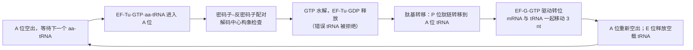

# 核糖体与蛋白质翻译的全过程

> 相关笔记：RNA

## 0. 一句话概括

翻译是核糖体把 mRNA 上的**核苷酸序列**解码成蛋白质**氨基酸序列**的过程。核糖体本身既是“解码器”，又是“肽基转移酶中心”（peptidyl transferase center，本质是核酶）。整个过程分为**起始、延伸、终止**三大阶段，延伸阶段又以“**解码—成肽—转位**”三步循环推进。

---

## 1. 参与者总览

| 成分 | 作用 |
|---|---|
| mRNA | 模板，按密码子（3 个碱基一组）被读取 |
| tRNA | “适配器”：一端反密码子配对密码子，另一端携带氨基酸 |
| 核糖体 | 小亚基负责解码，大亚基负责成肽；提供 A/P/E 三个位点 |
| 起始因子 | 组装起始复合物，保证从正确的起点开始 |
| 延伸因子 | 运送 aminoacyl-tRNA、驱动转位 |
| 终止因子 | 识别终止密码子、释放多肽 |
| GTP / ATP | 供能；GTP 用于各步构象开关，ATP 用于氨基酸活化 |

### 密码子与 tRNA 的基本规则

- 64 个密码子：61 个编码氨基酸，3 个终止（UAA、UAG、UGA）。
- AUG 既是起始密码子，也编码甲硫氨酸。
- tRNA 长 75–90 个核苷酸，三叶草二级结构折叠成 **L 形**（约 7 nm）；3′ 端是 CCA，氨基酸接在 3′-OH 上；反密码子在另一个“臂”上。
- 密码子第 3 位存在**摆动配对（wobble）**，允许一个 tRNA 识别多个同义密码子；次黄嘌呤（I）常出现在反密码子第 1 位。

---

## 2. 核糖体结构：一台“两亚基机器”

| 项目 | 细菌 70S | 真核 80S |
|---|---|---|
| 小亚基 | 30S（16S rRNA + 约 21 种蛋白） | 40S（18S rRNA + 约 33 种蛋白） |
| 大亚基 | 50S（23S + 5S rRNA + 约 34 种蛋白） | 60S（28S + 5.8S + 5S rRNA + 约 47 种蛋白） |
| 质量 | 约 2.5 MDa | 约 4.2 MDa |
| rRNA 占比 | 约 2/3 | 约 2/3 |
| 直径 | 约 25 nm | 约 25–30 nm |

### 三个 tRNA 位点（以 tRNA 结合状态命名）

- **A 位（aminoacyl site）**：进入位点，新来的 aminoacyl-tRNA 在此与密码子配对。
- **P 位（peptidyl site）**：持有正在延长的肽链（peptidyl-tRNA）。
- **E 位（exit site）**：脱去氨基酸的“空载 tRNA”从此离开。

核糖体沿 mRNA **5′ → 3′** 方向移动，因此 A 位总在 P 位的 3′ 侧。

### 四个关键功能区

| 功能区 | 所在亚基 | 功能 |
|---|---|---|
| 解码中心（decoding center） | 小亚基 | 检查密码子–反密码子配对；细菌中 16S rRNA 的 A1492/A1493 参与“嗅探” |
| 肽基转移酶中心（PTC） | 大亚基 | 形成肽键；催化核心是 23S/28S rRNA，**没有蛋白直接催化** |
| 肽链出口隧道 | 大亚基 | 新生肽链从这里通向胞质，长约 10 nm；也是大环内酯类抗生素的结合点 |
| GTPase 激活中心 | 大亚基 | 触发 EF-Tu / EF-G / eRF3 等 GTP 酶水解，充当“计时器” |

> 记忆要点：**小亚基“读”，大亚基“写”**；读的是 mRNA，写的是肽链。核糖体是**核酶（ribozyme）**，肽键形成靠 rRNA。

---

## 3. 起始阶段

起始阶段要解决三个问题：**小亚基如何找到起始密码子、起始 tRNA 如何进入 P 位、大小亚基如何正确组装**。

### 3.1 细菌：Shine–Dalgarno 定位 + fMet

1. **30S 亚基**在 IF3 帮助下保持游离，避免与 50S 过早结合。
2. mRNA 的 **Shine–Dalgarno 序列**（约 AGGAGG）与 16S rRNA 3′ 端的反 SD 序列（CCUCCU）互补配对，把起始 AUG 定位到 P 位。
3. **IF1** 占据 A 位，防止其他 tRNA 误入；**IF2·GTP** 携带起始 tRNA（**fMet-tRNAfMet**）进入 P 位。
4. 起始 codon 通常是 AUG，也可以是 GUG、UUG；起始氨基酸被甲酰化（fMet）。
5. 50S 加入，形成 70S 起始复合物；IF2 的 GTP 水解，IF1、IF2、IF3 依次释放。
6. 结果：**P 位坐着 fMet-tRNA，A 位空着**，等待第一个延伸因子送来的 tRNA。

> 原核 mRNA 常是**多顺反子**：一条 mRNA 上有多个 SD 序列与多个起始位点，可同时翻译出几种蛋白。

### 3.2 真核：帽子 + 扫描 + Kozak 序列

1. **eIF4F 复合体**识别 5′ 帽：eIF4E 结合 m⁷G 帽，eIF4G 作为支架，eIF4A 作为 RNA 解旋酶。
2. **43S 预起始复合物**：40S + eIF1 + eIF1A + eIF3 + eIF2·GTP·Met-tRNAi 组装。
3. 43S 结合到 mRNA 5′ 端，沿 5′→3′ **扫描**，直到遇到第一个处于合适 **Kozak 序列**（如 GCCRCCAUGG）中的 AUG。
4. 识别起始密码子后，eIF5 激活 eIF2 的 GTP 水解，eIF1 释放，构象锁定。
5. **eIF5B·GTP** 招募 60S 大亚基；GTP 水解后 eIF5B 释放，形成 80S 起始复合物。
6. eIF2·GDP 释放，由 **eIF2B** 交换回 GTP，准备下一轮。

> 真核 mRNA 通常是**单顺反子**，只有一条主要编码序列；但也有例外（多顺反子样转录本、病毒 mRNA）。部分病毒与应激状态下的 mRNA 使用 **IRES**（内部核糖体进入位点），不依赖帽子，直接招募 40S。

### 3.3 起始阶段的调控点

- **eIF2α 磷酸化**（由 PKR、PERK、GCN2、HRI 等激酶催化）会隔离并抑制 eIF2B，全局抑制翻译起始——这是整合应激反应（ISR）的核心。
- **eIF4E 结合蛋白（4E-BP）** 受 mTOR 调控：去磷酸化时结合 eIF4E，抑制帽依赖翻译。
- **eIF2B 突变** 导致白质消融性白质脑病（VWM）。

---

## 4. 延伸阶段：解码—成肽—转位

这是翻译的主体，每掺入一个氨基酸走一圈。

### 第一步：解码（decoding）

1. **EF-Tu·GTP**（真核为 **eEF1A·GTP**）携带 aminoacyl-tRNA 进入 A 位。
2. 反密码子与密码子在**解码中心**配对。正确的配对会诱导小亚基关键碱基（细菌 16S rRNA 的 A1492、A1493）翻转，把“配对正确”的信号传给大亚基。
3. 信号触发 EF-Tu 的 GTPase 活性，GTP 水解，EF-Tu·GDP 释放。
4. 错误的 tRNA 在 GTP 水解前就解离，形成**动力学校对（kinetic proofreading）**；这一步把错误率压到约 10⁻³–10⁻⁴。
5. EF-Tu·GDP 由 **EF-Ts**（真核 **eEF1B**）交换回 GTP，循环使用。

### 第二步：成肽（peptidyl transfer）

1. P 位肽链的 C 端与 tRNA 的 3′-OH 形成酯键；A 位新氨基酸的 α-氨基作为**亲核试剂**，攻击这个酯键的羰基碳。
2. 肽键形成，肽链从 P 位 tRNA **转移到 A 位 tRNA** 上；P 位 tRNA 变成“空载 tRNA”。
3. 催化由大亚基 rRNA（23S/28S 的肽基转移酶中心）完成；核糖体主要通过**定位底物、稳定过渡态、排除水**来降低活化能。
4. 这一步**不需要额外 ATP/GTP**，能量来自酯键→肽键的交换。

### 第三步：转位（translocation）

1. **EF-G·GTP**（真核 **eEF2·GTP**）结合核糖体，其形状模拟 tRNA。
2. GTP 水解驱动核糖体构象变化（“棘轮”运动），mRNA–tRNA 复合物相对核糖体移动 **3 个核苷酸**。
3. 结果：A 位 peptidyl-tRNA 移到 P 位，P 位空载 tRNA 移到 E 位，A 位空出。
4. E 位的空载 tRNA 释放；细菌的 E 位功能较明确，真核的 E 位作用相对弱。

### 延伸的“混合态”与棘轮

- 转位不是一步到位，而是经过 **杂交状态（hybrid state）**：tRNA 的接受臂先移动，反密码子端后移动，核糖体两个亚基发生相对旋转。
- 这种“棘轮 + 弹簧”机制保证 mRNA 严格按 3 nt 步进，不会滑移。

---

## 5. 终止与回收

### 5.1 细菌

1. 终止密码子（UAA、UAG、UGA）进入 A 位。
2. **RF1** 识别 UAA/UAG，**RF2** 识别 UGA；它们模拟 tRNA 的形状进入 A 位。
3. **RF3·GTP** 促进 RF1/RF2 的释放与循环。
4. 肽基转移酶中心把肽链从 P 位 tRNA 转移到**水分子**上（水解），多肽释放。
5. **RRF（核糖体回收因子）+ EF-G·GTP + IF3** 把 70S 拆成 30S 与 50S，mRNA 与空载 tRNA 释放。

### 5.2 真核

1. **eRF1** 识别三个终止密码子（UAA、UAG、UGA），进入 A 位。
2. **eRF3·GTP** 协助 eRF1 识别与水解肽链。
3. **ABCE1**（ATP 酶）驱动核糖体拆分与回收。
4. 终止后 mRNA 可能进入 **NMD（无义介导降解）** 或普通降解；核糖体亚基回到游离池。

### 5.3 终止密码子的“重编码”

- **硒代半胱氨酸（Sec）**：UGA + **SECIS 元件** + 特异 tRNA（tRNA^Sec） + EFsec，把 UGA 读成 Sec。
- **吡咯赖氨酸（Pyl）**：UAG + 特异 tRNA/合成酶，见于某些古菌与细菌。
- **终止密码子通读（readthrough）**：特定药物或突变可让终止密码子被读成氨基酸，是部分遗传病（如无义突变）的治疗思路。

---

## 6. 能量账本与速率

### 每个氨基酸的消耗

| 步骤 | 消耗 |
|---|---|
| 氨基酸活化（aminoacyl-tRNA synthetase） | ATP → AMP + PPi，相当于 **2 个高能磷酸键** |
| 解码（EF-Tu/eEF1A） | 1 GTP |
| 转位（EF-G/eEF2） | 1 GTP |
| 起始（每条约 1 次） | 1 GTP（分摊到每个残基很少） |
| 终止（每条约 1 次） | 1 GTP（分摊） |

> 经验值：每掺入 1 个氨基酸约消耗 **2 GTP + 2 个 ATP 高能键**，合计约 **4 个高能磷酸键**。

### 速率

| 体系 | 延伸速率 |
|---|---|
| 细菌 | 约 15–20 个氨基酸/秒 |
| 真核 | 约 2–6 个氨基酸/秒 |
| 体外最适条件 | 可达 20–30 个氨基酸/秒（细菌） |

一个 300 个氨基酸的蛋白，细菌约 20 秒完成，真核细胞约 1–2 分钟。

---

## 7. 保真性：核糖体如何“校对”

1. **氨基酸活化时的校对**：aminoacyl-tRNA synthetase 有合成位点与编辑位点，错误氨基酸被水解。
2. **起始选择**：起始 tRNA 与起始因子的特殊结构，保证从 AUG 而非内部 Met 密码子开始。
3. **解码中心的几何检查**：只有正确的 codon–anticodon 配对才能诱导 A1492/A1493 翻转，触发 GTP 水解。
4. **动力学校对**：GTP 水解前给错误 tRNA 留出解离时间；水解释放不可逆，等于“锁定”。
5. **摆动配对**：第 3 位允许非标准配对，扩大 tRNA 识别范围，但仍在可接受的能量范围内。
6. **核糖体质量控制（RQC）**：翻译 stalled 或 mRNA 损坏时，RQC 复合体识别停滞核糖体，降解异常肽链。

错误率通常约 **10⁻³–10⁻⁴/氨基酸**，即每合成 1000–10000 个残基出现 1 个错误。

---

## 8. 共翻译事件：翻译不只是“造一条线”

- **N 端加工**：甲硫氨酸/甲酰甲硫氨酸常被切除，随后可能乙酰化。
- **信号肽与 SRP**：N 端信号肽被 SRP 识别，核糖体–SRP–新生肽复合物被引导到内质网，通过 Sec61 转位子共翻译转运。
- **共翻译折叠**：肽链边合成边折叠，分子 chaperone（如 Hsp70、TRiC）参与；稀有密码子造成的“翻译暂停”会影响折叠路径。
- **多聚核糖体（polysome）**：一条 mRNA 上同时有多个核糖体，提高产量；真核中常形成环状结构（eIF4G–PABP–polyA 互作）。
- **mRNA  surveillance**：NMD、no-go decay、ribosome collision 触发降解与应激。

---

## 9. 原核 vs 真核：一张对照表

| 项目 | 细菌 | 真核 |
|---|---|---|
| 核糖体 | 70S（30S + 50S） | 80S（40S + 60S） |
| mRNA 结构 | 常多顺反子，无帽无尾 | 单顺反子，有 m⁷G 帽与 poly(A) 尾 |
| 起始定位 | Shine–Dalgarno 序列 | 帽子结合 + 5′→3′ 扫描 + Kozak |
| 起始 tRNA | fMet-tRNAfMet | Met-tRNAi |
| 起始因子 | IF1、IF2、IF3 | eIF1、1A、2、3、4A/4E/4G、4B、5、5B |
| 延伸因子 | EF-Tu、EF-Ts、EF-G | eEF1A、eEF1B、eEF2 |
| 终止因子 | RF1、RF2、RF3、RRF | eRF1、eRF3、ABCE1 |
| 转录与翻译 | 可偶联（无核膜） | 转录在核内，翻译在胞质/ER |
| 与抗生素 | 差异敏感 | 差异敏感 |

---

## 10. 抗生素与毒素：翻译机器的“靶点地图”

| 试剂 | 靶点 | 机制 |
|---|---|---|
| 链霉素 | 30S 解码中心 | 增加错误率、抑制起始 |
| 四环素 | 30S A 位 | 阻止 aa-tRNA 进入 |
| 氨基糖苷类（庆大霉素等） | 30S | 干扰校对，导致误读 |
| 氯霉素 | 50S PTC | 抑制肽键形成 |
| 大环内酯类（红霉素） | 50S 出口隧道 | 阻断新生肽链外排 |
| 林可霉素 | 50S PTC | 抑制成肽 |
| 嘌呤霉素 | 50S PTC | 模拟 aminoacyl-tRNA，提前释放肽链 |
| 夫西地酸 | EF-G | 抑制转位 |
| 环己酰亚胺 | 真核 60S | 抑制转位（不作用于细菌） |
| 白喉毒素 | eEF2 | ADP-核糖基化，抑制转位 |
| 蓖麻毒素 | 28S rRNA | 脱嘌呤，破坏 PTC |
| 志贺毒素 | 28S rRNA | 同类作用 |

> 抗生素选择性来自原核与真核核糖体的结构差异；但线粒体核糖体更像细菌核糖体，因此部分抗生素有线粒体毒性。

---

## 11. 与疾病、医学的关系

- **核糖体病（ribosomopathy）**：Diamond–Blackfan 贫血（RPS/RPL 突变）、Shwachman–Diamond 综合征（SBDS）、Treacher Collins 综合征（TCOF1）等。
- **eIF2B 突变**：白质消融性白质脑病（VWM）。
- **无义突变**：提前出现终止密码子，可用 readthrough 药物（如 ataluren）尝试通读。
- **CFTR ΔF508**：共翻译折叠失败，被 ER 质量控制降解；调节剂（ivacaftor/lumacaftor）可部分纠正。
- **肿瘤**：翻译起始因子（eIF4E、eIF2α）常被上调，mTOR 通路是重要靶点。
- **病毒**：IRES 介导的帽非依赖翻译、蛋白酶切割 eIF4G、PKR 磷酸化 eIF2α 等，都是病毒劫持宿主翻译的策略。

---

## 12. 常见误区

1. **“肽基转移酶是蛋白质”**：错。催化核心是 rRNA，核糖体是核酶；蛋白主要维持结构与定位。
2. **“核糖体沿 mRNA 从 3′ 到 5′”**：错。方向是 **5′ → 3′**。
3. **“A 位在 P 位的 5′ 侧”**：错。A 位在 P 位的 **3′ 侧**；核糖体向前移动，新的密码子进入 A 位。
4. **“每个氨基酸消耗 1 个 GTP”**：少算。延伸本身 2 GTP，加上氨基酸活化的 2 个高能键，约 4 个。
5. **“tRNA 只是搬运工”**：它同时是解码器与催化中心的“底物定位器”；L 形结构让反密码子与氨基酸端相距约 7 nm，正好跨越核糖体两个功能中心。
6. **“真核翻译和原核完全一样”**：起始机制差别最大（帽子扫描 vs SD），因子名称与数量也不同。
7. **“终止就是简单停下”**：终止需要释放因子识别、肽链水解、核糖体拆分与回收，是一套主动过程。
8. **“抗生素只杀细菌不影响人”**：线粒体核糖体是细菌型，部分药物有 mitochondrial toxicity。
9. **“翻译错误率极低所以不需要校对”**：错误率约 10⁻³–10⁻⁴，仍需要动力学校对与 RQC 多层保障。
10. **“一条 mRNA 只能被一个核糖体翻译”**：多聚核糖体可同时翻译；原核中转录与翻译还可偶联。

---

## 13. 一页速记

- **三阶段**：起始（找 AUG、放 fMet/Met）→ 延伸（解码—成肽—转位）→ 终止（识密码、放肽、拆核糖体）。
- **三位点**：A 进、P 长、E 出；核糖体沿 mRNA 5′→3′ 走。
- **两亚基**：小亚基读密码子，大亚基催化成肽；催化核心是 rRNA。
- **两套因子**：原核 IF/EF/RF，真核 eIF/eEF/eRF；起始机制差异最大。
- **两 GTP**：EF-Tu/eEF1A 一次，EF-G/eEF2 一次；加活化约 4 个高能键/残基。
- **一个方向**：mRNA 5′→3′，肽链 N 端→C 端。
- **一句提醒**：翻译是“解码 + 成肽 + 转位”的循环，核糖体是核酶，不是普通蛋白机器。
