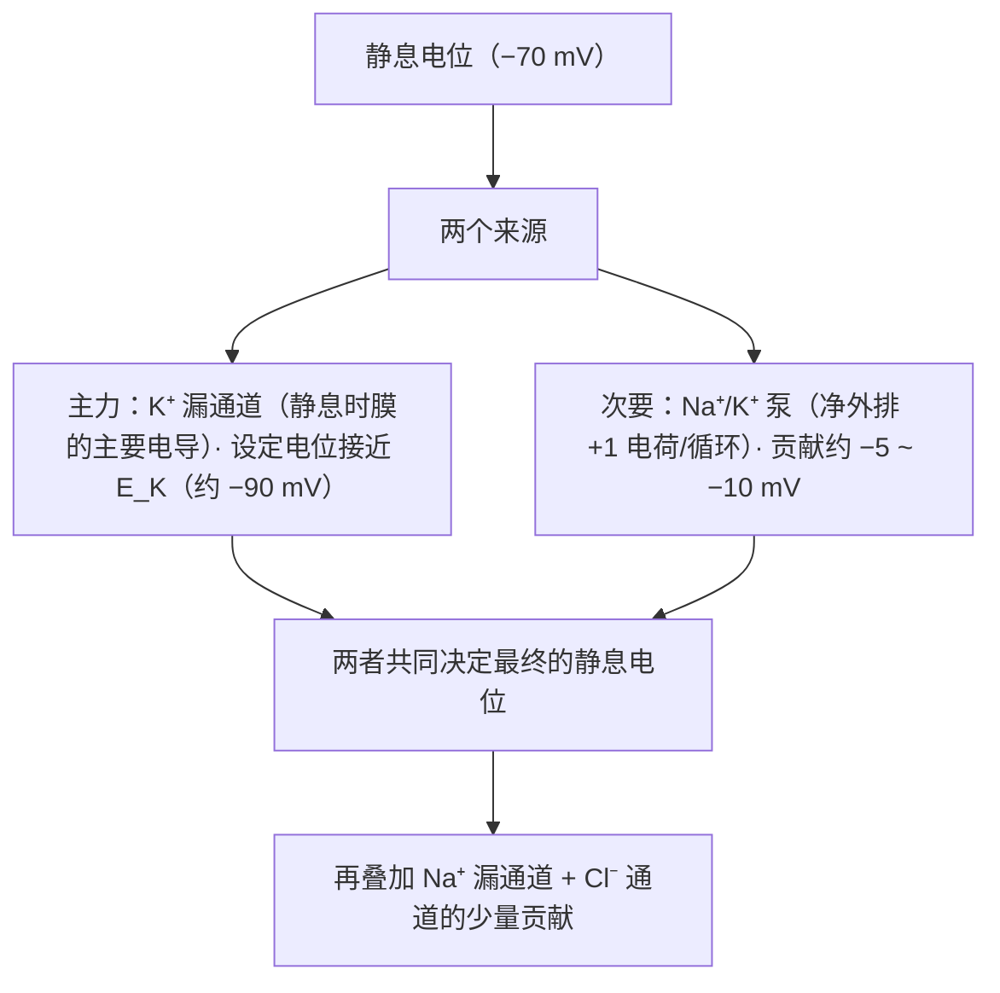
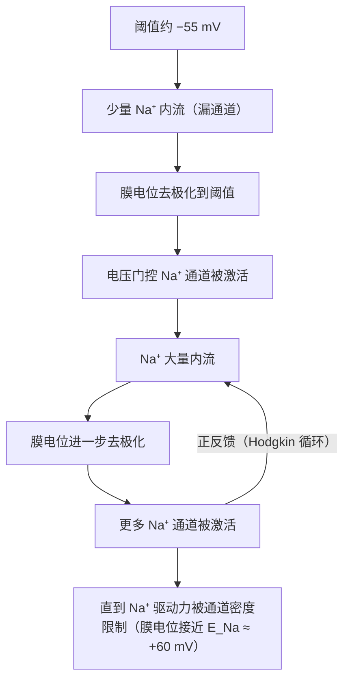
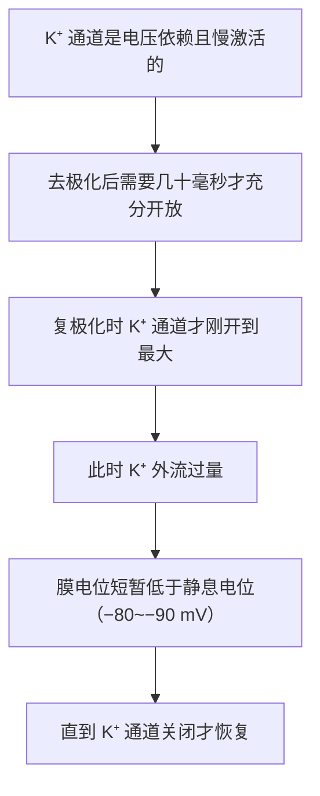
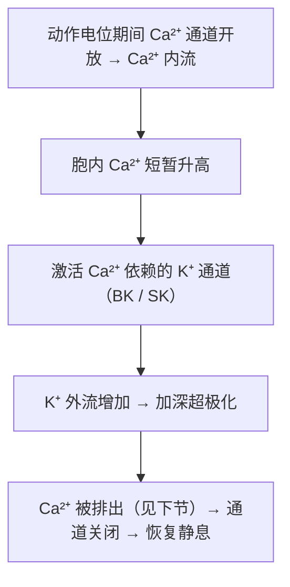
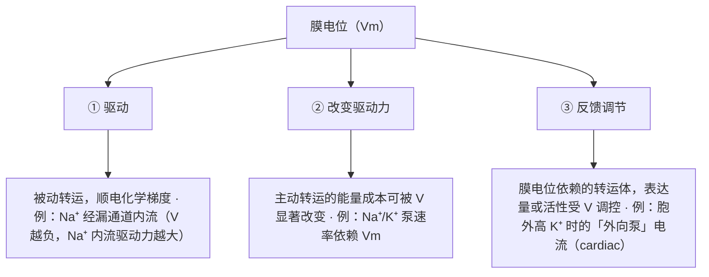
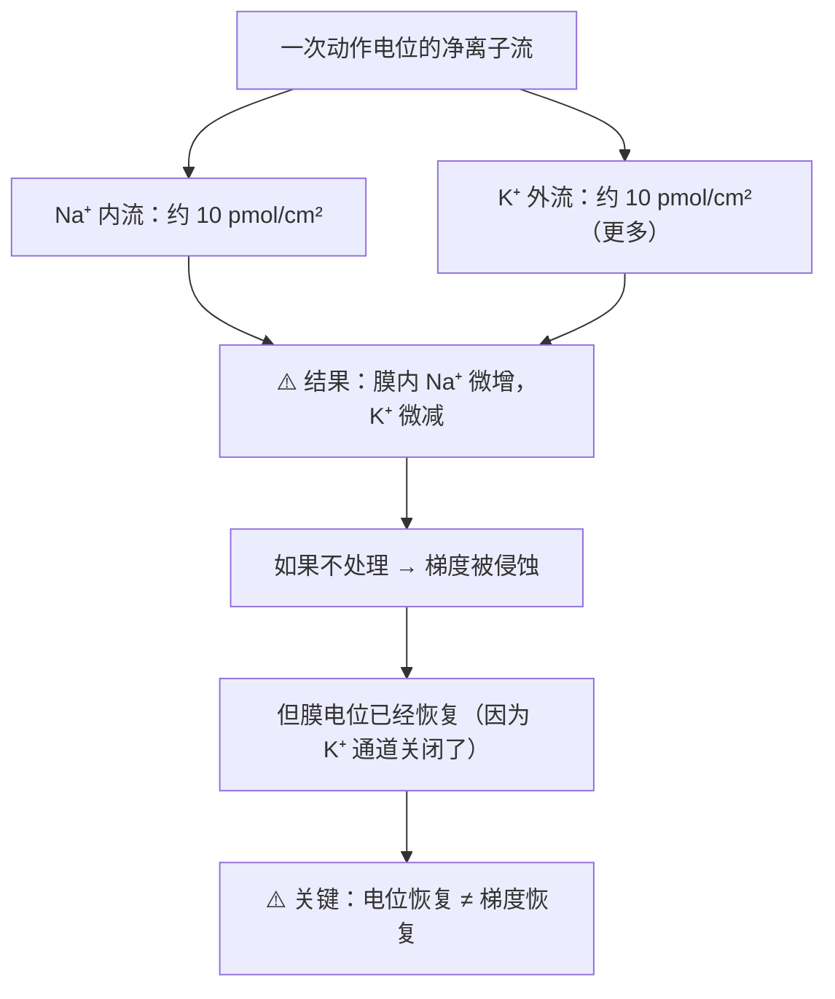
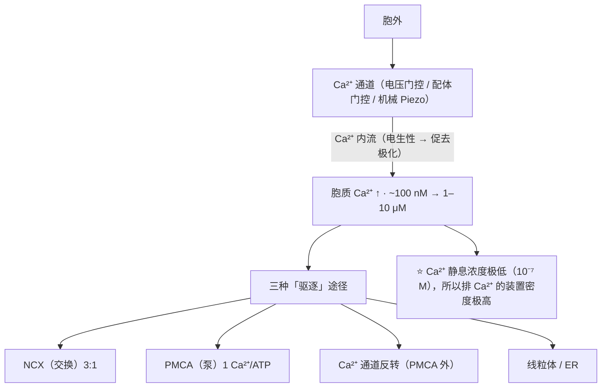

# 膜电位变化与跨膜转运

> **核心命题**：膜电位的变化有三个层次，**每一层都由特定的跨膜转运装置驱动**：
> - **快速层（毫秒级）**：**电压门控离子通道**开放 → 产生动作电位各阶段
> - **稳态层（秒~分钟级）**：**离子泵与交换体**维持/恢复离子梯度
> - **极化层（持续性）**：**Na⁺/K⁺-ATP 酶**长期维持静息梯度
>
> **一句话**：**通道负责"快速改变电位"，泵负责"长期维持梯度"**。动作电位后膜电位靠通道自身复原，靠的不是泵——这是最常见的误解。

---

## 一、前提：静息膜电位的建立

### 1.1 离子分布与电化学梯度

| 离子 | 细胞外 | 细胞内| 平衡电位（Nernst,哺乳动物） | 驱动力方向（静息时） |
|---|---|---|---|---|
| **Na⁺** | **145 mM** | **10–12 mM** | **E ≈ +60 mV** | ⬇️ 强烈内流趋势 |
| **K⁺** | **4–5 mM** | **140 mM** | **E ≈ −90 mV** | ⬆️ 强烈外流趋势 |
| **Cl⁻** | 110 mM | 5–30 mM | E ≈ −65 mV | 决定静息电导 |
| **Ca²⁺** | **1–2 mM** | **~100 nM**（10⁻⁷ M） | **E ≈ +120 mV** | 极强内流趋势 |
| **Na⁺/K⁺ 泵** | 3 Na⁺ **出** | 2 K⁺ **入** | — | ⭐ **唯一的净电荷外流源** |

> ⭐ **静息电位的核心矛盾**：Na⁺ 想进、K⁺ 想出，但细胞膜对两者**都有泄漏通道**。若只有泄漏，膜电位会稳定在两大泄漏电导的加权平均附近（**"极化电位（chord conductance）"**），并非任何单一离子的E 值。

### 1.2 静息电位的建立：哪一层的贡献？

**关键数值**
- **Na⁺/K⁺ 泵仅贡献静息电位的约 5–10%**（**5–10 mV**）
- **维持梯度的 90%+ 工作量**由 Na⁺/K⁺ 泵完成
- 但**设定电位的 90%+** 由 **K⁺ 漏通道**完成

> 🎯 **区分两个概念**：
> - **谁贡献静息电位的数值** → **K⁺ 漏通道**（主导）
> - **谁维持静息电位所依赖的梯度** → **Na⁺/K⁺ 泵**（唯一）

---

## 二、动作电位的五个阶段

### 2.1 总览：阶段与驱动装置

<svg viewBox="0 0 760 470" width="100%" style="max-width:760px;height:auto;display:block;margin:1rem auto" xmlns="http://www.w3.org/2000/svg" role="img" aria-label="动作电位五个阶段的膜电位曲线">
  <defs>
    <marker id="apf-arrow" viewBox="0 0 10 10" refX="8" refY="5" markerWidth="7" markerHeight="7" orient="auto-start-reverse">
      <path d="M0,0 L10,5 L0,10 z" fill="currentColor" stroke="none"/>
    </marker>
  </defs>

  <line x1="90" y1="385" x2="730" y2="385" stroke="currentColor" stroke-width="1.2" marker-end="url(#apf-arrow)"/>
  <line x1="90" y1="385" x2="90" y2="45" stroke="currentColor" stroke-width="1.2" marker-end="url(#apf-arrow)"/>
  <text x="700" y="404" font-size="12" text-anchor="middle" stroke="none">时间</text>
  <text x="30" y="215" font-size="12" text-anchor="middle" stroke="none" transform="rotate(-90 30 215)">膜电位 (mV)</text>

  <line x1="90" y1="165" x2="720" y2="165" stroke="currentColor" stroke-width="1" opacity="0.3"/>
  <line x1="90" y1="286" x2="720" y2="286" stroke="currentColor" stroke-width="1" stroke-dasharray="6 4" opacity="0.5"/>
  <line x1="90" y1="319" x2="720" y2="319" stroke="currentColor" stroke-width="1" stroke-dasharray="2 4" opacity="0.4"/>

  <g font-size="11" text-anchor="end" stroke="none">
    <text x="80" y="81">+40</text>
    <text x="80" y="169">0</text>
    <text x="80" y="290">−55</text>
    <text x="80" y="323">−70</text>
    <text x="80" y="367">−90</text>
  </g>

  <path d="M120,319 H245 C255,319 258,302 262,286 C272,200 282,100 300,80 C312,66 320,92 326,122 C336,192 342,272 350,300 C356,322 360,342 368,352 C378,366 392,366 402,360 C414,352 420,325 436,319 H700" fill="none" stroke="currentColor" stroke-width="2.2" stroke-linecap="round"/>

  <g font-size="12" stroke="none">
    <text x="340" y="100">③ 复极化：K⁺ 外流</text>
    <text x="340" y="122">④ 超极化：K⁺ 通道延迟关闭</text>
    <text x="100" y="350">② 去极化 · Na⁺ 通道开放</text>
    <text x="470" y="278">② 阈电位（约 −55 mV）</text>
    <text x="470" y="310">① 静息态（K⁺ 漏通道）</text>
    <text x="430" y="352">⑤ 后超极化（undershoot）</text>
  </g>

  <rect x="90" y="412" width="630" height="48" rx="8" fill="var(--lightgray)" opacity="0.2"/>
  <rect x="90" y="412" width="630" height="48" rx="8" fill="none" stroke="currentColor" stroke-width="1" opacity="0.4"/>
  <g font-size="11.5" stroke="none">
    <text x="106" y="432">⑤ 后超极化期间仍活跃的通道：电压门控 K⁺ 通道（尚未关闭）</text>
    <text x="106" y="450">· Na⁺/Ca²⁺ 交换器（NCX）· Na⁺/K⁺ 泵（低量）</text>
  </g>
</svg>

*上图：动作电位的五个阶段与对应的转运装置——①②③④⑤ 的顺序就是通道开放的时序。*

![[action-potential-phases-transporters.svg]]

### 2.2 五阶段详解与对应的转运装置

| 阶段 | 时间尺度 | 电位变化 | **主导转运装置** | 离子方向 |
|---|---|---|---|---|
| **① 静息态** Resting | 持续 | 稳定于 −70 mV | **K⁺ 漏通道**（KCNK/Kir）为主 + Na⁺/K⁺ 泵维持梯度 | K⁺ 少量外流 |
| **② 去极化** Depolarization | **~1 ms** | −70 → +30 mV | ⭐ **电压门控 Na⁺ 通道**（Nav）爆发开放 | **Na⁺ 大量内流** |
| **③ 复极化** Repolarization | **~1–2 ms** | +30 → −70 mV | ⭐ **电压门控 K⁺ 通道**（Kv）开放 + Na⁺ 通道**失活** | **K⁺ 外流** |
| **④ 超极化** Hyperpolarization | **~10 ms** | −70 → −80~−90 mV | **K⁺ 通道延迟关闭**（仍在开放） | **K⁺ 持续外流（过量）** |
| **⑤ 后超极化** Undershoot / AHP | **~10–100 ms** | 回到 −70 mV | **K⁺ 通道关闭**；**Ca²⁺ 通道/K⁺ 通道失活**； Ca²⁺ 激活的 **K⁺ 通道**（BK） | K⁺ 外流减少，Ca²⁺ 排出 |

> ⚠️ **易错点**：**Na⁺ 通道"失活"和"K⁺ 通道开放"共同复极化**——不是单靠 K⁺ 外流。电压门控 Na⁺ 通道有**独立的失活闸门（inactivation gate）**，即使膜仍在去极化状态它也会失活，这是**通道特有的现象**（其他离子通道无此机制）。

### 2.3 各阶段的分子细节

#### ② 去极化：正反馈"点火"

- **正反馈**是动作电位"全或无"的分子基础
- 峰值电位**不会达到 E_Na（+60 mV）**，因为 Na⁺ 通道开始**失活**

#### ④ 超极化的"过量 K⁺ 外流"

> 💡 **这解释了为什么动作电位有"回落"（undershoot）**——不是泵在工作，纯粹是 K⁺ 通道关闭滞后。

#### ⑤ 后超极化与 Ca²⁺ 的角色

---

## 三、膜电位与跨膜转运的联系（核心）

### 3.1 三类转运装置与时间尺度的分工

| 类别 | 装置 | 开关机制 | 时间尺度 | 在膜电位中的角色 |
|---|---|---|---|---|
| **离子通道** Ion channel | 电压门控、配体门控、机械门控、漏通道 | **门控机制**，毫秒级 | **μs–ms** | ⭐ **直接产生快速电位变化**（动作电位各阶段） |
| **载体转运体** Carrier / Transporter | Na⁺/Ca²⁺ 交换器、NHE、CAT、葡萄糖转运体 | **构象循环**（交替进入） | **ms–s** | 缓慢、持续地移动电荷或物质；参与**稳态维持** |
| **离子泵** Pump（ATPase） | **Na⁺/K⁺-ATP 酶**、Ca²⁺-ATP 酶、H⁺/K⁺-ATP 酶、CFTR | **ATP 水解驱动** | **s–min** | ⭐ **长期维持/恢复离子梯度**；不参与快速相位 |

> ⭐ **核心区分**：
> - **通道** = **被动 + 快速**（顺电化学梯度，毫秒级）
> - **泵** = **主动 + 慢速**（逆梯度，耗 ATP，秒~分钟级）
> - **交换器** = **被动 + 中速**（利用另一离子的梯度驱动）

![[transporter-timescale-division.svg]]

### 3.2 膜电位对转运的三重影响

| 影响 | 机制 | 生理意义 |
|---|---|---|
| **① 被动转运的驱动力** | 驱动力 = Vm − E_ion。Vm 越负，**阳离子内流驱动力越大** | 去极化时 Na⁺/Ca²⁺ 内流猛增；超极化时 K⁺ 外流增加 |
| **② 主动转运的能量成本** | 逆梯度转运需能量，**Vm 贡献了膜两侧电位差的一部分** | Vm 改变 → Na⁺/glucose 同向转运的净驱动力改变 |
| **③ 反馈调节** | 某些泵/通道**受 Vm 调控** | **Na⁺/K⁺ 泵**的外向泵电流依赖 Vm；**Ca²⁺ 通道**受 Vm 门控 |

### 3.3 动作电位后，膜电位是怎么恢复的？（关键澄清）

这是最常见的误解点。**不是 Na⁺/K⁺ 泵把电位"拉回来"。**

#### 真相：恢复靠通道，靠泵只会"越来越糟"

**三条恢复途径的分工**

| 途径 | 作用 | 性质 | 速度 |
|---|---|---|---|
| **电压门控 K⁺ 通道关闭** | ⭐ **直接把膜电位拉回静息值** | 被动、毫秒级 | **快** |
| **Na⁺/Ca²⁺ 交换器（NCX）** | 排 Na⁺、摄Ca²⁺（3:1 电生性）→ 产生**向外电流** | 被动、较慢 | 中 |
| **Ca²⁺-ATP 酶（PMCA）** | 排出胞内 Ca²⁺ | **主动** | 慢 |
| **Na⁺/K⁺-ATP 酶** | ⭐ **恢复 Na⁺/K⁺ 梯度**（真正的长期负责者） | **主动** | 慢 |

**数值对比（同一时间尺度上）**

| 装置 | 一个动作电位期间能搬运的电荷 |
|---|---|
| **电压门控 K⁺ 通道** | ⭐ **~10 pmol/cm²**（瞬间完成，主要恢复电位） |
| **Na⁺/K⁺ 泵** | 仅约 **0.001 pmol/cm²**（慢两个数量级） |

> 🎯 **结论**：**膜电位的快速恢复（后超极化结束）完全由通道完成；Na⁺/K⁺ 泵的作用尺度慢得多（秒~小时），它负责的是"把被侵蚀的梯度补回来"，而不是"把电位拉回来"。**

### 3.4 典型的电生性与电中性转运体

| 转运体 | 化学计量比 | 电荷净移动 | 类型 | 功能 |
|---|---|---|---|---|
| **Na⁺/K⁺-ATP 酶** | **3 Na⁺ 出/ 2 K⁺ 入** | **净 +1 出** | ⭐ **电生性（electrogenic）** | 维持基础梯度；产生外向泵电流 |
| **Na⁺/Ca²⁺ 交换器（NCX）** | **3 Na⁺ 入 / 1 Ca²⁺ 出** | **净 +2 入** | ⭐ **电生性** | 排出 Ca²⁺；**参与后超极化**；**心肌**重要 |
| **Ca²⁺-ATP 酶（PMCA）** | **1 Ca²⁺ 出**（1 ATP） | **净 +1 出** | **电生性** | 精确排钙；可产生外向电流 |
| **Na⁺/H⁺ 交换器（NHE1）** | **1 Na⁺ 入 / 1 H⁺ 出** | **净 0** | **电中性（electroneutral）** | pH 稳态；**无直接电贡献** |
| **Na⁺-K⁺-2Cl⁻ 同向转运（NKCC1）** | 1 Na⁺ + 1 K⁺ + 2 Cl⁻ 入 | **净 0** | **电中性** | 细胞容积调节 |
| **H⁺/K⁺-ATP 酶（胃壁细胞）** | 1 H⁺ 出 / 1 K⁺ 入 | **净 0** | **电中性** | 胃酸分泌（虽然耗 ATP，但电荷平衡） |
| **Cl⁻/HCO₃⁻ 交换（AE1）** | 1:1 交换 | **净 0** | **电中性** | CO₂ 运输；红细胞 |
| **Ca²⁺ 信号**（胞内） | 1 Ca²⁺ 入胞质 | **+1 入** | **电生性** | 参与后超极化、肌肉收缩 |

> ⚠️ **"电生性 vs 电中性"很重要**：因为膜电位是**带符号的量**，只有在转运体**搬运净电荷**时才会直接影响 Vm。电中性转运体（多数）**不直接产生电流**，它们只搬运特定底物。

### 3.5 特殊情形：Ca²⁺ 的双重身份

- **Ca²⁺ 的静息浓度比 Na⁺ 低 10⁴倍**，因此排钙装置（NCX、PMCA、Ca²⁺ 泵）在**细胞膜上密度极高**
- **PMCA** 亲和力高（低 Ca²⁺ 也能工作）、容量小；**NCX** 亲和力低、容量大（大量 Ca²⁺ 时才启用）
- → 这就是为什么 **NCX 参与后超极化**：胞内 Ca²⁺ 升高时 NCX 被激活，净转入 2 个正电荷 → 加深超极化

### 3.6 膜电位与转运的临床关联

| 场景 | 机制 | 应用 |
|---|---|---|
| **洋地黄（地高辛）** | 抑制 Na⁺/K⁺ 泵 → 胞内 Na⁺↑ → NCX 反转 → Ca²⁺↑ → 强心 | 心衰；同时**高钾血症**副作用 |
| **SGLT2 抑制剂** | 抑制 Na⁺-glucose 共转运 → 尿糖↑；同时 Na⁺/H⁺ 交换↑、K⁺ 重吸收↓ | 降糖 + **降尿酸** |
| **电压门控 Na⁺ 通道阻断剂** | 局麻药（利多卡因）、河豚毒素 | 麻醉；**动作电位传导阻断** |
| **AQP 与膜电位** | 水通道是被动，孔隙大，**不显著贡献 Vm** | 但转运改变细胞容积 → 影响膜张力 |
| **凋亡中的膜电位** | K⁺ 通道激活 + 泵抑制 → Vm 超极化；同时 PS 外翻 | 凋亡标志 |

---

## 四、要点速记

| 要点 | 内容 |
|---|---|
| **静息电位主力** | **K⁺ 漏通道**（贡献 90%+ 的数值）；**Na⁺/K⁺ 泵**只贡献 5–10 mV |
| **梯度的唯一维持者** | ⭐ **Na⁺/K⁺-ATP 酶**（3 Na⁺ 出/ 2 K⁺ 入，电生性） |
| **静息电位设定** | K⁺ 漏通道 + Na⁺/K⁺ 泵 + 少量 Na⁺/Cl⁻ 通道的加权平均（chord conductance） |
| **动作电位五阶段** | 静息 → **去极化**（Nav，Na⁺ 入）→ **复极化**（Kv，K⁺ 出 + Nav 失活）→ **超极化**（K⁺ 通道延迟关闭）→ **后超极化**（Ca²⁺ 激活 BK） |
| **关键机制** | ⭐ **Na⁺ 通道的"失活"是通道特有的**，复极化靠"Kv 开放 + Nav 失活"共同完成 |
| **正反馈** | Na⁺ 内流 → 去极化 → 更多 Nav 开放 → 更多内流（Hodgkin 循环）→ "全或无" |
| **通道 vs 泵 vs 交换体** | 通道 = 被动+**快**（μs–ms）；泵 = 主动+**慢**（s–min）；交换体 = 被动+中速 |
| **⭐恢复电位的真相** | **靠 K⁺ 通道关闭**，**不是靠 Na⁺/K⁺ 泵**；泵慢2 个数量级，负责长期补梯度 |
| **电生性** | Na⁺/K⁺ 泵（+1 出）、NCX（+2 入）、PMCA（+1 出）、Ca²⁺ 内流（+1 入） |
| **电中性** | NHE1（1:1）、NKCC1（1-1-2）、H⁺/K⁺ 泵（1:1）、AE1（1:1）——**不直接产生电流** |
| **Ca²⁺ 双重身份** | 既是第二信使（电生性入流），又因静息浓度极低（10⁻⁷ M）需**高密度排钙装置**（NCX+PMCA） |
| **NCX 的角色** | Ca²⁺ 升高时激活，净入 +2 → **参与后超极化**；洋地黄利用此机制 |
| **药物靶点** | 洋地黄（抑制泵）、局麻药/河豚毒素（阻断 Nav）、SGLT2 抑制剂（Na⁺-糖共转运） |

---

## 五、常见误区澄清

| 误区 | 正确认识 |
|---|---|
| ❌ "动作电位后Na⁺/K⁺ 泵大量工作把电位恢复" | ⭐ **错**。电位恢复靠**K⁺ 通道关闭**（毫秒级）；泵慢两个数量级，只负责长期补梯度 |
| ❌ "静息电位由 Na⁺/K⁺ 泵建立" | ⚠️ 不准确。**数值**由 **K⁺ 漏通道**决定；泵只贡献 5–10 mV |
| ❌ "复极化只是 K⁺ 外流" | ⚠️ **还包括 Na⁺ 通道失活**（通道特有的闸门机制）。两者共同完成 |
| ❌ "Na⁺ 通道只会开不会关" | ⚠️ 有**独立的失活闸门**（inactivation gate），去极化时自动关闭，与复极化无关 |
| ❌ "超极化是泵在工作" | ❌ 纯由**K⁺ 通道延迟关闭**造成。**此时泵仍在运行，但贡献极小** |
| ❌ "所有转运体都产生电流" | ❌ **只有电生性转运体**搬运净电荷。多数（NHE、NKCC、AE1）是**电中性** |
| ❌ "电生性 = 主动" | ❌ 是两个独立概念。**NCX 是电生性但被动**；**H⁺/K⁺ 泵是主动但电中性** |
| ❌ "膜电位只由 K⁺ 决定" | ❌ 是所有电导的**加权平衡**；Na⁺、Cl⁻ 通道也有贡献 |
| ❌ "Ca²⁺ 通道不产生电流" | ❌ Ca²⁺ 带 +2 电荷，**内流是强电生性事件**，是去极化的重要贡献者 |
| ❌ "AQP 参与膜电位" | ❌ 水通道孔隙大、选择性水，**几乎不贡献 Vm**；影响主要是容积/膜张力 |

---

## 附：关键缩写对照

| 缩写 | 全称 | 中文 |
|---|---|---|
| **Vm** | Membrane Potential | **膜电位** |
| **EREV** | Equilibrium Resting Vm | 静息平衡电位 |
| **RMP** | Resting Membrane Potential | **静息膜电位**（约 −70 mV） |
| **E_Na / E_K / E_Cl** | Equilibrium Potential | **平衡电位**（Nernst 方程算出） |
| **Nernst 方程** | — | 计算平衡电位的公式 |
| **GHK** | Goldman-Hodgkin-Katz | **GHK 方程**（多离子场论公式） |
| **chord conductance** | — | **弦电导**（所有电导的加权平均电位） |
| **Nav / Kv / CaV** | Voltage-gated Na⁺/K⁺/Ca²⁺ channel | **电压门控**通道 |
| **Vthreshold** | Threshold potential | **阈电位**（约 −55 mV） |
| **Hodgkin cycle / H-A** | Hodgkin cycle | **Hodgkin 循环**（Na⁺ 内流的正反馈） |
| **inactivation gate** | — | **失活闸门**（Na⁺ 通道特有） |
| **hyperpolarization / AHP** | Afterhyperpolarization | **超极化 / 后超极化** |
| **undershoot** | — | **回落**（超极化阶段的别名） |
| **Na⁺/K⁺-ATP 酶** | Na⁺/K⁺-ATPase | **钠钾泵**（3:2，电生性） |
| **NCX** | Na⁺/Ca²⁺ exchanger | **钠钙交换体**（3:1，反转模式参与强心） |
| **PMCA** | Plasma Membrane Ca²⁺-ATPase | **质膜钙泵**（1 Ca²⁺/ATP） |
| **SERCA** | SR Ca²⁺-ATPase | **肌浆网钙泵** |
| **NHE** | Na⁺/H⁺ exchanger | **钠氢交换体**（1:1，电中性） |
| **NKCC** | Na⁺-K⁺-2Cl⁻ cotransporter | **钠钾氯同向转运体**（电中性） |
| **AE1** | Anion Exchanger 1 | **阴离子交换器 1**（Cl⁻/HCO₃⁻） |
| **SGLT** | Na⁺-Glucose Linked Transporter | **钠-葡萄糖共转运体** |
| **electrogenic** | — | **电生性**（搬运净电荷） |
| **electroneutral** | — | **电中性**（净电荷为 0） |
| **BK / SK** | BK/SK channel | **Ca²⁺ 激活的 K⁺ 通道** |
| **KCNK / Kir** | — | **K⁺ 漏通道家族**（静息电位主力） |
| **Piezo** | — | **机械敏感通道** |
| **pacemaker potential** | — | **起搏电位**（窦房结，无稳定静息电位） |
| **digitalis / digoxin** | — | **洋地黄 / 地高辛**（抑制 Na⁺/K⁺ 泵） |
| **lidocaine / TTX** | — | **利多卡因 / 河豚毒素**（阻断 Nav） |

---

> **总结**
> **膜电位变化的本质是"通道开放的时序程序"，而跨膜转运提供的是"梯度的长期保障与缓慢恢复"。**
>
> - **快速层**：**电压门控通道**按**阈值 → Na⁺ 通道爆发 → 失活 + K⁺ 通道开放 → K⁺ 延迟关闭**的时序，产生**去极化、复极化、超极化、后超极化**四个相位；Na⁺ 内流的**正反馈**保证"全或无"
> - **稳态层**：**Na⁺/K⁺ 泵**以 3:2 的电生性方式长期维持梯度；它慢两个数量级，**不参与快速相位**，却贡献了静息电位的 5–10 mV
> - **反馈层**：**NCX、PMCA** 在 Ca²⁺ 升高时参与**后超极化**，并在洋地黄机制中被利用
>
> 记住一句话：**通道负责"快速改变电位"，泵负责"长期维持梯度"**——把这两者混为一谈是理解膜电位的最大障碍。