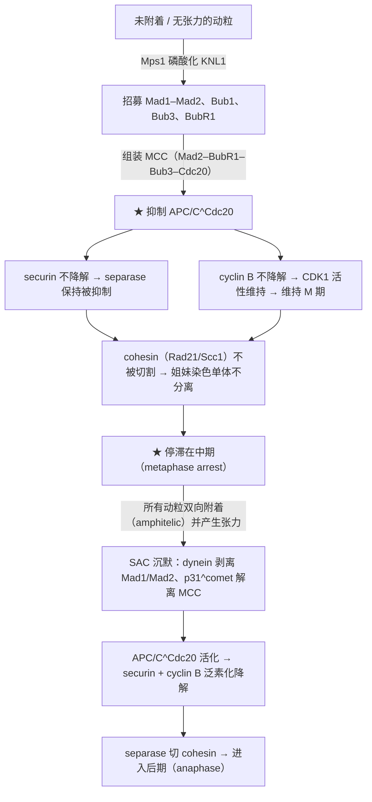
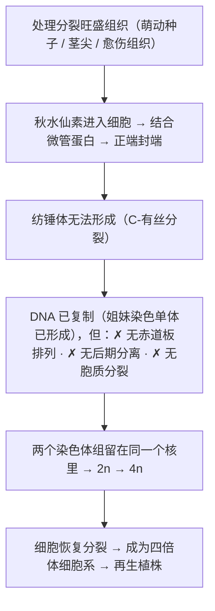

# 有丝分裂阻断剂：种类、靶点与原理

> **一句话**：绝大多数有丝分裂阻断剂并不直接"动染色体"，而是**破坏微管动态不稳定性**或**抑制纺锤体相关激酶/马达**，使动粒无法正确附着、纺锤体组装检查点（SAC）持续激活，把细胞卡在**前中期→中期**。秋水仙素是最经典的一种——结合游离微管蛋白并封住微管正端，让纺锤体根本搭不起来，于是姐妹染色单体不分离、染色体组加倍。
>
> **记忆钩子**：**药打微管或马达 → 动粒没附着/没张力 → SAC 不许过关 → 卡在中期**。

---

## 一、总览：按分子靶点分类

| 类别 | 代表药物 | 分子靶点 | 对微管/纺锤体的作用 | 阻断点 | 可逆性 |
|---|---|---|---|---|---|
| **微管去稳定剂** | **秋水仙素**、秋水仙胺、诺考达唑、长春新碱/长春碱、鬼臼毒素 | α/β-微管蛋白（colchicine site / vinca domain） | 抑制聚合、促进解聚、正端封端 | 前中期–中期 | 多数可逆（诺考达唑最易用） |
| **微管稳定剂** | **紫杉醇**、多西他赛、艾日布林、埃坡霉素 | β-微管蛋白（taxane site / 正端） | 促进聚合、**抑制解聚**，把微管"冻住" | 中期–后期转换 | 缓慢可逆 |
| **驱动蛋白抑制剂** | Monastrol、STLC、Ispinesib | **Eg5 / KIF11**（kinesin-5） | 中心体无法分离 → **单极纺锤体** | 前中期 | 可逆 |
| **有丝分裂激酶抑制剂** | Alisertib、Tozasertib、BI 2536、Volasertib | Aurora A/B、Plk1 | 纺锤体组装、动粒纠错、胞质分裂失败 | 前期–末期（多点） | 可逆 |
| **检查点激酶抑制剂** | Reversine、AZ3146 | **Mps1 / TTK** | **废除 SAC** → 提前进入后期 | *不阻断，反而放行* | 可逆 |
| **蛋白酶体抑制剂** | MG132、硼替佐米 | 26S 蛋白酶体 | securin / cyclin B 不降解 | 中期→后期转换 | 可逆 |
| **CDK1 抑制剂** | RO-3306 | CDK1–cyclin B | 不进入 M 期 | **G2/M 边界** | 洗脱即同步入 M |
| **DNA 损伤/复制抑制剂** | 羟基脲、阿非迪霉素、依托泊苷 | RNR / Pol α / Topo II | 经 **G2/M 检查点**间接阻断 | G2 或 S 期 | 视药物 |
| **胞质分裂抑制剂** | 细胞松弛素 B/D、Blebbistatin | 肌动蛋白 / myosin II | 收缩环不能形成 | **胞质分裂**（核分裂正常） | 可逆 |

---

## 二、共同的分子原理：为什么都停在中期

![[mitosis-blockers-checkpoint.svg]]

### 2.1 微管动态不稳定性（dynamic instability）

| 要素 | 内容 |
|---|---|
| 基本单元 | α/β-微管蛋白**异二聚体**，头尾相接成原丝，13 根原丝围成中空微管 |
| 极性 | **正端（+）**朝向细胞 periphery / 动粒，β-tubulin 暴露；**负端（−）**锚定于中心体 |
| GTP cap | β-tubulin 带 GTP 时构象直、易聚合；GTP 水解成 GDP 后构象弯曲、易解聚 |
| 动态行为 | **生长（rescue）↔ 灾变（catastrophe）**随机切换；间期还有**踏车行为（treadmill）** |
| 有丝分裂特殊性 | M 期微管 turnover **极快**：半衰期从间期的数分钟降到 **约 10–30 秒** |

> **这是全篇最关键的一句话**：正因为 M 期微管在不停地"长—缩—长"，**只要把动态冻住（不管往哪个方向冻），纺锤体就废了**。这解释了为什么"促进聚合"的紫杉醇和"促进解聚"的长春碱，最终都阻断有丝分裂。

纺锤体微管分三类，药物对三者的影响不同：

| 类型 | 连接 | 功能 |
|---|---|---|
| **动粒微管**（k-fiber） | 中心体 ↔ 动粒 | 牵拉染色体、产生张力 |
| **极性微管**（interpolar） | 两极互相交叠 | 由 Eg5 推开两极、撑起纺锤体 |
| **星状微管**（astral） | 中心体 ↔ 细胞皮层 | 定位纺锤体、决定分裂面 |

### 2.2 纺锤体组装检查点（SAC）：真正的"关卡"

- **SAC 感知的不是药物，而是"动粒有没有附着、有没有张力"**。药物只是制造了"没附着/没张力"的状态。
- 单个未附着动粒就足以让整个细胞停在中期——这是一个**极高增益的全或无开关**。
- 张力来自姐妹动粒被两极反向牵拉；**Monastrol 造成单极纺锤体**时动粒虽附着但无张力，同样激活 SAC。

### 2.3 长期阻断的三种结局

| 结局 | 机制 | 结果 |
|---|---|---|
| **凋亡** | 持续 M 期阻滞 → Mcl-1 降解、Bim/Bax 活化 → 线粒体途径 | 细胞死亡（抗肿瘤药期望的结局） |
| **有丝分裂滑脱**（mitotic slippage） | cyclin B 在 SAC 仍开启时**缓慢漏降解**，跌破阈值 | 不发生染色体分离就退出 M 期 → **四倍体 / 多倍体**、微核 |
| **有丝分裂灾难**（mitotic catastrophe） | 带错误分离或多倍体进入下一周期 | 死亡、衰老，或（少数）产生非整倍体存活克隆 |

> 滑脱是**秋水仙素能诱导多倍体**的分子基础，也是肿瘤对紫杉类产生"耐受而非死亡"的重要原因。

---

## 三、微管靶向药物（主角）

![[microtubule-dynamics-drugs.svg]]

### 3.1 秋水仙素（Colchicine）

| 项目 | 内容 |
|---|---|
| 来源 | 秋水仙 *Colchicum autumnale* 的生物碱，是最早被使用的有丝分裂阻断剂 |
| 结合位点 | **colchicine binding site**：β-tubulin 上与 α 亚基交界面、靠近不可交换 GTP 位点（E-site）的疏水口袋 |
| 分子机制 | 先与**游离 α/β 二聚体**形成 tubulin–colchicine 复合物，再**共聚合到微管正端** → **封端（end-capping）**，阻止继续加成 |
| 浓度效应 | **亚化学计量浓度**即可抑制动态不稳定性（无需把整根微管拆掉）；高浓度才明显促解聚 |
| 直接结果 | 纺锤体不能形成 → 染色体不能排列到赤道板、无后期 → **C-有丝分裂（C-mitosis / colchicine-mitosis）** |
| 遗传结果 | 姐妹染色单体复制了但不分离、胞质分裂不发生 → **染色体组整倍加倍（2n → 4n）** |

**主要用途**

| 用途 | 原理 | 备注 |
|---|---|---|
| **核型分析 / 染色体显带** | 把细胞堆在中期，获得大量分散良好的中期分裂相 | 常用 **Colcemid** 或低浓度秋水仙素，0.05–0.1 μg/mL，收获前 30 min–2 h |
| **多倍体育种** | 抑制纺锤体 → 染色体加倍 | 处理**萌动种子/分生组织/愈伤组织**（必须是分裂旺盛的组织） |
| **痛风、家族性地中海热** | **低剂量抗炎**：抑制中性粒细胞微管依赖的趋化、黏附与 NLRP3 炎症小体活化 | ⚠️ **与抗有丝分裂无关**，不是靠杀分裂细胞 |

**核型分析标准流程**（秋水仙素只是其中一步）

1. 外周血/骨髓培养（PHA 刺激 72 h）
2. 加 Colcemid／秋水仙素（收获前 30 min–2 h）
3. 0.075 M KCl 低渗（使细胞膨胀、染色体铺开）★ 关键
4. 甲醇 : 冰醋酸 = 3 : 1 固定
5. 滴片 → 胰酶消化 + Giemsa 染色（G 显带）
6. 镜检、核型排列

**毒性与注意**

- 治疗窗**极窄**，过量致骨髓抑制、胃肠反应、多器官衰竭；动物细胞远比植物敏感。
- 因微管参与**轴突运输、细胞迁移、胞质分裂、细胞形态维持**，长期使用可致周围神经病变。
- **秋水仙素不是诱变剂**：它不改变 DNA 序列，是**染色体数目变异（整倍加倍）**；把它当"诱变育种"是常见错答。

### 3.2 秋水仙胺（Colcemid / Demecolcine）

- N-去乙酰-N-甲基衍生物，**毒性更低、更易洗脱、作用更温和**。
- 实验室与临床细胞遗传学**首选**中期阻断剂（比秋水仙素更常用）。
- 只阻断中期，不阻止细胞进入 M 期，因此中期分裂相大量累积。

### 3.3 长春花生物碱（Vinca alkaloids）

| 药物 | 结合域 | 主要临床 | 剂量限制毒性 |
|---|---|---|---|
| **Vincristine** | β-tubulin **vinca domain** | 急淋、淋巴瘤、Wilms 瘤 | **周围神经病变**（明显） |
| **Vinblastine** | 同上 | 霍奇金淋巴瘤、睾丸癌 | **骨髓抑制**（明显） |
| Vinorelbine / Vindesine | 同上 | 非小细胞肺癌等 | 骨髓抑制 + 神经毒性 |

- 低浓度：**只抑制动态**（稳定正端、抑制加成），不显著改变微管总量。
- 高浓度：促解聚，并使微管蛋白聚成**螺旋状类结晶（paracrystals）**——这是长春碱的形态学标志。
- **Vincristine 与 Vinblastine 毒性谱不同**，只差一个甲基却是常考点。

### 3.4 紫杉烷类（Taxanes）

- **Paclitaxel（Taxol）**、Docetaxel、Cabazitaxel：结合 β-tubulin **内腔的 taxane site**，促进聚合、**抑制解聚**，使微管异常稳定并成束。
- **与长春碱"作用相反、结果相同"**：一个把微管冻在"长"的状态，一个冻在"缩"的状态，**都消除了动态不稳定性** → 都无法完成动粒捕获与张力建立 → 都停在中期。
- 临床：卵巢癌、乳腺癌、非小细胞肺癌、前列腺癌。
- 副作用：周围神经病变、中性粒细胞减少、超敏反应（紫杉醇溶媒 Cremophor EL 所致，需预处理）。
- 换代药物：**Ixabepilone**（埃坡霉素类，对紫杉烷耐药仍有效）、**Eribulin**（软海绵素 B 类似物，正端封端，机制接近秋水仙素但结合位点不同）。

### 3.5 诺考达唑（Nocodazole）

- **可逆、快速、廉价**，实验室做 M 期同步化的**最常用**药物。
- 结合 β-tubulin，迅速使微管解聚；**洗脱后 30–60 min 微管网络与纺锤体即可重建**。
- 常配合 **mitotic shake-off**（M 期细胞变圆、贴壁松，轻摇即脱落）收集高纯度 M 期细胞。

### 3.6 其他微管抑制剂

| 药物 | 说明 |
|---|---|
| 鬼臼毒素（Podophyllotoxin） | 与秋水仙素**竞争同一位点**；其半合成衍生物依托泊苷却主要抑制 **Topo II**（靶点变了） |
| Combretastatin A-4（CA4P） | colchicine site，**肿瘤血管破坏剂** |
| 2-甲氧雌二醇（2-ME2） | 内源雌激素代谢物，弱微管抑制 |
| Oryzalin / Benomyl | 分别为**植物/真菌**微管抑制剂（除草剂、杀菌剂），实验室做植物/酵母研究用 |
| Maytansinoid（DM1/DM4）、Auristatin（MMAE/MMAF） | 极强微管毒素，因全身毒性太大**只作 ADC 的 payload**（如 T-DM1、维布妥昔单抗） |

---

## 四、非微管靶点的阻断剂（现代研发的 main stage）

| 靶点 | 代表抑制剂 | 造成的表型 | 阻断点 |
|---|---|---|---|
| **Eg5 / KIF11**（kinesin-5） | Monastrol、STLC、Ispinesib、Filanesib | 两极推不开 → **单极纺锤体（monoaster）**，染色体呈玫瑰环状排列 | 前中期 |
| **Aurora A** | Alisertib（MLN8237）、Tozasertib（VX-680） | 中心体成熟与纺锤体组装失败 | 前期–前中期 |
| **Aurora B**（CPC 成员） | ZM447439、Barasertib（AZD1152） | 动粒–微管错误连接无法纠正、**胞质分裂失败** → 多倍体 | 中期 / 胞质分裂 |
| **Plk1** | BI 2536、Volasertib、Rigosertib | 无法进入 M 期、纺锤体不能形成 | G2/M |
| **CENP-E** | GSK923295 | 染色体无法向赤道板聚集（congression 失败） | 前中期 |
| **Mps1 / TTK** | Reversine、AZ3146 | **SAC 被废除** → 未附着就进后期 → 严重染色体错分离 | ⚠️ 取消阻断 |
| **26S 蛋白酶体** | MG132、硼替佐米 | securin / cyclin B 无法降解 | 中期→后期 |
| **CDK1** | RO-3306 | 停在 **G2/M 边界**；洗脱后同步、干净地进入 M 期 | G2 末 |
| **Chk1 / DNA 损伤检查点** | UCN-01、咖啡因 | **废除 G2/M 检查点** → 带损伤 DNA 强行入 M → 有丝分裂灾难 | ⚠️ 取消阻断 |

> **两个"反着来"的药**：Mps1 抑制剂和 Chk1 抑制剂**不制造阻断，而是拆掉检查点**。它们与微管抑制剂联用可"逼"肿瘤细胞带错分离进入后期，是合成致死策略的常用组合。

### 胞质分裂抑制剂（严格说不属于"核分裂阻断"）

| 药物 | 靶点 | 表型 |
|---|---|---|
| 细胞松弛素 B / D | 抑制**肌动蛋白聚合** | 收缩环不能形成 → 双核/多核细胞 |
| Blebbistatin | **myosin II** ATP 酶 | 收缩环不能收缩 → 胞质分裂失败 |
| Y-27632 | ROCK | 同上，且影响细胞张力 |

> 这类药物下**核分裂照常完成**（染色体已分成两个核），只是细胞没裂开，所以得到的是**双核细胞**，而非"中期停滞"。

---

## 五、实验应用：细胞同步化方案对照

| 方法 | 典型条件 | 阻断点 | 释放方式 | 优点 | 注意 |
|---|---|---|---|---|---|
| **Nocodazole + shake-off** | 约 100 ng/mL，12–16 h | 前中期–中期 | 洗脱 2–3 次 | M 期纯度高、便宜 | 长期处理会滑脱成多倍体 |
| **Colcemid** | 0.05–0.1 μg/mL，1–2 h | 中期 | 洗脱 | 温和、核型分析标准 | 累积中期相，不阻止入 M |
| **RO-3306**（CDK1i） | 约 9 μM，16–20 h | G2/M 边界 | 洗脱后 **30–60 min 集体入 M** | 目前**最干净**的 M 期同步化 | 需精确计时 |
| **双胸腺嘧啶核苷阻断** | 2 mM，两次 | **G1/S 边界** | 换液释放 | S 期同步经典 | 不是 M 期方法，常作对照 |
| **羟基脲 / 阿非迪霉素** | 1–2 mM / 1–5 μg/mL | G1/S | 洗脱 | 简单 | 引起复制应激与 DNA 损伤 |
| **有丝分裂摇落（无药）** | 物理轻摇 | M 期（已在此期） | 直接收集 | **无药物干扰**，最生理 | 得率低、需大量培养皿 |
| **低温 / 冷休克** | 4 ℃ 短时 | 微管冷解聚 → M 期 | 复温 | 无需药物 | 冷本身影响很多过程，特异性差 |

> **选型建议**：做**信号通路/磷酸化**研究优先 **RO-3306 释放 + 摇落**（无药物残留干扰）；只求"拿到一批 M 期细胞"用 **Nocodazole** 最省事；做核型用 **Colcemid**。

---

## 六、秋水仙素诱导多倍体的完整逻辑

| 关键点 | 说明 |
|---|---|
| **只加倍正在分裂的细胞** | 不分裂的细胞不受影响 → 常出现**嵌合体（mixoploid）**，必须筛选、纯化、连续鉴定 |
| **表型** | 器官变大、茎粗叶厚、气孔与花粉粒变大、保卫细胞叶绿体数增多 |
| **育性** | 同源多倍体减数分裂时形成**多价体** → 分离紊乱 → 育性下降 |
| **无籽西瓜怎么来的** | **4n（秋水仙素加倍）× 2n → 3n**，三倍体减数分裂紊乱而无籽。⚠️ **不是秋水仙素直接处理得到的** |
| **小黑麦**（Triticale） | 小麦 × 黑麦杂种原本不育，经染色体加倍成**异源多倍体**后恢复育性 |
| **属于哪种变异** | **染色体数目变异（整倍性变异）**，不是基因突变，也不是基因重组 |

---

## 七、临床关联与耐药

| 主题 | 内容 |
|---|---|
| **为什么抗肿瘤有效** | 肿瘤细胞增殖快、M 期占比高，且常伴 SAC/凋亡通路缺陷 → 对 M 期阻滞更易走向死亡 |
| **共同副作用** | 微管承担**轴突运输** → 周围神经病变；骨髓/毛囊/肠上皮增殖快 → 骨髓抑制、脱发、黏膜炎 |
| **P-gp / MDR1（ABCB1）外排** | 长春碱类、紫杉烷类的经典耐药机制；多药耐药 |
| **βIII-tubulin（TUBB3）过表达** | 微管动态本就不同 → 紫杉烷耐药标志物 |
| **tubulin 突变 / MAP 改变** | 改变药物结合位点或微管稳定性 |
| **凋亡通路缺陷** | Bcl-2 过表达、p53 缺失 → 阻滞了但不死，转向滑脱与多倍体 |
| **ADC 精准投放** | 把 DM1/MMAE 这类"太毒不能全身给"的微管毒素偶联到抗体上，定点释放 |

---

## 八、常见误区澄清

| 误区 | 纠正 |
|---|---|
| ❌ "秋水仙素抑制纺锤丝形成" | ✅ 太粗糙。它结合**游离二聚体**后共聚合到正端**封端**，亚化学计量即可**抑制动态不稳定性**，并非简单地"拆掉纺锤丝" |
| ❌ "紫杉醇促进聚合，所以和长春碱效果相反" | ✅ 二者**都消除动态不稳定性**，只是冻在"长"或"缩"的状态，**都停在中期** |
| ❌ "阻断在前期" | ✅ 绝大多数**卡在前中期→中期**（SAC 关卡所在），不是阻止细胞进入 M 期 |
| ❌ "秋水仙素是诱变剂，用来诱变育种" | ✅ 它**不改变 DNA 序列**，造成的是**染色体组整倍加倍**（数目变异） |
| ❌ "SAC 检测药物" | ✅ SAC 检测的是**动粒附着与张力**；药物只是制造了"没附着/没张力"的状态 |
| ❌ "阻断久了细胞一定凋亡" | ✅ 还有**有丝分裂滑脱** → 四倍体/多倍体，这正是多倍体育种与临床耐药的基础 |
| ❌ "秋水仙素治痛风是靠抗有丝分裂" | ✅ 低剂量下是**抑制中性粒细胞趋化与 NLRP3 炎症小体**的抗炎作用 |
| ❌ "细胞松弛素也是有丝分裂阻断剂" | ✅ 它阻断的是**胞质分裂**（肌动蛋白收缩环），核分裂照常完成 → 得到**双核细胞** |
| ❌ "无籽西瓜是秋水仙素处理出来的" | ✅ 先加倍得 **4n**，再与 **2n 杂交得 3n**；秋水仙素只用在第一步 |
| ❌ "Mps1 抑制剂也是一种阻断剂" | ✅ 它**废除 SAC**，让细胞带着未附着的染色体提前进后期，是"取消阻断" |

---

## 九、要点速记

> **一条链记全篇**：**微管动态 → 动粒附着/张力 → SAC → APC/C → separase → cohesin**
>
> 1. **M 期微管 turnover 极快**（半衰期 10–30 s）→ 对动态抑制剂特别敏感
> 2. **秋水仙素**：结合 colchicine site → 正端封端 → 纺锤体搭不起来 → **C-有丝分裂** → 染色体加倍
> 3. **紫杉醇 vs 长春碱**：一个稳定、一个去稳定，**都抑制动态 → 都停在中期**
> 4. **SAC**：未附着动粒 → MCC 抑制 APC/C^Cdc20 → securin/cyclin B 不降解 → cohesin 不切 → 停中期
> 5. **长期阻断三结局**：凋亡 / **滑脱→多倍体** / 有丝分裂灾难
> 6. **Colcemid** 做核型、**Nocodazole** 做同步化、**RO-3306** 做最干净的 G2/M 释放
> 7. **多倍体育种**：只加倍分裂中的细胞 → 嵌合体需筛选；无籽西瓜 = 4n × 2n → 3n

---

## 附：关键缩写对照

| 缩写 | 全称 | 说明 |
|---|---|---|
| **SAC** | Spindle assembly checkpoint | 纺锤体组装检查点 |
| **MCC** | Mitotic checkpoint complex | Mad2–BubR1–Bub3–Cdc20，抑制 APC/C |
| **APC/C** | Anaphase-promoting complex / cyclosome | 后期促进复合体，E3 泛素连接酶 |
| **CPC** | Chromosomal passenger complex | 染色体乘客复合体（Aurora B 等） |
| **KT / k-fiber** | Kinetochore / kinetochore fiber | 动粒 / 动粒微管 |
| **Eg5 / KIF11** | Kinesin-5 | 推开两极的驱动蛋白，Monastrol 靶点 |
| **Plk1** | Polo-like kinase 1 | G2/M 与纺锤体形成关键激酶 |
| **Mps1 / TTK** | Monopolar spindle 1 | SAC 上游激酶，其抑制剂**废除**检查点 |
| **CENP-E** | Centromere protein E | 染色体向赤道板聚集的驱动蛋白 |
| **cohesin** | Cohesin complex | 黏连蛋白，被 separase 切割后姐妹染色单体分离 |
| **securin** | Securin | separase 抑制蛋白，APC/C 底物 |
| **separase** | Separase | 切 cohesin 的蛋白酶 |
| **C-mitosis** | Colchicine mitosis | 秋水仙素型有丝分裂，无纺锤体、染色体散在 |
| **MDR1 / P-gp** | Multidrug resistance 1 / P-glycoprotein (ABCB1) | 外排泵，微管药物耐药主因 |
| **TUBB3** | Tubulin beta-3 chain | βIII-微管蛋白，紫杉烷耐药标志 |
| **ADC** | Antibody–drug conjugate | 抗体偶联药物，常用微管毒素作 payload |
| **G 显带** | Giemsa banding | 胰酶 + Giemsa 的染色体显带，见 [[染色体带]] |

---

## 相关笔记

- [[分裂方式]] —— 有丝分裂与减数分裂的过程对比
- [[染色体带]] —— 核型分析与中期染色体显带（秋水仙素的经典用途）
- [[动态方法]] —— 活细胞成像追踪微管动态与染色体运动
- [[动物细胞培养]] —— 细胞同步化与原代/传代培养
- [[单抗]] —— ADC 抗体的制备（微管毒素 payload 的递送载体）
